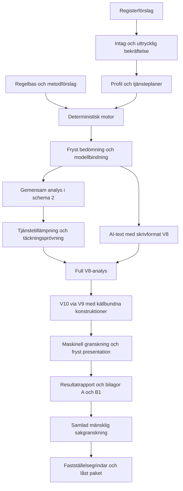

# Riskanalys – programkarta och filansvar

Uppdaterad **2026-10-24** från `main`, bascommit `8ca798d`. Lokala navigeringsändringar ingår i inventeringen. [[docs/START.md|Start]] · [[docs/omraden/Programflode.md|Programflödet]] · [[docs/kodkarta/INDEX.md|Filregister med hash och importer]].

## 1. Omfattning och läsnyckel

Kartan omfattar **1000 ej ignorerade projektfiler**: 249 programfiler, 316 regelbasfiler, 268 test-/fixturfiler och 167 dokumentations-, verktygs- och rotfiler. Programkoden har **27,149 fysiska Pythonrader**. Det är en strukturell inventering, inte ett mått på kvalitet eller testtäckning.

Filerna nedan har en rollbeskrivning och ett filkort med original, radantal, SHA-256, publika definitioner och direkta statiska importer. Binära resurser har storlek och hash i stället för radantal. Importer visar möjliga beroenden och utgör ingen fullständig körnings- eller testanalys.

Privata byrådata, `.env`, virtuella miljöer, `.git`, `.superpowers`, `.obsidian` och genererade filkort ingår inte. Verifierade PDF-/Word-/ZIP-leveranser ligger separat och kopieras inte in i valvet.

## 2. Programmets helhet

Riskanalys är ett Pythonprogram med CLI och ett lokalt webbgränssnitt. Regelbas och motor bestämmer riskutfall. Byrån bekräftar fakta och prövar den privata analysen. AI skriver avgränsad text från tillåtna faktablad. Rapportbyggaren sammanställer de redan bundna resultaten.



Detta visar huvudberoenden. Flera operationer kan köras separat via CLI/webb; ett utkast är inte en fastställd riskbedömning.

## 3. Grupper som hör ihop

| Område | Projektfiler | Ansvar och ingång |
|---|---:|---|
| [[docs/omraden/Intag.md\|Intag och formulär]] | 31 | Aktiva frågor, svar, gemensamma underlag och lokala HTML-formulär. |
| [[docs/omraden/Profil.md\|Byråprofil]] | 12 | Bekräftade fakta, tjänsteplaner, förändringar och uttryckligt införande med atomisk profilsparning. |
| [[docs/omraden/Foretagsdata.md\|Företagsdata]] | 9 | SCB, Bolagsverket och avgränsad iXBRL-tolkning till källbundna förslag. |
| [[docs/omraden/Regelverk.md\|Regelverk och regeldata]] | 333 | Källor, krav, kataloger, datumurval, typade villkor och separat sakkunniggranskning. |
| [[docs/omraden/Riskmotor.md\|Deterministisk riskmotor]] | 14 | Risk per tjänst och hot, scenarier, kontrollsänkningar och generiska kundmallar. |
| [[docs/omraden/Lokal-analys.md\|Lokal verksamhetsanalys]] | 15 | Gemensamt underlag i schema 2, tjänstens tillämpning, täckningsprövning och uttryckliga analysbeslut. |
| [[docs/omraden/AI-skrivning.md\|AI-skrivning]] | 17 | Tillåtet faktablad, promptar, textleverantör, svarsvalidering och sparade omförsök. |
| [[docs/omraden/Rapport.md\|Rapportens innehåll]] | 61 | V10-resultatrapport från full V8-analys, fakta, källbundna konstruktioner och bevarade original. |
| [[docs/omraden/Word-och-leverans.md\|Word och leverans]] | 22 | Fryst V10-presentation, resultatrapport, analysbilaga A och underlagsbilaga B1 som ett paket. |
| [[docs/omraden/Granskning.md\|Granskning och fastställelse]] | 21 | Maskinella fynd, frysta underlag, mänsklig sakgranskning och låsta versionspaket. |
| [[docs/omraden/Drift-och-lagring.md\|Drift och lagring]] | 11 | Datamapp, kontrollsummor, manifest, modellidentitet, modellrisk och historik. |
| [[docs/omraden/CLI.md\|Kommandorad och start]] | 19 | Programmets start, nyckelläsning, användarfel och CLI-adaptrar till kärnan. |
| [[docs/omraden/Tester.md\|Tester och syntetiska underlag]] | 270 | Enhet, intag, regelkontrakt, M2, typfall och frysta historiska fixturer. |
| [[docs/omraden/Projekt.md\|Projektets dokumentation]] | 165 | Befintlig spec, status, planer, research, verktyg och gemensamma arbetsregler. |

Mapparnas faktiska struktur bevaras. Områdena är läsgrupper, inte nya Pythonpaket. V10:s presentation/rendering ligger under Word och leverans; resultatunderlag och rapportkonstruktioner ligger under Rapport. `scripts/testa.py` och `scripts/testtid.py` hör till Tester.

## 4. Viktiga flöden, fil för fil

| Flöde | Ingångar att följa |
|---|---|
| Tjänsteplan och verkligt införande | [[docs/kodkarta/filer/src/riskanalys/profil/planering.py.md\|src/riskanalys/profil/planering.py]] → [[docs/kodkarta/filer/src/riskanalys/profil/planval.py.md\|src/riskanalys/profil/planval.py]] → [[docs/kodkarta/filer/src/riskanalys/profil/forandringar.py.md\|src/riskanalys/profil/forandringar.py]] → [[docs/kodkarta/filer/src/riskanalys/profil/planlivslopp.py.md\|src/riskanalys/profil/planlivslopp.py]] |
| Gemensam analys och tjänstens prövning | [[docs/kodkarta/filer/src/riskanalys/analys/gemensam.py.md\|src/riskanalys/analys/gemensam.py]] → [[docs/kodkarta/filer/src/riskanalys/analys/gemensamma_operationer.py.md\|src/riskanalys/analys/gemensamma_operationer.py]] → [[docs/kodkarta/filer/src/riskanalys/analys/provning_v2.py.md\|src/riskanalys/analys/provning_v2.py]] → [[docs/kodkarta/filer/src/riskanalys/analys/engangssvar.py.md\|src/riskanalys/analys/engangssvar.py]] |
| Kontrollerad överföring av äldre analys | [[docs/kodkarta/filer/src/riskanalys/analys/overforing.py.md\|src/riskanalys/analys/overforing.py]] → [[docs/kodkarta/filer/src/riskanalys/intag/overforingsvy.py.md\|src/riskanalys/intag/overforingsvy.py]] |
| Fryst riskberäkning | [[docs/kodkarta/filer/src/riskanalys/bedomning/korning.py.md\|src/riskanalys/bedomning/korning.py]] → [[docs/kodkarta/filer/src/riskanalys/bedomning/motor.py.md\|src/riskanalys/bedomning/motor.py]] → [[docs/kodkarta/filer/src/riskanalys/bedomning/scenarier.py.md\|src/riskanalys/bedomning/scenarier.py]] |
| Skrivsvar till full analys och V10 | [[docs/kodkarta/filer/src/riskanalys/dokument/skrivversion.py.md\|src/riskanalys/dokument/skrivversion.py]] → [[docs/kodkarta/filer/src/riskanalys/dokument/arb_v8.py.md\|src/riskanalys/dokument/arb_v8.py]] → [[docs/kodkarta/filer/src/riskanalys/dokument/arb_v9.py.md\|src/riskanalys/dokument/arb_v9.py]] → [[docs/kodkarta/filer/src/riskanalys/dokument/arb_v10.py.md\|src/riskanalys/dokument/arb_v10.py]] |
| V10:s redaktionella presentation | [[docs/kodkarta/filer/src/riskanalys/dokument/presentationsval_v10.py.md\|src/riskanalys/dokument/presentationsval_v10.py]] → [[docs/kodkarta/filer/src/riskanalys/dokument/redaktionspresentation_v10.py.md\|src/riskanalys/dokument/redaktionspresentation_v10.py]] → [[docs/kodkarta/filer/src/riskanalys/dokument/redaktionell_v10.py.md\|src/riskanalys/dokument/redaktionell_v10.py]] → [[docs/kodkarta/filer/src/riskanalys/dokument/redaktionmodell_v10.py.md\|src/riskanalys/dokument/redaktionmodell_v10.py]] |
| Granskning, leverans och fastställelse | [[docs/kodkarta/filer/src/riskanalys/granskning/dokument_v10.py.md\|src/riskanalys/granskning/dokument_v10.py]] → [[docs/kodkarta/filer/src/riskanalys/dokument/rapportpaket_v10.py.md\|src/riskanalys/dokument/rapportpaket_v10.py]] → [[docs/kodkarta/filer/src/riskanalys/faststallelse/resultatgranskning.py.md\|src/riskanalys/faststallelse/resultatgranskning.py]] → [[docs/kodkarta/filer/src/riskanalys/faststallelse/grindar.py.md\|src/riskanalys/faststallelse/grindar.py]] |
| Metodförslag och expertunderlag | [[docs/kodkarta/filer/src/riskanalys/regelverk/metodbeslut.py.md\|src/riskanalys/regelverk/metodbeslut.py]] → [[docs/kodkarta/filer/src/riskanalys/regelverk/sakkunnig.py.md\|src/riskanalys/regelverk/sakkunnig.py]] → [[docs/kodkarta/filer/src/riskanalys/regelverk/lasversion.py.md\|src/riskanalys/regelverk/lasversion.py]] |

## 5. Var uppgifter och resultat lagras

Källbundna regeldata ligger i `regelbas/`. Privata profiler, registerbilder, analysregister, belägg, körningar och fastställda paket hanteras i den separata datamappen via [[docs/omraden/Drift-och-lagring.md|lagring och drift]]. Lokala privata byrådata inventeras inte av denna karta.

`docs/kodkarta/` innehåller återbyggbara filkort och importrelationer. `.obsidian/` innehåller lokala valvinställningar. Handskrivna områdesguider och denna programkarta ligger i `docs/` och förvaltas med projektet.

## 6. Versionsgränser och skillnader i dokumentationen

| Kontrakt | Aktuellt läge |
|---|---|
| AI-skrivformat | `D-ARB-tjanst-v8`, från `skrivversion.py`. |
| Dokumentformat | `D-ARB-resultat-v10`, från `rapportversion.py`. |
| Presentation | `D-ARB-v10-presentation-2`, med bundna källor och exakt flyttregister. |
| Leverans | Resultatrapport, analysbilaga A och underlagsbilaga B1 i samma paket. |
| Analys | Schema 2 med gemensamma poster och uttrycklig tjänstetillämpning; schema 1 har bevarad läsning och uttrycklig överföring. |
| Regelbas | 2.12.3 vid bascommitten. Metodförslag och regelobjekt är fortsatt `ej_granskad`. |

V10 byggs via V9 och den fulla V8-analysen. Äldre formatfiler innehåller fortfarande använda funktioner. Ett äldre utkast byter inte dokument/presentation tyst; byte kräver uttrycklig handling och relevant förnyad granskning. Historiska statusposter beskriver sina dåvarande versioner och testkörningar, inte dagens navigeringsverifiering.

## 7. Samtliga programfiler

Varje rad länkar till aktuellt filkort. Där finns fulla direkta interna importrelationer, definitioner, källhash och originallänk.

| Fil / filkort | Ansvar |
|---|---|
| [[docs/kodkarta/filer/src/riskanalys/__init__.py.md\|src/riskanalys/__init__.py]] | Riskanalys – verksamhetsanpassad dokumentation enligt penningtvättsregelverket. |
| [[docs/kodkarta/filer/src/riskanalys/analys/__init__.py.md\|src/riskanalys/analys/__init__.py]] | Privata lokala analyser, skilda från AI-underlag och riskberäkning. |
| [[docs/kodkarta/filer/src/riskanalys/analys/engangssvar.py.md\|src/riskanalys/analys/engangssvar.py]] | Samlad bekräftelse av visat underlag; inga fakta eller beslut härleds. |
| [[docs/kodkarta/filer/src/riskanalys/analys/exponering.py.md\|src/riskanalys/analys/exponering.py]] | Gemensam innehållsdefinition för automatiskt förifylld exponering. |
| [[docs/kodkarta/filer/src/riskanalys/analys/gemensam.py.md\|src/riskanalys/analys/gemensam.py]] | Rena läsvyer och innehållssummor; inga svar eller bekräftelser skrivs här. |
| [[docs/kodkarta/filer/src/riskanalys/analys/gemensamma_operationer.py.md\|src/riskanalys/analys/gemensamma_operationer.py]] | Typade gemensamma handlingar. Varje skrivning går genom analysens lås och CAS. |
| [[docs/kodkarta/filer/src/riskanalys/analys/guide.py.md\|src/riskanalys/analys/guide.py]] | Gemensam läsmodell för de sexton lokala guidestegen. |
| [[docs/kodkarta/filer/src/riskanalys/analys/lagring.py.md\|src/riskanalys/analys/lagring.py]] | Privat analysregister: CAS, atomiska kopior och gemensam låsordning. |
| [[docs/kodkarta/filer/src/riskanalys/analys/modeller.py.md\|src/riskanalys/analys/modeller.py]] | Typade privata analysobjekt för schema 1/2, gemensamma poster, tjänstetillämpningar, täckningsprövning och beslut. |
| [[docs/kodkarta/filer/src/riskanalys/analys/overforing.py.md\|src/riskanalys/analys/overforing.py]] | Uttryckligt schema-2-förslag. Gamla svar bevaras; inga attester överförs. |
| [[docs/kodkarta/filer/src/riskanalys/analys/provning.py.md\|src/riskanalys/analys/provning.py]] | Rena innehållsprövningar; kontrollerar inte levande filer eller modellkod. |
| [[docs/kodkarta/filer/src/riskanalys/analys/provning_v2.py.md\|src/riskanalys/analys/provning_v2.py]] | Schema 2: gemensamt underlag, aktuell tillämpning och uttrycklig risktäckning. |
| [[docs/kodkarta/filer/src/riskanalys/analys/referens.py.md\|src/riskanalys/analys/referens.py]] | Kontrafaktisk referens, samma scenarioregler med antagandet ytterligare +1. Ändrar aldrig motorutfall eller kontrollantaganden. +1 är ingen beslutad vikt för den egna sårbarheten; giltig täckning kräver en separat sakprövning. |
| [[docs/kodkarta/filer/src/riskanalys/analys/riktning.py.md\|src/riskanalys/analys/riktning.py]] | Härledda upplysningar och brister per hot och dimension, ingen alternativ motor. |
| [[docs/kodkarta/filer/src/riskanalys/analys/tjanst.py.md\|src/riskanalys/analys/tjanst.py]] | Gemensamma lokala analysoperationer för CLI och loopbackformuläret. |
| [[docs/kodkarta/filer/src/riskanalys/analys/utkast.py.md\|src/riskanalys/analys/utkast.py]] | Förifyll redigerbara ogranskade svar från bekräftad profil och motor. |
| [[docs/kodkarta/filer/src/riskanalys/bedomning/__init__.py.md\|src/riskanalys/bedomning/__init__.py]] | Riskbedömning: deterministisk motor och körningar. |
| [[docs/kodkarta/filer/src/riskanalys/bedomning/erfarenheter.py.md\|src/riskanalys/bedomning/erfarenheter.py]] | PTL 2:1/LSF 2:2: beakta rapportering utan att härleda en riskpoäng ur antal. |
| [[docs/kodkarta/filer/src/riskanalys/bedomning/korning.py.md\|src/riskanalys/bedomning/korning.py]] | Läser profil och exakt samma originalbytes i ett snapshot, beräknar resultatet och sparar profilkopia, modellbindning och manifest. |
| [[docs/kodkarta/filer/src/riskanalys/bedomning/kundmodell/__init__.py.md\|src/riskanalys/bedomning/kundmodell/__init__.py]] | Generiska kundmallar för sakkunniggranskning, utan verkliga kundärenden. |
| [[docs/kodkarta/filer/src/riskanalys/bedomning/kundmodell/modeller.py.md\|src/riskanalys/bedomning/kundmodell/modeller.py]] | Frysta mallar och utfall. |
| [[docs/kodkarta/filer/src/riskanalys/bedomning/kundmodell/pep.py.md\|src/riskanalys/bedomning/kundmodell/pep.py]] | PEP-period räknas i kalendermånader; härledda indata kan inte förfalskas. |
| [[docs/kodkarta/filer/src/riskanalys/bedomning/kundmodell/tabeller.py.md\|src/riskanalys/bedomning/kundmodell/tabeller.py]] | Typade villkor och datum avgränsar kundrader. |
| [[docs/kodkarta/filer/src/riskanalys/bedomning/kundmodell/utvardering.py.md\|src/riskanalys/bedomning/kundmodell/utvardering.py]] | Ingen låg/normal fallback: C måste träffa en explicit granskad metodrad. |
| [[docs/kodkarta/filer/src/riskanalys/bedomning/modeller.py.md\|src/riskanalys/bedomning/modeller.py]] | Bedömningsresultat (spec 7). |
| [[docs/kodkarta/filer/src/riskanalys/bedomning/motor.py.md\|src/riskanalys/bedomning/motor.py]] | Deterministisk riskmotor (spec 7). |
| [[docs/kodkarta/filer/src/riskanalys/bedomning/omfattning.py.md\|src/riskanalys/bedomning/omfattning.py]] | Dokumentomfattning efter storlek och art; inget undantag från lagkrav. |
| [[docs/kodkarta/filer/src/riskanalys/bedomning/sanktioner.py.md\|src/riskanalys/bedomning/sanktioner.py]] | Separat föreslagen riskdimension; aldrig kopierad från terrorfinansiering. |
| [[docs/kodkarta/filer/src/riskanalys/bedomning/scenarier.py.md\|src/riskanalys/bedomning/scenarier.py]] | Beräknar PT-/TF-scenarier per tjänst och hot, med möjliggörande sårbarheter. |
| [[docs/kodkarta/filer/src/riskanalys/bedomning/sektorsrisk.py.md\|src/riskanalys/bedomning/sektorsrisk.py]] | NRA:s originalskala bevaras; jämförbarhet är ett eget metodval. |
| [[docs/kodkarta/filer/src/riskanalys/cli.py.md\|src/riskanalys/cli.py]] | Programmets CLI-ingång. |
| [[docs/kodkarta/filer/src/riskanalys/dokument/__init__.py.md\|src/riskanalys/dokument/__init__.py]] | Dokument: AI-underlag, AI-utkast, validering, sammanställning och export. |
| [[docs/kodkarta/filer/src/riskanalys/dokument/aischema.py.md\|src/riskanalys/dokument/aischema.py]] | Schemat som AI svarar i. |
| [[docs/kodkarta/filer/src/riskanalys/dokument/analysbilaga.py.md\|src/riskanalys/dokument/analysbilaga.py]] | Enbart lokal proveniens och beläggsmetadata; inga privata dokumentbytes. |
| [[docs/kodkarta/filer/src/riskanalys/dokument/analysreferenser.py.md\|src/riskanalys/dokument/analysreferenser.py]] | Lokala logiska referenser med läsbara etiketter; inga filvägar öppnas. |
| [[docs/kodkarta/filer/src/riskanalys/dokument/analysstatus.py.md\|src/riskanalys/dokument/analysstatus.py]] | Beskriv registrerad analys och modellrapport utan att attestera eller läsa filer. |
| [[docs/kodkarta/filer/src/riskanalys/dokument/analystabeller.py.md\|src/riskanalys/dokument/analystabeller.py]] | Scenarier, kontroller och rutiner ur lokal prövning, utan numerisk riskberäkning. |
| [[docs/kodkarta/filer/src/riskanalys/dokument/analysunderlag.py.md\|src/riskanalys/dokument/analysunderlag.py]] | Lokala motiveringar med källor; fritext skickas aldrig vidare till AI. |
| [[docs/kodkarta/filer/src/riskanalys/dokument/arb.py.md\|src/riskanalys/dokument/arb.py]] | Sammanställer den allmänna riskbedömningen (spec 11). Bara riskavsnitten är skrivna av AI. |
| [[docs/kodkarta/filer/src/riskanalys/dokument/arb_v10.py.md\|src/riskanalys/dokument/arb_v10.py]] | Offlinebyggare för V10 från oförändrade analys- och skrivkällor. |
| [[docs/kodkarta/filer/src/riskanalys/dokument/arb_v5.py.md\|src/riskanalys/dokument/arb_v5.py]] | V5-byggare med kompakta tabeller och återanvändbara stycke-/avsnittshjälpare. |
| [[docs/kodkarta/filer/src/riskanalys/dokument/arb_v5_1.py.md\|src/riskanalys/dokument/arb_v5_1.py]] | V5.1:s läsordning och metodfrågor/sakkunnigstatus; delar används även av V8-byggaren. |
| [[docs/kodkarta/filer/src/riskanalys/dokument/arb_v6.py.md\|src/riskanalys/dokument/arb_v6.py]] | V6 sammanför skyddad AI-text och lokal prövning utan nya riskbeslut. |
| [[docs/kodkarta/filer/src/riskanalys/dokument/arb_v8.py.md\|src/riskanalys/dokument/arb_v8.py]] | Full kanonisk analys i V8; återanvänd källa till V9/V10 och historiska V8-leveranser. |
| [[docs/kodkarta/filer/src/riskanalys/dokument/arb_v9.py.md\|src/riskanalys/dokument/arb_v9.py]] | Nytt presentationsformat från oförändrade V8-skrivresultat och analyskällor. |
| [[docs/kodkarta/filer/src/riskanalys/dokument/atgardsgrupper.py.md\|src/riskanalys/dokument/atgardsgrupper.py]] | Rubrikgrupper av registrerade rutinåtgärder med fulla tjänstemedlemmar. |
| [[docs/kodkarta/filer/src/riskanalys/dokument/claude.py.md\|src/riskanalys/dokument/claude.py]] | Claude som textleverantör via den officiella SDK:n (spec 8.3). |
| [[docs/kodkarta/filer/src/riskanalys/dokument/delskrivning.py.md\|src/riskanalys/dokument/delskrivning.py]] | Bygger en versionsstyrd AI-del i taget, prövar svaret, hanterar omförsök och markerar mallreserv. |
| [[docs/kodkarta/filer/src/riskanalys/dokument/delvalidering.py.md\|src/riskanalys/dokument/delvalidering.py]] | Kontroller per analysdel (spec 8.4.4–8.4.5). |
| [[docs/kodkarta/filer/src/riskanalys/dokument/exponeringsmetadata_v6.py.md\|src/riskanalys/dokument/exponeringsmetadata_v6.py]] | Korta bara ett exakt återidentifierat automatiskt prefix i V6:s visning. |
| [[docs/kodkarta/filer/src/riskanalys/dokument/export.py.md\|src/riskanalys/dokument/export.py]] | Export av ett utkast till Word utifrån den senaste granskningen (spec 10). |
| [[docs/kodkarta/filer/src/riskanalys/dokument/faktablad.py.md\|src/riskanalys/dokument/faktablad.py]] | Bygger tjänstens skyddade faktablad från tillåtet underlag, med versionsstyrd talvisning och referenser. |
| [[docs/kodkarta/filer/src/riskanalys/dokument/faktorstatus_v10.py.md\|src/riskanalys/dokument/faktorstatus_v10.py]] | Bekräftad faktastatus hålls skild från motorns försiktighetspåslag. |
| [[docs/kodkarta/filer/src/riskanalys/dokument/foljder_v6.py.md\|src/riskanalys/dokument/foljder_v6.py]] | D-ARB.9 i v6: följder för rutiner, kundkännedom, övervakning och utbildning. |
| [[docs/kodkarta/filer/src/riskanalys/dokument/forandringar_v8.py.md\|src/riskanalys/dokument/forandringar_v8.py]] | Privat plan- och gruppunderlag återges ordagrant, utan att tolkas till riskpoäng. |
| [[docs/kodkarta/filer/src/riskanalys/dokument/gemensam_analys.py.md\|src/riskanalys/dokument/gemensam_analys.py]] | Dela endast exakt identiska lokala resonemang med uttrycklig tjänstetillämpning. |
| [[docs/kodkarta/filer/src/riskanalys/dokument/gemensam_provning_v8.py.md\|src/riskanalys/dokument/gemensam_provning_v8.py]] | Gemensam analys en gång; tjänstens explicita tillämpning utan nya motorbeslut. |
| [[docs/kodkarta/filer/src/riskanalys/dokument/gemensamt_v8.py.md\|src/riskanalys/dokument/gemensamt_v8.py]] | V8:s gemensamma faktaunderlag och tjänstens egen prövning av det (B-09, B-10, B-15). Byråövergripande underlag skrivs en gång i avsnittet Gemensamt faktaunderlag. Varje tjänst har ett eget, kortare stycke med tjänstens geografi och en hänvisning, så att tjänstens prövning fortfarande syns och kontrolleras i tjänsteavsnittet. V6- och V7-kontrakten är oförändrade. |
| [[docs/kodkarta/filer/src/riskanalys/dokument/intagsunderlag.py.md\|src/riskanalys/dokument/intagsunderlag.py]] | Infoga lokala fakta; fri text ingår aldrig i AI-underlag eller automatiska riskbeslut. |
| [[docs/kodkarta/filer/src/riskanalys/dokument/kallhanvisningar.py.md\|src/riskanalys/dokument/kallhanvisningar.py]] | Versionsbundna källhänvisningar i den modell som sakgranskas. |
| [[docs/kodkarta/filer/src/riskanalys/dokument/kapitel3_v10.py.md\|src/riskanalys/dokument/kapitel3_v10.py]] | Alla indikatorer och lagexempel, med fulla lokala områdesmotiveringar. |
| [[docs/kodkarta/filer/src/riskanalys/dokument/klartext.py.md\|src/riskanalys/dokument/klartext.py]] | Svensk klartext för låsta stycken: fältnamn, uppgifter och villkor utan fält-ID (spec 8.4.9). |
| [[docs/kodkarta/filer/src/riskanalys/dokument/lasta_v6.py.md\|src/riskanalys/dokument/lasta_v6.py]] | Deterministiska stycken om egen rapportering och geografiskt underlag. |
| [[docs/kodkarta/filer/src/riskanalys/dokument/leverans_v10.py.md\|src/riskanalys/dokument/leverans_v10.py]] | Tre filer med granskade fasta mallar och begränsade leveransvärden. |
| [[docs/kodkarta/filer/src/riskanalys/dokument/leverans_v8.py.md\|src/riskanalys/dokument/leverans_v8.py]] | Parametriserad leveranspresentation: fasta mallar attesteras, värden levereras. |
| [[docs/kodkarta/filer/src/riskanalys/dokument/leverans_v9.py.md\|src/riskanalys/dokument/leverans_v9.py]] | Tre filer med granskade fasta mallar och begränsade leveransvärden. |
| [[docs/kodkarta/filer/src/riskanalys/dokument/leverantor.py.md\|src/riskanalys/dokument/leverantor.py]] | Gränssnitt för textleverantörer och en testleverantör för automatiska tester (spec 8.3). |
| [[docs/kodkarta/filer/src/riskanalys/dokument/likhet.py.md\|src/riskanalys/dokument/likhet.py]] | Signal för text som inte är tjänstespecifik (tillsynsbrist B-04). |
| [[docs/kodkarta/filer/src/riskanalys/dokument/lokalblock_v8.py.md\|src/riskanalys/dokument/lokalblock_v8.py]] | Typade lokala byggoperationer; fråga och källfält bestäms före svensk formulering. |
| [[docs/kodkarta/filer/src/riskanalys/dokument/lokaldata_v8.py.md\|src/riskanalys/dokument/lokaldata_v8.py]] | Lokala profilfakta med egna perioder; inga tal eller råsvar går till AI. |
| [[docs/kodkarta/filer/src/riskanalys/dokument/lokaltext_v6.py.md\|src/riskanalys/dokument/lokaltext_v6.py]] | Lokala resonemang ersätter v5:s tre borttagna AI-delar. |
| [[docs/kodkarta/filer/src/riskanalys/dokument/m1_forslag.py.md\|src/riskanalys/dokument/m1_forslag.py]] | M1-förslaget i B1: ett metodförslag till sakkunnig som inte påverkar något beräknat utfall. |
| [[docs/kodkarta/filer/src/riskanalys/dokument/matning.py.md\|src/riskanalys/dokument/matning.py]] | Mätning av skrivkörningar: förstaförsök, omförsök, felklasser och tokens (spec 8.4.7–8.4.8). |
| [[docs/kodkarta/filer/src/riskanalys/dokument/metodavsnitt_v10.py.md\|src/riskanalys/dokument/metodavsnitt_v10.py]] | Metodtabeller läses ur den regelversion som källpaketet binder. |
| [[docs/kodkarta/filer/src/riskanalys/dokument/modeller.py.md\|src/riskanalys/dokument/modeller.py]] | Modeller för AI-schemat, AI-underlaget och dokumenten (spec 8 och 11). |
| [[docs/kodkarta/filer/src/riskanalys/dokument/nivamotivering_v6.py.md\|src/riskanalys/dokument/nivamotivering_v6.py]] | Risknivå och motivering sist i varje v6-tjänst: programmets beräkning i ord och byråns egen bedömning. |
| [[docs/kodkarta/filer/src/riskanalys/dokument/nivamotivering_v8.py.md\|src/riskanalys/dokument/nivamotivering_v8.py]] | V8 visar varje nivåväg och alla avgörande före/efter lokalt, utan omräkning. |
| [[docs/kodkarta/filer/src/riskanalys/dokument/nivatext.py.md\|src/riskanalys/dokument/nivatext.py]] | Risknivåmeningar skrivs av programmet, aldrig av AI (spec 8.4.1). |
| [[docs/kodkarta/filer/src/riskanalys/dokument/omfattning.py.md\|src/riskanalys/dokument/omfattning.py]] | Dokumenttäckning följer typade mål, med explicit M1-kompatibilitet. |
| [[docs/kodkarta/filer/src/riskanalys/dokument/omfattningsutkast.py.md\|src/riskanalys/dokument/omfattningsutkast.py]] | Avgränsat granskningsunderlag för katalogluckor, aldrig en komplett riskrapport. |
| [[docs/kodkarta/filer/src/riskanalys/dokument/operationskarta_v8.py.md\|src/riskanalys/dokument/operationskarta_v8.py]] | Källfält från samma typade byggoperationer som V8 använder, utan textsökning. |
| [[docs/kodkarta/filer/src/riskanalys/dokument/platshallare.py.md\|src/riskanalys/dokument/platshallare.py]] | Platshållare i AI-text (spec 8.4.5). |
| [[docs/kodkarta/filer/src/riskanalys/dokument/presentation_v10.py.md\|src/riskanalys/dokument/presentation_v10.py]] | Fryst presentation efter slutlig fyndlista; inga nya fakta eller riskbeslut. |
| [[docs/kodkarta/filer/src/riskanalys/dokument/presentation_v8.py.md\|src/riskanalys/dokument/presentation_v8.py]] | Deterministiska V8-presentationslistor ur fulla frysta källposter. Kanoniska avsnitt ändras inte. H7.6 binder analys, full fyndkälla och denna presentationsversion tillsammans med dokumentets vystruktur. |
| [[docs/kodkarta/filer/src/riskanalys/dokument/presentation_v9.py.md\|src/riskanalys/dokument/presentation_v9.py]] | Fryst presentation efter slutlig fyndlista; inga nya fakta eller riskbeslut. |
| [[docs/kodkarta/filer/src/riskanalys/dokument/presentationsval_v10.py.md\|src/riskanalys/dokument/presentationsval_v10.py]] | Befintliga utkast byter bara disposition genom ett uttryckligt formatval. |
| [[docs/kodkarta/filer/src/riskanalys/dokument/profiloriginal_v8.py.md\|src/riskanalys/dokument/profiloriginal_v8.py]] | Typade originalspann för V8-producenten som även ligger under V9/V10. |
| [[docs/kodkarta/filer/src/riskanalys/dokument/promptar/__init__.py.md\|src/riskanalys/dokument/promptar/__init__.py]] | Promptarnas delar och deras kontrollsummor. |
| [[docs/kodkarta/filer/src/riskanalys/dokument/promptar/delar.py.md\|src/riskanalys/dokument/promptar/delar.py]] | En modul per analysdel: mål, krav med skäl och fällor med skäl (spec 8.4.4). |
| [[docs/kodkarta/filer/src/riskanalys/dokument/promptar/meddelande.py.md\|src/riskanalys/dokument/promptar/meddelande.py]] | Användarmeddelandet i fast ordning: faktablad först, uppgiften sist (spec 8.4.2). |
| [[docs/kodkarta/filer/src/riskanalys/dokument/promptar/system.py.md\|src/riskanalys/dokument/promptar/system.py]] | Den fasta systemprompten. |
| [[docs/kodkarta/filer/src/riskanalys/dokument/rackvidd_v6.py.md\|src/riskanalys/dokument/rackvidd_v6.py]] | Kort katalogstatus i huvudtext; komplett källbunden beskrivning finns i B1. |
| [[docs/kodkarta/filer/src/riskanalys/dokument/radata_v8.py.md\|src/riskanalys/dokument/radata_v8.py]] | Ordagnanna fria analysfält och läsbar placeringskarta i kompletterande B1. |
| [[docs/kodkarta/filer/src/riskanalys/dokument/rapportdelar_v10.py.md\|src/riskanalys/dokument/rapportdelar_v10.py]] | Små byggblock för källbundna avsnitt; inga riskbeslut. |
| [[docs/kodkarta/filer/src/riskanalys/dokument/rapportfakta_v10.py.md\|src/riskanalys/dokument/rapportfakta_v10.py]] | Verksamhetsfakta från uttryckliga källor, med synliga dataluckor. |
| [[docs/kodkarta/filer/src/riskanalys/dokument/rapportpaket_v10.py.md\|src/riskanalys/dokument/rapportpaket_v10.py]] | Tre obligatoriska V10-delar; aktuell återbyggnad och historisk bytekontroll. |
| [[docs/kodkarta/filer/src/riskanalys/dokument/rapportpaket_v8.py.md\|src/riskanalys/dokument/rapportpaket_v8.py]] | V8:s frysta presentationskälla och begränsade leveransmetadata. |
| [[docs/kodkarta/filer/src/riskanalys/dokument/rapportpaket_v9.py.md\|src/riskanalys/dokument/rapportpaket_v9.py]] | Tre obligatoriska V9-delar; aktuell återbyggnad och historisk bytekontroll. |
| [[docs/kodkarta/filer/src/riskanalys/dokument/rapportversion.py.md\|src/riskanalys/dokument/rapportversion.py]] | V10 är aktuell dokumentstandard; V8/V9-konstanter stödjer äldre utkast och paket. |
| [[docs/kodkarta/filer/src/riskanalys/dokument/rapportvyer.py.md\|src/riskanalys/dokument/rapportvyer.py]] | Rena, disjunkta projektioner av det fullständiga V8-dokumentet. |
| [[docs/kodkarta/filer/src/riskanalys/dokument/rapportvyer_v10.py.md\|src/riskanalys/dokument/rapportvyer_v10.py]] | Tre disjunkta V10-vyer; sammanfattningens källöverlappp är explicit spårad. |
| [[docs/kodkarta/filer/src/riskanalys/dokument/rapportvyer_v9.py.md\|src/riskanalys/dokument/rapportvyer_v9.py]] | Tre disjunkta V9-vyer; sammanfattningens källöverlappp är explicit spårad. |
| [[docs/kodkarta/filer/src/riskanalys/dokument/redaktion_v7.py.md\|src/riskanalys/dokument/redaktion_v7.py]] | V7:s korta automatiska upprepningar; författad analys och historiska format lämnas kvar. |
| [[docs/kodkarta/filer/src/riskanalys/dokument/redaktionell_v10.py.md\|src/riskanalys/dokument/redaktionell_v10.py]] | Redaktionell presentation av frysta fakta; inga riskbeslut eller AI-anrop. |
| [[docs/kodkarta/filer/src/riskanalys/dokument/redaktionmodell_v10.py.md\|src/riskanalys/dokument/redaktionmodell_v10.py]] | Frysta källor och exakt flyttregister för V10:s andra presentation. |
| [[docs/kodkarta/filer/src/riskanalys/dokument/redaktionspresentation_v10.py.md\|src/riskanalys/dokument/redaktionspresentation_v10.py]] | Återbygg den nya presentationen och bind alla källor utan att ändra analysen. |
| [[docs/kodkarta/filer/src/riskanalys/dokument/rendering.py.md\|src/riskanalys/dokument/rendering.py]] | Gemensamma Word-hjälpare och routing för aktuella och äldre rapportformat. |
| [[docs/kodkarta/filer/src/riskanalys/dokument/rendering_v10.py.md\|src/riskanalys/dokument/rendering_v10.py]] | Word från tre frysta V10-vyer; inga anrop till export, motor eller AI. |
| [[docs/kodkarta/filer/src/riskanalys/dokument/rendering_v9.py.md\|src/riskanalys/dokument/rendering_v9.py]] | Word från tre frysta V9-vyer; inga anrop till export, motor eller AI. |
| [[docs/kodkarta/filer/src/riskanalys/dokument/resultatmodell_v10.py.md\|src/riskanalys/dokument/resultatmodell_v10.py]] | Källbunden V10-konstruktion; generiska frysta källtyper återanvänds. |
| [[docs/kodkarta/filer/src/riskanalys/dokument/resultatmodell_v9.py.md\|src/riskanalys/dokument/resultatmodell_v9.py]] | Frysta källor och urvalsbeslut för V9; inga alternativa riskberäkningar. |
| [[docs/kodkarta/filer/src/riskanalys/dokument/resultatrapport_v10.py.md\|src/riskanalys/dokument/resultatrapport_v10.py]] | Ny disposition från fulla original; inga nya AI-svar eller riskberäkningar. |
| [[docs/kodkarta/filer/src/riskanalys/dokument/resultatrapport_v9.py.md\|src/riskanalys/dokument/resultatrapport_v9.py]] | Kort resultatrapport ur sparade sakuppgifter; varken fri sammanfattning eller AI. |
| [[docs/kodkarta/filer/src/riskanalys/dokument/resultattexter_v9.py.md\|src/riskanalys/dokument/resultattexter_v9.py]] | Fasta presentationsetiketter och förklaringar; ändrar inga motorutfall. |
| [[docs/kodkarta/filer/src/riskanalys/dokument/resultatunderlag_v9.py.md\|src/riskanalys/dokument/resultatunderlag_v9.py]] | Deterministiskt urval med bevarade originalreferenser, inte nya riskbeslut. |
| [[docs/kodkarta/filer/src/riskanalys/dokument/scenariokedjor_v10.py.md\|src/riskanalys/dokument/scenariokedjor_v10.py]] | Samma originalmekanism en gång även när den används för både PT och TF. |
| [[docs/kodkarta/filer/src/riskanalys/dokument/scenariotabell.py.md\|src/riskanalys/dokument/scenariotabell.py]] | Lokala scenariotabeller och förklaringar ur sparade motorutfall. |
| [[docs/kodkarta/filer/src/riskanalys/dokument/skrivning.py.md\|src/riskanalys/dokument/skrivning.py]] | Samordnar skrivkörningar, binder dem till en aktuell bedömning och sparar varje försök. |
| [[docs/kodkarta/filer/src/riskanalys/dokument/skrivversion.py.md\|src/riskanalys/dokument/skrivversion.py]] | V8 är aktuellt AI-skrivformat; hålls separat från dokument- och presentationsformat. |
| [[docs/kodkarta/filer/src/riskanalys/dokument/tabeller.py.md\|src/riskanalys/dokument/tabeller.py]] | Lokala H6-tabeller från bekräftad profil och sparade motorutfall. |
| [[docs/kodkarta/filer/src/riskanalys/dokument/tjanstavsnitt.py.md\|src/riskanalys/dokument/tjanstavsnitt.py]] | Sex sammanhängande analysdelar per tjänst; AI skriver endast riskmotiveringen. |
| [[docs/kodkarta/filer/src/riskanalys/dokument/tjanstavsnitt_v6.py.md\|src/riskanalys/dokument/tjanstavsnitt_v6.py]] | V6-tjänsteavsnitt samt hjälparen lokaltext, som också används av senare dokumentbyggare. |
| [[docs/kodkarta/filer/src/riskanalys/dokument/tjanstavsnitt_v7.py.md\|src/riskanalys/dokument/tjanstavsnitt_v7.py]] | V7-tjänsteavsnitt samt kategoriöversikt och reservkatalog för B1, som även V8 återanvänder. |
| [[docs/kodkarta/filer/src/riskanalys/dokument/tjanstavsnitt_v8.py.md\|src/riskanalys/dokument/tjanstavsnitt_v8.py]] | Sex lokala analysfrågor, med skyddad AI-text och fulltextfallback för fria svar. |
| [[docs/kodkarta/filer/src/riskanalys/dokument/underlag.py.md\|src/riskanalys/dokument/underlag.py]] | Väljer tillåtna fält och katalogposter till skrivunderlaget. |
| [[docs/kodkarta/filer/src/riskanalys/dokument/uppfoljning.py.md\|src/riskanalys/dokument/uppfoljning.py]] | Lokal omfattning, utförd bevakning och uppföljning med tydliga belägg. |
| [[docs/kodkarta/filer/src/riskanalys/dokument/ursprung_v8.py.md\|src/riskanalys/dokument/ursprung_v8.py]] | Reproducerbar innehållskarta: placeringsidentitet, mall och faktiska ingångar. Kartan är härledd ur samma frysta ingångar som byggaren. En giltig pointer är teknisk spårning, inte en automatisk sakattest för den formulerade slutsatsen. |
| [[docs/kodkarta/filer/src/riskanalys/dokument/utfall_v6.py.md\|src/riskanalys/dokument/utfall_v6.py]] | Lokala utfall för sårbarheter vars exakta underlag inte lämnar byrån. |
| [[docs/kodkarta/filer/src/riskanalys/dokument/validering.py.md\|src/riskanalys/dokument/validering.py]] | Maskinell validering av AI-utkast (spec 8.4). |
| [[docs/kodkarta/filer/src/riskanalys/dokument/wordstil.py.md\|src/riskanalys/dokument/wordstil.py]] | Läsbar v5-typografi och kolumnbredder; påverkar inte bedömningar eller text. |
| [[docs/kodkarta/filer/src/riskanalys/dokument/wordstil_v10.py.md\|src/riskanalys/dokument/wordstil_v10.py]] | Kolumnbredder för den nya dispositionen; samma minsta textstorlek som V9. |
| [[docs/kodkarta/filer/src/riskanalys/drift/__init__.py.md\|src/riskanalys/drift/__init__.py]] | Minsta drift: versionshistorik och nästa genomgång. |
| [[docs/kodkarta/filer/src/riskanalys/drift/historik.py.md\|src/riskanalys/drift/historik.py]] | Versionshistorik och nästa genomgång (spec 13.1). |
| [[docs/kodkarta/filer/src/riskanalys/drift/modellidentitet.py.md\|src/riskanalys/drift/modellidentitet.py]] | Smal, innehållsbunden identitet för den granskade riskberäkningen. |
| [[docs/kodkarta/filer/src/riskanalys/drift/modellrapport.py.md\|src/riskanalys/drift/modellrapport.py]] | Projektets frysta rapportpaket; export skapar aldrig sakkunnigattest. |
| [[docs/kodkarta/filer/src/riskanalys/drift/modellrisk.py.md\|src/riskanalys/drift/modellrisk.py]] | Privat modellriskunderlag och fullständighetsgrind, utan automatisk attest. |
| [[docs/kodkarta/filer/src/riskanalys/faststallelse/__init__.py.md\|src/riskanalys/faststallelse/__init__.py]] | Fastställelse: sakgranskning, grindar, låsning och verifiering. |
| [[docs/kodkarta/filer/src/riskanalys/faststallelse/faststall.py.md\|src/riskanalys/faststallelse/faststall.py]] | Fastställelse: kontroll av kedjan och grindarna, låst paket och verifiering (spec 5.3 och 10). Publiceringen är ett enda namnbyte. Allt, också versionshistoriken med det nya beslutet, skrivs i en arbetsmapp som byter namn till v{n} när den är klar. Efter namnbytet skrivs ingenting mer, så en fastställelse är antingen helt gjord eller inte gjord alls. Därför läses fastställelserna ur de låsta paketen och inte ur byråns historikfil. |
| [[docs/kodkarta/filer/src/riskanalys/faststallelse/grindar.py.md\|src/riskanalys/faststallelse/grindar.py]] | Villkor för fastställelse (spec 10). Varje hinder är en mening som säger vad som saknas. |
| [[docs/kodkarta/filer/src/riskanalys/faststallelse/modeller.py.md\|src/riskanalys/faststallelse/modeller.py]] | Sakgranskning och beslut om fastställelse (spec 10). |
| [[docs/kodkarta/filer/src/riskanalys/faststallelse/resultatgranskning.py.md\|src/riskanalys/faststallelse/resultatgranskning.py]] | En explicit handling ger vanliga attestposter för exakt alla visade R-avsnitt. |
| [[docs/kodkarta/filer/src/riskanalys/faststallelse/sakgranskning.py.md\|src/riskanalys/faststallelse/sakgranskning.py]] | Sakgranskning per avsnitt (spec 10). En sakgranskning gäller exakt den text som granskaren såg: avsnittet med namnen insatta, så som exporten skriver ut det. Ändras texten eller ett namn som sätts in i den slutar sakgranskningen att gälla. |
| [[docs/kodkarta/filer/src/riskanalys/fel.py.md\|src/riskanalys/fel.py]] | Gemensam basklass för fel som visas för användaren. |
| [[docs/kodkarta/filer/src/riskanalys/foretagsdata/__init__.py.md\|src/riskanalys/foretagsdata/__init__.py]] | Lokala registerförslag; ingenting här bekräftar riskprofilen. |
| [[docs/kodkarta/filer/src/riskanalys/foretagsdata/arsredovisning.py.md\|src/riskanalys/foretagsdata/arsredovisning.py]] | Avgränsad iXBRL-läsare. |
| [[docs/kodkarta/filer/src/riskanalys/foretagsdata/bokslut.py.md\|src/riskanalys/foretagsdata/bokslut.py]] | Tillåtna bokslutsfakta, med period och spårbarhet till privat original. |
| [[docs/kodkarta/filer/src/riskanalys/foretagsdata/bolagsverket.py.md\|src/riskanalys/foretagsdata/bolagsverket.py]] | Bolagsverket HVD v1: lokalt uppslag, OAuth-token endast i minnet. |
| [[docs/kodkarta/filer/src/riskanalys/foretagsdata/bolagsverket_svar.py.md\|src/riskanalys/foretagsdata/bolagsverket_svar.py]] | Lokal projektion av HVD v1. |
| [[docs/kodkarta/filer/src/riskanalys/foretagsdata/lagring.py.md\|src/riskanalys/foretagsdata/lagring.py]] | Privata registerbilder och atomisk aktuell pekare utanför Git. |
| [[docs/kodkarta/filer/src/riskanalys/foretagsdata/modeller.py.md\|src/riskanalys/foretagsdata/modeller.py]] | Minimal, oföränderlig registerbild. |
| [[docs/kodkarta/filer/src/riskanalys/foretagsdata/samlad.py.md\|src/riskanalys/foretagsdata/samlad.py]] | Komplettera SCB-bilden utan att göra registerhämtning till bekräftelse. |
| [[docs/kodkarta/filer/src/riskanalys/foretagsdata/scb.py.md\|src/riskanalys/foretagsdata/scb.py]] | SCB AFR v1. |
| [[docs/kodkarta/filer/src/riskanalys/granskning/__init__.py.md\|src/riskanalys/granskning/__init__.py]] | Maskinell granskning: täckning, spårbarhet och bristmönster. |
| [[docs/kodkarta/filer/src/riskanalys/granskning/analys.py.md\|src/riskanalys/granskning/analys.py]] | B-09/B-10/B-15 kontrollerar belägg och lokal analys, inte juridisk fullständighet. |
| [[docs/kodkarta/filer/src/riskanalys/granskning/analysunderlag.py.md\|src/riskanalys/granskning/analysunderlag.py]] | Fryst lokal analys och verifierade belägg för dokumentets återbyggnad. |
| [[docs/kodkarta/filer/src/riskanalys/granskning/dokument_v10.py.md\|src/riskanalys/granskning/dokument_v10.py]] | Offlinekontroll av V10 mot ny återbyggnad och dess fulla V8-källa. |
| [[docs/kodkarta/filer/src/riskanalys/granskning/dokument_v5.py.md\|src/riskanalys/granskning/dokument_v5.py]] | Bind allt H6-innehåll till samma profil, bedömning och validerade skrivsvar. |
| [[docs/kodkarta/filer/src/riskanalys/granskning/dokument_v6.py.md\|src/riskanalys/granskning/dokument_v6.py]] | V6 återbyggs från exakt fryst lokal analys och validerade skrivresultat. |
| [[docs/kodkarta/filer/src/riskanalys/granskning/dokument_v8.py.md\|src/riskanalys/granskning/dokument_v8.py]] | V8 återbyggs från exakt fryst lokal analys och validerade skrivresultat. |
| [[docs/kodkarta/filer/src/riskanalys/granskning/dokument_v9.py.md\|src/riskanalys/granskning/dokument_v9.py]] | V9 prövas mot full V8-analys och en återbyggd spårbar presentation. |
| [[docs/kodkarta/filer/src/riskanalys/granskning/fyndgrupper.py.md\|src/riskanalys/granskning/fyndgrupper.py]] | Ren exakt visningsgruppering; inga fyndbeslut ändras. |
| [[docs/kodkarta/filer/src/riskanalys/granskning/kontroller.py.md\|src/riskanalys/granskning/kontroller.py]] | Maskinell granskning av dokumentet: täckning, spårbarhet och bristmönster (spec 9). |
| [[docs/kodkarta/filer/src/riskanalys/granskning/korning.py.md\|src/riskanalys/granskning/korning.py]] | Granskningskörning: bygger dokumentet, granskar det och sparar resultatet med manifest. |
| [[docs/kodkarta/filer/src/riskanalys/granskning/lasta_v6.py.md\|src/riskanalys/granskning/lasta_v6.py]] | B-09, B-10 och B-15 i v6: belägg och programmets låsta stycken i varje tjänstavsnitt (spec 8.4.6 punkt 2). |
| [[docs/kodkarta/filer/src/riskanalys/granskning/lasta_v8.py.md\|src/riskanalys/granskning/lasta_v8.py]] | V8:s kravtäckning för geografiskt underlag och egen rapportering (B-09, B-10, B-15). Byråövergripande underlag står en gång i avsnittet Gemensamt faktaunderlag och tjänstens egen prövning i tjänsteavsnittet. Båda kontrolleras mot ett återbyggt dokument; ett gemensamt stycke ersätter aldrig tjänstens eget. Äldre v6/v7-kontroller och bytekontrakt ändras inte. |
| [[docs/kodkarta/filer/src/riskanalys/granskning/modeller.py.md\|src/riskanalys/granskning/modeller.py]] | Fynd från granskningen (spec 9 och 10). |
| [[docs/kodkarta/filer/src/riskanalys/granskning/sektorsrisk.py.md\|src/riskanalys/granskning/sektorsrisk.py]] | B-13 hittar avsaknad av belagd lokal motivering, inte dess juridiska kvalitet. |
| [[docs/kodkarta/filer/src/riskanalys/intag/__init__.py.md\|src/riskanalys/intag/__init__.py]] | Lokalt regelstyrt intag för verksamhetsanpassad riskbedömning. |
| [[docs/kodkarta/filer/src/riskanalys/intag/analysformular.py.md\|src/riskanalys/intag/analysformular.py]] | Strikt, sidoeffektsfri adapter från guidade fält till analysmodeller. |
| [[docs/kodkarta/filer/src/riskanalys/intag/analysvy.py.md\|src/riskanalys/intag/analysvy.py]] | Guidad lokal analys i vanliga HTML-formulär utan egna lagringsvägar. |
| [[docs/kodkarta/filer/src/riskanalys/intag/bolagsverksvy.py.md\|src/riskanalys/intag/bolagsverksvy.py]] | Källor och bokslutsbakgrund, utan att bakgrund blir bekräftade svar. |
| [[docs/kodkarta/filer/src/riskanalys/intag/dokument.py.md\|src/riskanalys/intag/dokument.py]] | Hela befintliga dokumentkedjan, utan att attestera eller fastställa något. |
| [[docs/kodkarta/filer/src/riskanalys/intag/engangsvy.py.md\|src/riskanalys/intag/engangsvy.py]] | Engångsunderlag och en genomgång per tjänst; lokal redigering är separat. |
| [[docs/kodkarta/filer/src/riskanalys/intag/flervalsvy.py.md\|src/riskanalys/intag/flervalsvy.py]] | Flervalsfält i webbintaget: en kryssruta per alternativ, tillbaka som kommaseparerad svarstext. |
| [[docs/kodkarta/filer/src/riskanalys/intag/fordelning.py.md\|src/riskanalys/intag/fordelning.py]] | Frivillig tjänstefördelning stannar lokalt och ändrar inga motorvillkor. |
| [[docs/kodkarta/filer/src/riskanalys/intag/fragor.py.md\|src/riskanalys/intag/fragor.py]] | Aktiveringsfrågor går före följdfrågor; alias och andelar frågas aldrig två gånger. |
| [[docs/kodkarta/filer/src/riskanalys/intag/gemensamformular.py.md\|src/riskanalys/intag/gemensamformular.py]] | Strikt adapter för schema 2. Endast typade modeller och visade referenser. |
| [[docs/kodkarta/filer/src/riskanalys/intag/gemensamvy.py.md\|src/riskanalys/intag/gemensamvy.py]] | Tre arbetsvyer för gemensam analys, tillämpning och separat sakgranskning. |
| [[docs/kodkarta/filer/src/riskanalys/intag/komplettering.py.md\|src/riskanalys/intag/komplettering.py]] | Koppla även beräknade/äldre AI-referenser till intagets grundfrågor. |
| [[docs/kodkarta/filer/src/riskanalys/intag/kvalitet.py.md\|src/riskanalys/intag/kvalitet.py]] | Samma sakliga begränsningar gäller formulär, CLI och handredigerade profiler. |
| [[docs/kodkarta/filer/src/riskanalys/intag/modeller.py.md\|src/riskanalys/intag/modeller.py]] | Pydantic-modellerna IntagSvar, Intagsfraga och Tackning: formatet för inkommande svar, aktiva frågor och intagets fullständighet. |
| [[docs/kodkarta/filer/src/riskanalys/intag/overforingsvy.py.md\|src/riskanalys/intag/overforingsvy.py]] | Läsbar jämförelse och separat, uttrycklig överföringshandling. |
| [[docs/kodkarta/filer/src/riskanalys/intag/planeringsvy.py.md\|src/riskanalys/intag/planeringsvy.py]] | Lokala planer, förändringsutvärderingar, rättelser och kombinationsgrupper. |
| [[docs/kodkarta/filer/src/riskanalys/intag/planvalsvy.py.md\|src/riskanalys/intag/planvalsvy.py]] | Visat planval utan profilsparning eller implicit val av första kandidaten. |
| [[docs/kodkarta/filer/src/riskanalys/intag/register.py.md\|src/riskanalys/intag/register.py]] | Överför bara uttryckligen bekräftade förslag genom vanlig svarshantering. |
| [[docs/kodkarta/filer/src/riskanalys/intag/registervy.py.md\|src/riskanalys/intag/registervy.py]] | En samlad granskning av källbundna förslag, skild från registerbakgrunden. |
| [[docs/kodkarta/filer/src/riskanalys/intag/samlade.py.md\|src/riskanalys/intag/samlade.py]] | Gruppera jämförbara intagsfrågor; spara genom ordinarie svarshantering. |
| [[docs/kodkarta/filer/src/riskanalys/intag/samladvy.py.md\|src/riskanalys/intag/samladvy.py]] | Flera närliggande svar med gemensamt underlag och uttrycklig bekräftelse. |
| [[docs/kodkarta/filer/src/riskanalys/intag/svar.py.md\|src/riskanalys/intag/svar.py]] | Bekräfta ett svar och ompröva tidigare belägg vid faktiska ändringar. |
| [[docs/kodkarta/filer/src/riskanalys/intag/tackning.py.md\|src/riskanalys/intag/tackning.py]] | Underlaget kontrolleras separat från juridiska attester och dokumentgranskning. |
| [[docs/kodkarta/filer/src/riskanalys/intag/tjanst.py.md\|src/riskanalys/intag/tjanst.py]] | En byrås intag, med explicit grunddata och skydd mot gamla formulär. |
| [[docs/kodkarta/filer/src/riskanalys/intag/tjanstvy.py.md\|src/riskanalys/intag/tjanstvy.py]] | Byrån bekräftar hela tjänsteförteckningen, aldrig härledd från SNI. |
| [[docs/kodkarta/filer/src/riskanalys/intag/underlag.py.md\|src/riskanalys/intag/underlag.py]] | Synliga underlagsval, avgränsade till samma slags fakta och statistikperiod. |
| [[docs/kodkarta/filer/src/riskanalys/intag/underlagsvy.py.md\|src/riskanalys/intag/underlagsvy.py]] | Underlagsväljare utan skript eller automatisk bekräftelse. |
| [[docs/kodkarta/filer/src/riskanalys/intag/utvardering.py.md\|src/riskanalys/intag/utvardering.py]] | Registrera bara en uttryckligen bekräftad, faktiskt genomförd utvärdering. |
| [[docs/kodkarta/filer/src/riskanalys/intag/verksamhetsval.py.md\|src/riskanalys/intag/verksamhetsval.py]] | Fasta fakta om uppdragets faktiska mandat, aldrig härledda ur fritext. |
| [[docs/kodkarta/filer/src/riskanalys/intag/vyer.py.md\|src/riskanalys/intag/vyer.py]] | HTML utan externa resurser. Allt dynamiskt innehåll escapes. |
| [[docs/kodkarta/filer/src/riskanalys/intag/webb.py.md\|src/riskanalys/intag/webb.py]] | Ett privat formulär på loopback; ingen publik webbserver eller filrouter. |
| [[docs/kodkarta/filer/src/riskanalys/kommandon/__init__.py.md\|src/riskanalys/kommandon/__init__.py]] | Underkommandon. |
| [[docs/kodkarta/filer/src/riskanalys/kommandon/analys_kommando.py.md\|src/riskanalys/kommandon/analys_kommando.py]] | riskanalys analys: lokala frågor, utkast och uttrycklig tjänsteattest. |
| [[docs/kodkarta/filer/src/riskanalys/kommandon/bedom_kommando.py.md\|src/riskanalys/kommandon/bedom_kommando.py]] | riskanalys bedom |
| [[docs/kodkarta/filer/src/riskanalys/kommandon/bolagsverket_kommando.py.md\|src/riskanalys/kommandon/bolagsverket_kommando.py]] | Lokalt registeruppslag. |
| [[docs/kodkarta/filer/src/riskanalys/kommandon/drift_kommando.py.md\|src/riskanalys/kommandon/drift_kommando.py]] | riskanalys utvardera |
| [[docs/kodkarta/filer/src/riskanalys/kommandon/exportera_kommando.py.md\|src/riskanalys/kommandon/exportera_kommando.py]] | riskanalys exportera |
| [[docs/kodkarta/filer/src/riskanalys/kommandon/faststall_kommando.py.md\|src/riskanalys/kommandon/faststall_kommando.py]] | riskanalys faststall och verifiera |
| [[docs/kodkarta/filer/src/riskanalys/kommandon/gemensam_analys.py.md\|src/riskanalys/kommandon/gemensam_analys.py]] | Typade filadaptrar för gemensamma analysoperationer, aldrig import av attester. |
| [[docs/kodkarta/filer/src/riskanalys/kommandon/granska_kommando.py.md\|src/riskanalys/kommandon/granska_kommando.py]] | riskanalys granska |
| [[docs/kodkarta/filer/src/riskanalys/kommandon/intag_kommando.py.md\|src/riskanalys/kommandon/intag_kommando.py]] | Starta eller återuppta en byrås lokala intervju. |
| [[docs/kodkarta/filer/src/riskanalys/kommandon/profil_kommando.py.md\|src/riskanalys/kommandon/profil_kommando.py]] | riskanalys ny, bekrafta och profil |
| [[docs/kodkarta/filer/src/riskanalys/kommandon/regelbas_kommando.py.md\|src/riskanalys/kommandon/regelbas_kommando.py]] | riskanalys regelbas validera |
| [[docs/kodkarta/filer/src/riskanalys/kommandon/sakgranska_kommando.py.md\|src/riskanalys/kommandon/sakgranska_kommando.py]] | riskanalys sakgranska |
| [[docs/kodkarta/filer/src/riskanalys/kommandon/sakkunnig_kommando.py.md\|src/riskanalys/kommandon/sakkunnig_kommando.py]] | CLI för sakkunnigunderlag och separat import av regelpaket/facit. |
| [[docs/kodkarta/filer/src/riskanalys/kommandon/skriv_kommando.py.md\|src/riskanalys/kommandon/skriv_kommando.py]] | riskanalys skriv |
| [[docs/kodkarta/filer/src/riskanalys/lagring/__init__.py.md\|src/riskanalys/lagring/__init__.py]] | Lagring av byrådata, manifest och kontrollsummor. |
| [[docs/kodkarta/filer/src/riskanalys/lagring/datamapp.py.md\|src/riskanalys/lagring/datamapp.py]] | Datamappen där byråernas uppgifter lagras. |
| [[docs/kodkarta/filer/src/riskanalys/lagring/kontrollsumma.py.md\|src/riskanalys/lagring/kontrollsumma.py]] | SHA-256-kontrollsummor för filer och text. |
| [[docs/kodkarta/filer/src/riskanalys/lagring/korningar.py.md\|src/riskanalys/lagring/korningar.py]] | Tidsstämplade körningsmappar. |
| [[docs/kodkarta/filer/src/riskanalys/lagring/manifest.py.md\|src/riskanalys/lagring/manifest.py]] | Manifest med kontrollsummor för alla filer i en mapp (spec 5.3). Kontrollsummorna visar att sparade filer är oförändrade. De återskapar inga förlorade filer. |
| [[docs/kodkarta/filer/src/riskanalys/lagring/yamlfil.py.md\|src/riskanalys/lagring/yamlfil.py]] | Läs och skriv YAML med svenska tecken. |
| [[docs/kodkarta/filer/src/riskanalys/nyckelfil.py.md\|src/riskanalys/nyckelfil.py]] | Lokala API-nycklar i en fil utanför repot. |
| [[docs/kodkarta/filer/src/riskanalys/profil/__init__.py.md\|src/riskanalys/profil/__init__.py]] | Byråprofilen: uppgifter om byrån med status och källa. |
| [[docs/kodkarta/filer/src/riskanalys/profil/forandringar.py.md\|src/riskanalys/profil/forandringar.py]] | Gemensam transaktionsgräns för CLI/webb: förändringslås → profil-CAS → historiklås. Rättelsens revisionsbundna avsikt journalförs före profilens atomiska namnbyte. Vid avbruten profilsparning visar historiken därför ett försök, aldrig ett oregistrerat undantag från införandespärren. Eftervärdet i profilen visar om rättelsen genomfördes. |
| [[docs/kodkarta/filer/src/riskanalys/profil/hantering.py.md\|src/riskanalys/profil/hantering.py]] | Skapa och ändra byråprofilen (spec 6.2 och 14). |
| [[docs/kodkarta/filer/src/riskanalys/profil/katalogstatistik.py.md\|src/riskanalys/profil/katalogstatistik.py]] | Population och period för steg B:s räknade kundegenskaper. |
| [[docs/kodkarta/filer/src/riskanalys/profil/kombinationer.py.md\|src/riskanalys/profil/kombinationer.py]] | Deklarerade grupper är lokala belägg. De ändrar inga motorvikter eller trösklar. |
| [[docs/kodkarta/filer/src/riskanalys/profil/lagring.py.md\|src/riskanalys/profil/lagring.py]] | Läs och spara byråprofilen i byråns datamapp. |
| [[docs/kodkarta/filer/src/riskanalys/profil/modeller.py.md\|src/riskanalys/profil/modeller.py]] | Profilfakta, status och belägg samt tjänsteplaner, förändringsutvärderingar och införandeval. |
| [[docs/kodkarta/filer/src/riskanalys/profil/omfattning.py.md\|src/riskanalys/profil/omfattning.py]] | Spårbara andelar härleds ur bekräftade antal/belopp med samma period. |
| [[docs/kodkarta/filer/src/riskanalys/profil/planering.py.md\|src/riskanalys/profil/planering.py]] | Ren prövning av registrerade förändringar. Ingen beräkning av planens risk. Plansumma v1: sorterad JSON av regelbasens kontrollsumma, byråidentitet, planen och aktuella icke-personliga sakuppgifter i mål-P-TJ, P-GEO, P-KUND, P-KANAL och P-RISK samt tjänstens kombinationsgrupper. Hela måltjänstens erbjudandeuppgift undantas. Erbjudandets automatiska inaktualisering av följdsvar normaliseras till inaktuell=True i båda lägena; värden, källor, status, datum och belägg bevaras. Historik ingår inte. Detta påverkar inte profilrevision eller analysbindning. |
| [[docs/kodkarta/filer/src/riskanalys/profil/planlivslopp.py.md\|src/riskanalys/profil/planlivslopp.py]] | Uttryckligt planavslut som sparas atomiskt tillsammans med profilen. Genomförande är en historisk registrering, aldrig en slutsats av dagens erbjudandeflagga eller av avsett datum. Den bevarar planinnehåll och den utvärdering som gällde vid genomförandet; nutida byråfakta ingår inte i kontrollen. |
| [[docs/kodkarta/filer/src/riskanalys/profil/planval.py.md\|src/riskanalys/profil/planval.py]] | Skrivfritt införandeval; samma regler gäller för webb, CLI och profilsparning. |
| [[docs/kodkarta/filer/src/riskanalys/profil/text.py.md\|src/riskanalys/profil/text.py]] | XML 1.0:s teckenkrav kontrolleras före lagring och kostsam skrivning. |
| [[docs/kodkarta/filer/src/riskanalys/regelverk/__init__.py.md\|src/riskanalys/regelverk/__init__.py]] | Regelbasen: källor, krav, kataloger, villkor och urval. |
| [[docs/kodkarta/filer/src/riskanalys/regelverk/amlr.py.md\|src/riskanalys/regelverk/amlr.py]] | Framtida EU-utkast är aldrig en operativ regelbas. |
| [[docs/kodkarta/filer/src/riskanalys/regelverk/facit.py.md\|src/riskanalys/regelverk/facit.py]] | Separat versionsbunden granskning av syntetiska tillsynsfall. |
| [[docs/kodkarta/filer/src/riskanalys/regelverk/granser.py.md\|src/riskanalys/regelverk/granser.py]] | Metodgränser för visning, med ett index som kan återanvändas under en rendering. |
| [[docs/kodkarta/filer/src/riskanalys/regelverk/intagskontrakt.py.md\|src/riskanalys/regelverk/intagskontrakt.py]] | Intagsreferenser valideras utan att likställa frågetäckning med uppfyllda krav. |
| [[docs/kodkarta/filer/src/riskanalys/regelverk/inventering.py.md\|src/riskanalys/regelverk/inventering.py]] | Oberoende paragrafinventarium; extraktion är underlag för källgranskning. |
| [[docs/kodkarta/filer/src/riskanalys/regelverk/laddning.py.md\|src/riskanalys/regelverk/laddning.py]] | Läser in regelbasen från YAML-filer och lydelsetexter (spec 5.1). |
| [[docs/kodkarta/filer/src/riskanalys/regelverk/lasversion.py.md\|src/riskanalys/regelverk/lasversion.py]] | En liten läsversion med identiska kopior ur ett verifierat expertunderlag. |
| [[docs/kodkarta/filer/src/riskanalys/regelverk/metodbeslut.py.md\|src/riskanalys/regelverk/metodbeslut.py]] | Ingen beslutsattest får skiljas från sitt faktiska genomförande. |
| [[docs/kodkarta/filer/src/riskanalys/regelverk/modeller.py.md\|src/riskanalys/regelverk/modeller.py]] | Typat regelbasschema inklusive kontrollräckvidd, lägre-risk-indikatorer och bundna metodbeslut. |
| [[docs/kodkarta/filer/src/riskanalys/regelverk/sakkunnig.py.md\|src/riskanalys/regelverk/sakkunnig.py]] | Granskningsbeslut binds till innehåll; atomisk import skriver en lokal attestfil. |
| [[docs/kodkarta/filer/src/riskanalys/regelverk/tillsyn.py.md\|src/riskanalys/regelverk/tillsyn.py]] | PTF 16 §: tillsyn efter säte/folkbokföring; PTL 1:2 skiljer yrkesroller. |
| [[docs/kodkarta/filer/src/riskanalys/regelverk/urval.py.md\|src/riskanalys/regelverk/urval.py]] | Datumstyrt urval av krav och paragraflydelser (spec 6.4) och kravens tillämplighet. |
| [[docs/kodkarta/filer/src/riskanalys/regelverk/validering.py.md\|src/riskanalys/regelverk/validering.py]] | Kontrollerar att regelbasens poster hänger ihop (spec 6 och 16). |
| [[docs/kodkarta/filer/src/riskanalys/regelverk/validering_m2.py.md\|src/riskanalys/regelverk/validering_m2.py]] | M2-dependenser får inte falla ur kartor, datatyper eller metodattester. |
| [[docs/kodkarta/filer/src/riskanalys/regelverk/validering_scenario.py.md\|src/riskanalys/regelverk/validering_scenario.py]] | Kontrollerar scenariometodens katalogkopplingar (spec 2026-10-18, Datamodell och Preciseringar). |
| [[docs/kodkarta/filer/src/riskanalys/regelverk/villkor.py.md\|src/riskanalys/regelverk/villkor.py]] | Typat villkorsformat för regelbasen (spec 6.3). |

## 8. Samtliga regelbasfiler

Källor och typade kataloger är regelunderlag; en karta eller ett passerat test gör inte ett objekt sakkunniggranskat.

| Fil / filkort | Ansvar |
|---|---|
| [[docs/kodkarta/filer/regelbas/beslutstabeller/kundmodell.yaml.md\|regelbas/beslutstabeller/kundmodell.yaml]] | Gemensam kundmodellmetadata, metodförslag och åtgärdsdefinitioner. |
| [[docs/kodkarta/filer/regelbas/beslutstabeller/kundmodell/a-sanktioner.yaml.md\|regelbas/beslutstabeller/kundmodell/a-sanktioner.yaml]] | Kundmodellens A-spår för sanktioner. 3 toppnivåposter. |
| [[docs/kodkarta/filer/regelbas/beslutstabeller/kundmodell/a-stopp.yaml.md\|regelbas/beslutstabeller/kundmodell/a-stopp.yaml]] | Kundmodellens A-spår för stoppvillkor. 8 toppnivåposter. |
| [[docs/kodkarta/filer/regelbas/beslutstabeller/kundmodell/b-atgarder.yaml.md\|regelbas/beslutstabeller/kundmodell/b-atgarder.yaml]] | Kundmodellens B-spår för kundkännedomsåtgärder. 4 toppnivåposter. |
| [[docs/kodkarta/filer/regelbas/beslutstabeller/kundmodell/c-risk.yaml.md\|regelbas/beslutstabeller/kundmodell/c-risk.yaml]] | Kundmodellens C-spår för riskklassificering. 1 toppnivåposter. |
| [[docs/kodkarta/filer/regelbas/beslutstabeller/kundmodell/d-rapportering.yaml.md\|regelbas/beslutstabeller/kundmodell/d-rapportering.yaml]] | Kundmodellens D-spår för rapporteringsrelaterade utfall; ingen automatisk sändning. 5 toppnivåposter. |
| [[docs/kodkarta/filer/regelbas/beslutstabeller/metod.yaml.md\|regelbas/beslutstabeller/metod.yaml]] | Riskmatris, sannolikhet, konsekvens, kvarstående risk, omfattning och scenariometod. |
| [[docs/kodkarta/filer/regelbas/beslutstabeller/metodbeslut.yaml.md\|regelbas/beslutstabeller/metodbeslut.yaml]] | Provisoriska D1–D9/D-LAGRE-förslag med källor, sak- och kodbindningar; ingen verklig sakkunnigattest. |
| [[docs/kodkarta/filer/regelbas/beslutstabeller/sanktionsrisk.yaml.md\|regelbas/beslutstabeller/sanktionsrisk.yaml]] | Separat sanktionsriskmetod och dess beslutsrader. |
| [[docs/kodkarta/filer/regelbas/beslutstabeller/skalmappning.yaml.md\|regelbas/beslutstabeller/skalmappning.yaml]] | Metod för att översätta sektorsreferensens skala till jämförelsen med lokal nivå. |
| [[docs/kodkarta/filer/regelbas/beslutstabeller/tillamplighet.yaml.md\|regelbas/beslutstabeller/tillamplighet.yaml]] | Villkor för rättslig tillämplighet. 6 toppnivåposter. |
| [[docs/kodkarta/filer/regelbas/falt.yaml.md\|regelbas/falt.yaml]] | Profilfältens typer, aktivering, beroenden, periodkrav och intagsfrågor. 371 toppnivåposter. |
| [[docs/kodkarta/filer/regelbas/inventering/01fs.yaml.md\|regelbas/inventering/01fs.yaml]] | Oberoende paragrafinventarium för 01FS; används för att finna luckor i paketens paragrafkartor. |
| [[docs/kodkarta/filer/regelbas/inventering/12fs.yaml.md\|regelbas/inventering/12fs.yaml]] | Oberoende paragrafinventarium för 12FS; används för att finna luckor i paketens paragrafkartor. |
| [[docs/kodkarta/filer/regelbas/inventering/14fs.yaml.md\|regelbas/inventering/14fs.yaml]] | Oberoende paragrafinventarium för 14FS; används för att finna luckor i paketens paragrafkartor. |
| [[docs/kodkarta/filer/regelbas/inventering/ptf.yaml.md\|regelbas/inventering/ptf.yaml]] | Oberoende paragrafinventarium för PTF; används för att finna luckor i paketens paragrafkartor. |
| [[docs/kodkarta/filer/regelbas/inventering/ptl.yaml.md\|regelbas/inventering/ptl.yaml]] | Oberoende paragrafinventarium för PTL; används för att finna luckor i paketens paragrafkartor. |
| [[docs/kodkarta/filer/regelbas/kallor.yaml.md\|regelbas/kallor.yaml]] | Källregister med ID, titel och proveniens. 29 toppnivåposter. |
| [[docs/kodkarta/filer/regelbas/kalltexter/01fs-2024-20-stockholm.txt.md\|regelbas/kalltexter/01fs-2024-20-stockholm.txt]] | Bevarat källutdrag/register för Stockholms föreskrifter 01FS 2024:20. |
| [[docs/kodkarta/filer/regelbas/kalltexter/12fs-2024-8-skane.txt.md\|regelbas/kalltexter/12fs-2024-8-skane.txt]] | Bevarat källutdrag/register för Skånes föreskrifter 12FS 2024:8. |
| [[docs/kodkarta/filer/regelbas/kalltexter/14fs-2024-11-vastra-gotaland.txt.md\|regelbas/kalltexter/14fs-2024-11-vastra-gotaland.txt]] | Bevarat källutdrag/register för Västra Götalands föreskrifter 14FS 2024:11. |
| [[docs/kodkarta/filer/regelbas/kalltexter/eu269-art2-eut-utdrag.txt.md\|regelbas/kalltexter/eu269-art2-eut-utdrag.txt]] | Bevarat källutdrag/register för artikel 2 i EU:s sanktionsförordning 269/2014. |
| [[docs/kodkarta/filer/regelbas/kalltexter/ptf-2009-92-rkrattsbaser.txt.md\|regelbas/kalltexter/ptf-2009-92-rkrattsbaser.txt]] | Bevarat källutdrag/register för penningtvättsförordningen 2009:92. |
| [[docs/kodkarta/filer/regelbas/kalltexter/ptf-datumregister.txt.md\|regelbas/kalltexter/ptf-datumregister.txt]] | Bevarat källutdrag/register för förordningens lydelsedatum. |
| [[docs/kodkarta/filer/regelbas/kalltexter/ptl-2017-630-rkrattsbaser.txt.md\|regelbas/kalltexter/ptl-2017-630-rkrattsbaser.txt]] | Bevarat källutdrag/register för penningtvättslagen 2017:630. |
| [[docs/kodkarta/filer/regelbas/kalltexter/ptl-datumregister.txt.md\|regelbas/kalltexter/ptl-datumregister.txt]] | Bevarat källutdrag/register för lagens lydelsedatum. |
| [[docs/kodkarta/filer/regelbas/kataloger/bristmonster.yaml.md\|regelbas/kataloger/bristmonster.yaml]] | Bristmönster som den maskinella granskningen använder. 29 toppnivåposter. |
| [[docs/kodkarta/filer/regelbas/kataloger/hot.yaml.md\|regelbas/kataloger/hot.yaml]] | Hot, dimensioner, hotnivåer och källbundna motiv. 21 toppnivåposter. |
| [[docs/kodkarta/filer/regelbas/kataloger/kontroller.yaml.md\|regelbas/kataloger/kontroller.yaml]] | Kontroller, beläggsfaser, räckvidd och mål mot tjänst/hot. 13 toppnivåposter. |
| [[docs/kodkarta/filer/regelbas/kataloger/lagre_risk.yaml.md\|regelbas/kataloger/lagre_risk.yaml]] | Källbundna indikatorer för lägre risk, med synliga begränsningar. |
| [[docs/kodkarta/filer/regelbas/kataloger/sarbarheter.yaml.md\|regelbas/kataloger/sarbarheter.yaml]] | Sårbarheters villkor, effekter, ersättningsregler och hotkopplingar. 28 toppnivåposter. |
| [[docs/kodkarta/filer/regelbas/kataloger/tjanster.yaml.md\|regelbas/kataloger/tjanster.yaml]] | Tjänster med grundnivåer och kopplingar till hot, sårbarheter, kontroller och profilfält. 11 toppnivåposter. |
| [[docs/kodkarta/filer/regelbas/krav/allman_riskbedomning.yaml.md\|regelbas/krav/allman_riskbedomning.yaml]] | Krav på den allmänna riskbedömningen. 6 toppnivåposter. |
| [[docs/kodkarta/filer/regelbas/krav/foreskrifter.yaml.md\|regelbas/krav/foreskrifter.yaml]] | Krav från tillsynsmyndigheternas föreskrifter. 29 toppnivåposter. |
| [[docs/kodkarta/filer/regelbas/krav/lag.yaml.md\|regelbas/krav/lag.yaml]] | Lagkrav med källor, villkor och täckningsmål. 69 toppnivåposter. |
| [[docs/kodkarta/filer/regelbas/krav/registrering.yaml.md\|regelbas/krav/registrering.yaml]] | Krav om registrering. 3 toppnivåposter. |
| [[docs/kodkarta/filer/regelbas/kundfalt.yaml.md\|regelbas/kundfalt.yaml]] | Fältdefinitioner för kundmodellens generiska mallprövning. 38 toppnivåposter. |
| [[docs/kodkarta/filer/regelbas/lydelser.yaml.md\|regelbas/lydelser.yaml]] | Metadata och kontrollsummor för varje paragraflydelse; kopplar lydelsetexter till källa, lagrum och giltighet. 265 toppnivåposter. |
| [[docs/kodkarta/filer/regelbas/lydelsetexter/LYD-01FS-20-1-1-2024-07-01.txt.md\|regelbas/lydelsetexter/LYD-01FS-20-1-1-2024-07-01.txt]] | Paragraftext för SRC-01FS-2024-20, 1 kap. 1 §; registrerad ikraft 2024-07-01. |
| [[docs/kodkarta/filer/regelbas/lydelsetexter/LYD-01FS-20-1-2-2024-07-01.txt.md\|regelbas/lydelsetexter/LYD-01FS-20-1-2-2024-07-01.txt]] | Paragraftext för SRC-01FS-2024-20, 1 kap. 2 §; registrerad ikraft 2024-07-01. |
| [[docs/kodkarta/filer/regelbas/lydelsetexter/LYD-01FS-20-2-1-2024-07-01.txt.md\|regelbas/lydelsetexter/LYD-01FS-20-2-1-2024-07-01.txt]] | Paragraftext för SRC-01FS-2024-20, 2 kap. 1 §; registrerad ikraft 2024-07-01. |
| [[docs/kodkarta/filer/regelbas/lydelsetexter/LYD-01FS-20-2-10-2024-07-01.txt.md\|regelbas/lydelsetexter/LYD-01FS-20-2-10-2024-07-01.txt]] | Paragraftext för SRC-01FS-2024-20, 2 kap. 10 §; registrerad ikraft 2024-07-01. |
| [[docs/kodkarta/filer/regelbas/lydelsetexter/LYD-01FS-20-2-11-2024-07-01.txt.md\|regelbas/lydelsetexter/LYD-01FS-20-2-11-2024-07-01.txt]] | Paragraftext för SRC-01FS-2024-20, 2 kap. 11 §; registrerad ikraft 2024-07-01. |
| [[docs/kodkarta/filer/regelbas/lydelsetexter/LYD-01FS-20-2-12-2024-07-01.txt.md\|regelbas/lydelsetexter/LYD-01FS-20-2-12-2024-07-01.txt]] | Paragraftext för SRC-01FS-2024-20, 2 kap. 12 §; registrerad ikraft 2024-07-01. |
| [[docs/kodkarta/filer/regelbas/lydelsetexter/LYD-01FS-20-2-2-2024-07-01.txt.md\|regelbas/lydelsetexter/LYD-01FS-20-2-2-2024-07-01.txt]] | Paragraftext för SRC-01FS-2024-20, 2 kap. 2 §; registrerad ikraft 2024-07-01. |
| [[docs/kodkarta/filer/regelbas/lydelsetexter/LYD-01FS-20-2-3-2024-07-01.txt.md\|regelbas/lydelsetexter/LYD-01FS-20-2-3-2024-07-01.txt]] | Paragraftext för SRC-01FS-2024-20, 2 kap. 3 §; registrerad ikraft 2024-07-01. |
| [[docs/kodkarta/filer/regelbas/lydelsetexter/LYD-01FS-20-2-4-2024-07-01.txt.md\|regelbas/lydelsetexter/LYD-01FS-20-2-4-2024-07-01.txt]] | Paragraftext för SRC-01FS-2024-20, 2 kap. 4 §; registrerad ikraft 2024-07-01. |
| [[docs/kodkarta/filer/regelbas/lydelsetexter/LYD-01FS-20-2-5-2024-07-01.txt.md\|regelbas/lydelsetexter/LYD-01FS-20-2-5-2024-07-01.txt]] | Paragraftext för SRC-01FS-2024-20, 2 kap. 5 §; registrerad ikraft 2024-07-01. |
| [[docs/kodkarta/filer/regelbas/lydelsetexter/LYD-01FS-20-2-6-2024-07-01.txt.md\|regelbas/lydelsetexter/LYD-01FS-20-2-6-2024-07-01.txt]] | Paragraftext för SRC-01FS-2024-20, 2 kap. 6 §; registrerad ikraft 2024-07-01. |
| [[docs/kodkarta/filer/regelbas/lydelsetexter/LYD-01FS-20-2-7-2024-07-01.txt.md\|regelbas/lydelsetexter/LYD-01FS-20-2-7-2024-07-01.txt]] | Paragraftext för SRC-01FS-2024-20, 2 kap. 7 §; registrerad ikraft 2024-07-01. |
| [[docs/kodkarta/filer/regelbas/lydelsetexter/LYD-01FS-20-2-8-2024-07-01.txt.md\|regelbas/lydelsetexter/LYD-01FS-20-2-8-2024-07-01.txt]] | Paragraftext för SRC-01FS-2024-20, 2 kap. 8 §; registrerad ikraft 2024-07-01. |
| [[docs/kodkarta/filer/regelbas/lydelsetexter/LYD-01FS-20-2-9-2024-07-01.txt.md\|regelbas/lydelsetexter/LYD-01FS-20-2-9-2024-07-01.txt]] | Paragraftext för SRC-01FS-2024-20, 2 kap. 9 §; registrerad ikraft 2024-07-01. |
| [[docs/kodkarta/filer/regelbas/lydelsetexter/LYD-01FS-20-3-1-2024-07-01.txt.md\|regelbas/lydelsetexter/LYD-01FS-20-3-1-2024-07-01.txt]] | Paragraftext för SRC-01FS-2024-20, 3 kap. 1 §; registrerad ikraft 2024-07-01. |
| [[docs/kodkarta/filer/regelbas/lydelsetexter/LYD-01FS-20-3-2-2024-07-01.txt.md\|regelbas/lydelsetexter/LYD-01FS-20-3-2-2024-07-01.txt]] | Paragraftext för SRC-01FS-2024-20, 3 kap. 2 §; registrerad ikraft 2024-07-01. |
| [[docs/kodkarta/filer/regelbas/lydelsetexter/LYD-01FS-20-3-3-2024-07-01.txt.md\|regelbas/lydelsetexter/LYD-01FS-20-3-3-2024-07-01.txt]] | Paragraftext för SRC-01FS-2024-20, 3 kap. 3 §; registrerad ikraft 2024-07-01. |
| [[docs/kodkarta/filer/regelbas/lydelsetexter/LYD-01FS-20-3-4-2024-07-01.txt.md\|regelbas/lydelsetexter/LYD-01FS-20-3-4-2024-07-01.txt]] | Paragraftext för SRC-01FS-2024-20, 3 kap. 4 §; registrerad ikraft 2024-07-01. |
| [[docs/kodkarta/filer/regelbas/lydelsetexter/LYD-01FS-20-3-5-2024-07-01.txt.md\|regelbas/lydelsetexter/LYD-01FS-20-3-5-2024-07-01.txt]] | Paragraftext för SRC-01FS-2024-20, 3 kap. 5 §; registrerad ikraft 2024-07-01. |
| [[docs/kodkarta/filer/regelbas/lydelsetexter/LYD-01FS-20-3-6-2024-07-01.txt.md\|regelbas/lydelsetexter/LYD-01FS-20-3-6-2024-07-01.txt]] | Paragraftext för SRC-01FS-2024-20, 3 kap. 6 §; registrerad ikraft 2024-07-01. |
| [[docs/kodkarta/filer/regelbas/lydelsetexter/LYD-01FS-20-3-7-2024-07-01.txt.md\|regelbas/lydelsetexter/LYD-01FS-20-3-7-2024-07-01.txt]] | Paragraftext för SRC-01FS-2024-20, 3 kap. 7 §; registrerad ikraft 2024-07-01. |
| [[docs/kodkarta/filer/regelbas/lydelsetexter/LYD-01FS-20-4-1-2024-07-01.txt.md\|regelbas/lydelsetexter/LYD-01FS-20-4-1-2024-07-01.txt]] | Paragraftext för SRC-01FS-2024-20, 4 kap. 1 §; registrerad ikraft 2024-07-01. |
| [[docs/kodkarta/filer/regelbas/lydelsetexter/LYD-01FS-20-5-1-2024-07-01.txt.md\|regelbas/lydelsetexter/LYD-01FS-20-5-1-2024-07-01.txt]] | Paragraftext för SRC-01FS-2024-20, 5 kap. 1 §; registrerad ikraft 2024-07-01. |
| [[docs/kodkarta/filer/regelbas/lydelsetexter/LYD-01FS-20-5-2-2024-07-01.txt.md\|regelbas/lydelsetexter/LYD-01FS-20-5-2-2024-07-01.txt]] | Paragraftext för SRC-01FS-2024-20, 5 kap. 2 §; registrerad ikraft 2024-07-01. |
| [[docs/kodkarta/filer/regelbas/lydelsetexter/LYD-01FS-20-6-1-2024-07-01.txt.md\|regelbas/lydelsetexter/LYD-01FS-20-6-1-2024-07-01.txt]] | Paragraftext för SRC-01FS-2024-20, 6 kap. 1 §; registrerad ikraft 2024-07-01. |
| [[docs/kodkarta/filer/regelbas/lydelsetexter/LYD-01FS-20-6-2-2024-07-01.txt.md\|regelbas/lydelsetexter/LYD-01FS-20-6-2-2024-07-01.txt]] | Paragraftext för SRC-01FS-2024-20, 6 kap. 2 §; registrerad ikraft 2024-07-01. |
| [[docs/kodkarta/filer/regelbas/lydelsetexter/LYD-01FS-20-6-3-2024-07-01.txt.md\|regelbas/lydelsetexter/LYD-01FS-20-6-3-2024-07-01.txt]] | Paragraftext för SRC-01FS-2024-20, 6 kap. 3 §; registrerad ikraft 2024-07-01. |
| [[docs/kodkarta/filer/regelbas/lydelsetexter/LYD-01FS-20-6-4-2024-07-01.txt.md\|regelbas/lydelsetexter/LYD-01FS-20-6-4-2024-07-01.txt]] | Paragraftext för SRC-01FS-2024-20, 6 kap. 4 §; registrerad ikraft 2024-07-01. |
| [[docs/kodkarta/filer/regelbas/lydelsetexter/LYD-01FS-20-7-1-2024-07-01.txt.md\|regelbas/lydelsetexter/LYD-01FS-20-7-1-2024-07-01.txt]] | Paragraftext för SRC-01FS-2024-20, 7 kap. 1 §; registrerad ikraft 2024-07-01. |
| [[docs/kodkarta/filer/regelbas/lydelsetexter/LYD-01FS-20-7-2-2024-07-01.txt.md\|regelbas/lydelsetexter/LYD-01FS-20-7-2-2024-07-01.txt]] | Paragraftext för SRC-01FS-2024-20, 7 kap. 2 §; registrerad ikraft 2024-07-01. |
| [[docs/kodkarta/filer/regelbas/lydelsetexter/LYD-01FS-20-7-3-2024-07-01.txt.md\|regelbas/lydelsetexter/LYD-01FS-20-7-3-2024-07-01.txt]] | Paragraftext för SRC-01FS-2024-20, 7 kap. 3 §; registrerad ikraft 2024-07-01. |
| [[docs/kodkarta/filer/regelbas/lydelsetexter/LYD-12FS-8-1-1-2024-07-01.txt.md\|regelbas/lydelsetexter/LYD-12FS-8-1-1-2024-07-01.txt]] | Paragraftext för SRC-12FS-2024-8, 1 kap. 1 §; registrerad ikraft 2024-07-01. |
| [[docs/kodkarta/filer/regelbas/lydelsetexter/LYD-12FS-8-1-2-2024-07-01.txt.md\|regelbas/lydelsetexter/LYD-12FS-8-1-2-2024-07-01.txt]] | Paragraftext för SRC-12FS-2024-8, 1 kap. 2 §; registrerad ikraft 2024-07-01. |
| [[docs/kodkarta/filer/regelbas/lydelsetexter/LYD-12FS-8-2-1-2024-07-01.txt.md\|regelbas/lydelsetexter/LYD-12FS-8-2-1-2024-07-01.txt]] | Paragraftext för SRC-12FS-2024-8, 2 kap. 1 §; registrerad ikraft 2024-07-01. |
| [[docs/kodkarta/filer/regelbas/lydelsetexter/LYD-12FS-8-2-10-2024-07-01.txt.md\|regelbas/lydelsetexter/LYD-12FS-8-2-10-2024-07-01.txt]] | Paragraftext för SRC-12FS-2024-8, 2 kap. 10 §; registrerad ikraft 2024-07-01. |
| [[docs/kodkarta/filer/regelbas/lydelsetexter/LYD-12FS-8-2-11-2024-07-01.txt.md\|regelbas/lydelsetexter/LYD-12FS-8-2-11-2024-07-01.txt]] | Paragraftext för SRC-12FS-2024-8, 2 kap. 11 §; registrerad ikraft 2024-07-01. |
| [[docs/kodkarta/filer/regelbas/lydelsetexter/LYD-12FS-8-2-12-2024-07-01.txt.md\|regelbas/lydelsetexter/LYD-12FS-8-2-12-2024-07-01.txt]] | Paragraftext för SRC-12FS-2024-8, 2 kap. 12 §; registrerad ikraft 2024-07-01. |
| [[docs/kodkarta/filer/regelbas/lydelsetexter/LYD-12FS-8-2-2-2024-07-01.txt.md\|regelbas/lydelsetexter/LYD-12FS-8-2-2-2024-07-01.txt]] | Paragraftext för SRC-12FS-2024-8, 2 kap. 2 §; registrerad ikraft 2024-07-01. |
| [[docs/kodkarta/filer/regelbas/lydelsetexter/LYD-12FS-8-2-3-2024-07-01.txt.md\|regelbas/lydelsetexter/LYD-12FS-8-2-3-2024-07-01.txt]] | Paragraftext för SRC-12FS-2024-8, 2 kap. 3 §; registrerad ikraft 2024-07-01. |
| [[docs/kodkarta/filer/regelbas/lydelsetexter/LYD-12FS-8-2-4-2024-07-01.txt.md\|regelbas/lydelsetexter/LYD-12FS-8-2-4-2024-07-01.txt]] | Paragraftext för SRC-12FS-2024-8, 2 kap. 4 §; registrerad ikraft 2024-07-01. |
| [[docs/kodkarta/filer/regelbas/lydelsetexter/LYD-12FS-8-2-5-2024-07-01.txt.md\|regelbas/lydelsetexter/LYD-12FS-8-2-5-2024-07-01.txt]] | Paragraftext för SRC-12FS-2024-8, 2 kap. 5 §; registrerad ikraft 2024-07-01. |
| [[docs/kodkarta/filer/regelbas/lydelsetexter/LYD-12FS-8-2-6-2024-07-01.txt.md\|regelbas/lydelsetexter/LYD-12FS-8-2-6-2024-07-01.txt]] | Paragraftext för SRC-12FS-2024-8, 2 kap. 6 §; registrerad ikraft 2024-07-01. |
| [[docs/kodkarta/filer/regelbas/lydelsetexter/LYD-12FS-8-2-7-2024-07-01.txt.md\|regelbas/lydelsetexter/LYD-12FS-8-2-7-2024-07-01.txt]] | Paragraftext för SRC-12FS-2024-8, 2 kap. 7 §; registrerad ikraft 2024-07-01. |
| [[docs/kodkarta/filer/regelbas/lydelsetexter/LYD-12FS-8-2-8-2024-07-01.txt.md\|regelbas/lydelsetexter/LYD-12FS-8-2-8-2024-07-01.txt]] | Paragraftext för SRC-12FS-2024-8, 2 kap. 8 §; registrerad ikraft 2024-07-01. |
| [[docs/kodkarta/filer/regelbas/lydelsetexter/LYD-12FS-8-2-9-2024-07-01.txt.md\|regelbas/lydelsetexter/LYD-12FS-8-2-9-2024-07-01.txt]] | Paragraftext för SRC-12FS-2024-8, 2 kap. 9 §; registrerad ikraft 2024-07-01. |
| [[docs/kodkarta/filer/regelbas/lydelsetexter/LYD-12FS-8-3-1-2024-07-01.txt.md\|regelbas/lydelsetexter/LYD-12FS-8-3-1-2024-07-01.txt]] | Paragraftext för SRC-12FS-2024-8, 3 kap. 1 §; registrerad ikraft 2024-07-01. |
| [[docs/kodkarta/filer/regelbas/lydelsetexter/LYD-12FS-8-3-2-2024-07-01.txt.md\|regelbas/lydelsetexter/LYD-12FS-8-3-2-2024-07-01.txt]] | Paragraftext för SRC-12FS-2024-8, 3 kap. 2 §; registrerad ikraft 2024-07-01. |
| [[docs/kodkarta/filer/regelbas/lydelsetexter/LYD-12FS-8-3-3-2024-07-01.txt.md\|regelbas/lydelsetexter/LYD-12FS-8-3-3-2024-07-01.txt]] | Paragraftext för SRC-12FS-2024-8, 3 kap. 3 §; registrerad ikraft 2024-07-01. |
| [[docs/kodkarta/filer/regelbas/lydelsetexter/LYD-12FS-8-3-4-2024-07-01.txt.md\|regelbas/lydelsetexter/LYD-12FS-8-3-4-2024-07-01.txt]] | Paragraftext för SRC-12FS-2024-8, 3 kap. 4 §; registrerad ikraft 2024-07-01. |
| [[docs/kodkarta/filer/regelbas/lydelsetexter/LYD-12FS-8-3-5-2024-07-01.txt.md\|regelbas/lydelsetexter/LYD-12FS-8-3-5-2024-07-01.txt]] | Paragraftext för SRC-12FS-2024-8, 3 kap. 5 §; registrerad ikraft 2024-07-01. |
| [[docs/kodkarta/filer/regelbas/lydelsetexter/LYD-12FS-8-3-6-2024-07-01.txt.md\|regelbas/lydelsetexter/LYD-12FS-8-3-6-2024-07-01.txt]] | Paragraftext för SRC-12FS-2024-8, 3 kap. 6 §; registrerad ikraft 2024-07-01. |
| [[docs/kodkarta/filer/regelbas/lydelsetexter/LYD-12FS-8-3-7-2024-07-01.txt.md\|regelbas/lydelsetexter/LYD-12FS-8-3-7-2024-07-01.txt]] | Paragraftext för SRC-12FS-2024-8, 3 kap. 7 §; registrerad ikraft 2024-07-01. |
| [[docs/kodkarta/filer/regelbas/lydelsetexter/LYD-12FS-8-4-1-2024-07-01.txt.md\|regelbas/lydelsetexter/LYD-12FS-8-4-1-2024-07-01.txt]] | Paragraftext för SRC-12FS-2024-8, 4 kap. 1 §; registrerad ikraft 2024-07-01. |
| [[docs/kodkarta/filer/regelbas/lydelsetexter/LYD-12FS-8-5-1-2024-07-01.txt.md\|regelbas/lydelsetexter/LYD-12FS-8-5-1-2024-07-01.txt]] | Paragraftext för SRC-12FS-2024-8, 5 kap. 1 §; registrerad ikraft 2024-07-01. |
| [[docs/kodkarta/filer/regelbas/lydelsetexter/LYD-12FS-8-5-2-2024-07-01.txt.md\|regelbas/lydelsetexter/LYD-12FS-8-5-2-2024-07-01.txt]] | Paragraftext för SRC-12FS-2024-8, 5 kap. 2 §; registrerad ikraft 2024-07-01. |
| [[docs/kodkarta/filer/regelbas/lydelsetexter/LYD-12FS-8-6-1-2024-07-01.txt.md\|regelbas/lydelsetexter/LYD-12FS-8-6-1-2024-07-01.txt]] | Paragraftext för SRC-12FS-2024-8, 6 kap. 1 §; registrerad ikraft 2024-07-01. |
| [[docs/kodkarta/filer/regelbas/lydelsetexter/LYD-12FS-8-6-2-2024-07-01.txt.md\|regelbas/lydelsetexter/LYD-12FS-8-6-2-2024-07-01.txt]] | Paragraftext för SRC-12FS-2024-8, 6 kap. 2 §; registrerad ikraft 2024-07-01. |
| [[docs/kodkarta/filer/regelbas/lydelsetexter/LYD-12FS-8-6-3-2024-07-01.txt.md\|regelbas/lydelsetexter/LYD-12FS-8-6-3-2024-07-01.txt]] | Paragraftext för SRC-12FS-2024-8, 6 kap. 3 §; registrerad ikraft 2024-07-01. |
| [[docs/kodkarta/filer/regelbas/lydelsetexter/LYD-12FS-8-6-4-2024-07-01.txt.md\|regelbas/lydelsetexter/LYD-12FS-8-6-4-2024-07-01.txt]] | Paragraftext för SRC-12FS-2024-8, 6 kap. 4 §; registrerad ikraft 2024-07-01. |
| [[docs/kodkarta/filer/regelbas/lydelsetexter/LYD-12FS-8-7-1-2024-07-01.txt.md\|regelbas/lydelsetexter/LYD-12FS-8-7-1-2024-07-01.txt]] | Paragraftext för SRC-12FS-2024-8, 7 kap. 1 §; registrerad ikraft 2024-07-01. |
| [[docs/kodkarta/filer/regelbas/lydelsetexter/LYD-12FS-8-7-2-2024-07-01.txt.md\|regelbas/lydelsetexter/LYD-12FS-8-7-2-2024-07-01.txt]] | Paragraftext för SRC-12FS-2024-8, 7 kap. 2 §; registrerad ikraft 2024-07-01. |
| [[docs/kodkarta/filer/regelbas/lydelsetexter/LYD-12FS-8-7-3-2024-07-01.txt.md\|regelbas/lydelsetexter/LYD-12FS-8-7-3-2024-07-01.txt]] | Paragraftext för SRC-12FS-2024-8, 7 kap. 3 §; registrerad ikraft 2024-07-01. |
| [[docs/kodkarta/filer/regelbas/lydelsetexter/LYD-14FS-11-1-1-2024-07-01.txt.md\|regelbas/lydelsetexter/LYD-14FS-11-1-1-2024-07-01.txt]] | Paragraftext för SRC-14FS-2024-11, 1 kap. 1 §; registrerad ikraft 2024-07-01. |
| [[docs/kodkarta/filer/regelbas/lydelsetexter/LYD-14FS-11-1-2-2024-07-01.txt.md\|regelbas/lydelsetexter/LYD-14FS-11-1-2-2024-07-01.txt]] | Paragraftext för SRC-14FS-2024-11, 1 kap. 2 §; registrerad ikraft 2024-07-01. |
| [[docs/kodkarta/filer/regelbas/lydelsetexter/LYD-14FS-11-2-10-2024-07-01.txt.md\|regelbas/lydelsetexter/LYD-14FS-11-2-10-2024-07-01.txt]] | Paragraftext för SRC-14FS-2024-11, 2 kap. 10 §; registrerad ikraft 2024-07-01. |
| [[docs/kodkarta/filer/regelbas/lydelsetexter/LYD-14FS-11-2-11-2024-07-01.txt.md\|regelbas/lydelsetexter/LYD-14FS-11-2-11-2024-07-01.txt]] | Paragraftext för SRC-14FS-2024-11, 2 kap. 11 §; registrerad ikraft 2024-07-01. |
| [[docs/kodkarta/filer/regelbas/lydelsetexter/LYD-14FS-11-2-12-2024-07-01.txt.md\|regelbas/lydelsetexter/LYD-14FS-11-2-12-2024-07-01.txt]] | Paragraftext för SRC-14FS-2024-11, 2 kap. 12 §; registrerad ikraft 2024-07-01. |
| [[docs/kodkarta/filer/regelbas/lydelsetexter/LYD-14FS-11-2-4-2024-07-01.txt.md\|regelbas/lydelsetexter/LYD-14FS-11-2-4-2024-07-01.txt]] | Paragraftext för SRC-14FS-2024-11, 2 kap. 4 §; registrerad ikraft 2024-07-01. |
| [[docs/kodkarta/filer/regelbas/lydelsetexter/LYD-14FS-11-2-5-2024-07-01.txt.md\|regelbas/lydelsetexter/LYD-14FS-11-2-5-2024-07-01.txt]] | Paragraftext för SRC-14FS-2024-11, 2 kap. 5 §; registrerad ikraft 2024-07-01. |
| [[docs/kodkarta/filer/regelbas/lydelsetexter/LYD-14FS-11-2-6-2024-07-01.txt.md\|regelbas/lydelsetexter/LYD-14FS-11-2-6-2024-07-01.txt]] | Paragraftext för SRC-14FS-2024-11, 2 kap. 6 §; registrerad ikraft 2024-07-01. |
| [[docs/kodkarta/filer/regelbas/lydelsetexter/LYD-14FS-11-2-7-2024-07-01.txt.md\|regelbas/lydelsetexter/LYD-14FS-11-2-7-2024-07-01.txt]] | Paragraftext för SRC-14FS-2024-11, 2 kap. 7 §; registrerad ikraft 2024-07-01. |
| [[docs/kodkarta/filer/regelbas/lydelsetexter/LYD-14FS-11-2-8-2024-07-01.txt.md\|regelbas/lydelsetexter/LYD-14FS-11-2-8-2024-07-01.txt]] | Paragraftext för SRC-14FS-2024-11, 2 kap. 8 §; registrerad ikraft 2024-07-01. |
| [[docs/kodkarta/filer/regelbas/lydelsetexter/LYD-14FS-11-2-9-2024-07-01.txt.md\|regelbas/lydelsetexter/LYD-14FS-11-2-9-2024-07-01.txt]] | Paragraftext för SRC-14FS-2024-11, 2 kap. 9 §; registrerad ikraft 2024-07-01. |
| [[docs/kodkarta/filer/regelbas/lydelsetexter/LYD-14FS-11-3-1-2024-07-01.txt.md\|regelbas/lydelsetexter/LYD-14FS-11-3-1-2024-07-01.txt]] | Paragraftext för SRC-14FS-2024-11, 3 kap. 1 §; registrerad ikraft 2024-07-01. |
| [[docs/kodkarta/filer/regelbas/lydelsetexter/LYD-14FS-11-3-2-2024-07-01.txt.md\|regelbas/lydelsetexter/LYD-14FS-11-3-2-2024-07-01.txt]] | Paragraftext för SRC-14FS-2024-11, 3 kap. 2 §; registrerad ikraft 2024-07-01. |
| [[docs/kodkarta/filer/regelbas/lydelsetexter/LYD-14FS-11-3-3-2024-07-01.txt.md\|regelbas/lydelsetexter/LYD-14FS-11-3-3-2024-07-01.txt]] | Paragraftext för SRC-14FS-2024-11, 3 kap. 3 §; registrerad ikraft 2024-07-01. |
| [[docs/kodkarta/filer/regelbas/lydelsetexter/LYD-14FS-11-3-4-2024-07-01.txt.md\|regelbas/lydelsetexter/LYD-14FS-11-3-4-2024-07-01.txt]] | Paragraftext för SRC-14FS-2024-11, 3 kap. 4 §; registrerad ikraft 2024-07-01. |
| [[docs/kodkarta/filer/regelbas/lydelsetexter/LYD-14FS-11-3-5-2024-07-01.txt.md\|regelbas/lydelsetexter/LYD-14FS-11-3-5-2024-07-01.txt]] | Paragraftext för SRC-14FS-2024-11, 3 kap. 5 §; registrerad ikraft 2024-07-01. |
| [[docs/kodkarta/filer/regelbas/lydelsetexter/LYD-14FS-11-3-6-2024-07-01.txt.md\|regelbas/lydelsetexter/LYD-14FS-11-3-6-2024-07-01.txt]] | Paragraftext för SRC-14FS-2024-11, 3 kap. 6 §; registrerad ikraft 2024-07-01. |
| [[docs/kodkarta/filer/regelbas/lydelsetexter/LYD-14FS-11-3-7-2024-07-01.txt.md\|regelbas/lydelsetexter/LYD-14FS-11-3-7-2024-07-01.txt]] | Paragraftext för SRC-14FS-2024-11, 3 kap. 7 §; registrerad ikraft 2024-07-01. |
| [[docs/kodkarta/filer/regelbas/lydelsetexter/LYD-14FS-11-4-1-2024-07-01.txt.md\|regelbas/lydelsetexter/LYD-14FS-11-4-1-2024-07-01.txt]] | Paragraftext för SRC-14FS-2024-11, 4 kap. 1 §; registrerad ikraft 2024-07-01. |
| [[docs/kodkarta/filer/regelbas/lydelsetexter/LYD-14FS-11-5-1-2024-07-01.txt.md\|regelbas/lydelsetexter/LYD-14FS-11-5-1-2024-07-01.txt]] | Paragraftext för SRC-14FS-2024-11, 5 kap. 1 §; registrerad ikraft 2024-07-01. |
| [[docs/kodkarta/filer/regelbas/lydelsetexter/LYD-14FS-11-5-2-2024-07-01.txt.md\|regelbas/lydelsetexter/LYD-14FS-11-5-2-2024-07-01.txt]] | Paragraftext för SRC-14FS-2024-11, 5 kap. 2 §; registrerad ikraft 2024-07-01. |
| [[docs/kodkarta/filer/regelbas/lydelsetexter/LYD-14FS-11-6-1-2024-07-01.txt.md\|regelbas/lydelsetexter/LYD-14FS-11-6-1-2024-07-01.txt]] | Paragraftext för SRC-14FS-2024-11, 6 kap. 1 §; registrerad ikraft 2024-07-01. |
| [[docs/kodkarta/filer/regelbas/lydelsetexter/LYD-14FS-11-6-2-2024-07-01.txt.md\|regelbas/lydelsetexter/LYD-14FS-11-6-2-2024-07-01.txt]] | Paragraftext för SRC-14FS-2024-11, 6 kap. 2 §; registrerad ikraft 2024-07-01. |
| [[docs/kodkarta/filer/regelbas/lydelsetexter/LYD-14FS-11-6-3-2024-07-01.txt.md\|regelbas/lydelsetexter/LYD-14FS-11-6-3-2024-07-01.txt]] | Paragraftext för SRC-14FS-2024-11, 6 kap. 3 §; registrerad ikraft 2024-07-01. |
| [[docs/kodkarta/filer/regelbas/lydelsetexter/LYD-14FS-11-6-4-2024-07-01.txt.md\|regelbas/lydelsetexter/LYD-14FS-11-6-4-2024-07-01.txt]] | Paragraftext för SRC-14FS-2024-11, 6 kap. 4 §; registrerad ikraft 2024-07-01. |
| [[docs/kodkarta/filer/regelbas/lydelsetexter/LYD-14FS-11-7-1-2024-07-01.txt.md\|regelbas/lydelsetexter/LYD-14FS-11-7-1-2024-07-01.txt]] | Paragraftext för SRC-14FS-2024-11, 7 kap. 1 §; registrerad ikraft 2024-07-01. |
| [[docs/kodkarta/filer/regelbas/lydelsetexter/LYD-14FS-11-7-2-2024-07-01.txt.md\|regelbas/lydelsetexter/LYD-14FS-11-7-2-2024-07-01.txt]] | Paragraftext för SRC-14FS-2024-11, 7 kap. 2 §; registrerad ikraft 2024-07-01. |
| [[docs/kodkarta/filer/regelbas/lydelsetexter/LYD-14FS-11-7-3-2024-07-01.txt.md\|regelbas/lydelsetexter/LYD-14FS-11-7-3-2024-07-01.txt]] | Paragraftext för SRC-14FS-2024-11, 7 kap. 3 §; registrerad ikraft 2024-07-01. |
| [[docs/kodkarta/filer/regelbas/lydelsetexter/LYD-EU269-ART2-2025-10-23.txt.md\|regelbas/lydelsetexter/LYD-EU269-ART2-2025-10-23.txt]] | Paragraftext för EU-269-2014, artikel 2; registrerad ikraft 2025-10-23. |
| [[docs/kodkarta/filer/regelbas/lydelsetexter/LYD-LSF-2-1-2024-07-01.txt.md\|regelbas/lydelsetexter/LYD-LSF-2-1-2024-07-01.txt]] | Paragraftext för SRC-14FS-2024-11, 2 kap. 1 §; registrerad ikraft 2024-07-01. |
| [[docs/kodkarta/filer/regelbas/lydelsetexter/LYD-LSF-2-2-2024-07-01.txt.md\|regelbas/lydelsetexter/LYD-LSF-2-2-2024-07-01.txt]] | Paragraftext för SRC-14FS-2024-11, 2 kap. 2 §; registrerad ikraft 2024-07-01. |
| [[docs/kodkarta/filer/regelbas/lydelsetexter/LYD-LSF-2-3-2024-07-01.txt.md\|regelbas/lydelsetexter/LYD-LSF-2-3-2024-07-01.txt]] | Paragraftext för SRC-14FS-2024-11, 2 kap. 3 §; registrerad ikraft 2024-07-01. |
| [[docs/kodkarta/filer/regelbas/lydelsetexter/LYD-PTF-1-2017-08-01.txt.md\|regelbas/lydelsetexter/LYD-PTF-1-2017-08-01.txt]] | Paragraftext för SRC-PTF, 1 §; registrerad ikraft 2017-08-01. |
| [[docs/kodkarta/filer/regelbas/lydelsetexter/LYD-PTF-10-2018-05-25.txt.md\|regelbas/lydelsetexter/LYD-PTF-10-2018-05-25.txt]] | Paragraftext för SRC-PTF, 10 §; registrerad ikraft 2018-05-25. |
| [[docs/kodkarta/filer/regelbas/lydelsetexter/LYD-PTF-11-2018-05-25.txt.md\|regelbas/lydelsetexter/LYD-PTF-11-2018-05-25.txt]] | Paragraftext för SRC-PTF, 11 §; registrerad ikraft 2018-05-25. |
| [[docs/kodkarta/filer/regelbas/lydelsetexter/LYD-PTF-12-2009-03-15.txt.md\|regelbas/lydelsetexter/LYD-PTF-12-2009-03-15.txt]] | Paragraftext för SRC-PTF, 12 §; registrerad ikraft 2009-03-15. |
| [[docs/kodkarta/filer/regelbas/lydelsetexter/LYD-PTF-12a-2025-06-19.txt.md\|regelbas/lydelsetexter/LYD-PTF-12a-2025-06-19.txt]] | Paragraftext för SRC-PTF, 12 a §; registrerad ikraft 2025-06-19. |
| [[docs/kodkarta/filer/regelbas/lydelsetexter/LYD-PTF-13-2025-02-01.txt.md\|regelbas/lydelsetexter/LYD-PTF-13-2025-02-01.txt]] | Paragraftext för SRC-PTF, 13 §; registrerad ikraft 2025-02-01. |
| [[docs/kodkarta/filer/regelbas/lydelsetexter/LYD-PTF-14-2025-02-01.txt.md\|regelbas/lydelsetexter/LYD-PTF-14-2025-02-01.txt]] | Paragraftext för SRC-PTF, 14 §; registrerad ikraft 2025-02-01. |
| [[docs/kodkarta/filer/regelbas/lydelsetexter/LYD-PTF-15-2025-02-01.txt.md\|regelbas/lydelsetexter/LYD-PTF-15-2025-02-01.txt]] | Paragraftext för SRC-PTF, 15 §; registrerad ikraft 2025-02-01. |
| [[docs/kodkarta/filer/regelbas/lydelsetexter/LYD-PTF-15a-2025-02-01.txt.md\|regelbas/lydelsetexter/LYD-PTF-15a-2025-02-01.txt]] | Paragraftext för SRC-PTF, 15 a §; registrerad ikraft 2025-02-01. |
| [[docs/kodkarta/filer/regelbas/lydelsetexter/LYD-PTF-15b-2021-06-30.txt.md\|regelbas/lydelsetexter/LYD-PTF-15b-2021-06-30.txt]] | Paragraftext för SRC-PTF, 15 b §; registrerad ikraft 2021-06-30. |
| [[docs/kodkarta/filer/regelbas/lydelsetexter/LYD-PTF-15c-2023-01-01.txt.md\|regelbas/lydelsetexter/LYD-PTF-15c-2023-01-01.txt]] | Paragraftext för SRC-PTF, 15 c §; registrerad ikraft 2023-01-01. |
| [[docs/kodkarta/filer/regelbas/lydelsetexter/LYD-PTF-16-2022-01-01.txt.md\|regelbas/lydelsetexter/LYD-PTF-16-2022-01-01.txt]] | Paragraftext för SRC-PTF, 16 §; registrerad ikraft 2022-01-01. |
| [[docs/kodkarta/filer/regelbas/lydelsetexter/LYD-PTF-17-2017-08-01.txt.md\|regelbas/lydelsetexter/LYD-PTF-17-2017-08-01.txt]] | Paragraftext för SRC-PTF, 17 §; registrerad ikraft 2017-08-01. |
| [[docs/kodkarta/filer/regelbas/lydelsetexter/LYD-PTF-17a-2019-01-01.txt.md\|regelbas/lydelsetexter/LYD-PTF-17a-2019-01-01.txt]] | Paragraftext för SRC-PTF, 17 a §; registrerad ikraft 2019-01-01. |
| [[docs/kodkarta/filer/regelbas/lydelsetexter/LYD-PTF-17b-2019-01-01.txt.md\|regelbas/lydelsetexter/LYD-PTF-17b-2019-01-01.txt]] | Paragraftext för SRC-PTF, 17 b §; registrerad ikraft 2019-01-01. |
| [[docs/kodkarta/filer/regelbas/lydelsetexter/LYD-PTF-17c-2017-08-01.txt.md\|regelbas/lydelsetexter/LYD-PTF-17c-2017-08-01.txt]] | Paragraftext för SRC-PTF, 17 c §; registrerad ikraft 2017-08-01. |
| [[docs/kodkarta/filer/regelbas/lydelsetexter/LYD-PTF-17d-2020-01-01.txt.md\|regelbas/lydelsetexter/LYD-PTF-17d-2020-01-01.txt]] | Paragraftext för SRC-PTF, 17 d §; registrerad ikraft 2020-01-01. |
| [[docs/kodkarta/filer/regelbas/lydelsetexter/LYD-PTF-17e-2022-07-01.txt.md\|regelbas/lydelsetexter/LYD-PTF-17e-2022-07-01.txt]] | Paragraftext för SRC-PTF, 17 e §; registrerad ikraft 2022-07-01. |
| [[docs/kodkarta/filer/regelbas/lydelsetexter/LYD-PTF-18-2020-01-01.txt.md\|regelbas/lydelsetexter/LYD-PTF-18-2020-01-01.txt]] | Paragraftext för SRC-PTF, 18 §; registrerad ikraft 2020-01-01. |
| [[docs/kodkarta/filer/regelbas/lydelsetexter/LYD-PTF-19-2025-11-01.txt.md\|regelbas/lydelsetexter/LYD-PTF-19-2025-11-01.txt]] | Paragraftext för SRC-PTF, 19 §; registrerad ikraft 2025-11-01. |
| [[docs/kodkarta/filer/regelbas/lydelsetexter/LYD-PTF-2-2017-08-01.txt.md\|regelbas/lydelsetexter/LYD-PTF-2-2017-08-01.txt]] | Paragraftext för SRC-PTF, 2 §; registrerad ikraft 2017-08-01. |
| [[docs/kodkarta/filer/regelbas/lydelsetexter/LYD-PTF-20-2019-01-01.txt.md\|regelbas/lydelsetexter/LYD-PTF-20-2019-01-01.txt]] | Paragraftext för SRC-PTF, 20 §; registrerad ikraft 2019-01-01. |
| [[docs/kodkarta/filer/regelbas/lydelsetexter/LYD-PTF-3-2019-01-01.txt.md\|regelbas/lydelsetexter/LYD-PTF-3-2019-01-01.txt]] | Paragraftext för SRC-PTF, 3 §; registrerad ikraft 2019-01-01. |
| [[docs/kodkarta/filer/regelbas/lydelsetexter/LYD-PTF-4-2009-03-15.txt.md\|regelbas/lydelsetexter/LYD-PTF-4-2009-03-15.txt]] | Paragraftext för SRC-PTF, 4 §; registrerad ikraft 2009-03-15. |
| [[docs/kodkarta/filer/regelbas/lydelsetexter/LYD-PTF-5-2018-05-25.txt.md\|regelbas/lydelsetexter/LYD-PTF-5-2018-05-25.txt]] | Paragraftext för SRC-PTF, 5 §; registrerad ikraft 2018-05-25. |
| [[docs/kodkarta/filer/regelbas/lydelsetexter/LYD-PTF-6-2019-01-01.txt.md\|regelbas/lydelsetexter/LYD-PTF-6-2019-01-01.txt]] | Paragraftext för SRC-PTF, 6 §; registrerad ikraft 2019-01-01. |
| [[docs/kodkarta/filer/regelbas/lydelsetexter/LYD-PTF-7-2017-08-01.txt.md\|regelbas/lydelsetexter/LYD-PTF-7-2017-08-01.txt]] | Paragraftext för SRC-PTF, 7 §; registrerad ikraft 2017-08-01. |
| [[docs/kodkarta/filer/regelbas/lydelsetexter/LYD-PTF-8-2009-03-15.txt.md\|regelbas/lydelsetexter/LYD-PTF-8-2009-03-15.txt]] | Paragraftext för SRC-PTF, 8 §; registrerad ikraft 2009-03-15. |
| [[docs/kodkarta/filer/regelbas/lydelsetexter/LYD-PTF-9-2009-03-15.txt.md\|regelbas/lydelsetexter/LYD-PTF-9-2009-03-15.txt]] | Paragraftext för SRC-PTF, 9 §; registrerad ikraft 2009-03-15. |
| [[docs/kodkarta/filer/regelbas/lydelsetexter/LYD-PTL-1-1-2017-08-01.txt.md\|regelbas/lydelsetexter/LYD-PTL-1-1-2017-08-01.txt]] | Paragraftext för SRC-PTL, 1 kap. 1 §; registrerad ikraft 2017-08-01. |
| [[docs/kodkarta/filer/regelbas/lydelsetexter/LYD-PTL-1-10-2017-08-01.txt.md\|regelbas/lydelsetexter/LYD-PTL-1-10-2017-08-01.txt]] | Paragraftext för SRC-PTL, 1 kap. 10 §; registrerad ikraft 2017-08-01. |
| [[docs/kodkarta/filer/regelbas/lydelsetexter/LYD-PTL-1-2-2025-07-01.txt.md\|regelbas/lydelsetexter/LYD-PTL-1-2-2025-07-01.txt]] | Paragraftext för SRC-PTL, 1 kap. 2 §; registrerad ikraft 2025-07-01, upphör 2026-11-20. |
| [[docs/kodkarta/filer/regelbas/lydelsetexter/LYD-PTL-1-2-2026-11-20.txt.md\|regelbas/lydelsetexter/LYD-PTL-1-2-2026-11-20.txt]] | Paragraftext för SRC-PTL, 1 kap. 2 §; registrerad ikraft 2026-11-20. |
| [[docs/kodkarta/filer/regelbas/lydelsetexter/LYD-PTL-1-3-2025-07-01.txt.md\|regelbas/lydelsetexter/LYD-PTL-1-3-2025-07-01.txt]] | Paragraftext för SRC-PTL, 1 kap. 3 §; registrerad ikraft 2025-07-01. |
| [[docs/kodkarta/filer/regelbas/lydelsetexter/LYD-PTL-1-4-2021-11-10.txt.md\|regelbas/lydelsetexter/LYD-PTL-1-4-2021-11-10.txt]] | Paragraftext för SRC-PTL, 1 kap. 4 §; registrerad ikraft 2021-11-10. |
| [[docs/kodkarta/filer/regelbas/lydelsetexter/LYD-PTL-1-5-2017-08-01.txt.md\|regelbas/lydelsetexter/LYD-PTL-1-5-2017-08-01.txt]] | Paragraftext för SRC-PTL, 1 kap. 5 §; registrerad ikraft 2017-08-01. |
| [[docs/kodkarta/filer/regelbas/lydelsetexter/LYD-PTL-1-6-2017-08-01.txt.md\|regelbas/lydelsetexter/LYD-PTL-1-6-2017-08-01.txt]] | Paragraftext för SRC-PTL, 1 kap. 6 §; registrerad ikraft 2017-08-01. |
| [[docs/kodkarta/filer/regelbas/lydelsetexter/LYD-PTL-1-7-2022-07-01.txt.md\|regelbas/lydelsetexter/LYD-PTL-1-7-2022-07-01.txt]] | Paragraftext för SRC-PTL, 1 kap. 7 §; registrerad ikraft 2022-07-01. |
| [[docs/kodkarta/filer/regelbas/lydelsetexter/LYD-PTL-1-8-2020-04-01.txt.md\|regelbas/lydelsetexter/LYD-PTL-1-8-2020-04-01.txt]] | Paragraftext för SRC-PTL, 1 kap. 8 §; registrerad ikraft 2020-04-01. |
| [[docs/kodkarta/filer/regelbas/lydelsetexter/LYD-PTL-1-9-2020-04-01.txt.md\|regelbas/lydelsetexter/LYD-PTL-1-9-2020-04-01.txt]] | Paragraftext för SRC-PTL, 1 kap. 9 §; registrerad ikraft 2020-04-01. |
| [[docs/kodkarta/filer/regelbas/lydelsetexter/LYD-PTL-2-1-2017-08-01.txt.md\|regelbas/lydelsetexter/LYD-PTL-2-1-2017-08-01.txt]] | Paragraftext för SRC-PTL, 2 kap. 1 §; registrerad ikraft 2017-08-01. |
| [[docs/kodkarta/filer/regelbas/lydelsetexter/LYD-PTL-2-10-2017-08-01.txt.md\|regelbas/lydelsetexter/LYD-PTL-2-10-2017-08-01.txt]] | Paragraftext för SRC-PTL, 2 kap. 10 §; registrerad ikraft 2017-08-01. |
| [[docs/kodkarta/filer/regelbas/lydelsetexter/LYD-PTL-2-11-2017-08-01.txt.md\|regelbas/lydelsetexter/LYD-PTL-2-11-2017-08-01.txt]] | Paragraftext för SRC-PTL, 2 kap. 11 §; registrerad ikraft 2017-08-01. |
| [[docs/kodkarta/filer/regelbas/lydelsetexter/LYD-PTL-2-12-2017-08-01.txt.md\|regelbas/lydelsetexter/LYD-PTL-2-12-2017-08-01.txt]] | Paragraftext för SRC-PTL, 2 kap. 12 §; registrerad ikraft 2017-08-01. |
| [[docs/kodkarta/filer/regelbas/lydelsetexter/LYD-PTL-2-13-2017-08-01.txt.md\|regelbas/lydelsetexter/LYD-PTL-2-13-2017-08-01.txt]] | Paragraftext för SRC-PTL, 2 kap. 13 §; registrerad ikraft 2017-08-01. |
| [[docs/kodkarta/filer/regelbas/lydelsetexter/LYD-PTL-2-14-2017-08-01.txt.md\|regelbas/lydelsetexter/LYD-PTL-2-14-2017-08-01.txt]] | Paragraftext för SRC-PTL, 2 kap. 14 §; registrerad ikraft 2017-08-01. |
| [[docs/kodkarta/filer/regelbas/lydelsetexter/LYD-PTL-2-15-2020-01-01.txt.md\|regelbas/lydelsetexter/LYD-PTL-2-15-2020-01-01.txt]] | Paragraftext för SRC-PTL, 2 kap. 15 §; registrerad ikraft 2020-01-01. |
| [[docs/kodkarta/filer/regelbas/lydelsetexter/LYD-PTL-2-16-2021-07-01.txt.md\|regelbas/lydelsetexter/LYD-PTL-2-16-2021-07-01.txt]] | Paragraftext för SRC-PTL, 2 kap. 16 §; registrerad ikraft 2021-07-01. |
| [[docs/kodkarta/filer/regelbas/lydelsetexter/LYD-PTL-2-2-2017-08-01.txt.md\|regelbas/lydelsetexter/LYD-PTL-2-2-2017-08-01.txt]] | Paragraftext för SRC-PTL, 2 kap. 2 §; registrerad ikraft 2017-08-01. |
| [[docs/kodkarta/filer/regelbas/lydelsetexter/LYD-PTL-2-3-2017-08-01.txt.md\|regelbas/lydelsetexter/LYD-PTL-2-3-2017-08-01.txt]] | Paragraftext för SRC-PTL, 2 kap. 3 §; registrerad ikraft 2017-08-01. |
| [[docs/kodkarta/filer/regelbas/lydelsetexter/LYD-PTL-2-4-2020-01-01.txt.md\|regelbas/lydelsetexter/LYD-PTL-2-4-2020-01-01.txt]] | Paragraftext för SRC-PTL, 2 kap. 4 §; registrerad ikraft 2020-01-01. |
| [[docs/kodkarta/filer/regelbas/lydelsetexter/LYD-PTL-2-5-2017-08-01.txt.md\|regelbas/lydelsetexter/LYD-PTL-2-5-2017-08-01.txt]] | Paragraftext för SRC-PTL, 2 kap. 5 §; registrerad ikraft 2017-08-01. |
| [[docs/kodkarta/filer/regelbas/lydelsetexter/LYD-PTL-2-6-2021-11-10.txt.md\|regelbas/lydelsetexter/LYD-PTL-2-6-2021-11-10.txt]] | Paragraftext för SRC-PTL, 2 kap. 6 §; registrerad ikraft 2021-11-10. |
| [[docs/kodkarta/filer/regelbas/lydelsetexter/LYD-PTL-2-7-2021-11-10.txt.md\|regelbas/lydelsetexter/LYD-PTL-2-7-2021-11-10.txt]] | Paragraftext för SRC-PTL, 2 kap. 7 §; registrerad ikraft 2021-11-10. |
| [[docs/kodkarta/filer/regelbas/lydelsetexter/LYD-PTL-2-8-2017-08-01.txt.md\|regelbas/lydelsetexter/LYD-PTL-2-8-2017-08-01.txt]] | Paragraftext för SRC-PTL, 2 kap. 8 §; registrerad ikraft 2017-08-01. |
| [[docs/kodkarta/filer/regelbas/lydelsetexter/LYD-PTL-2-9-2017-08-01.txt.md\|regelbas/lydelsetexter/LYD-PTL-2-9-2017-08-01.txt]] | Paragraftext för SRC-PTL, 2 kap. 9 §; registrerad ikraft 2017-08-01. |
| [[docs/kodkarta/filer/regelbas/lydelsetexter/LYD-PTL-3-1-2019-11-01.txt.md\|regelbas/lydelsetexter/LYD-PTL-3-1-2019-11-01.txt]] | Paragraftext för SRC-PTL, 3 kap. 1 §; registrerad ikraft 2019-11-01. |
| [[docs/kodkarta/filer/regelbas/lydelsetexter/LYD-PTL-3-10-2017-08-01.txt.md\|regelbas/lydelsetexter/LYD-PTL-3-10-2017-08-01.txt]] | Paragraftext för SRC-PTL, 3 kap. 10 §; registrerad ikraft 2017-08-01. |
| [[docs/kodkarta/filer/regelbas/lydelsetexter/LYD-PTL-3-11-2017-08-01.txt.md\|regelbas/lydelsetexter/LYD-PTL-3-11-2017-08-01.txt]] | Paragraftext för SRC-PTL, 3 kap. 11 §; registrerad ikraft 2017-08-01. |
| [[docs/kodkarta/filer/regelbas/lydelsetexter/LYD-PTL-3-12-2017-08-01.txt.md\|regelbas/lydelsetexter/LYD-PTL-3-12-2017-08-01.txt]] | Paragraftext för SRC-PTL, 3 kap. 12 §; registrerad ikraft 2017-08-01. |
| [[docs/kodkarta/filer/regelbas/lydelsetexter/LYD-PTL-3-13-2020-01-01.txt.md\|regelbas/lydelsetexter/LYD-PTL-3-13-2020-01-01.txt]] | Paragraftext för SRC-PTL, 3 kap. 13 §; registrerad ikraft 2020-01-01. |
| [[docs/kodkarta/filer/regelbas/lydelsetexter/LYD-PTL-3-14-2017-08-01.txt.md\|regelbas/lydelsetexter/LYD-PTL-3-14-2017-08-01.txt]] | Paragraftext för SRC-PTL, 3 kap. 14 §; registrerad ikraft 2017-08-01. |
| [[docs/kodkarta/filer/regelbas/lydelsetexter/LYD-PTL-3-15-2017-08-01.txt.md\|regelbas/lydelsetexter/LYD-PTL-3-15-2017-08-01.txt]] | Paragraftext för SRC-PTL, 3 kap. 15 §; registrerad ikraft 2017-08-01. |
| [[docs/kodkarta/filer/regelbas/lydelsetexter/LYD-PTL-3-16-2017-08-01.txt.md\|regelbas/lydelsetexter/LYD-PTL-3-16-2017-08-01.txt]] | Paragraftext för SRC-PTL, 3 kap. 16 §; registrerad ikraft 2017-08-01. |
| [[docs/kodkarta/filer/regelbas/lydelsetexter/LYD-PTL-3-17-2020-01-01.txt.md\|regelbas/lydelsetexter/LYD-PTL-3-17-2020-01-01.txt]] | Paragraftext för SRC-PTL, 3 kap. 17 §; registrerad ikraft 2020-01-01. |
| [[docs/kodkarta/filer/regelbas/lydelsetexter/LYD-PTL-3-18-2024-12-30.txt.md\|regelbas/lydelsetexter/LYD-PTL-3-18-2024-12-30.txt]] | Paragraftext för SRC-PTL, 3 kap. 18 §; registrerad ikraft 2024-12-30. |
| [[docs/kodkarta/filer/regelbas/lydelsetexter/LYD-PTL-3-18a-2024-12-30.txt.md\|regelbas/lydelsetexter/LYD-PTL-3-18a-2024-12-30.txt]] | Paragraftext för SRC-PTL, 3 kap. 18 a §; registrerad ikraft 2024-12-30. |
| [[docs/kodkarta/filer/regelbas/lydelsetexter/LYD-PTL-3-19-2017-08-01.txt.md\|regelbas/lydelsetexter/LYD-PTL-3-19-2017-08-01.txt]] | Paragraftext för SRC-PTL, 3 kap. 19 §; registrerad ikraft 2017-08-01. |
| [[docs/kodkarta/filer/regelbas/lydelsetexter/LYD-PTL-3-2-2017-08-01.txt.md\|regelbas/lydelsetexter/LYD-PTL-3-2-2017-08-01.txt]] | Paragraftext för SRC-PTL, 3 kap. 2 §; registrerad ikraft 2017-08-01. |
| [[docs/kodkarta/filer/regelbas/lydelsetexter/LYD-PTL-3-20-2017-08-01.txt.md\|regelbas/lydelsetexter/LYD-PTL-3-20-2017-08-01.txt]] | Paragraftext för SRC-PTL, 3 kap. 20 §; registrerad ikraft 2017-08-01. |
| [[docs/kodkarta/filer/regelbas/lydelsetexter/LYD-PTL-3-21-2017-08-01.txt.md\|regelbas/lydelsetexter/LYD-PTL-3-21-2017-08-01.txt]] | Paragraftext för SRC-PTL, 3 kap. 21 §; registrerad ikraft 2017-08-01. |
| [[docs/kodkarta/filer/regelbas/lydelsetexter/LYD-PTL-3-22-2021-11-10.txt.md\|regelbas/lydelsetexter/LYD-PTL-3-22-2021-11-10.txt]] | Paragraftext för SRC-PTL, 3 kap. 22 §; registrerad ikraft 2021-11-10. |
| [[docs/kodkarta/filer/regelbas/lydelsetexter/LYD-PTL-3-23-2017-08-01.txt.md\|regelbas/lydelsetexter/LYD-PTL-3-23-2017-08-01.txt]] | Paragraftext för SRC-PTL, 3 kap. 23 §; registrerad ikraft 2017-08-01. |
| [[docs/kodkarta/filer/regelbas/lydelsetexter/LYD-PTL-3-24-2017-08-01.txt.md\|regelbas/lydelsetexter/LYD-PTL-3-24-2017-08-01.txt]] | Paragraftext för SRC-PTL, 3 kap. 24 §; registrerad ikraft 2017-08-01. |
| [[docs/kodkarta/filer/regelbas/lydelsetexter/LYD-PTL-3-25-2025-07-01.txt.md\|regelbas/lydelsetexter/LYD-PTL-3-25-2025-07-01.txt]] | Paragraftext för SRC-PTL, 3 kap. 25 §; registrerad ikraft 2025-07-01. |
| [[docs/kodkarta/filer/regelbas/lydelsetexter/LYD-PTL-3-26-2020-04-01.txt.md\|regelbas/lydelsetexter/LYD-PTL-3-26-2020-04-01.txt]] | Paragraftext för SRC-PTL, 3 kap. 26 §; registrerad ikraft 2020-04-01. |
| [[docs/kodkarta/filer/regelbas/lydelsetexter/LYD-PTL-3-27-2020-04-01.txt.md\|regelbas/lydelsetexter/LYD-PTL-3-27-2020-04-01.txt]] | Paragraftext för SRC-PTL, 3 kap. 27 §; registrerad ikraft 2020-04-01. |
| [[docs/kodkarta/filer/regelbas/lydelsetexter/LYD-PTL-3-28-2017-08-01.txt.md\|regelbas/lydelsetexter/LYD-PTL-3-28-2017-08-01.txt]] | Paragraftext för SRC-PTL, 3 kap. 28 §; registrerad ikraft 2017-08-01. |
| [[docs/kodkarta/filer/regelbas/lydelsetexter/LYD-PTL-3-29-2017-08-01.txt.md\|regelbas/lydelsetexter/LYD-PTL-3-29-2017-08-01.txt]] | Paragraftext för SRC-PTL, 3 kap. 29 §; registrerad ikraft 2017-08-01. |
| [[docs/kodkarta/filer/regelbas/lydelsetexter/LYD-PTL-3-3-2017-08-01.txt.md\|regelbas/lydelsetexter/LYD-PTL-3-3-2017-08-01.txt]] | Paragraftext för SRC-PTL, 3 kap. 3 §; registrerad ikraft 2017-08-01. |
| [[docs/kodkarta/filer/regelbas/lydelsetexter/LYD-PTL-3-30-2017-08-01.txt.md\|regelbas/lydelsetexter/LYD-PTL-3-30-2017-08-01.txt]] | Paragraftext för SRC-PTL, 3 kap. 30 §; registrerad ikraft 2017-08-01. |
| [[docs/kodkarta/filer/regelbas/lydelsetexter/LYD-PTL-3-31-2020-01-01.txt.md\|regelbas/lydelsetexter/LYD-PTL-3-31-2020-01-01.txt]] | Paragraftext för SRC-PTL, 3 kap. 31 §; registrerad ikraft 2020-01-01. |
| [[docs/kodkarta/filer/regelbas/lydelsetexter/LYD-PTL-3-32-2021-11-10.txt.md\|regelbas/lydelsetexter/LYD-PTL-3-32-2021-11-10.txt]] | Paragraftext för SRC-PTL, 3 kap. 32 §; registrerad ikraft 2021-11-10. |
| [[docs/kodkarta/filer/regelbas/lydelsetexter/LYD-PTL-3-4-2024-12-30.txt.md\|regelbas/lydelsetexter/LYD-PTL-3-4-2024-12-30.txt]] | Paragraftext för SRC-PTL, 3 kap. 4 §; registrerad ikraft 2024-12-30. |
| [[docs/kodkarta/filer/regelbas/lydelsetexter/LYD-PTL-3-5-2021-11-10.txt.md\|regelbas/lydelsetexter/LYD-PTL-3-5-2021-11-10.txt]] | Paragraftext för SRC-PTL, 3 kap. 5 §; registrerad ikraft 2021-11-10. |
| [[docs/kodkarta/filer/regelbas/lydelsetexter/LYD-PTL-3-6-2021-11-10.txt.md\|regelbas/lydelsetexter/LYD-PTL-3-6-2021-11-10.txt]] | Paragraftext för SRC-PTL, 3 kap. 6 §; registrerad ikraft 2021-11-10. |
| [[docs/kodkarta/filer/regelbas/lydelsetexter/LYD-PTL-3-7-2020-01-01.txt.md\|regelbas/lydelsetexter/LYD-PTL-3-7-2020-01-01.txt]] | Paragraftext för SRC-PTL, 3 kap. 7 §; registrerad ikraft 2020-01-01. |
| [[docs/kodkarta/filer/regelbas/lydelsetexter/LYD-PTL-3-8-2017-08-01.txt.md\|regelbas/lydelsetexter/LYD-PTL-3-8-2017-08-01.txt]] | Paragraftext för SRC-PTL, 3 kap. 8 §; registrerad ikraft 2017-08-01. |
| [[docs/kodkarta/filer/regelbas/lydelsetexter/LYD-PTL-3-8a-2020-01-02.txt.md\|regelbas/lydelsetexter/LYD-PTL-3-8a-2020-01-02.txt]] | Paragraftext för SRC-PTL, 3 kap. 8 a §; registrerad ikraft 2020-01-02. |
| [[docs/kodkarta/filer/regelbas/lydelsetexter/LYD-PTL-3-9-2017-08-01.txt.md\|regelbas/lydelsetexter/LYD-PTL-3-9-2017-08-01.txt]] | Paragraftext för SRC-PTL, 3 kap. 9 §; registrerad ikraft 2017-08-01. |
| [[docs/kodkarta/filer/regelbas/lydelsetexter/LYD-PTL-4-1-2017-08-01.txt.md\|regelbas/lydelsetexter/LYD-PTL-4-1-2017-08-01.txt]] | Paragraftext för SRC-PTL, 4 kap. 1 §; registrerad ikraft 2017-08-01. |
| [[docs/kodkarta/filer/regelbas/lydelsetexter/LYD-PTL-4-10-2023-01-01.txt.md\|regelbas/lydelsetexter/LYD-PTL-4-10-2023-01-01.txt]] | Paragraftext för SRC-PTL, 4 kap. 10 §; registrerad ikraft 2023-01-01. |
| [[docs/kodkarta/filer/regelbas/lydelsetexter/LYD-PTL-4-11-2017-08-01.txt.md\|regelbas/lydelsetexter/LYD-PTL-4-11-2017-08-01.txt]] | Paragraftext för SRC-PTL, 4 kap. 11 §; registrerad ikraft 2017-08-01. |
| [[docs/kodkarta/filer/regelbas/lydelsetexter/LYD-PTL-4-12-2017-08-01.txt.md\|regelbas/lydelsetexter/LYD-PTL-4-12-2017-08-01.txt]] | Paragraftext för SRC-PTL, 4 kap. 12 §; registrerad ikraft 2017-08-01. |
| [[docs/kodkarta/filer/regelbas/lydelsetexter/LYD-PTL-4-13-2017-08-01.txt.md\|regelbas/lydelsetexter/LYD-PTL-4-13-2017-08-01.txt]] | Paragraftext för SRC-PTL, 4 kap. 13 §; registrerad ikraft 2017-08-01. |
| [[docs/kodkarta/filer/regelbas/lydelsetexter/LYD-PTL-4-2-2017-08-01.txt.md\|regelbas/lydelsetexter/LYD-PTL-4-2-2017-08-01.txt]] | Paragraftext för SRC-PTL, 4 kap. 2 §; registrerad ikraft 2017-08-01. |
| [[docs/kodkarta/filer/regelbas/lydelsetexter/LYD-PTL-4-3-2017-08-01.txt.md\|regelbas/lydelsetexter/LYD-PTL-4-3-2017-08-01.txt]] | Paragraftext för SRC-PTL, 4 kap. 3 §; registrerad ikraft 2017-08-01. |
| [[docs/kodkarta/filer/regelbas/lydelsetexter/LYD-PTL-4-3a-2025-07-01.txt.md\|regelbas/lydelsetexter/LYD-PTL-4-3a-2025-07-01.txt]] | Paragraftext för SRC-PTL, 4 kap. 3 a §; registrerad ikraft 2025-07-01. |
| [[docs/kodkarta/filer/regelbas/lydelsetexter/LYD-PTL-4-3b-2025-07-01.txt.md\|regelbas/lydelsetexter/LYD-PTL-4-3b-2025-07-01.txt]] | Paragraftext för SRC-PTL, 4 kap. 3 b §; registrerad ikraft 2025-07-01. |
| [[docs/kodkarta/filer/regelbas/lydelsetexter/LYD-PTL-4-4-2017-08-01.txt.md\|regelbas/lydelsetexter/LYD-PTL-4-4-2017-08-01.txt]] | Paragraftext för SRC-PTL, 4 kap. 4 §; registrerad ikraft 2017-08-01. |
| [[docs/kodkarta/filer/regelbas/lydelsetexter/LYD-PTL-4-5-2017-08-01.txt.md\|regelbas/lydelsetexter/LYD-PTL-4-5-2017-08-01.txt]] | Paragraftext för SRC-PTL, 4 kap. 5 §; registrerad ikraft 2017-08-01. |
| [[docs/kodkarta/filer/regelbas/lydelsetexter/LYD-PTL-4-6-2024-07-01.txt.md\|regelbas/lydelsetexter/LYD-PTL-4-6-2024-07-01.txt]] | Paragraftext för SRC-PTL, 4 kap. 6 §; registrerad ikraft 2024-07-01. |
| [[docs/kodkarta/filer/regelbas/lydelsetexter/LYD-PTL-4-7-2017-08-01.txt.md\|regelbas/lydelsetexter/LYD-PTL-4-7-2017-08-01.txt]] | Paragraftext för SRC-PTL, 4 kap. 7 §; registrerad ikraft 2017-08-01. |
| [[docs/kodkarta/filer/regelbas/lydelsetexter/LYD-PTL-4-8-2019-11-01.txt.md\|regelbas/lydelsetexter/LYD-PTL-4-8-2019-11-01.txt]] | Paragraftext för SRC-PTL, 4 kap. 8 §; registrerad ikraft 2019-11-01. |
| [[docs/kodkarta/filer/regelbas/lydelsetexter/LYD-PTL-4-9-2023-01-01.txt.md\|regelbas/lydelsetexter/LYD-PTL-4-9-2023-01-01.txt]] | Paragraftext för SRC-PTL, 4 kap. 9 §; registrerad ikraft 2023-01-01. |
| [[docs/kodkarta/filer/regelbas/lydelsetexter/LYD-PTL-4-9a-2025-07-01.txt.md\|regelbas/lydelsetexter/LYD-PTL-4-9a-2025-07-01.txt]] | Paragraftext för SRC-PTL, 4 kap. 9 a §; registrerad ikraft 2025-07-01. |
| [[docs/kodkarta/filer/regelbas/lydelsetexter/LYD-PTL-4a-1-2023-01-01.txt.md\|regelbas/lydelsetexter/LYD-PTL-4a-1-2023-01-01.txt]] | Paragraftext för SRC-PTL, 4 a kap. 1 §; registrerad ikraft 2023-01-01. |
| [[docs/kodkarta/filer/regelbas/lydelsetexter/LYD-PTL-4a-2-2023-01-01.txt.md\|regelbas/lydelsetexter/LYD-PTL-4a-2-2023-01-01.txt]] | Paragraftext för SRC-PTL, 4 a kap. 2 §; registrerad ikraft 2023-01-01. |
| [[docs/kodkarta/filer/regelbas/lydelsetexter/LYD-PTL-4a-3-2023-01-01.txt.md\|regelbas/lydelsetexter/LYD-PTL-4a-3-2023-01-01.txt]] | Paragraftext för SRC-PTL, 4 a kap. 3 §; registrerad ikraft 2023-01-01. |
| [[docs/kodkarta/filer/regelbas/lydelsetexter/LYD-PTL-4a-4-2023-01-01.txt.md\|regelbas/lydelsetexter/LYD-PTL-4a-4-2023-01-01.txt]] | Paragraftext för SRC-PTL, 4 a kap. 4 §; registrerad ikraft 2023-01-01. |
| [[docs/kodkarta/filer/regelbas/lydelsetexter/LYD-PTL-4a-5-2023-01-01.txt.md\|regelbas/lydelsetexter/LYD-PTL-4a-5-2023-01-01.txt]] | Paragraftext för SRC-PTL, 4 a kap. 5 §; registrerad ikraft 2023-01-01. |
| [[docs/kodkarta/filer/regelbas/lydelsetexter/LYD-PTL-5-1-2023-01-01.txt.md\|regelbas/lydelsetexter/LYD-PTL-5-1-2023-01-01.txt]] | Paragraftext för SRC-PTL, 5 kap. 1 §; registrerad ikraft 2023-01-01. |
| [[docs/kodkarta/filer/regelbas/lydelsetexter/LYD-PTL-5-10-2018-05-25.txt.md\|regelbas/lydelsetexter/LYD-PTL-5-10-2018-05-25.txt]] | Paragraftext för SRC-PTL, 5 kap. 10 §; registrerad ikraft 2018-05-25. |
| [[docs/kodkarta/filer/regelbas/lydelsetexter/LYD-PTL-5-11-2017-08-01.txt.md\|regelbas/lydelsetexter/LYD-PTL-5-11-2017-08-01.txt]] | Paragraftext för SRC-PTL, 5 kap. 11 §; registrerad ikraft 2017-08-01. |
| [[docs/kodkarta/filer/regelbas/lydelsetexter/LYD-PTL-5-12-2025-07-01.txt.md\|regelbas/lydelsetexter/LYD-PTL-5-12-2025-07-01.txt]] | Paragraftext för SRC-PTL, 5 kap. 12 §; registrerad ikraft 2025-07-01. |
| [[docs/kodkarta/filer/regelbas/lydelsetexter/LYD-PTL-5-13-2025-07-01.txt.md\|regelbas/lydelsetexter/LYD-PTL-5-13-2025-07-01.txt]] | Paragraftext för SRC-PTL, 5 kap. 13 §; registrerad ikraft 2025-07-01. |
| [[docs/kodkarta/filer/regelbas/lydelsetexter/LYD-PTL-5-2-2017-08-01.txt.md\|regelbas/lydelsetexter/LYD-PTL-5-2-2017-08-01.txt]] | Paragraftext för SRC-PTL, 5 kap. 2 §; registrerad ikraft 2017-08-01. |
| [[docs/kodkarta/filer/regelbas/lydelsetexter/LYD-PTL-5-3-2017-08-01.txt.md\|regelbas/lydelsetexter/LYD-PTL-5-3-2017-08-01.txt]] | Paragraftext för SRC-PTL, 5 kap. 3 §; registrerad ikraft 2017-08-01. |
| [[docs/kodkarta/filer/regelbas/lydelsetexter/LYD-PTL-5-4-2024-12-30.txt.md\|regelbas/lydelsetexter/LYD-PTL-5-4-2024-12-30.txt]] | Paragraftext för SRC-PTL, 5 kap. 4 §; registrerad ikraft 2024-12-30. |
| [[docs/kodkarta/filer/regelbas/lydelsetexter/LYD-PTL-5-5-2023-01-01.txt.md\|regelbas/lydelsetexter/LYD-PTL-5-5-2023-01-01.txt]] | Paragraftext för SRC-PTL, 5 kap. 5 §; registrerad ikraft 2023-01-01. |
| [[docs/kodkarta/filer/regelbas/lydelsetexter/LYD-PTL-5-6-2023-01-01.txt.md\|regelbas/lydelsetexter/LYD-PTL-5-6-2023-01-01.txt]] | Paragraftext för SRC-PTL, 5 kap. 6 §; registrerad ikraft 2023-01-01. |
| [[docs/kodkarta/filer/regelbas/lydelsetexter/LYD-PTL-5-7-2017-08-01.txt.md\|regelbas/lydelsetexter/LYD-PTL-5-7-2017-08-01.txt]] | Paragraftext för SRC-PTL, 5 kap. 7 §; registrerad ikraft 2017-08-01. |
| [[docs/kodkarta/filer/regelbas/lydelsetexter/LYD-PTL-5-8-2017-08-01.txt.md\|regelbas/lydelsetexter/LYD-PTL-5-8-2017-08-01.txt]] | Paragraftext för SRC-PTL, 5 kap. 8 §; registrerad ikraft 2017-08-01. |
| [[docs/kodkarta/filer/regelbas/lydelsetexter/LYD-PTL-5-9-2021-11-10.txt.md\|regelbas/lydelsetexter/LYD-PTL-5-9-2021-11-10.txt]] | Paragraftext för SRC-PTL, 5 kap. 9 §; registrerad ikraft 2021-11-10. |
| [[docs/kodkarta/filer/regelbas/lydelsetexter/LYD-PTL-6-1-2017-08-01.txt.md\|regelbas/lydelsetexter/LYD-PTL-6-1-2017-08-01.txt]] | Paragraftext för SRC-PTL, 6 kap. 1 §; registrerad ikraft 2017-08-01. |
| [[docs/kodkarta/filer/regelbas/lydelsetexter/LYD-PTL-6-2-2017-08-01.txt.md\|regelbas/lydelsetexter/LYD-PTL-6-2-2017-08-01.txt]] | Paragraftext för SRC-PTL, 6 kap. 2 §; registrerad ikraft 2017-08-01. |
| [[docs/kodkarta/filer/regelbas/lydelsetexter/LYD-PTL-6-3-2024-12-30.txt.md\|regelbas/lydelsetexter/LYD-PTL-6-3-2024-12-30.txt]] | Paragraftext för SRC-PTL, 6 kap. 3 §; registrerad ikraft 2024-12-30. |
| [[docs/kodkarta/filer/regelbas/lydelsetexter/LYD-PTL-6-4-2024-12-30.txt.md\|regelbas/lydelsetexter/LYD-PTL-6-4-2024-12-30.txt]] | Paragraftext för SRC-PTL, 6 kap. 4 §; registrerad ikraft 2024-12-30. |
| [[docs/kodkarta/filer/regelbas/lydelsetexter/LYD-PTL-6-4a-2020-01-01.txt.md\|regelbas/lydelsetexter/LYD-PTL-6-4a-2020-01-01.txt]] | Paragraftext för SRC-PTL, 6 kap. 4 a §; registrerad ikraft 2020-01-01. |
| [[docs/kodkarta/filer/regelbas/lydelsetexter/LYD-PTL-6-5-2017-08-01.txt.md\|regelbas/lydelsetexter/LYD-PTL-6-5-2017-08-01.txt]] | Paragraftext för SRC-PTL, 6 kap. 5 §; registrerad ikraft 2017-08-01. |
| [[docs/kodkarta/filer/regelbas/lydelsetexter/LYD-PTL-6a-1-2020-01-01.txt.md\|regelbas/lydelsetexter/LYD-PTL-6a-1-2020-01-01.txt]] | Paragraftext för SRC-PTL, 6 a kap. 1 §; registrerad ikraft 2020-01-01. |
| [[docs/kodkarta/filer/regelbas/lydelsetexter/LYD-PTL-6a-2-2020-01-01.txt.md\|regelbas/lydelsetexter/LYD-PTL-6a-2-2020-01-01.txt]] | Paragraftext för SRC-PTL, 6 a kap. 2 §; registrerad ikraft 2020-01-01. |
| [[docs/kodkarta/filer/regelbas/lydelsetexter/LYD-PTL-6a-3-2020-01-01.txt.md\|regelbas/lydelsetexter/LYD-PTL-6a-3-2020-01-01.txt]] | Paragraftext för SRC-PTL, 6 a kap. 3 §; registrerad ikraft 2020-01-01. |
| [[docs/kodkarta/filer/regelbas/lydelsetexter/LYD-PTL-6a-4-2020-01-01.txt.md\|regelbas/lydelsetexter/LYD-PTL-6a-4-2020-01-01.txt]] | Paragraftext för SRC-PTL, 6 a kap. 4 §; registrerad ikraft 2020-01-01. |
| [[docs/kodkarta/filer/regelbas/lydelsetexter/LYD-PTL-7-1-2021-11-10.txt.md\|regelbas/lydelsetexter/LYD-PTL-7-1-2021-11-10.txt]] | Paragraftext för SRC-PTL, 7 kap. 1 §; registrerad ikraft 2021-11-10. |
| [[docs/kodkarta/filer/regelbas/lydelsetexter/LYD-PTL-7-10-2017-08-01.txt.md\|regelbas/lydelsetexter/LYD-PTL-7-10-2017-08-01.txt]] | Paragraftext för SRC-PTL, 7 kap. 10 §; registrerad ikraft 2017-08-01. |
| [[docs/kodkarta/filer/regelbas/lydelsetexter/LYD-PTL-7-11-2017-08-01.txt.md\|regelbas/lydelsetexter/LYD-PTL-7-11-2017-08-01.txt]] | Paragraftext för SRC-PTL, 7 kap. 11 §; registrerad ikraft 2017-08-01. |
| [[docs/kodkarta/filer/regelbas/lydelsetexter/LYD-PTL-7-12-2017-08-01.txt.md\|regelbas/lydelsetexter/LYD-PTL-7-12-2017-08-01.txt]] | Paragraftext för SRC-PTL, 7 kap. 12 §; registrerad ikraft 2017-08-01. |
| [[docs/kodkarta/filer/regelbas/lydelsetexter/LYD-PTL-7-13-2017-08-01.txt.md\|regelbas/lydelsetexter/LYD-PTL-7-13-2017-08-01.txt]] | Paragraftext för SRC-PTL, 7 kap. 13 §; registrerad ikraft 2017-08-01. |
| [[docs/kodkarta/filer/regelbas/lydelsetexter/LYD-PTL-7-14-2017-08-01.txt.md\|regelbas/lydelsetexter/LYD-PTL-7-14-2017-08-01.txt]] | Paragraftext för SRC-PTL, 7 kap. 14 §; registrerad ikraft 2017-08-01. |
| [[docs/kodkarta/filer/regelbas/lydelsetexter/LYD-PTL-7-15-2017-08-01.txt.md\|regelbas/lydelsetexter/LYD-PTL-7-15-2017-08-01.txt]] | Paragraftext för SRC-PTL, 7 kap. 15 §; registrerad ikraft 2017-08-01. |
| [[docs/kodkarta/filer/regelbas/lydelsetexter/LYD-PTL-7-16-2017-08-01.txt.md\|regelbas/lydelsetexter/LYD-PTL-7-16-2017-08-01.txt]] | Paragraftext för SRC-PTL, 7 kap. 16 §; registrerad ikraft 2017-08-01. |
| [[docs/kodkarta/filer/regelbas/lydelsetexter/LYD-PTL-7-17-2017-08-01.txt.md\|regelbas/lydelsetexter/LYD-PTL-7-17-2017-08-01.txt]] | Paragraftext för SRC-PTL, 7 kap. 17 §; registrerad ikraft 2017-08-01. |
| [[docs/kodkarta/filer/regelbas/lydelsetexter/LYD-PTL-7-18-2017-08-01.txt.md\|regelbas/lydelsetexter/LYD-PTL-7-18-2017-08-01.txt]] | Paragraftext för SRC-PTL, 7 kap. 18 §; registrerad ikraft 2017-08-01. |
| [[docs/kodkarta/filer/regelbas/lydelsetexter/LYD-PTL-7-19-2017-08-01.txt.md\|regelbas/lydelsetexter/LYD-PTL-7-19-2017-08-01.txt]] | Paragraftext för SRC-PTL, 7 kap. 19 §; registrerad ikraft 2017-08-01. |
| [[docs/kodkarta/filer/regelbas/lydelsetexter/LYD-PTL-7-2-2017-08-01.txt.md\|regelbas/lydelsetexter/LYD-PTL-7-2-2017-08-01.txt]] | Paragraftext för SRC-PTL, 7 kap. 2 §; registrerad ikraft 2017-08-01. |
| [[docs/kodkarta/filer/regelbas/lydelsetexter/LYD-PTL-7-20-2024-01-01.txt.md\|regelbas/lydelsetexter/LYD-PTL-7-20-2024-01-01.txt]] | Paragraftext för SRC-PTL, 7 kap. 20 §; registrerad ikraft 2024-01-01. |
| [[docs/kodkarta/filer/regelbas/lydelsetexter/LYD-PTL-7-21-2017-08-01.txt.md\|regelbas/lydelsetexter/LYD-PTL-7-21-2017-08-01.txt]] | Paragraftext för SRC-PTL, 7 kap. 21 §; registrerad ikraft 2017-08-01. |
| [[docs/kodkarta/filer/regelbas/lydelsetexter/LYD-PTL-7-22-2017-08-01.txt.md\|regelbas/lydelsetexter/LYD-PTL-7-22-2017-08-01.txt]] | Paragraftext för SRC-PTL, 7 kap. 22 §; registrerad ikraft 2017-08-01. |
| [[docs/kodkarta/filer/regelbas/lydelsetexter/LYD-PTL-7-23-2017-08-01.txt.md\|regelbas/lydelsetexter/LYD-PTL-7-23-2017-08-01.txt]] | Paragraftext för SRC-PTL, 7 kap. 23 §; registrerad ikraft 2017-08-01. |
| [[docs/kodkarta/filer/regelbas/lydelsetexter/LYD-PTL-7-24-2017-08-01.txt.md\|regelbas/lydelsetexter/LYD-PTL-7-24-2017-08-01.txt]] | Paragraftext för SRC-PTL, 7 kap. 24 §; registrerad ikraft 2017-08-01. |
| [[docs/kodkarta/filer/regelbas/lydelsetexter/LYD-PTL-7-25-2017-08-01.txt.md\|regelbas/lydelsetexter/LYD-PTL-7-25-2017-08-01.txt]] | Paragraftext för SRC-PTL, 7 kap. 25 §; registrerad ikraft 2017-08-01. |
| [[docs/kodkarta/filer/regelbas/lydelsetexter/LYD-PTL-7-3-2017-08-01.txt.md\|regelbas/lydelsetexter/LYD-PTL-7-3-2017-08-01.txt]] | Paragraftext för SRC-PTL, 7 kap. 3 §; registrerad ikraft 2017-08-01. |
| [[docs/kodkarta/filer/regelbas/lydelsetexter/LYD-PTL-7-4-2017-08-01.txt.md\|regelbas/lydelsetexter/LYD-PTL-7-4-2017-08-01.txt]] | Paragraftext för SRC-PTL, 7 kap. 4 §; registrerad ikraft 2017-08-01. |
| [[docs/kodkarta/filer/regelbas/lydelsetexter/LYD-PTL-7-5-2017-08-01.txt.md\|regelbas/lydelsetexter/LYD-PTL-7-5-2017-08-01.txt]] | Paragraftext för SRC-PTL, 7 kap. 5 §; registrerad ikraft 2017-08-01. |
| [[docs/kodkarta/filer/regelbas/lydelsetexter/LYD-PTL-7-6-2023-01-01.txt.md\|regelbas/lydelsetexter/LYD-PTL-7-6-2023-01-01.txt]] | Paragraftext för SRC-PTL, 7 kap. 6 §; registrerad ikraft 2023-01-01. |
| [[docs/kodkarta/filer/regelbas/lydelsetexter/LYD-PTL-7-7-2023-01-01.txt.md\|regelbas/lydelsetexter/LYD-PTL-7-7-2023-01-01.txt]] | Paragraftext för SRC-PTL, 7 kap. 7 §; registrerad ikraft 2023-01-01. |
| [[docs/kodkarta/filer/regelbas/lydelsetexter/LYD-PTL-7-8-2017-08-01.txt.md\|regelbas/lydelsetexter/LYD-PTL-7-8-2017-08-01.txt]] | Paragraftext för SRC-PTL, 7 kap. 8 §; registrerad ikraft 2017-08-01. |
| [[docs/kodkarta/filer/regelbas/lydelsetexter/LYD-PTL-7-9-2023-01-01.txt.md\|regelbas/lydelsetexter/LYD-PTL-7-9-2023-01-01.txt]] | Paragraftext för SRC-PTL, 7 kap. 9 §; registrerad ikraft 2023-01-01. |
| [[docs/kodkarta/filer/regelbas/lydelsetexter/LYD-PTL-7a-1-2019-11-01.txt.md\|regelbas/lydelsetexter/LYD-PTL-7a-1-2019-11-01.txt]] | Paragraftext för SRC-PTL, 7 a kap. 1 §; registrerad ikraft 2019-11-01. |
| [[docs/kodkarta/filer/regelbas/lydelsetexter/LYD-PTL-7a-10-2019-11-01.txt.md\|regelbas/lydelsetexter/LYD-PTL-7a-10-2019-11-01.txt]] | Paragraftext för SRC-PTL, 7 a kap. 10 §; registrerad ikraft 2019-11-01. |
| [[docs/kodkarta/filer/regelbas/lydelsetexter/LYD-PTL-7a-11-2019-11-01.txt.md\|regelbas/lydelsetexter/LYD-PTL-7a-11-2019-11-01.txt]] | Paragraftext för SRC-PTL, 7 a kap. 11 §; registrerad ikraft 2019-11-01. |
| [[docs/kodkarta/filer/regelbas/lydelsetexter/LYD-PTL-7a-2-2019-11-01.txt.md\|regelbas/lydelsetexter/LYD-PTL-7a-2-2019-11-01.txt]] | Paragraftext för SRC-PTL, 7 a kap. 2 §; registrerad ikraft 2019-11-01. |
| [[docs/kodkarta/filer/regelbas/lydelsetexter/LYD-PTL-7a-3-2026-07-01.txt.md\|regelbas/lydelsetexter/LYD-PTL-7a-3-2026-07-01.txt]] | Paragraftext för SRC-PTL, 7 a kap. 3 §; registrerad ikraft 2026-07-01. |
| [[docs/kodkarta/filer/regelbas/lydelsetexter/LYD-PTL-7a-4-2019-11-01.txt.md\|regelbas/lydelsetexter/LYD-PTL-7a-4-2019-11-01.txt]] | Paragraftext för SRC-PTL, 7 a kap. 4 §; registrerad ikraft 2019-11-01. |
| [[docs/kodkarta/filer/regelbas/lydelsetexter/LYD-PTL-7a-5-2019-11-01.txt.md\|regelbas/lydelsetexter/LYD-PTL-7a-5-2019-11-01.txt]] | Paragraftext för SRC-PTL, 7 a kap. 5 §; registrerad ikraft 2019-11-01. |
| [[docs/kodkarta/filer/regelbas/lydelsetexter/LYD-PTL-7a-6-2019-11-01.txt.md\|regelbas/lydelsetexter/LYD-PTL-7a-6-2019-11-01.txt]] | Paragraftext för SRC-PTL, 7 a kap. 6 §; registrerad ikraft 2019-11-01. |
| [[docs/kodkarta/filer/regelbas/lydelsetexter/LYD-PTL-7a-7-2019-11-01.txt.md\|regelbas/lydelsetexter/LYD-PTL-7a-7-2019-11-01.txt]] | Paragraftext för SRC-PTL, 7 a kap. 7 §; registrerad ikraft 2019-11-01. |
| [[docs/kodkarta/filer/regelbas/lydelsetexter/LYD-PTL-7a-8-2019-11-01.txt.md\|regelbas/lydelsetexter/LYD-PTL-7a-8-2019-11-01.txt]] | Paragraftext för SRC-PTL, 7 a kap. 8 §; registrerad ikraft 2019-11-01. |
| [[docs/kodkarta/filer/regelbas/lydelsetexter/LYD-PTL-7a-9-2019-11-01.txt.md\|regelbas/lydelsetexter/LYD-PTL-7a-9-2019-11-01.txt]] | Paragraftext för SRC-PTL, 7 a kap. 9 §; registrerad ikraft 2019-11-01. |
| [[docs/kodkarta/filer/regelbas/lydelsetexter/LYD-PTL-8-1-2025-07-01.txt.md\|regelbas/lydelsetexter/LYD-PTL-8-1-2025-07-01.txt]] | Paragraftext för SRC-PTL, 8 kap. 1 §; registrerad ikraft 2025-07-01. |
| [[docs/kodkarta/filer/regelbas/mal.yaml.md\|regelbas/mal.yaml]] | Typade mål för krav- och dokumenttäckning. 34 toppnivåposter. |
| [[docs/kodkarta/filer/regelbas/referensdata/facit.json.md\|regelbas/referensdata/facit.json]] | Syntetiska tillsynsfall och förväntade utfall; separat gransknings- och utvärderingsunderlag. |
| [[docs/kodkarta/filer/regelbas/referensdata/sektorsrisk.yaml.md\|regelbas/referensdata/sektorsrisk.yaml]] | Sektorns riskreferens med ursprunglig skala och källor. 4 toppnivåposter. |
| [[docs/kodkarta/filer/regelbas/regelpaket/redovisning-skane.yaml.md\|regelbas/regelpaket/redovisning-skane.yaml]] | Regelpaket RP-RED-SKANE: Bokföring, skatterådgivning och bolagstjänster: RP-RED-SKANE. |
| [[docs/kodkarta/filer/regelbas/regelpaket/redovisning-stockholm.yaml.md\|regelbas/regelpaket/redovisning-stockholm.yaml]] | Regelpaket RP-RED-STHLM: Bokföring, skatterådgivning och bolagstjänster: RP-RED-STHLM. |
| [[docs/kodkarta/filer/regelbas/regelpaket/redovisning-vg.yaml.md\|regelbas/regelpaket/redovisning-vg.yaml]] | Regelpaket RP-RED-VG: Bokföring, skatterådgivning och bolagstjänster: RP-RED-VG. |
| [[docs/kodkarta/filer/regelbas/tillatelselistor.yaml.md\|regelbas/tillatelselistor.yaml]] | Anger vilka strukturerade uppgifter som får användas i AI-underlag. 1 toppnivåposter. |
| [[docs/kodkarta/filer/regelbas/utkast/amlr/README.md.md\|regelbas/utkast/amlr/README.md]] | Dokumentation: AMLR-utkast. |
| [[docs/kodkarta/filer/regelbas/utkast/amlr/kallor.yaml.md\|regelbas/utkast/amlr/kallor.yaml]] | Källor enbart för AMLR-utkastet. 3 toppnivåposter. |
| [[docs/kodkarta/filer/regelbas/utkast/amlr/kravkarta.yaml.md\|regelbas/utkast/amlr/kravkarta.yaml]] | Preliminär kravkarta för AMLR-utkastet. 96 toppnivåposter. |
| [[docs/kodkarta/filer/regelbas/utkast/amlr/manifest.json.md\|regelbas/utkast/amlr/manifest.json]] | Kontrollsummor och bindning för det separata AMLR-utkastet. |
| [[docs/kodkarta/filer/regelbas/utkast/amlr/paket.yaml.md\|regelbas/utkast/amlr/paket.yaml]] | Separat framtidsutkast med status och tillämpningsdatum; laddas inte som operativ regelbas. |
| [[docs/kodkarta/filer/regelbas/version.yaml.md\|regelbas/version.yaml]] | Versionsnummer för regelbasen. |

## 9. Samtliga test- och fixturfiler

Testfiler och syntetiska/frysta underlag visas var för sig. Komprimerad fixtur inventeras utan uppackning eller ändring.

| Fil / filkort | Ansvar |
|---|---|
| [[docs/kodkarta/filer/tester/conftest.py.md\|tester/conftest.py]] | Gemensamma fixturer. |
| [[docs/kodkarta/filer/tester/enhet/conftest.py.md\|tester/enhet/conftest.py]] | M1:s CLI-regressioner använder en explicit fryst v0-bas. |
| [[docs/kodkarta/filer/tester/enhet/test_aischema.py.md\|tester/enhet/test_aischema.py]] | Testar AI-svarets JSON-schema, obligatoriska fält, tolkning och tillåtna referenser. |
| [[docs/kodkarta/filer/tester/enhet/test_aldre_skrivvag.py.md\|tester/enhet/test_aldre_skrivvag.py]] | Den äldre skrivvägen utan faktablad skyddar inte AI-begäran och är stängd för riktiga AI-anrop (spec 8.4.10). |
| [[docs/kodkarta/filer/tester/enhet/test_analys_kommando.py.md\|tester/enhet/test_analys_kommando.py]] | CLI avvisar farliga flaggkombinationer innan filer eller tjänster används. |
| [[docs/kodkarta/filer/tester/enhet/test_analys_overforing_lagring.py.md\|tester/enhet/test_analys_overforing_lagring.py]] | Pythonmodul; se definitioner och importer på filkortet. |
| [[docs/kodkarta/filer/tester/enhet/test_analys_overforing_v2.py.md\|tester/enhet/test_analys_overforing_v2.py]] | Pythonmodul; se definitioner och importer på filkortet. |
| [[docs/kodkarta/filer/tester/enhet/test_analysformular.py.md\|tester/enhet/test_analysformular.py]] | Typade HTML-adaptrar får ändra svar, aldrig skapa en attest. |
| [[docs/kodkarta/filer/tester/enhet/test_analysgrind.py.md\|tester/enhet/test_analysgrind.py]] | AB5 binder dokumentet och publiceringen till exakt fryst lokal evidens. |
| [[docs/kodkarta/filer/tester/enhet/test_analysguide.py.md\|tester/enhet/test_analysguide.py]] | Guiden får inte gömma obligatoriska bedömningar eller kalla utkast attesterade. |
| [[docs/kodkarta/filer/tester/enhet/test_analyslagring.py.md\|tester/enhet/test_analyslagring.py]] | CAS, privata kopior och låsta beslut provas med syntetiska filer. |
| [[docs/kodkarta/filer/tester/enhet/test_analysschema_v2.py.md\|tester/enhet/test_analysschema_v2.py]] | Pythonmodul; se definitioner och importer på filkortet. |
| [[docs/kodkarta/filer/tester/enhet/test_andel_vid_grans.py.md\|tester/enhet/test_andel_vid_grans.py]] | Testar visning av andelar nära metodgränser och vid noll/hundra procent. |
| [[docs/kodkarta/filer/tester/enhet/test_arb.py.md\|tester/enhet/test_arb.py]] | Testar grunddokumentets avsnittsordning, roller och källreferenser. |
| [[docs/kodkarta/filer/tester/enhet/test_arb_v5_1.py.md\|tester/enhet/test_arb_v5_1.py]] | Steg 1:s läsordning ska behålla motorutfall, underlag och granskningsgrindar. |
| [[docs/kodkarta/filer/tester/enhet/test_arb_v6.py.md\|tester/enhet/test_arb_v6.py]] | V6 bygger ett läsbart utkast utan att låtsas ha en lokal attest. |
| [[docs/kodkarta/filer/tester/enhet/test_arb_v7.py.md\|tester/enhet/test_arb_v7.py]] | V7 behåller den lokala kedjan och versionsbundna äldre dokument. |
| [[docs/kodkarta/filer/tester/enhet/test_arb_v8.py.md\|tester/enhet/test_arb_v8.py]] | V8: källbunden lokal analys och versionssäkert kanoniskt återbygge. |
| [[docs/kodkarta/filer/tester/enhet/test_atgardsgrupper.py.md\|tester/enhet/test_atgardsgrupper.py]] | Testar gruppering av åtgärdsrubriker med bevarade tjänstevisa skillnader. |
| [[docs/kodkarta/filer/tester/enhet/test_b1_delrubriker_v6.py.md\|tester/enhet/test_b1_delrubriker_v6.py]] | B1:s delrubriker i v6 ingår i dokumentmodellen. |
| [[docs/kodkarta/filer/tester/enhet/test_bedomning_korning.py.md\|tester/enhet/test_bedomning_korning.py]] | Testar sparad bedömning, profilkopia, manifest och upptäckt av ändrat underlag. |
| [[docs/kodkarta/filer/tester/enhet/test_bedomningsbindning.py.md\|tester/enhet/test_bedomningsbindning.py]] | Regressioner för bedömningens frysta profil och modellidentitet. |
| [[docs/kodkarta/filer/tester/enhet/test_claude.py.md\|tester/enhet/test_claude.py]] | Testar Claude-adapterns anropsinställningar, svar, referensschema och sparade anropsdata. |
| [[docs/kodkarta/filer/tester/enhet/test_cli.py.md\|tester/enhet/test_cli.py]] | Testar regelbaskommandon, kontrollsummor och begripliga CLI-fel. |
| [[docs/kodkarta/filer/tester/enhet/test_cli_process.py.md\|tester/enhet/test_cli_process.py]] | Pythonmodul; se definitioner och importer på filkortet. |
| [[docs/kodkarta/filer/tester/enhet/test_delvalidering.py.md\|tester/enhet/test_delvalidering.py]] | Testar analysdelarnas innehållsregler, referenser, tal och otillåtna slutsatser. |
| [[docs/kodkarta/filer/tester/enhet/test_dokument_v9.py.md\|tester/enhet/test_dokument_v9.py]] | R4: V9 prövar både originalanalysen och exakt återbyggd presentation. |
| [[docs/kodkarta/filer/tester/enhet/test_dokumentmodeller.py.md\|tester/enhet/test_dokumentmodeller.py]] | Testar låsta dokument-/AI-modeller och avvisning av okända fält eller stycketyper. |
| [[docs/kodkarta/filer/tester/enhet/test_dokumentpaket.py.md\|tester/enhet/test_dokumentpaket.py]] | Testar Word-paketens tabeller, länkar, bilagor och skillnader mellan äldre format och V8. |
| [[docs/kodkarta/filer/tester/enhet/test_dokumenttabeller.py.md\|tester/enhet/test_dokumenttabeller.py]] | Testar tabellstruktur, positioner, referenser och historisk serialisering. |
| [[docs/kodkarta/filer/tester/enhet/test_engangssvar.py.md\|tester/enhet/test_engangssvar.py]] | Pythonmodul; se definitioner och importer på filkortet. |
| [[docs/kodkarta/filer/tester/enhet/test_exportera_kommando.py.md\|tester/enhet/test_exportera_kommando.py]] | Testar CLI-export av granskade utkast med fynd och oklarheter. |
| [[docs/kodkarta/filer/tester/enhet/test_faktorforklaring_v8.py.md\|tester/enhet/test_faktorforklaring_v8.py]] | Pythonmodul; se definitioner och importer på filkortet. |
| [[docs/kodkarta/filer/tester/enhet/test_faktorstatus_v10.py.md\|tester/enhet/test_faktorstatus_v10.py]] | Faktastatus i rapporten är inte motorns konservativa tillämpning. |
| [[docs/kodkarta/filer/tester/enhet/test_faststall.py.md\|tester/enhet/test_faststall.py]] | Testar fristående låsta paket, beslutsdatum, statusmarkering och skydd mot dubbla beslut. |
| [[docs/kodkarta/filer/tester/enhet/test_faststall_kommando.py.md\|tester/enhet/test_faststall_kommando.py]] | Testar CLI för fastställelse/verifiering, felkoder och skadade manifest. |
| [[docs/kodkarta/filer/tester/enhet/test_foljder_v6.py.md\|tester/enhet/test_foljder_v6.py]] | D-ARB.9 och omfattningsmotiveringen i v6, endast med syntetiska uppgifter. |
| [[docs/kodkarta/filer/tester/enhet/test_forenklat_slutprovsverktyg.py.md\|tester/enhet/test_forenklat_slutprovsverktyg.py]] | Pythonmodul; se definitioner och importer på filkortet. |
| [[docs/kodkarta/filer/tester/enhet/test_formathinder.py.md\|tester/enhet/test_formathinder.py]] | Testar spärrar för blandade, saknade eller felaktiga dokumentformat. |
| [[docs/kodkarta/filer/tester/enhet/test_fyndgrupper.py.md\|tester/enhet/test_fyndgrupper.py]] | Testar visningsgruppering som bevarar alla fynd-ID och fastställelsespärrar. |
| [[docs/kodkarta/filer/tester/enhet/test_gemensam_analys_v2.py.md\|tester/enhet/test_gemensam_analys_v2.py]] | Pythonmodul; se definitioner och importer på filkortet. |
| [[docs/kodkarta/filer/tester/enhet/test_gemensam_annorlunda_v2.py.md\|tester/enhet/test_gemensam_annorlunda_v2.py]] | Pythonmodul; se definitioner och importer på filkortet. |
| [[docs/kodkarta/filer/tester/enhet/test_gemensam_evidens_v2.py.md\|tester/enhet/test_gemensam_evidens_v2.py]] | Pythonmodul; se definitioner och importer på filkortet. |
| [[docs/kodkarta/filer/tester/enhet/test_gemensam_granskningsfynd_v2.py.md\|tester/enhet/test_gemensam_granskningsfynd_v2.py]] | Reproduktioner från den oberoende helgranskningen; syntetiska data. |
| [[docs/kodkarta/filer/tester/enhet/test_gemensam_provning_v2.py.md\|tester/enhet/test_gemensam_provning_v2.py]] | Pythonmodul; se definitioner och importer på filkortet. |
| [[docs/kodkarta/filer/tester/enhet/test_gemensam_rapport_v2.py.md\|tester/enhet/test_gemensam_rapport_v2.py]] | Pythonmodul; se definitioner och importer på filkortet. |
| [[docs/kodkarta/filer/tester/enhet/test_gemensam_verksamhetsavvikelse_v2.py.md\|tester/enhet/test_gemensam_verksamhetsavvikelse_v2.py]] | Pythonmodul; se definitioner och importer på filkortet. |
| [[docs/kodkarta/filer/tester/enhet/test_gemensam_vy_v2.py.md\|tester/enhet/test_gemensam_vy_v2.py]] | Pythonmodul; se definitioner och importer på filkortet. |
| [[docs/kodkarta/filer/tester/enhet/test_gemensamma_operationer.py.md\|tester/enhet/test_gemensamma_operationer.py]] | Gemensamma handlingar använder CAS, bevarar sakstatus och skapar inga beslut. |
| [[docs/kodkarta/filer/tester/enhet/test_granskning_korning.py.md\|tester/enhet/test_granskning_korning.py]] | Testar granskningskedjan och bindning till rätt profil, bedömning och skrivutkast. |
| [[docs/kodkarta/filer/tester/enhet/test_h6_fixturlangd.py.md\|tester/enhet/test_h6_fixturlangd.py]] | Testar att syntetiska skrivsvar uppfyller respektive formats längdkontrakt. |
| [[docs/kodkarta/filer/tester/enhet/test_historik.py.md\|tester/enhet/test_historik.py]] | Testar versionshistorik, kalendermånader och nästa genomgång efter faktisk utvärdering. |
| [[docs/kodkarta/filer/tester/enhet/test_hotkopplingar_v2.py.md\|tester/enhet/test_hotkopplingar_v2.py]] | Pythonmodul; se definitioner och importer på filkortet. |
| [[docs/kodkarta/filer/tester/enhet/test_inforandeval.py.md\|tester/enhet/test_inforandeval.py]] | Valet är en del av erbjudandetransaktionen, aldrig en implicit katalogordning. |
| [[docs/kodkarta/filer/tester/enhet/test_kallhanvisningar.py.md\|tester/enhet/test_kallhanvisningar.py]] | Källnumrering utgår från refererat innehåll, aldrig bilagans inventarium. |
| [[docs/kodkarta/filer/tester/enhet/test_kedjecache.py.md\|tester/enhet/test_kedjecache.py]] | Pythonmodul; se definitioner och importer på filkortet. |
| [[docs/kodkarta/filer/tester/enhet/test_kombinationsgrupper.py.md\|tester/enhet/test_kombinationsgrupper.py]] | Pythonmodul; se definitioner och importer på filkortet. |
| [[docs/kodkarta/filer/tester/enhet/test_korningar.py.md\|tester/enhet/test_korningar.py]] | Testar unika körningsmappar och hantering av saknade/avbrutna körningar. |
| [[docs/kodkarta/filer/tester/enhet/test_laddning.py.md\|tester/enhet/test_laddning.py]] | Testar inläsning av regelbasens källor, lydelser, krav och paragrafkartor. |
| [[docs/kodkarta/filer/tester/enhet/test_lagring_grund.py.md\|tester/enhet/test_lagring_grund.py]] | Testar SHA-256, datamappsval och skydd mot byrådata inne i repot. |
| [[docs/kodkarta/filer/tester/enhet/test_langdkontrakt.py.md\|tester/enhet/test_langdkontrakt.py]] | H6:s gränser prövas mot faktiska svar, inte bara konstanter. |
| [[docs/kodkarta/filer/tester/enhet/test_langdprov_v6_regression.py.md\|tester/enhet/test_langdprov_v6_regression.py]] | Längdprovets tillfälliga avvikelse får inte dölja andra regressioner. |
| [[docs/kodkarta/filer/tester/enhet/test_lasta_v6.py.md\|tester/enhet/test_lasta_v6.py]] | Låsta erfarenhets- och geografistycken i v6 med endast syntetiska uppgifter och Testleverantor. |
| [[docs/kodkarta/filer/tester/enhet/test_lasversion.py.md\|tester/enhet/test_lasversion.py]] | Läsversionens kopior binds byte för byte till det fullständiga paketet. |
| [[docs/kodkarta/filer/tester/enhet/test_leverantor.py.md\|tester/enhet/test_leverantor.py]] | Testar textleverantörens gränssnitt, syntetiska svar och registrerade anropsdata. |
| [[docs/kodkarta/filer/tester/enhet/test_likhet.py.md\|tester/enhet/test_likhet.py]] | Testar likhetssignalen för lika respektive olika analystexter. |
| [[docs/kodkarta/filer/tester/enhet/test_lokal_analys.py.md\|tester/enhet/test_lokal_analys.py]] | Privat analys: syntetiska svar får aldrig bli implicit godkända. |
| [[docs/kodkarta/filer/tester/enhet/test_lokalt_dokument_v6.py.md\|tester/enhet/test_lokalt_dokument_v6.py]] | Lokala resonemang och bevismetadata följer med utan AI-beslut eller filinläsning. |
| [[docs/kodkarta/filer/tester/enhet/test_lydelsetexter.py.md\|tester/enhet/test_lydelsetexter.py]] | Regressioner för researchverktygets verkliga kommandorad, med syntetisk lagtext. |
| [[docs/kodkarta/filer/tester/enhet/test_m1_gyllene_dokument.py.md\|tester/enhet/test_m1_gyllene_dokument.py]] | Gyllene prov för den frysta M1-kedjan: dokumentets JSON ska vara byte för byte oförändrat. |
| [[docs/kodkarta/filer/tester/enhet/test_manifest.py.md\|tester/enhet/test_manifest.py]] | Testar manifestets filurval och upptäckt av ändrade, borttagna eller tillagda filer. |
| [[docs/kodkarta/filer/tester/enhet/test_matning.py.md\|tester/enhet/test_matning.py]] | Testar anropsförsök, felklasser och redovisning av token inklusive cache. |
| [[docs/kodkarta/filer/tester/enhet/test_metodkontraster.py.md\|tester/enhet/test_metodkontraster.py]] | De faktiska sänkningarna måste följas även från ursprungsbaslinjen. |
| [[docs/kodkarta/filer/tester/enhet/test_modellrisk.py.md\|tester/enhet/test_modellrisk.py]] | AB7:s underlag är syntetiska; grön teknik är aldrig sakkunnigattest. |
| [[docs/kodkarta/filer/tester/enhet/test_nivamotivering_v6.py.md\|tester/enhet/test_nivamotivering_v6.py]] | Risknivå och motivering: programmets beräkning i ord och byråns egen bedömning, skilda åt i varje tjänst. |
| [[docs/kodkarta/filer/tester/enhet/test_nyckelfil.py.md\|tester/enhet/test_nyckelfil.py]] | Lokala API-nycklar i en fil utanför repot. |
| [[docs/kodkarta/filer/tester/enhet/test_omfattning.py.md\|tester/enhet/test_omfattning.py]] | Testar perioder, härledda andelar och hantering av ogiltiga basuppgifter. |
| [[docs/kodkarta/filer/tester/enhet/test_ordbudget.py.md\|tester/enhet/test_ordbudget.py]] | Testar ordräkning i text/tabeller/bilaga och längdvarning utan att kapa innehåll. |
| [[docs/kodkarta/filer/tester/enhet/test_planaterkallelse.py.md\|tester/enhet/test_planaterkallelse.py]] | Återkallande är ett uttryckligt terminalt beslut med bevarad historik. |
| [[docs/kodkarta/filer/tester/enhet/test_planens_genomforande.py.md\|tester/enhet/test_planens_genomforande.py]] | Pythonmodul; se definitioner och importer på filkortet. |
| [[docs/kodkarta/filer/tester/enhet/test_planens_livslopp.py.md\|tester/enhet/test_planens_livslopp.py]] | Regressionstest för planens livslopp efter införande (granskning av a7f9377). Placera filen i tester/enhet/ på codex/kravstod-tjansteexponering. Testerna beskriver beteende, inte implementation: en plan som införts med en giltig, bunden utvärdering ska därefter vara genomförd historik och får inte spärra fastställelsen när bedömningsdatum eller byråns fakta ändras. Planer som ännu inte är genomförda ska fortsatt spärra. `forandringshinder(rb, profil, profil, historik, datum)` är samma anrop som `faststallelse/grindar.py:_drift` gör före fastställelse. |
| [[docs/kodkarta/filer/tester/enhet/test_platshallare.py.md\|tester/enhet/test_platshallare.py]] | Testar tillåtna talplatshållare, skyddade värden och stopp vid olösta referenser. |
| [[docs/kodkarta/filer/tester/enhet/test_platshallare_position.py.md\|tester/enhet/test_platshallare_position.py]] | Testar positionsnumrering av platshållare och unika fält-ID i textordning. |
| [[docs/kodkarta/filer/tester/enhet/test_presentation_v10.py.md\|tester/enhet/test_presentation_v10.py]] | Fryst V10-presentation avvisar ändringar före rendering. |
| [[docs/kodkarta/filer/tester/enhet/test_profil.py.md\|tester/enhet/test_profil.py]] | Testar profilvärden, svensk talvisning och validering av bekräftade uppgifter. |
| [[docs/kodkarta/filer/tester/enhet/test_profil_kommando.py.md\|tester/enhet/test_profil_kommando.py]] | Testar CLI för att skapa och bekräfta profiler med begripliga fel. |
| [[docs/kodkarta/filer/tester/enhet/test_projekt.py.md\|tester/enhet/test_projekt.py]] | Testar programmets versionsnummer och gemensamma undantagsklass. |
| [[docs/kodkarta/filer/tester/enhet/test_promptar.py.md\|tester/enhet/test_promptar.py]] | Testar system-/delpromptar, instruktioner och bevarade äldre AI-begäranden. |
| [[docs/kodkarta/filer/tester/enhet/test_rapportmatning_v9.py.md\|tester/enhet/test_rapportmatning_v9.py]] | R7: uttryckligt formatval och fulltext även vid långa huvudrapporter. |
| [[docs/kodkarta/filer/tester/enhet/test_rapportpaket_v10.py.md\|tester/enhet/test_rapportpaket_v10.py]] | R4/R5: verklig granskning, tre exportdelar och frysta källor. |
| [[docs/kodkarta/filer/tester/enhet/test_rapportpaket_v8.py.md\|tester/enhet/test_rapportpaket_v8.py]] | Tvådelat V8-paket och sakgranskningens fulla presentationsbindning. |
| [[docs/kodkarta/filer/tester/enhet/test_rapportpaket_v9.py.md\|tester/enhet/test_rapportpaket_v9.py]] | R4/R5: verklig granskning, tre exportdelar och frysta källor. |
| [[docs/kodkarta/filer/tester/enhet/test_rapportversion.py.md\|tester/enhet/test_rapportversion.py]] | Pythonmodul; se definitioner och importer på filkortet. |
| [[docs/kodkarta/filer/tester/enhet/test_rapportvyer.py.md\|tester/enhet/test_rapportvyer.py]] | De två rena projektionerna är tillsammans det kanoniska dokumentet. |
| [[docs/kodkarta/filer/tester/enhet/test_rapportvyer_v9.py.md\|tester/enhet/test_rapportvyer_v9.py]] | Pythonmodul; se definitioner och importer på filkortet. |
| [[docs/kodkarta/filer/tester/enhet/test_redaktionell_offline.py.md\|tester/enhet/test_redaktionell_offline.py]] | Redaktionell vy prövas mot de faktiska frysta källorna; ingen produktkod ändras. |
| [[docs/kodkarta/filer/tester/enhet/test_redaktionell_produkt.py.md\|tester/enhet/test_redaktionell_produkt.py]] | Versionsbyte, källbindning och läsbar presentation i produktkedjan. |
| [[docs/kodkarta/filer/tester/enhet/test_reduktionssparr_scenario.py.md\|tester/enhet/test_reduktionssparr_scenario.py]] | Reduktionsspärren per motorscenario (spec 2026-10-18, steg 5 punkt 4). Byrån kan bara stoppa en sänkning, aldrig skapa en. Endast syntetiska data: motorns scenarier fryses här uttryckligen per test, så att spärren prövas oberoende av katalogens aktuella kontrollmål. |
| [[docs/kodkarta/filer/tester/enhet/test_referensniva.py.md\|tester/enhet/test_referensniva.py]] | Pythonmodul; se definitioner och importer på filkortet. |
| [[docs/kodkarta/filer/tester/enhet/test_rendering.py.md\|tester/enhet/test_rendering.py]] | Testar Word-rendering, insatta rollnamn, verifieringsmarkeringar och avsnittsnummer. |
| [[docs/kodkarta/filer/tester/enhet/test_rendering_v6.py.md\|tester/enhet/test_rendering_v6.py]] | V6-presentation i Word: åtskilda länkar, hela tabellrader och navigerbar bilaga B1. |
| [[docs/kodkarta/filer/tester/enhet/test_rendering_v8.py.md\|tester/enhet/test_rendering_v8.py]] | Testar V8:s A4-rapport, fullständiga tabeller, åtgärdsindex och faktorregister. |
| [[docs/kodkarta/filer/tester/enhet/test_rendering_v9.py.md\|tester/enhet/test_rendering_v9.py]] | R3: fryst text, tre filer och versionsbundna leveransvärden. |
| [[docs/kodkarta/filer/tester/enhet/test_resultatgranskning_v10.py.md\|tester/enhet/test_resultatgranskning_v10.py]] | Samlad sakgranskning av exakt visad R-struktur; ingen attest av A/B1. |
| [[docs/kodkarta/filer/tester/enhet/test_resultatgranskning_v9.py.md\|tester/enhet/test_resultatgranskning_v9.py]] | Samlad sakgranskning av exakt visad R-struktur; ingen attest av A/B1. |
| [[docs/kodkarta/filer/tester/enhet/test_resultatrapport_cli.py.md\|tester/enhet/test_resultatrapport_cli.py]] | Verkliga CLI-val och attestbindning mot en isolerad syntetisk kedja. |
| [[docs/kodkarta/filer/tester/enhet/test_resultatrapport_granskningsfynd.py.md\|tester/enhet/test_resultatrapport_granskningsfynd.py]] | Reproduktion av Claudes PDF-fynd på f653eea; bara syntetiska data. |
| [[docs/kodkarta/filer/tester/enhet/test_resultatrapport_offline.py.md\|tester/enhet/test_resultatrapport_offline.py]] | Pythonmodul; se definitioner och importer på filkortet. |
| [[docs/kodkarta/filer/tester/enhet/test_resultatrapport_v10.py.md\|tester/enhet/test_resultatrapport_v10.py]] | Disposition, fria original och oförändrade historiska format. |
| [[docs/kodkarta/filer/tester/enhet/test_resultatrapport_v9.py.md\|tester/enhet/test_resultatrapport_v9.py]] | Resultatrapporten återanvänder hela motiveringar och delar gemensamma kedjor. |
| [[docs/kodkarta/filer/tester/enhet/test_resultatunderlag_v9.py.md\|tester/enhet/test_resultatunderlag_v9.py]] | Urvalet får inte tappa riskled, lokal osäkerhet eller ursprung vid delning. |
| [[docs/kodkarta/filer/tester/enhet/test_riktning_v2.py.md\|tester/enhet/test_riktning_v2.py]] | Riktning följer verkligt villkor och scenario, aldrig frånvaro ensam. |
| [[docs/kodkarta/filer/tester/enhet/test_sakgranska_kommando.py.md\|tester/enhet/test_sakgranska_kommando.py]] | Testar CLI-visning och registrering av godkända/underkända dokumentavsnitt. |
| [[docs/kodkarta/filer/tester/enhet/test_sakgranskning.py.md\|tester/enhet/test_sakgranskning.py]] | Testar att mänsklig sakgranskning gäller exakt text och insatta namn. |
| [[docs/kodkarta/filer/tester/enhet/test_scenariotabell.py.md\|tester/enhet/test_scenariotabell.py]] | Scenariodokument visar sparade beräkningar, aldrig nya riskbeslut. |
| [[docs/kodkarta/filer/tester/enhet/test_skriv_kommando.py.md\|tester/enhet/test_skriv_kommando.py]] | Testar CLI-skrivning, leverantörsval, underkända svar och bevarade avbrutna försök. |
| [[docs/kodkarta/filer/tester/enhet/test_skrivformat_v7.py.md\|tester/enhet/test_skrivformat_v7.py]] | V7:s sammanhängande analys och externa integritetsgräns. |
| [[docs/kodkarta/filer/tester/enhet/test_skrivformat_v8.py.md\|tester/enhet/test_skrivformat_v8.py]] | V8:s explicita provväg och begränsade språkregressioner, inte semantisk attest. |
| [[docs/kodkarta/filer/tester/enhet/test_skrivning.py.md\|tester/enhet/test_skrivning.py]] | Testar skrivförsök, validering, återkoppling och högsta antal omförsök. |
| [[docs/kodkarta/filer/tester/enhet/test_testverktyg.py.md\|tester/enhet/test_testverktyg.py]] | Körprofilen får aldrig göra ett tomt/felaktigt urval grönt. |
| [[docs/kodkarta/filer/tester/enhet/test_tillampningsbyte.py.md\|tester/enhet/test_tillampningsbyte.py]] | Pythonmodul; se definitioner och importer på filkortet. |
| [[docs/kodkarta/filer/tester/enhet/test_tjanstegenomgang.py.md\|tester/enhet/test_tjanstegenomgang.py]] | Pythonmodul; se definitioner och importer på filkortet. |
| [[docs/kodkarta/filer/tester/enhet/test_tjansteplanering.py.md\|tester/enhet/test_tjansteplanering.py]] | Förändringsutvärdering är en lokal sakprövning, inte ett motorbeslut. |
| [[docs/kodkarta/filer/tester/enhet/test_tredelstexter_v9.py.md\|tester/enhet/test_tredelstexter_v9.py]] | Kända tvådelsprogramtexter får inte läcka från V8 till V9. |
| [[docs/kodkarta/filer/tester/enhet/test_underlag.py.md\|tester/enhet/test_underlag.py]] | Testar tjänstens tillåtna AI-underlag, personuppgiftsskydd och smågruppsskydd. |
| [[docs/kodkarta/filer/tester/enhet/test_utfall_v6.py.md\|tester/enhet/test_utfall_v6.py]] | Lokala utfall redovisar skyddade värden utan att ändra villkor eller AI-underlag. |
| [[docs/kodkarta/filer/tester/enhet/test_utfallsforklaring.py.md\|tester/enhet/test_utfallsforklaring.py]] | Sparade motorutfall förklaras utan ny bedömning. |
| [[docs/kodkarta/filer/tester/enhet/test_validering_utkast.py.md\|tester/enhet/test_validering_utkast.py]] | Testar maskinell validering av utkastets avsnitt, innehåll och referenser. |
| [[docs/kodkarta/filer/tester/enhet/test_verksamhetsval_v7.py.md\|tester/enhet/test_verksamhetsval_v7.py]] | Versionerad faktavy och hela skyddade begäranden för äldre format. |
| [[docs/kodkarta/filer/tester/fixturer/analys_hela_kedjan.py.md\|tester/fixturer/analys_hela_kedjan.py]] | AB6:s syntetiska byrådata; inga riktiga kunder, attester eller API-anrop. Basfallet har tolv scenarier. Utlandsvarianten har tjugo eftersom varje relevant delat scenario får en egen lokal tillämpning för bokföringen. |
| [[docs/kodkarta/filer/tester/fixturer/arb_kedja.py.md\|tester/fixturer/arb_kedja.py]] | Syntetisk motor- och D-ARB-kedja för regelkontrakten. Endast syntetiska uppgifter och Testleverantor; inga riktiga byrådata och inga API-anrop. Nya dokument byggs via bygg_arb i D-ARB-tjanst-v6 med de två AI-delarna hot och sårbarheter. Historisk v5 byggs bara uttryckligen, för att verifieringen av äldre paket ska fortsätta vara prövad. |
| [[docs/kodkarta/filer/tester/fixturer/cli_process.py.md\|tester/fixturer/cli_process.py]] | CLI-gränsen utan ny Pythonprocess; isolerad miljö och fångad utdata. |
| [[docs/kodkarta/filer/tester/fixturer/faktorer.py.md\|tester/fixturer/faktorer.py]] | Syntetiska profiler där valda riskfaktorer (sårbarheter) är uppfyllda, för systematiska nivåjämförelser. |
| [[docs/kodkarta/filer/tester/fixturer/fylld_gemensam.py.md\|tester/fixturer/fylld_gemensam.py]] | Enbart explicit syntetiskt ifyllda svar för slutprov; används aldrig av produkten. |
| [[docs/kodkarta/filer/tester/fixturer/gemensam_analys.py.md\|tester/fixturer/gemensam_analys.py]] | Syntetisk schema-2-fixtur; gamla rapportläsprov ändras inte. |
| [[docs/kodkarta/filer/tester/fixturer/kedjecache.py.md\|tester/fixturer/kedjecache.py]] | Klona läsklara syntetiska kedjor; aldrig ett muterbart delat byråregister. |
| [[docs/kodkarta/filer/tester/fixturer/kravstod.py.md\|tester/fixturer/kravstod.py]] | Enbart syntetiskt jämförelseunderlag; ingen beslutad ny riskmetod. |
| [[docs/kodkarta/filer/tester/fixturer/kundmodell.py.md\|tester/fixturer/kundmodell.py]] | Bygger en syntetisk kundmall till kundmodellens tester. |
| [[docs/kodkarta/filer/tester/fixturer/lokal_analys.py.md\|tester/fixturer/lokal_analys.py]] | Uttryckligt syntetiska bekräftelser; aldrig sakkunnig- eller driftbevis. |
| [[docs/kodkarta/filer/tester/fixturer/m2.py.md\|tester/fixturer/m2.py]] | Enbart syntetiska M2-uppgifter, aldrig juridiskt facit eller riktiga byrådata. |
| [[docs/kodkarta/filer/tester/fixturer/metodbeslut.py.md\|tester/fixturer/metodbeslut.py]] | Explicit ombindning i syntetiska regelkopior före deras testattest. |
| [[docs/kodkarta/filer/tester/fixturer/promptar_v5_v6_regelbas_2_0_0.json.gz.md\|tester/fixturer/promptar_v5_v6_regelbas_2_0_0.json.gz]] | Komprimerad, fryst JSON-fixtur för redaktionell V10; kartläggs som binär resurs med SHA-256. |
| [[docs/kodkarta/filer/tester/fixturer/rapportlasprov.py.md\|tester/fixturer/rapportlasprov.py]] | H7.1:s frysta, uttryckligen påhittade verksamhet; inga live-AI-svar. JSON-resursen är den slutliga provexportens bundna syntetiska profil och lokala ogranskade analys. Äldre fixturer och deras beteende lämnas orörda. |
| [[docs/kodkarta/filer/tester/fixturer/rapportlasprov_bas.json.md\|tester/fixturer/rapportlasprov_bas.json]] | Fryst syntetisk basprofil och ogranskad lokal analys till rapportläsproven. |
| [[docs/kodkarta/filer/tester/fixturer/redaktionell_v10_d8a91a1.json.gz.md\|tester/fixturer/redaktionell_v10_d8a91a1.json.gz]] | Komprimerad, fryst JSON-fixtur för redaktionell V10; kartläggs som binär resurs med SHA-256. |
| [[docs/kodkarta/filer/tester/fixturer/regelbas_v0/beslutstabeller/metod.yaml.md\|tester/fixturer/regelbas_v0/beslutstabeller/metod.yaml]] | Fryst v0-testdata: riskmatris och metodregler; bevarar historiska M1-kontrakt. |
| [[docs/kodkarta/filer/tester/fixturer/regelbas_v0/falt.yaml.md\|tester/fixturer/regelbas_v0/falt.yaml]] | Fryst v0-testdata: profilfält; bevarar historiska M1-kontrakt. |
| [[docs/kodkarta/filer/tester/fixturer/regelbas_v0/kallor.yaml.md\|tester/fixturer/regelbas_v0/kallor.yaml]] | Fryst v0-testdata: källor; bevarar historiska M1-kontrakt. |
| [[docs/kodkarta/filer/tester/fixturer/regelbas_v0/kataloger/bristmonster.yaml.md\|tester/fixturer/regelbas_v0/kataloger/bristmonster.yaml]] | Fryst v0-testdata: granskningsmönster; bevarar historiska M1-kontrakt. |
| [[docs/kodkarta/filer/tester/fixturer/regelbas_v0/kataloger/hot.yaml.md\|tester/fixturer/regelbas_v0/kataloger/hot.yaml]] | Fryst v0-testdata: hot; bevarar historiska M1-kontrakt. |
| [[docs/kodkarta/filer/tester/fixturer/regelbas_v0/kataloger/kontroller.yaml.md\|tester/fixturer/regelbas_v0/kataloger/kontroller.yaml]] | Fryst v0-testdata: kontroller; bevarar historiska M1-kontrakt. |
| [[docs/kodkarta/filer/tester/fixturer/regelbas_v0/kataloger/sarbarheter.yaml.md\|tester/fixturer/regelbas_v0/kataloger/sarbarheter.yaml]] | Fryst v0-testdata: sårbarheter; bevarar historiska M1-kontrakt. |
| [[docs/kodkarta/filer/tester/fixturer/regelbas_v0/kataloger/tjanster.yaml.md\|tester/fixturer/regelbas_v0/kataloger/tjanster.yaml]] | Fryst v0-testdata: tjänster; bevarar historiska M1-kontrakt. |
| [[docs/kodkarta/filer/tester/fixturer/regelbas_v0/krav/allman_riskbedomning.yaml.md\|tester/fixturer/regelbas_v0/krav/allman_riskbedomning.yaml]] | Fryst v0-testdata: krav på allmän riskbedömning; bevarar historiska M1-kontrakt. |
| [[docs/kodkarta/filer/tester/fixturer/regelbas_v0/lydelser.yaml.md\|tester/fixturer/regelbas_v0/lydelser.yaml]] | Fryst v0-testdata: lydelsemetadata; bevarar historiska M1-kontrakt. |
| [[docs/kodkarta/filer/tester/fixturer/regelbas_v0/lydelsetexter/LYD-LSF-2-1-2024-07-01.txt.md\|tester/fixturer/regelbas_v0/lydelsetexter/LYD-LSF-2-1-2024-07-01.txt]] | Fryst v0-testdata: syntetisk paragraftext LYD-LSF-2-1-2024-07-01; bevarar historiska M1-kontrakt. |
| [[docs/kodkarta/filer/tester/fixturer/regelbas_v0/lydelsetexter/LYD-LSF-2-2-2024-07-01.txt.md\|tester/fixturer/regelbas_v0/lydelsetexter/LYD-LSF-2-2-2024-07-01.txt]] | Fryst v0-testdata: syntetisk paragraftext LYD-LSF-2-2-2024-07-01; bevarar historiska M1-kontrakt. |
| [[docs/kodkarta/filer/tester/fixturer/regelbas_v0/lydelsetexter/LYD-LSF-2-3-2024-07-01.txt.md\|tester/fixturer/regelbas_v0/lydelsetexter/LYD-LSF-2-3-2024-07-01.txt]] | Fryst v0-testdata: syntetisk paragraftext LYD-LSF-2-3-2024-07-01; bevarar historiska M1-kontrakt. |
| [[docs/kodkarta/filer/tester/fixturer/regelbas_v0/regelpaket/redovisning-vg.yaml.md\|tester/fixturer/regelbas_v0/regelpaket/redovisning-vg.yaml]] | Fryst v0-testdata: Västra Götalands regelpaket; bevarar historiska M1-kontrakt. |
| [[docs/kodkarta/filer/tester/fixturer/regelbas_v0/tillatelselistor.yaml.md\|tester/fixturer/regelbas_v0/tillatelselistor.yaml]] | Fryst v0-testdata: tillåtna AI-fält; bevarar historiska M1-kontrakt. |
| [[docs/kodkarta/filer/tester/fixturer/regelbas_v0/version.yaml.md\|tester/fixturer/regelbas_v0/version.yaml]] | Fryst v0-testdata: versionsnummer; bevarar historiska M1-kontrakt. |
| [[docs/kodkarta/filer/tester/fixturer/resultatkedja.py.md\|tester/fixturer/resultatkedja.py]] | En läsklar syntetisk V8-bas; varje prov arbetar i egen kopia. |
| [[docs/kodkarta/filer/tester/fixturer/resultatrapport.py.md\|tester/fixturer/resultatrapport.py]] | Delat syntetiskt underlag till rena V9-prov; inga riktiga AI-anrop. |
| [[docs/kodkarta/filer/tester/fixturer/skrivsvar_v7.py.md\|tester/fixturer/skrivsvar_v7.py]] | Syntetiska V7-svar; äldre testsvar och deras ordalydelse lämnas orörda. |
| [[docs/kodkarta/filer/tester/fixturer/v6_analys.py.md\|tester/fixturer/v6_analys.py]] | Syntetisk aktuell M2-analys med verkliga privata kopior och separata attester. |
| [[docs/kodkarta/filer/tester/foretagsdata/test_arsredovisning.py.md\|tester/foretagsdata/test_arsredovisning.py]] | Syntetisk iXBRL: fel skala, identitet eller kontext får inte bli profilsvar. |
| [[docs/kodkarta/filer/tester/foretagsdata/test_bolagsverket.py.md\|tester/foretagsdata/test_bolagsverket.py]] | Syntetiskt HVD-kontrakt. |
| [[docs/kodkarta/filer/tester/foretagsdata/test_register_bolagsverket.py.md\|tester/foretagsdata/test_register_bolagsverket.py]] | Samlad registerbild bevarar SCB-källor och gamla checksummor. |
| [[docs/kodkarta/filer/tester/foretagsdata/test_scb.py.md\|tester/foretagsdata/test_scb.py]] | Testar SCB-identitet, organisationsnummer och begränsad projektion av registeruppgifter. |
| [[docs/kodkarta/filer/tester/intag/conftest.py.md\|tester/intag/conftest.py]] | Intagsfixturer med fryst klocka, regelbas samt tom och färdig syntetisk profil. |
| [[docs/kodkarta/filer/tester/intag/test_analys.py.md\|tester/intag/test_analys.py]] | Lokala analysformulär genom riktig loopback-HTTP, endast syntetiska underlag. |
| [[docs/kodkarta/filer/tester/intag/test_analys_overforing_v2.py.md\|tester/intag/test_analys_overforing_v2.py]] | Pythonmodul; se definitioner och importer på filkortet. |
| [[docs/kodkarta/filer/tester/intag/test_bolagsverket_intag.py.md\|tester/intag/test_bolagsverket_intag.py]] | Hela HTTP-flödet med syntetiska myndighetssvar och verklig lagring. |
| [[docs/kodkarta/filer/tester/intag/test_delskrivning.py.md\|tester/intag/test_delskrivning.py]] | Testar delanrop, skyddat underlag, omförsök och mallreserv. |
| [[docs/kodkarta/filer/tester/intag/test_faktablad.py.md\|tester/intag/test_faktablad.py]] | Testar stabila faktablad, skyddade tal och uteslutna privata käll-/bekräftartexter. |
| [[docs/kodkarta/filer/tester/intag/test_flerval.py.md\|tester/intag/test_flerval.py]] | Flervalsfält i intaget: sorterad tuple av giltiga val, kryssrutor på webben och aldrig kritiskt eller blockerande. |
| [[docs/kodkarta/filer/tester/intag/test_format_v4.py.md\|tester/intag/test_format_v4.py]] | Testar aktuell V8, läsning av äldre dokument och versionsbundna kontrollsummor. |
| [[docs/kodkarta/filer/tester/intag/test_fragor.py.md\|tester/intag/test_fragor.py]] | Testar frågeaktivering, följdordning, täckning och inaktuella beroenden efter ändring. |
| [[docs/kodkarta/filer/tester/intag/test_gemensam_analys_v2.py.md\|tester/intag/test_gemensam_analys_v2.py]] | Schema2-rutter genom riktig loopback-HTTP. Endast syntetiska fakta. |
| [[docs/kodkarta/filer/tester/intag/test_gemensam_granskningsfynd_v2.py.md\|tester/intag/test_gemensam_granskningsfynd_v2.py]] | Verkliga spar-/förnyelse- och HTML-vägar från slutgranskningen. |
| [[docs/kodkarta/filer/tester/intag/test_gemensam_helhetsbekraftelse.py.md\|tester/intag/test_gemensam_helhetsbekraftelse.py]] | Pythonmodul; se definitioner och importer på filkortet. |
| [[docs/kodkarta/filer/tester/intag/test_granskning_analyslas.py.md\|tester/intag/test_granskning_analyslas.py]] | Granskningen tar analyslåset bara med omfattningsmetod, på samma sätt som fastställelsen. |
| [[docs/kodkarta/filer/tester/intag/test_granskningsfynd.py.md\|tester/intag/test_granskningsfynd.py]] | Regressioner för Claude Codes granskning 2026-10-10. Endast syntetiska data. |
| [[docs/kodkarta/filer/tester/intag/test_harledbara_antal.py.md\|tester/intag/test_harledbara_antal.py]] | Testar skydd mot återidentifiering genom härledda antal och restgrupper. |
| [[docs/kodkarta/filer/tester/intag/test_kedja.py.md\|tester/intag/test_kedja.py]] | Testar hela intags-/dokumentkedjan, stopp före AI och export av mallar som utkast. |
| [[docs/kodkarta/filer/tester/intag/test_klartext.py.md\|tester/intag/test_klartext.py]] | Testar läsbara fältnamn, etiketter och svenska formuleringar för lokala fakta. |
| [[docs/kodkarta/filer/tester/intag/test_kontrakt.py.md\|tester/intag/test_kontrakt.py]] | Testar intagsfältens krav-/avsnittskopplingar och avvisning av okända eller cykliska referenser. |
| [[docs/kodkarta/filer/tester/intag/test_lagring.py.md\|tester/intag/test_lagring.py]] | Testar återupptagning, revisionskonflikter, atomisk profilsparning och länspaket. |
| [[docs/kodkarta/filer/tester/intag/test_lasta_aterges_v6.py.md\|tester/intag/test_lasta_aterges_v6.py]] | AI-text i v6 får inte återge programmets låsta stycken (spec 8.4.1) och begäran får inte bero på dem (8.4.10). |
| [[docs/kodkarta/filer/tester/intag/test_lasta_stycken.py.md\|tester/intag/test_lasta_stycken.py]] | Testar låsta lokaltexter, härledda andelar och spårbara källhänvisningar. |
| [[docs/kodkarta/filer/tester/intag/test_lokal_sparr_rapportering.py.md\|tester/intag/test_lokal_sparr_rapportering.py]] | Testar namnstopp och redovisning av lokalt spärrade AI-svar utan att röja namn. |
| [[docs/kodkarta/filer/tester/intag/test_nivatext.py.md\|tester/intag/test_nivatext.py]] | Testar att risknivåmeningar motsvarar motorns sparade utfall. |
| [[docs/kodkarta/filer/tester/intag/test_omfattningsutkast.py.md\|tester/intag/test_omfattningsutkast.py]] | Avgränsad, verklig Word-export med syntetisk kataloglucka. |
| [[docs/kodkarta/filer/tester/intag/test_paketval_webb.py.md\|tester/intag/test_paketval_webb.py]] | Riktiga korta HTTP-gränsprov och frågekontrakt för alla länsvarianter. |
| [[docs/kodkarta/filer/tester/intag/test_rapportflode_v8.py.md\|tester/intag/test_rapportflode_v8.py]] | H7.8: verkligt standardintag, öppna brister och båda Word-delarnas innehåll. |
| [[docs/kodkarta/filer/tester/intag/test_register.py.md\|tester/intag/test_register.py]] | Testar privata registerbilder, revisionsbunden bekräftelse och bevarade tidigare profilsvar. |
| [[docs/kodkarta/filer/tester/intag/test_registerwebb.py.md\|tester/intag/test_registerwebb.py]] | Testar registerhämtning, importmärkning, HTML-escaping och bekräftelse genom HTTP. |
| [[docs/kodkarta/filer/tester/intag/test_resultatrapport_v10.py.md\|tester/intag/test_resultatrapport_v10.py]] | R6: samma skydd och aktualitet för alla tre nedladdningarna. |
| [[docs/kodkarta/filer/tester/intag/test_resultatrapport_v9.py.md\|tester/intag/test_resultatrapport_v9.py]] | R6: samma skydd och aktualitet för alla tre nedladdningarna. |
| [[docs/kodkarta/filer/tester/intag/test_samlade_fragor.py.md\|tester/intag/test_samlade_fragor.py]] | Samlade svar ska ge samma belägg och spärrar som enskilda svar. |
| [[docs/kodkarta/filer/tester/intag/test_samlat_register.py.md\|tester/intag/test_samlat_register.py]] | Samlat godkännande genom riktig HTTP/lagring, med syntetisk SCB-transport. |
| [[docs/kodkarta/filer/tester/intag/test_skrivning_v6.py.md\|tester/intag/test_skrivning_v6.py]] | Versionsgränsen hindrar fem historiska AI-delar från att bli v6. |
| [[docs/kodkarta/filer/tester/intag/test_skyddad_begaran.py.md\|tester/intag/test_skyddad_begaran.py]] | Testar att hela AI-begäran skyddar smågrupper och utesluter risknivåer/regelspår. |
| [[docs/kodkarta/filer/tester/intag/test_standardtjanster.py.md\|tester/intag/test_standardtjanster.py]] | Pythonmodul; se definitioner och importer på filkortet. |
| [[docs/kodkarta/filer/tester/intag/test_tjanstefordelning.py.md\|tester/intag/test_tjanstefordelning.py]] | Frivillig lokal tjänsteexponering med giltiga baser, aldrig en ny motorfaktor. |
| [[docs/kodkarta/filer/tester/intag/test_tjanstegenomgang.py.md\|tester/intag/test_tjanstegenomgang.py]] | Pythonmodul; se definitioner och importer på filkortet. |
| [[docs/kodkarta/filer/tester/intag/test_tjansteplanering.py.md\|tester/intag/test_tjansteplanering.py]] | Pythonmodul; se definitioner och importer på filkortet. |
| [[docs/kodkarta/filer/tester/intag/test_tjansteurval_planval.py.md\|tester/intag/test_tjansteurval_planval.py]] | Planval och återkallelse genom riktiga skyddade HTTP-/CLI-gränser. |
| [[docs/kodkarta/filer/tester/intag/test_underlagsval.py.md\|tester/intag/test_underlagsval.py]] | Underlag väljs uttryckligt, hålls åtskilda och sparas genom ordinarie HTTP-flöde. |
| [[docs/kodkarta/filer/tester/intag/test_v3_grind.py.md\|tester/intag/test_v3_grind.py]] | Testar äldre V3:s avsnitt, låsta stycken, kontrollsummor och platshållarspärrar. |
| [[docs/kodkarta/filer/tester/intag/test_v6_aldre_utkast.py.md\|tester/intag/test_v6_aldre_utkast.py]] | V6-byggaren avvisar utkast från en äldre skrivare tidigt, med ett fel som användaren kan åtgärda. |
| [[docs/kodkarta/filer/tester/intag/test_verksamhetsval.py.md\|tester/intag/test_verksamhetsval.py]] | Frivilliga strukturerade fakta, utan inferens från privata beskrivningar. |
| [[docs/kodkarta/filer/tester/intag/test_webb.py.md\|tester/intag/test_webb.py]] | Testar loopbackformulärets HTTP-flöde, escaping, återupptagning och revisionsskydd. |
| [[docs/kodkarta/filer/tester/live/test_delcache.py.md\|tester/live/test_delcache.py]] | Testar cacheträff i ett andra verkligt AI-delanrop; bortvalt livetest i standardkörningen. |
| [[docs/kodkarta/filer/tester/m2/test_amlr_utkast.py.md\|tester/m2/test_amlr_utkast.py]] | Testar att framtidsutkast hålls utanför operativ regelbas och skyddas av eget manifest. |
| [[docs/kodkarta/filer/tester/m2/test_beroenden.py.md\|tester/m2/test_beroenden.py]] | Testar att trasiga M2-referenser rapporteras som valideringsfel. |
| [[docs/kodkarta/filer/tester/m2/test_datumgrind.py.md\|tester/m2/test_datumgrind.py]] | Testar omprövning när krav, lydelser eller kundtabeller passerar en datumgräns. |
| [[docs/kodkarta/filer/tester/m2/test_facitgranskning.py.md\|tester/m2/test_facitgranskning.py]] | Facit granskas separat utan att ändra en regelpaketsattest. |
| [[docs/kodkarta/filer/tester/m2/test_granskning_rattelser.py.md\|tester/m2/test_granskning_rattelser.py]] | Regressioner för fynden i den externa M2-granskningen. |
| [[docs/kodkarta/filer/tester/m2/test_integrationskrav.py.md\|tester/m2/test_integrationskrav.py]] | Testar M2:s profilalias, yrkesroll, riskdimensioner och dokumentintegration. |
| [[docs/kodkarta/filer/tester/m2/test_m2_grindar.py.md\|tester/m2/test_m2_grindar.py]] | Isolerade fel med riktig CLI-huvudfunktion och en kontrollerad positiv bas. |
| [[docs/kodkarta/filer/tester/m2/test_m2_kedja.py.md\|tester/m2/test_m2_kedja.py]] | Testar syntetisk M2-kedja genom CLI med sakkunnigkopia, återställning och negativa fall. |
| [[docs/kodkarta/filer/tester/m2/test_proveniens_fel.py.md\|tester/m2/test_proveniens_fel.py]] | Testar UTC-sortering, programproveniens och begripliga manifest-/YAML-fel. |
| [[docs/kodkarta/filer/tester/m2/test_sakkunnigpaket.py.md\|tester/m2/test_sakkunnigpaket.py]] | Testar syntetisk sakkunnigimport, innehållsbindning och avvisning av ändrat/ofullständigt beslut. |
| [[docs/kodkarta/filer/tester/regelkontrakt/test_arb_erfarenhet_motivering.py.md\|tester/regelkontrakt/test_arb_erfarenhet_motivering.py]] | H1/H2: syntetiskt underlag genom motor, AI-gräns och dokumentgranskning. |
| [[docs/kodkarta/filer/tester/regelkontrakt/test_arb_tabeller.py.md\|tester/regelkontrakt/test_arb_tabeller.py]] | H6: presentation får inte byta riskutfall eller dölja underlagsbrister. |
| [[docs/kodkarta/filer/tester/regelkontrakt/test_arb_utvidgning.py.md\|tester/regelkontrakt/test_arb_utvidgning.py]] | H3/H4/M1–M4 och H5 med endast syntetiska uppgifter. Nya dokument byggs i D-ARB-tjanst-v6. Prov som bara gäller motorn bygger inget dokument. Historisk v5-verifiering prövas uttryckligen med bygg_arb_v5. |
| [[docs/kodkarta/filer/tester/regelkontrakt/test_dokumentomfattning.py.md\|tester/regelkontrakt/test_dokumentomfattning.py]] | Testar att krav på andra dokument eller drift inte felaktigt blockerar allmän riskbedömning. |
| [[docs/kodkarta/filer/tester/regelkontrakt/test_etiketter.py.md\|tester/regelkontrakt/test_etiketter.py]] | Testar egna korta klartextnamn för låsta fält, härledda andelar och hindertexter. |
| [[docs/kodkarta/filer/tester/regelkontrakt/test_granskning.py.md\|tester/regelkontrakt/test_granskning.py]] | Testar kravtäckning, tillämplighet och upptäckt av saknade riskavsnitt. |
| [[docs/kodkarta/filer/tester/regelkontrakt/test_grindar.py.md\|tester/regelkontrakt/test_grindar.py]] | Testar fullständighets-, sakkunnig- och sakgranskningsvillkor för fastställelse. |
| [[docs/kodkarta/filer/tester/regelkontrakt/test_hotnivaer_c.py.md\|tester/regelkontrakt/test_hotnivaer_c.py]] | C:s lästa källställen ger relevans, ingen uppfunnen tjänstefrekvens. |
| [[docs/kodkarta/filer/tester/regelkontrakt/test_inventering.py.md\|tester/regelkontrakt/test_inventering.py]] | Oberoende källinventarium upptäcker luckor även när kartan också ändrats. |
| [[docs/kodkarta/filer/tester/regelkontrakt/test_kataloger_v1.py.md\|tester/regelkontrakt/test_kataloger_v1.py]] | Testar tjänsternas separata erbjudanden och kontroller för tjänster som inte erbjuds. |
| [[docs/kodkarta/filer/tester/regelkontrakt/test_katalogkomplettering_b.py.md\|tester/regelkontrakt/test_katalogkomplettering_b.py]] | Användarens beslut efter steg A; syntetiska profiler, inga externa anrop. |
| [[docs/kodkarta/filer/tester/regelkontrakt/test_kontrollrackvidd.py.md\|tester/regelkontrakt/test_kontrollrackvidd.py]] | Beskrivande räckvidd binds till källa och attest, aldrig till ny riskreduktion. |
| [[docs/kodkarta/filer/tester/regelkontrakt/test_kundmodell_ab.py.md\|tester/regelkontrakt/test_kundmodell_ab.py]] | Testar kundmodellens stopp/undantag samt lagbundna kundkännedomsåtgärder. |
| [[docs/kodkarta/filer/tester/regelkontrakt/test_kundmodell_c.py.md\|tester/regelkontrakt/test_kundmodell_c.py]] | Testar uttrycklig signerad riskmetod och avvisning av ogiltiga kundklassificeringar. |
| [[docs/kodkarta/filer/tester/regelkontrakt/test_kundmodell_d.py.md\|tester/regelkontrakt/test_kundmodell_d.py]] | Testar självständig rapporteringsprövning och hantering av okända skydds-/utredningsuppgifter. |
| [[docs/kodkarta/filer/tester/regelkontrakt/test_kundmodell_sanktioner.py.md\|tester/regelkontrakt/test_kundmodell_sanktioner.py]] | Testar skillnad mellan möjlig träff, bekräftat förbud, ägandekontroll och tillstånd. |
| [[docs/kodkarta/filer/tester/regelkontrakt/test_kundrader.py.md\|tester/regelkontrakt/test_kundrader.py]] | Handskrivna rättsliga exempel per produktionsrad, oberoende av YAML-villkoren. |
| [[docs/kodkarta/filer/tester/regelkontrakt/test_lanslydelser.py.md\|tester/regelkontrakt/test_lanslydelser.py]] | Alternativa länskällor väljs efter lydelsen, inte huvudkällan. |
| [[docs/kodkarta/filer/tester/regelkontrakt/test_metodbeslut_d.py.md\|tester/regelkontrakt/test_metodbeslut_d.py]] | Provisoriska metodval binds till innehåll och körbar implementation. |
| [[docs/kodkarta/filer/tester/regelkontrakt/test_motor.py.md\|tester/regelkontrakt/test_motor.py]] | Testar deterministiska riskutfall och belagda/obelagda kontrollsänkningar. |
| [[docs/kodkarta/filer/tester/regelkontrakt/test_namnfalt.py.md\|tester/regelkontrakt/test_namnfalt.py]] | Testar namnfältsmetadata, serialisering och lokalt identifierade personnamn. |
| [[docs/kodkarta/filer/tester/regelkontrakt/test_regelbas_v0.py.md\|tester/regelkontrakt/test_regelbas_v0.py]] | Testar regelbasens grundkontrakt, paragrafkartor, lydelsetexter och ogranskad sakkunnigstatus. |
| [[docs/kodkarta/filer/tester/regelkontrakt/test_regelbas_v1.py.md\|tester/regelkontrakt/test_regelbas_v1.py]] | Full täckning kontrolleras mot oberoende inventarium, aldrig mot kartan själv. |
| [[docs/kodkarta/filer/tester/regelkontrakt/test_sanktionsrisk.py.md\|tester/regelkontrakt/test_sanktionsrisk.py]] | Testar separat sanktionsrisk, okänd geografi och förbud mot AI-ändrade nivåer. |
| [[docs/kodkarta/filer/tester/regelkontrakt/test_scenariokatalog_v2.py.md\|tester/regelkontrakt/test_scenariokatalog_v2.py]] | Katalogens scenarier ska vara källbundna och kunna användas utan tysta bortfall. |
| [[docs/kodkarta/filer/tester/regelkontrakt/test_scenariomotor.py.md\|tester/regelkontrakt/test_scenariomotor.py]] | Scenarioberäkning i riskmotorn (spec 2026-10-18, Modellen steg 1–6). Alla uppgifter är syntetiska. |
| [[docs/kodkarta/filer/tester/regelkontrakt/test_scenarioschema.py.md\|tester/regelkontrakt/test_scenarioschema.py]] | Schema och validering för scenariometoden (tjänst × hot). |
| [[docs/kodkarta/filer/tester/regelkontrakt/test_sektorsrisk.py.md\|tester/regelkontrakt/test_sektorsrisk.py]] | Testar sektorsjämförelse, skalmappning och belagd lokal avvikelsemotivering. |
| [[docs/kodkarta/filer/tester/regelkontrakt/test_tillamplighet.py.md\|tester/regelkontrakt/test_tillamplighet.py]] | Rättslig yrkeskategori, faktisk tjänst och tillsyn provas separat. |
| [[docs/kodkarta/filer/tester/regelkontrakt/test_tillatelselista_kontroller.py.md\|tester/regelkontrakt/test_tillatelselista_kontroller.py]] | Testar att kontrollkategorier får användas av AI medan lokala utfallstexter hålls utanför. |
| [[docs/kodkarta/filer/tester/regelkontrakt/test_tjansteforslag.py.md\|tester/regelkontrakt/test_tjansteforslag.py]] | Katalogbeskrivningar är ogranskade förslag, inte uppgifter om en viss byrå. |
| [[docs/kodkarta/filer/tester/regelkontrakt/test_urval.py.md\|tester/regelkontrakt/test_urval.py]] | Testar datumstyrt urval av krav och gamla/nya paragraflydelser. |
| [[docs/kodkarta/filer/tester/regelkontrakt/test_validering_regelbas.py.md\|tester/regelkontrakt/test_validering_regelbas.py]] | Testar regelbasens referenser, datum, typer och felmeddelanden. |
| [[docs/kodkarta/filer/tester/regelkontrakt/test_villkor.py.md\|tester/regelkontrakt/test_villkor.py]] | Testar typade villkor, jämförelser, kombinatorer och kända/okända värden. |
| [[docs/kodkarta/filer/tester/testprofiler.json.md\|tester/testprofiler.json]] | Strukturerat underlag eller fixtur för testprofiler. |
| [[docs/kodkarta/filer/tester/typfall/conftest.py.md\|tester/typfall/conftest.py]] | M1:s CLI-regressioner använder en explicit fryst v0-bas. |
| [[docs/kodkarta/filer/tester/typfall/test_analys_hela_kedjan.py.md\|tester/typfall/test_analys_hela_kedjan.py]] | AB6: syntetiska privata analyser påverkar aldrig AI-begäran. |
| [[docs/kodkarta/filer/tester/typfall/test_engangssvar_arbetsflode.py.md\|tester/typfall/test_engangssvar_arbetsflode.py]] | Verklig schema-2-start; frysta rapportfall hålls åtskilda från komplett attestprov. |
| [[docs/kodkarta/filer/tester/typfall/test_gemensam_analys_ai_grans.py.md\|tester/typfall/test_gemensam_analys_ai_grans.py]] | Hela privata schema-2-paketet får inte påverka begäranden, inte ens omförsök. |
| [[docs/kodkarta/filer/tester/typfall/test_gemensam_analys_hela_kedjan.py.md\|tester/typfall/test_gemensam_analys_hela_kedjan.py]] | Riktig schema2-kedja med enbart syntetiska sak-/modellattester i tempkopia. |
| [[docs/kodkarta/filer/tester/typfall/test_kravstod_hela_kedjan.py.md\|tester/typfall/test_kravstod_hela_kedjan.py]] | Underlag → rapport/bindning, med uttryckligt oförändrad numerisk metod. |
| [[docs/kodkarta/filer/tester/typfall/test_rapportlasprov.py.md\|tester/typfall/test_rapportlasprov.py]] | H7.1: kontraster i faktaunderlag; inga verkliga byråuppgifter eller AI-anrop. |
| [[docs/kodkarta/filer/tester/typfall/test_resultatrapport_hela_kedjan.py.md\|tester/typfall/test_resultatrapport_hela_kedjan.py]] | Få riktiga V9-kedjor; negativa mutationer görs på kopior av granskade källor. |
| [[docs/kodkarta/filer/tester/typfall/test_tunn_kedja.py.md\|tester/typfall/test_tunn_kedja.py]] | Typfall för M1: hela kedjan via kommandoraden med syntetiska uppgifter (spec 15). |

## 10. Samtliga dokumentations-, verktygs- och rotfiler

Dokumentationens status och körbevis skiljs från själva produktkoden. Kartläggningen startar inga externa AI-/API-anrop.

| Fil / filkort | Ansvar |
|---|---|
| [[docs/kodkarta/filer/fil-.gitattributes.md\|.gitattributes]] | Git-attribut för filhantering och radslut. |
| [[docs/kodkarta/filer/fil-.gitignore.md\|.gitignore]] | Anger filer och lokala arbets-/datamappar som Git ska ignorera. |
| [[docs/kodkarta/filer/AGENTS.md.md\|AGENTS.md]] | Gemensamma arbetsregler, selektiv Obsidian-navigering och aktuell Python 3.12-/verifieringspolicy. |
| [[docs/kodkarta/filer/CLAUDE.md.md\|CLAUDE.md]] | Hänvisar Claude Code till projektets gemensamma instruktioner. |
| [[docs/kodkarta/filer/Namnlös.canvas.md\|Namnlös.canvas]] | Användarens lokala Obsidian-canvas. |
| [[docs/kodkarta/filer/README.md.md\|README.md]] | Introduktion, användarflöden och kommandon. |
| [[docs/kodkarta/filer/docs/PROGRAMKARTA.md.md\|docs/PROGRAMKARTA.md]] | Aktuell programöversikt, gruppansvar och fullständigt annoterat filträd. |
| [[docs/kodkarta/filer/docs/START.md.md\|docs/START.md]] | Gemensam start med aktuell main-struktur, V10 och selektiva områdesguider. |
| [[docs/kodkarta/filer/docs/STATUS.md.md\|docs/STATUS.md]] | Befintlig status- och beslutsjournal; skiljer tekniska resultat från öppna läsbarhets-, metod- och användningsfrågor. |
| [[docs/kodkarta/filer/docs/kravstod.md.md\|docs/kravstod.md]] | Dokumentation: Resultatrapport, analysbilaga och underlag. |
| [[docs/kodkarta/filer/docs/omraden/AI-skrivning.md.md\|docs/omraden/AI-skrivning.md]] | Dokumentation: AI-skrivning. |
| [[docs/kodkarta/filer/docs/omraden/CLI.md.md\|docs/omraden/CLI.md]] | Dokumentation: Kommandorad och start. |
| [[docs/kodkarta/filer/docs/omraden/Drift-och-lagring.md.md\|docs/omraden/Drift-och-lagring.md]] | Dokumentation: Drift och lagring. |
| [[docs/kodkarta/filer/docs/omraden/Foretagsdata.md.md\|docs/omraden/Foretagsdata.md]] | Dokumentation: Företagsdata. |
| [[docs/kodkarta/filer/docs/omraden/Granskning.md.md\|docs/omraden/Granskning.md]] | Dokumentation: Granskning och fastställelse. |
| [[docs/kodkarta/filer/docs/omraden/Intag.md.md\|docs/omraden/Intag.md]] | Dokumentation: Intag och formulär. |
| [[docs/kodkarta/filer/docs/omraden/Lokal-analys.md.md\|docs/omraden/Lokal-analys.md]] | Dokumentation: Lokal verksamhetsanalys. |
| [[docs/kodkarta/filer/docs/omraden/Profil.md.md\|docs/omraden/Profil.md]] | Dokumentation: Byråprofil. |
| [[docs/kodkarta/filer/docs/omraden/Programflode.md.md\|docs/omraden/Programflode.md]] | Dokumentation: Hela programflödet. |
| [[docs/kodkarta/filer/docs/omraden/Projekt.md.md\|docs/omraden/Projekt.md]] | Dokumentation: Projektets dokumentation. |
| [[docs/kodkarta/filer/docs/omraden/Rapport.md.md\|docs/omraden/Rapport.md]] | Dokumentation: Rapportens innehåll. |
| [[docs/kodkarta/filer/docs/omraden/Regelverk.md.md\|docs/omraden/Regelverk.md]] | Dokumentation: Regelverk och regeldata. |
| [[docs/kodkarta/filer/docs/omraden/Riskmotor.md.md\|docs/omraden/Riskmotor.md]] | Dokumentation: Deterministisk riskmotor. |
| [[docs/kodkarta/filer/docs/omraden/Tester.md.md\|docs/omraden/Tester.md]] | Dokumentation: Tester och syntetiska underlag. |
| [[docs/kodkarta/filer/docs/omraden/Word-och-leverans.md.md\|docs/omraden/Word-och-leverans.md]] | Dokumentation: Word och leverans. |
| [[docs/kodkarta/filer/docs/research/01-kallmaterial.md.md\|docs/research/01-kallmaterial.md]] | Dokumentation: 01 Källmaterial. |
| [[docs/kodkarta/filer/docs/research/02-kravkarta.md.md\|docs/research/02-kravkarta.md]] | Dokumentation: 02 Kravkarta. |
| [[docs/kodkarta/filer/docs/research/03-tillsyn-och-sanktioner.md.md\|docs/research/03-tillsyn-och-sanktioner.md]] | Dokumentation: 03 Tillsyn och sanktioner. |
| [[docs/kodkarta/filer/docs/research/04-eu-regelverk.md.md\|docs/research/04-eu-regelverk.md]] | Dokumentation: 04 EU-regelverket och svensk lagändring. |
| [[docs/kodkarta/filer/docs/research/05-metod-och-arkitektur.md.md\|docs/research/05-metod-och-arkitektur.md]] | Dokumentation: 05 Metod och arkitektur. |
| [[docs/kodkarta/filer/docs/research/06-ai-och-teknik.md.md\|docs/research/06-ai-och-teknik.md]] | Dokumentation: 06 AI och teknik. |
| [[docs/kodkarta/filer/docs/research/07-referensdata-och-integrationer.md.md\|docs/research/07-referensdata-och-integrationer.md]] | Dokumentation: 07 Referensdata och integrationer. |
| [[docs/kodkarta/filer/docs/research/08-lardomar-fran-ai-utkast.md.md\|docs/research/08-lardomar-fran-ai-utkast.md]] | Dokumentation: 08 Lärdomar från ett tidigare AI-genererat dokumentpaket. |
| [[docs/kodkarta/filer/docs/research/09-tillsynsbeslut-2026.md.md\|docs/research/09-tillsynsbeslut-2026.md]] | Dokumentation: 09 Två fullständiga tillsynsbeslut från 2026. |
| [[docs/kodkarta/filer/docs/research/10-kallkontroll-och-gapinventering-m2.md.md\|docs/research/10-kallkontroll-och-gapinventering-m2.md]] | Dokumentation: 10 Källkontroll och gapinventering inför M2. |
| [[docs/kodkarta/filer/docs/research/11-kallkontroll-allman-riskbedomning.md.md\|docs/research/11-kallkontroll-allman-riskbedomning.md]] | Dokumentation: 11 Källkontroll av den allmänna riskbedömningen mot användarens källor. |
| [[docs/kodkarta/filer/docs/research/12-promptdesign-ai-skrivning.md.md\|docs/research/12-promptdesign-ai-skrivning.md]] | Dokumentation: Lås fakta i koden, låt Claude analysera. |
| [[docs/kodkarta/filer/docs/research/13-scenariomotor-katalog.md.md\|docs/research/13-scenariomotor-katalog.md]] | Dokumentation: Scenariokatalog 2.0.0: källstöd och konsekvenser. |
| [[docs/kodkarta/filer/docs/research/README.md.md\|docs/research/README.md]] | Dokumentation: Research – sammanställning. |
| [[docs/kodkarta/filer/docs/research/bolagsverket-hvd-v1-kontrakt.json.md\|docs/research/bolagsverket-hvd-v1-kontrakt.json]] | Sparad API-kontraktsbild för integrationens implementation och syntetiska kontraktsprov. |
| [[docs/kodkarta/filer/docs/research/intag-prestanda-2026-10-11.json.md\|docs/research/intag-prestanda-2026-10-11.json]] | Tidigare uppmätta intagsprestanda; historiskt mätunderlag. |
| [[docs/kodkarta/filer/docs/research/kallmanifest-2026-10-11.json.md\|docs/research/kallmanifest-2026-10-11.json]] | Kontrollsummor och metadata för researchens källinsamling. |
| [[docs/kodkarta/filer/docs/research/kallor.md.md\|docs/research/kallor.md]] | Dokumentation: Källförteckning. |
| [[docs/kodkarta/filer/docs/research/scb-afr-v1-kontrakt.json.md\|docs/research/scb-afr-v1-kontrakt.json]] | Sparad API-kontraktsbild för integrationens implementation och syntetiska kontraktsprov. |
| [[docs/kodkarta/filer/docs/research/typfall/tillsyn-2026.json.md\|docs/research/typfall/tillsyn-2026.json]] | Syntetiska tillsynsfall med förväntade fynd för maskinell utvärdering. |
| [[docs/kodkarta/filer/docs/research/verktyg/README.md.md\|docs/research/verktyg/README.md]] | Dokumentation: Researchverktyg. |
| [[docs/kodkarta/filer/docs/research/verktyg/analyslagen.py.md\|docs/research/verktyg/analyslagen.py]] | Gemensamma, uttryckliga lägen för syntetiska jämförelser. |
| [[docs/kodkarta/filer/docs/research/verktyg/bygg_obsidiankarta.py.md\|docs/research/verktyg/bygg_obsidiankarta.py]] | Bygger och kontrollerar filkort, områdesindex, källhashar och statiska importer; stöder binära fixturer. |
| [[docs/kodkarta/filer/docs/research/verktyg/enskilda_faktorer.py.md\|docs/research/verktyg/enskilda_faktorer.py]] | Vad gör varje enskild riskfaktor i en byrå utan andra faktorer? Nuvarande metod och TF-alternativ. Endast syntetiska profiler (tester/fixturer/faktorer.py). Inga regelbasfiler ändras; TF-alternativet sätts bara i minnet för denna körning. |
| [[docs/kodkarta/filer/docs/research/verktyg/extrahera_text.py.md\|docs/research/verktyg/extrahera_text.py]] | Forskningsverktyg som extraherar text ur PDF, MHTML, Word, Excel och Pages till en vald utmatningsmapp. |
| [[docs/kodkarta/filer/docs/research/verktyg/forenklad_slutprov.py.md\|docs/research/verktyg/forenklad_slutprov.py]] | Syntetisk V8-export med frysta fakta och skrivsvar, utan nätverk eller verkliga attester. |
| [[docs/kodkarta/filer/docs/research/verktyg/lydelsetexter.py.md\|docs/research/verktyg/lydelsetexter.py]] | Paragraftexter ur hämtade primärkällor (researchverktyg, inte en del av programmet). |
| [[docs/kodkarta/filer/docs/research/verktyg/matkontrakt.py.md\|docs/research/verktyg/matkontrakt.py]] | Stabilt skrivsvarsunderlag för jämförelser; bara anropens klockslag undantas. |
| [[docs/kodkarta/filer/docs/research/verktyg/metodalternativ.py.md\|docs/research/verktyg/metodalternativ.py]] | Provkör ogranskade metodalternativ för D6 och D9 mot syntetiska profiler. Inga beslut. Alternativen sätts bara i minnet för körningen; regelbasens filer och motorns kod ändras inte. Körs från repots rot: .venv/bin/python docs/research/verktyg/metodalternativ.py |
| [[docs/kodkarta/filer/docs/research/verktyg/metodkontraster.py.md\|docs/research/verktyg/metodkontraster.py]] | Frysta syntetiska kontraster för D utan experimentmutation av motorn. |
| [[docs/kodkarta/filer/docs/research/verktyg/metodsteg.py.md\|docs/research/verktyg/metodsteg.py]] | Spara fulla motorutfall och redovisa varje sänkt eller borttaget scenarioled. Python 3.12, ingen AI. Kör snapshot före mutation, sedan efter och jämförelse. Profilerna är frysta syntetiska byråer från B:s evidenskatalog. |
| [[docs/kodkarta/filer/docs/research/verktyg/rapport_v10_offline.py.md\|docs/research/verktyg/rapport_v10_offline.py]] | V10:s två fulla syntetiska referenspaket utan produktintegration eller attester. |
| [[docs/kodkarta/filer/docs/research/verktyg/rapportmatning.py.md\|docs/research/verktyg/rapportmatning.py]] | Mät V8- eller V9-rapporten för H7.1:s fyrtjänstfall: ord per avsnitt och leveransdel, och upprepade stycken. Syntetiska uppgifter och Testleverantor; inga AI-anrop. Körs från repots rot: .venv312/bin/python docs/research/verktyg/rapportmatning.py [H7.1-fall, standard fyra_tjanster] |
| [[docs/kodkarta/filer/docs/research/verktyg/redaktionell_offline.py.md\|docs/research/verktyg/redaktionell_offline.py]] | Bygg separat förhandsvisning ur bevarade V10-paket; ingen motor eller AI. |
| [[docs/kodkarta/filer/docs/research/verktyg/redaktionell_paket.py.md\|docs/research/verktyg/redaktionell_paket.py]] | Reproducerbara syntetiska produktreferenser och tre expertunderlag, utan AI. |
| [[docs/kodkarta/filer/docs/research/verktyg/redaktionell_v10.py.md\|docs/research/verktyg/redaktionell_v10.py]] | Separat offlinepresentation. Inga ändringar i motor, app eller regelbas. |
| [[docs/kodkarta/filer/docs/research/verktyg/resultatrapport_offline.py.md\|docs/research/verktyg/resultatrapport_offline.py]] | Två syntetiska PDF-granskningsunderlag, utan produktens export eller attester. Kör med Python 3.12 från repots rot och en ny --ut-mapp. Konvertera skapad resultatrapport.docx till PDF med Word/LibreOffice före användargranskningen. |
| [[docs/kodkarta/filer/docs/research/verktyg/resultatrapport_slutprov.py.md\|docs/research/verktyg/resultatrapport_slutprov.py]] | Två verkliga syntetiska exportkedjor, samma V8/V9-källor och ofiltrerade fynd. |
| [[docs/kodkarta/filer/docs/research/verktyg/resultatrapport_wordprov.py.md\|docs/research/verktyg/resultatrapport_wordprov.py]] | R3:s tre Word-delar i två syntetiska provfall. Ingen produktgranskning eller fastställelse. Kör med projektets Python 3.12 och ny --ut-mapp. Fyndlistan är en uttryckligen tom provlista; verklig V9-granskning och paketexport tillkommer i R4–R5. |
| [[docs/kodkarta/filer/docs/research/verktyg/sanktionsstatistik.py.md\|docs/research/verktyg/sanktionsstatistik.py]] | Forskningsverktyg som sammanställer granskningens omfattning och sanktionsbelopp per tillsynsbeslut. |
| [[docs/kodkarta/filer/docs/research/verktyg/verifiera_tillsynsmaterial.py.md\|docs/research/verktyg/verifiera_tillsynsmaterial.py]] | Kontrollerar granskningsfall och, valfritt, det lokala källarkivet. |
| [[docs/kodkarta/filer/docs/sakkunniggranskning.md.md\|docs/sakkunniggranskning.md]] | Dokumentation: Guide för sakkunniggranskning av regelbas 2.12.3. |
| [[docs/kodkarta/filer/docs/superpowers/plans/2026-10-08-m0-m1-grund-och-tunn-kedja.md.md\|docs/superpowers/plans/2026-10-08-m0-m1-grund-och-tunn-kedja.md]] | Genomförandeplan och arbetsjournal: M0 och M1: grund och tunn kedja – implementeringsplan. |
| [[docs/kodkarta/filer/docs/superpowers/plans/2026-10-10-intag-och-hel-riskbedomning.md.md\|docs/superpowers/plans/2026-10-10-intag-och-hel-riskbedomning.md]] | Genomförandeplan och arbetsjournal: Fullständigt intag och hel riskbedömning – implementeringsplan. |
| [[docs/kodkarta/filer/docs/superpowers/plans/2026-10-10-m2-regelbas-v1-och-juridisk-granskning.md.md\|docs/superpowers/plans/2026-10-10-m2-regelbas-v1-och-juridisk-granskning.md]] | Genomförandeplan och arbetsjournal: M2 – regelbas v1 och juridisk granskning: implementeringsplan. |
| [[docs/kodkarta/filer/docs/superpowers/plans/2026-10-10-registerhamtning.md.md\|docs/superpowers/plans/2026-10-10-registerhamtning.md]] | Genomförandeplan och arbetsjournal: Plan: myndighetsdata i byråintaget. |
| [[docs/kodkarta/filer/docs/superpowers/plans/2026-10-11-ai-skrivning-fran-faktablad.md.md\|docs/superpowers/plans/2026-10-11-ai-skrivning-fran-faktablad.md]] | Genomförandeplan och arbetsjournal: AI-skrivning från faktablad – implementeringsplan. |
| [[docs/kodkarta/filer/docs/superpowers/plans/2026-10-11-d-arb-tjanststruktur.md.md\|docs/superpowers/plans/2026-10-11-d-arb-tjanststruktur.md]] | Genomförandeplan och arbetsjournal: H5 – verksamhetsanpassad tjänststruktur för D-ARB. |
| [[docs/kodkarta/filer/docs/superpowers/plans/2026-10-12-klartext-i-lasta-stycken.md.md\|docs/superpowers/plans/2026-10-12-klartext-i-lasta-stycken.md]] | Genomförandeplan och arbetsjournal: Klartext i låsta stycken – implementeringsplan. |
| [[docs/kodkarta/filer/docs/superpowers/plans/2026-10-13-skyddad-ai-begaran.md.md\|docs/superpowers/plans/2026-10-13-skyddad-ai-begaran.md]] | Genomförandeplan och arbetsjournal: Skyddad AI-begäran och kvarvarande klartext – implementeringsplan. |
| [[docs/kodkarta/filer/docs/superpowers/plans/2026-10-14-kedja-precision-namnfalt.md.md\|docs/superpowers/plans/2026-10-14-kedja-precision-namnfalt.md]] | Genomförandeplan och arbetsjournal: Kedja, begränsad precision och namnfält: byggplan. |
| [[docs/kodkarta/filer/docs/superpowers/plans/2026-10-14-namn-maskering-avrundning.md.md\|docs/superpowers/plans/2026-10-14-namn-maskering-avrundning.md]] | Genomförandeplan och arbetsjournal: Personnamn, maskering och avrundning: byggplan. |
| [[docs/kodkarta/filer/docs/superpowers/plans/2026-10-17-nivamotivering-och-sammanhangande-text.md.md\|docs/superpowers/plans/2026-10-17-nivamotivering-och-sammanhangande-text.md]] | Genomförandeplan och arbetsjournal: Nivåmotivering, lokala utfall och sammanhängande tjänstetext – genomförandeplan. |
| [[docs/kodkarta/filer/docs/superpowers/plans/2026-10-18-scenariomotor.md.md\|docs/superpowers/plans/2026-10-18-scenariomotor.md]] | Genomförandeplan och arbetsjournal: Scenariomotor – genomförandeplan. |
| [[docs/kodkarta/filer/docs/superpowers/plans/2026-10-21-kravstod-och-tjansteexponering-plan.md.md\|docs/superpowers/plans/2026-10-21-kravstod-och-tjansteexponering-plan.md]] | Dokumentation: Kravstöd och tjänsteexponering Implementation Plan. |
| [[docs/kodkarta/filer/docs/superpowers/plans/2026-10-22-engangssvar-plan.md.md\|docs/superpowers/plans/2026-10-22-engangssvar-plan.md]] | Dokumentation: Engångssvar och automatisk återanvändning – genomförandeplan F. |
| [[docs/kodkarta/filer/docs/superpowers/plans/2026-10-22-forenklad-riskbedomning-plan.md.md\|docs/superpowers/plans/2026-10-22-forenklad-riskbedomning-plan.md]] | Dokumentation: Förenklad riskbedömning Implementation Plan. |
| [[docs/kodkarta/filer/docs/superpowers/plans/2026-10-22-planaterkallelse-och-inforandeval-plan.md.md\|docs/superpowers/plans/2026-10-22-planaterkallelse-och-inforandeval-plan.md]] | Dokumentation: Planåterkallelse och införandeval Implementation Plan. |
| [[docs/kodkarta/filer/docs/superpowers/plans/2026-10-22-resultatrapport-plan.md.md\|docs/superpowers/plans/2026-10-22-resultatrapport-plan.md]] | Dokumentation: Kort resultatrapport – genomförandeplan. |
| [[docs/kodkarta/filer/docs/superpowers/plans/2026-10-22-snabbare-verifiering-plan.md.md\|docs/superpowers/plans/2026-10-22-snabbare-verifiering-plan.md]] | Dokumentation: Kortare testkörningar – genomförandeplan T. |
| [[docs/kodkarta/filer/docs/superpowers/plans/2026-10-23-metodbeslut-d.md.md\|docs/superpowers/plans/2026-10-23-metodbeslut-d.md]] | Dokumentation: D – genomförande av provisoriska metodbeslut. |
| [[docs/kodkarta/filer/docs/superpowers/plans/2026-10-23-r4-r7-granskningsrattning.md.md\|docs/superpowers/plans/2026-10-23-r4-r7-granskningsrattning.md]] | Dokumentation: Rättning efter R4–R7 – genomförandeplan. |
| [[docs/kodkarta/filer/docs/superpowers/plans/2026-10-23-rapport-v10.md.md\|docs/superpowers/plans/2026-10-23-rapport-v10.md]] | Dokumentation: Rapportdisposition V10 Implementation Plan. |
| [[docs/kodkarta/filer/docs/superpowers/plans/2026-10-23-regelbas-c-rapport-d-e.md.md\|docs/superpowers/plans/2026-10-23-regelbas-c-rapport-d-e.md]] | Dokumentation: Regelbas C, rapportdisposition, D och E Implementation Plan. |
| [[docs/kodkarta/filer/docs/superpowers/plans/2026-10-23-regelbas-steg-b.md.md\|docs/superpowers/plans/2026-10-23-regelbas-steg-b.md]] | Dokumentation: Regelbasens steg B Implementation Plan. |
| [[docs/kodkarta/filer/docs/superpowers/plans/2026-10-24-redaktionell-runda.md.md\|docs/superpowers/plans/2026-10-24-redaktionell-runda.md]] | Dokumentation: Redaktionell runda för V10 Implementation Plan. |
| [[docs/kodkarta/filer/docs/superpowers/plans/verktyg/README.md.md\|docs/superpowers/plans/verktyg/README.md]] | Genomförandeplan och arbetsjournal: Provkörning av en implementeringsplan. |
| [[docs/kodkarta/filer/docs/superpowers/plans/verktyg/provkor_plan.py.md\|docs/superpowers/plans/verktyg/provkor_plan.py]] | Bygger projektet ur en implementeringsplan, steg för steg, i en tom mapp. |
| [[docs/kodkarta/filer/docs/superpowers/reviews/2026-10-21-beslutsformular-jamforelsepar.md.md\|docs/superpowers/reviews/2026-10-21-beslutsformular-jamforelsepar.md]] | Dokumentation: Beslutsformulär: vilka skillnader ska påverka bedömningen?. |
| [[docs/kodkarta/filer/docs/superpowers/reviews/2026-10-21-beslutsunderlag-steg0.md.md\|docs/superpowers/reviews/2026-10-21-beslutsunderlag-steg0.md]] | Dokumentation: Beslutsunderlag för steg 0: D3, D5, D6, D8 och D9. |
| [[docs/kodkarta/filer/docs/superpowers/reviews/2026-10-21-granskning-kravstodsplan.md.md\|docs/superpowers/reviews/2026-10-21-granskning-kravstodsplan.md]] | Dokumentation: Granskning av planen för kravstöd och tjänsteexponering. |
| [[docs/kodkarta/filer/docs/superpowers/reviews/2026-10-21-kravmatris-36.md.md\|docs/superpowers/reviews/2026-10-21-kravmatris-36.md]] | Dokumentation: Kravmatris 1–36. |
| [[docs/kodkarta/filer/docs/superpowers/reviews/2026-10-21-kravstod-baslinje.md.md\|docs/superpowers/reviews/2026-10-21-kravstod-baslinje.md]] | Dokumentation: Baslinje för genomförandet. |
| [[docs/kodkarta/filer/docs/superpowers/reviews/2026-10-21-kravstod-foreutfall.json.md\|docs/superpowers/reviews/2026-10-21-kravstod-foreutfall.json]] | Strukturerat underlag eller fixtur för 2026-10-21-kravstod-foreutfall. |
| [[docs/kodkarta/filer/docs/superpowers/reviews/2026-10-21-kravstod-slutprov.md.md\|docs/superpowers/reviews/2026-10-21-kravstod-slutprov.md]] | Dokumentation: Slutprov för kravstöd och tjänsteexponering. |
| [[docs/kodkarta/filer/docs/superpowers/reviews/2026-10-21-svar-granskning-kravstodsplan.md.md\|docs/superpowers/reviews/2026-10-21-svar-granskning-kravstodsplan.md]] | Dokumentation: Revision efter granskning av kravstödsplanen. |
| [[docs/kodkarta/filer/docs/superpowers/reviews/2026-10-22-engangssvar-slutgranskning.md.md\|docs/superpowers/reviews/2026-10-22-engangssvar-slutgranskning.md]] | Dokumentation: Oberoende slutgranskning av T och F, 2026-10-22. |
| [[docs/kodkarta/filer/docs/superpowers/reviews/2026-10-22-engangssvar-slutprov.md.md\|docs/superpowers/reviews/2026-10-22-engangssvar-slutprov.md]] | Dokumentation: Engångssvar och snabbare verifiering 2026-10-22. |
| [[docs/kodkarta/filer/docs/superpowers/reviews/2026-10-22-forenklad-riskbedomning-b3.md.md\|docs/superpowers/reviews/2026-10-22-forenklad-riskbedomning-b3.md]] | Dokumentation: Mellanleverans B1–B3: underlag för Claude. |
| [[docs/kodkarta/filer/docs/superpowers/reviews/2026-10-22-forenklad-riskbedomning-b5.md.md\|docs/superpowers/reviews/2026-10-22-forenklad-riskbedomning-b5.md]] | Dokumentation: B4–B5: gemensam analys, lokala tillämpningar och V8-rapport. |
| [[docs/kodkarta/filer/docs/superpowers/reviews/2026-10-22-forenklad-riskbedomning-slutprov.md.md\|docs/superpowers/reviews/2026-10-22-forenklad-riskbedomning-slutprov.md]] | Dokumentation: Gemensam analys – slutprov och granskningsunderlag för Claude. |
| [[docs/kodkarta/filer/docs/superpowers/reviews/2026-10-22-granskning-forenklad-struktur.md.md\|docs/superpowers/reviews/2026-10-22-granskning-forenklad-struktur.md]] | Dokumentation: Granskning av förslaget till förenklad struktur för allmän riskbedömning. |
| [[docs/kodkarta/filer/docs/superpowers/reviews/2026-10-22-granskning-kravstod-implementation.md.md\|docs/superpowers/reviews/2026-10-22-granskning-kravstod-implementation.md]] | Dokumentation: Granskning av implementationen av kravstöd och tjänsteexponering. |
| [[docs/kodkarta/filer/docs/superpowers/reviews/2026-10-22-planlivslopp-slutprov.md.md\|docs/superpowers/reviews/2026-10-22-planlivslopp-slutprov.md]] | Dokumentation: Plan A inför Claude-granskning. |
| [[docs/kodkarta/filer/docs/superpowers/reviews/2026-10-22-svar-claude-scenario-d9.md.md\|docs/superpowers/reviews/2026-10-22-svar-claude-scenario-d9.md]] | Dokumentation: Rättning av scenarioavvikelse och D9-upprepning. |
| [[docs/kodkarta/filer/docs/superpowers/reviews/2026-10-22-svar-granskning-kravstod-implementation.md.md\|docs/superpowers/reviews/2026-10-22-svar-granskning-kravstod-implementation.md]] | Dokumentation: Rättning efter granskning av kravstödet. |
| [[docs/kodkarta/filer/docs/superpowers/reviews/2026-10-22-svar-plangranskning-forenklad-struktur.md.md\|docs/superpowers/reviews/2026-10-22-svar-plangranskning-forenklad-struktur.md]] | Dokumentation: Svar på plangranskning: förenklad riskbedömning. |
| [[docs/kodkarta/filer/docs/superpowers/reviews/2026-10-22-testtackningsmatris.md.md\|docs/superpowers/reviews/2026-10-22-testtackningsmatris.md]] | Dokumentation: Påståendetäckning vid kortare verifiering. |
| [[docs/kodkarta/filer/docs/superpowers/reviews/2026-10-22-testtid-baslinje.json.md\|docs/superpowers/reviews/2026-10-22-testtid-baslinje.json]] | Strukturerat underlag eller fixtur för 2026-10-22-testtid-baslinje. |
| [[docs/kodkarta/filer/docs/superpowers/reviews/2026-10-22-testtid-slutprov.md.md\|docs/superpowers/reviews/2026-10-22-testtid-slutprov.md]] | Dokumentation: Teststrategins slutprov 2026-10-22. |
| [[docs/kodkarta/filer/docs/superpowers/reviews/2026-10-23-genomforandebeslut.md.md\|docs/superpowers/reviews/2026-10-23-genomforandebeslut.md]] | Dokumentation: Genomförandebeslut och kvarvarande begränsningar. |
| [[docs/kodkarta/filer/docs/superpowers/reviews/2026-10-23-katalogluckor.md.md\|docs/superpowers/reviews/2026-10-23-katalogluckor.md]] | Dokumentation: Katalogluckor inför komplettering av regelbasen. |
| [[docs/kodkarta/filer/docs/superpowers/reviews/2026-10-23-metodbeslut-beroenden.json.md\|docs/superpowers/reviews/2026-10-23-metodbeslut-beroenden.json]] | Strukturerat underlag eller fixtur för 2026-10-23-metodbeslut-beroenden. |
| [[docs/kodkarta/filer/docs/superpowers/reviews/2026-10-23-metodbeslut-d-lagre.md.md\|docs/superpowers/reviews/2026-10-23-metodbeslut-d-lagre.md]] | Dokumentation: D-LAGRE – ombindningar. |
| [[docs/kodkarta/filer/docs/superpowers/reviews/2026-10-23-metodbeslut-d1.md.md\|docs/superpowers/reviews/2026-10-23-metodbeslut-d1.md]] | Dokumentation: D1 – löneberedning och momskarusell. |
| [[docs/kodkarta/filer/docs/superpowers/reviews/2026-10-23-metodbeslut-d2.md.md\|docs/superpowers/reviews/2026-10-23-metodbeslut-d2.md]] | Dokumentation: D2 – ombindningar. |
| [[docs/kodkarta/filer/docs/superpowers/reviews/2026-10-23-metodbeslut-d3.md.md\|docs/superpowers/reviews/2026-10-23-metodbeslut-d3.md]] | Dokumentation: D3 – ombindningar. |
| [[docs/kodkarta/filer/docs/superpowers/reviews/2026-10-23-metodbeslut-d4.md.md\|docs/superpowers/reviews/2026-10-23-metodbeslut-d4.md]] | Dokumentation: D4 – ombindningar. |
| [[docs/kodkarta/filer/docs/superpowers/reviews/2026-10-23-metodbeslut-d5.md.md\|docs/superpowers/reviews/2026-10-23-metodbeslut-d5.md]] | Dokumentation: D5 – ombindningar. |
| [[docs/kodkarta/filer/docs/superpowers/reviews/2026-10-23-metodbeslut-d6.md.md\|docs/superpowers/reviews/2026-10-23-metodbeslut-d6.md]] | Dokumentation: D6 – ombindningar. |
| [[docs/kodkarta/filer/docs/superpowers/reviews/2026-10-23-metodbeslut-d7.md.md\|docs/superpowers/reviews/2026-10-23-metodbeslut-d7.md]] | Dokumentation: D7 – ombindningar. |
| [[docs/kodkarta/filer/docs/superpowers/reviews/2026-10-23-metodbeslut-d8.md.md\|docs/superpowers/reviews/2026-10-23-metodbeslut-d8.md]] | Dokumentation: D8 – ombindningar. |
| [[docs/kodkarta/filer/docs/superpowers/reviews/2026-10-23-metodbeslut-d9.md.md\|docs/superpowers/reviews/2026-10-23-metodbeslut-d9.md]] | Dokumentation: D9 – ombindningar. |
| [[docs/kodkarta/filer/docs/superpowers/reviews/2026-10-23-metodbeslut-samlat.md.md\|docs/superpowers/reviews/2026-10-23-metodbeslut-samlat.md]] | Dokumentation: D – samlat underlag och slutkontroll av rapporten. |
| [[docs/kodkarta/filer/docs/superpowers/reviews/2026-10-23-rapport-datatackning.md.md\|docs/superpowers/reviews/2026-10-23-rapport-datatackning.md]] | Dokumentation: Del 3 – datatäckning och fyra val före rapportbygge. |
| [[docs/kodkarta/filer/docs/superpowers/reviews/2026-10-23-rapport-v10-offline.md.md\|docs/superpowers/reviews/2026-10-23-rapport-v10-offline.md]] | Dokumentation: Del 3 – V10-förslag för PDF-läsning. |
| [[docs/kodkarta/filer/docs/superpowers/reviews/2026-10-23-rapport-v10-produkt.md.md\|docs/superpowers/reviews/2026-10-23-rapport-v10-produkt.md]] | Dokumentation: V10 – produktanpassning efter PDF-godkännande. |
| [[docs/kodkarta/filer/docs/superpowers/reviews/2026-10-23-regelbas-slutprov.md.md\|docs/superpowers/reviews/2026-10-23-regelbas-slutprov.md]] | Dokumentation: Samlad slutverifiering av C–E och resultatrapport V10. |
| [[docs/kodkarta/filer/docs/superpowers/reviews/2026-10-23-regelbas-steg-b-objekt.json.md\|docs/superpowers/reviews/2026-10-23-regelbas-steg-b-objekt.json]] | Strukturerat underlag eller fixtur för 2026-10-23-regelbas-steg-b-objekt. |
| [[docs/kodkarta/filer/docs/superpowers/reviews/2026-10-23-regelbas-steg-b.md.md\|docs/superpowers/reviews/2026-10-23-regelbas-steg-b.md]] | Dokumentation: Regelbasens steg B. |
| [[docs/kodkarta/filer/docs/superpowers/reviews/2026-10-23-regelbas-steg-c.md.md\|docs/superpowers/reviews/2026-10-23-regelbas-steg-c.md]] | Dokumentation: Steg C – hotnivåer som förslag. |
| [[docs/kodkarta/filer/docs/superpowers/reviews/2026-10-23-regelbas-steg-e.md.md\|docs/superpowers/reviews/2026-10-23-regelbas-steg-e.md]] | Dokumentation: Steg E – sakkunnigpaket och granskningsguide. |
| [[docs/kodkarta/filer/docs/superpowers/reviews/2026-10-23-resultatrapport-r2.md.md\|docs/superpowers/reviews/2026-10-23-resultatrapport-r2.md]] | Dokumentation: Resultatrapport R0–R2 för PDF-granskning. |
| [[docs/kodkarta/filer/docs/superpowers/reviews/2026-10-23-resultatrapport-r3.md.md\|docs/superpowers/reviews/2026-10-23-resultatrapport-r3.md]] | Dokumentation: R3: fryst presentation och tre Word-delar – underlag till Claude. |
| [[docs/kodkarta/filer/docs/superpowers/reviews/2026-10-23-resultatrapport-r4-r7.md.md\|docs/superpowers/reviews/2026-10-23-resultatrapport-r4-r7.md]] | Dokumentation: Resultatrapport R4–R7 – genomförande och underlag till Claude. |
| [[docs/kodkarta/filer/docs/superpowers/reviews/2026-10-23-steg-d-forberedelse.md.md\|docs/superpowers/reviews/2026-10-23-steg-d-forberedelse.md]] | Dokumentation: Steg D – förberedelse och beroenden. |
| [[docs/kodkarta/filer/docs/superpowers/reviews/2026-10-23-svar-claude-resultatrapport-r2.md.md\|docs/superpowers/reviews/2026-10-23-svar-claude-resultatrapport-r2.md]] | Dokumentation: Rättning efter granskning av R2 på f653eea. |
| [[docs/kodkarta/filer/docs/superpowers/reviews/2026-10-23-svar-r4-r7-granskning.md.md\|docs/superpowers/reviews/2026-10-23-svar-r4-r7-granskning.md]] | Dokumentation: Svar på granskningen av R4–R7 – del 1. |
| [[docs/kodkarta/filer/docs/superpowers/reviews/2026-10-24-redaktionell-arbetslogg.md.md\|docs/superpowers/reviews/2026-10-24-redaktionell-arbetslogg.md]] | Dokumentation: SDD ledger — plan: docs/superpowers/plans/2026-10-24-redaktionell-runda.md. |
| [[docs/kodkarta/filer/docs/superpowers/reviews/2026-10-24-redaktionell-offline.md.md\|docs/superpowers/reviews/2026-10-24-redaktionell-offline.md]] | Dokumentation: Redaktionell offlineförhandsvisning – kontrollpunkt 1. |
| [[docs/kodkarta/filer/docs/superpowers/reviews/2026-10-24-redaktionell-paketmatning.md.md\|docs/superpowers/reviews/2026-10-24-redaktionell-paketmatning.md]] | Dokumentation: Slutlig paketering 2.12.3. |
| [[docs/kodkarta/filer/docs/superpowers/reviews/2026-10-24-redaktionell-slutprov.md.md\|docs/superpowers/reviews/2026-10-24-redaktionell-slutprov.md]] | Dokumentation: Redaktionell V10 – produktkoppling och slutprov. |
| [[docs/kodkarta/filer/docs/superpowers/reviews/2026-10-24-teststrategi-femminuter.md.md\|docs/superpowers/reviews/2026-10-24-teststrategi-femminuter.md]] | Dokumentation: Research: högst fem minuters normal teståterkoppling. |
| [[docs/kodkarta/filer/docs/superpowers/reviews/kravstod-2026-10-21/baslinje.log.md\|docs/superpowers/reviews/kravstod-2026-10-21/baslinje.log]] | Sparad verifieringslogg; historiskt körbevis, ingen ny testkörning. |
| [[docs/kodkarta/filer/docs/superpowers/reviews/kravstod-2026-10-21/genomforandejournal.md.md\|docs/superpowers/reviews/kravstod-2026-10-21/genomforandejournal.md]] | Dokumentation: SDD ledger — plan: docs/superpowers/plans/2026-10-21-kravstod-och-tjansteexponering-plan.md. |
| [[docs/kodkarta/filer/docs/superpowers/reviews/kravstod-2026-10-21/granskningsrattningar.log.md\|docs/superpowers/reviews/kravstod-2026-10-21/granskningsrattningar.log]] | Sparad verifieringslogg; historiskt körbevis, ingen ny testkörning. |
| [[docs/kodkarta/filer/docs/superpowers/reviews/kravstod-2026-10-21/hela-sviten.log.md\|docs/superpowers/reviews/kravstod-2026-10-21/hela-sviten.log]] | Sparad verifieringslogg; historiskt körbevis, ingen ny testkörning. |
| [[docs/kodkarta/filer/docs/superpowers/reviews/kravstod-2026-10-21/rapport-efter-fyra.log.md\|docs/superpowers/reviews/kravstod-2026-10-21/rapport-efter-fyra.log]] | Sparad verifieringslogg; historiskt körbevis, ingen ny testkörning. |
| [[docs/kodkarta/filer/docs/superpowers/reviews/kravstod-2026-10-21/rapport-efter-mandat.log.md\|docs/superpowers/reviews/kravstod-2026-10-21/rapport-efter-mandat.log]] | Sparad verifieringslogg; historiskt körbevis, ingen ny testkörning. |
| [[docs/kodkarta/filer/docs/superpowers/reviews/kravstod-2026-10-21/rapport-fore-fyra.log.md\|docs/superpowers/reviews/kravstod-2026-10-21/rapport-fore-fyra.log]] | Sparad verifieringslogg; historiskt körbevis, ingen ny testkörning. |
| [[docs/kodkarta/filer/docs/superpowers/reviews/kravstod-2026-10-21/rapport-fore-mandat.log.md\|docs/superpowers/reviews/kravstod-2026-10-21/rapport-fore-mandat.log]] | Sparad verifieringslogg; historiskt körbevis, ingen ny testkörning. |
| [[docs/kodkarta/filer/docs/superpowers/reviews/kravstod-granskning-2026-10-22/test_planens_livslopp.py.md\|docs/superpowers/reviews/kravstod-granskning-2026-10-22/test_planens_livslopp.py]] | Regressionstest för planens livslopp efter införande (granskning av a7f9377). Placera filen i tester/enhet/ på codex/kravstod-tjansteexponering. Testerna beskriver beteende, inte implementation: en plan som införts med en giltig, bunden utvärdering ska därefter vara genomförd historik och får inte spärra fastställelsen när bedömningsdatum eller byråns fakta ändras. Planer som ännu inte är genomförda ska fortsatt spärra. `forandringshinder(rb, profil, profil, historik, datum)` är samma anrop som `faststallelse/grindar.py:_drift` gör före fastställelse. |
| [[docs/kodkarta/filer/docs/superpowers/specs/2026-10-08-riskanalys-design.md.md\|docs/superpowers/specs/2026-10-08-riskanalys-design.md]] | Befintlig designspecifikation: Riskanalys – designspecifikation. |
| [[docs/kodkarta/filer/docs/superpowers/specs/2026-10-18-scenariomotor-design.md.md\|docs/superpowers/specs/2026-10-18-scenariomotor-design.md]] | Befintlig designspecifikation: Scenariomotor: hot och sårbarheter som blir risker. |
| [[docs/kodkarta/filer/docs/superpowers/specs/2026-10-21-kravstod-och-tjansteexponering-design.md.md\|docs/superpowers/specs/2026-10-21-kravstod-och-tjansteexponering-design.md]] | Dokumentation: Kravstöd och tjänsteexponering i Riskanalys. |
| [[docs/kodkarta/filer/docs/superpowers/specs/2026-10-22-engangssvar-och-testtid-design.md.md\|docs/superpowers/specs/2026-10-22-engangssvar-och-testtid-design.md]] | Dokumentation: Engångssvar och kortare testkörningar – granskningsförslag. |
| [[docs/kodkarta/filer/docs/superpowers/specs/2026-10-22-forenklad-riskbedomning-design.md.md\|docs/superpowers/specs/2026-10-22-forenklad-riskbedomning-design.md]] | Dokumentation: Förenklad analys av byråns tjänster och sårbarheter. |
| [[docs/kodkarta/filer/docs/superpowers/specs/2026-10-22-resultatrapport-design.md.md\|docs/superpowers/specs/2026-10-22-resultatrapport-design.md]] | Dokumentation: Kort resultatrapport med fastställda bilagor – designunderlag. |
| [[docs/kodkarta/filer/docs/testning.md.md\|docs/testning.md]] | Dokumentation: Testning med Python 3.12. |
| [[docs/kodkarta/filer/pyproject.toml.md\|pyproject.toml]] | Paketering, Pythonkrav, beroenden, CLI-ingång och pytest-inställningar. |
| [[docs/kodkarta/filer/scripts/testa.py.md\|scripts/testa.py]] | Explicita pytestprofiler med collection, JUnit och oförändrat källsnapshot. |
| [[docs/kodkarta/filer/scripts/testtid.py.md\|scripts/testtid.py]] | Summera befintlig JUnit; startar aldrig en ny testkörning. |

## 11. Hitta rätt när du vill ändra något

Välj uppgift via [[docs/START.md|Start]]. Läs en områdesguide och dess relevanta ingångar; följ sedan originalkod, konsumenter och kontraktsprov. Vid ändrad presentation börjar du med Word och leverans, vid ändrat sakunderlag med Rapport eller Lokal analys. Kontrollera alltid vilken arbetskopia som är ansluten till Obsidian.

## 12. Underhåll och verifiering av kartan

```bash
python3.12 docs/research/verktyg/bygg_obsidiankarta.py
python3.12 docs/research/verktyg/bygg_obsidiankarta.py --check
git diff --check
```

Generatorn kräver bara standardbiblioteket. Uppdatera ansvarstext, områdesguide och relevant befintlig plan/status när beteendet ändras. Maskinell aktualitetskontroll av filkort omprövar inte handskrivna ansvarsbeskrivningar. Produktprov använder Python 3.12 och urvalen i [[docs/testning.md|testguiden]]; testinsamling är inte passerade prov.

## 13. Programmets storlek och förenkling för AI-arbete

[Arkitekturgenomgång 2026-10-24](superpowers/reviews/2026-10-24-programarkitektur.md) jämför aktuell kod med OpenFisca, Open edX, Sphinx och pretix samt dokumentation via Context7. Den föreslår gemensamma arbetsflöden, tydligare Python-gränssnitt och skilda ansvar för skrivning, rapport och leverans. Förslagen är inte genomförda. Rapportens färska mätning och källhashar omfattar även aktuella lokala kodändringar och ersätter inte denna kartas daterade inventering.

- `analys/`: 15 filer, 2,498 fysiska Pythonrader.
- `bedomning/`: 14 filer, 947 fysiska Pythonrader.
- `dokument/`: 100 filer, 11,430 fysiska Pythonrader.
- `faststallelse/`: 6 filer, 831 fysiska Pythonrader.
- `foretagsdata/`: 9 filer, 779 fysiska Pythonrader.
- `granskning/`: 15 filer, 1,115 fysiska Pythonrader.
- `intag/`: 31 filer, 3,425 fysiska Pythonrader.
- `kommandon/`: 15 filer, 1,068 fysiska Pythonrader.
- `lagring/`: 6 filer, 331 fysiska Pythonrader.
- `profil/`: 12 filer, 1,224 fysiska Pythonrader.
- `regelverk/`: 17 filer, 2,834 fysiska Pythonrader.
- `drift/`: 5 filer, 548 fysiska Pythonrader.

Storlek är ett läshjälpmedel och ett underlag för avgränsning, inte ett automatiskt skäl att slå ihop filer. Dokumentkedjan återanvänder flera versionsgenerationer, och aktuella schema-2-operationer påverkar analys, webb, CLI, rapport och granskning. Följ de faktiska importerna och kontrakten vid ändring.

Behåll selektiv startkontext, gemensamma arbetsregler och ansvar per område. Kartans områden förenklar läsningen utan att flytta produktmoduler. Ingen uppmätt tokenbesparing, kvalitetsvinst, ny fullsvit eller arkitekturomläggning påstås för navigeringsuppdateringen.

## 14. Fullständigt filträd med varje fils ansvar

Detta träd visar exakt samma Git-urval som filkorten, inklusive nya ej ignorerade navigeringsfiler. Mappar visar rekursiva filantal och Pythonrader; varje fil har en rollbeskrivning. Ingen programkod har flyttats.

```text
<!-- filtrad-start -->
Riskanalys/ [1000 projektfiler] — Befintligt program, regeldata, tester och dokumentation.
├── docs/ [158 filer; 2,389 Pythonrader] — Gemensam projektdokumentation och navigering.
│   ├── omraden/ [15 filer] — Relaterade projektfiler; se filernas ansvar nedan.
│   │   ├── AI-skrivning.md — Dokumentation: AI-skrivning.
│   │   ├── CLI.md — Dokumentation: Kommandorad och start.
│   │   ├── Drift-och-lagring.md — Dokumentation: Drift och lagring.
│   │   ├── Foretagsdata.md — Dokumentation: Företagsdata.
│   │   ├── Granskning.md — Dokumentation: Granskning och fastställelse.
│   │   ├── Intag.md — Dokumentation: Intag och formulär.
│   │   ├── Lokal-analys.md — Dokumentation: Lokal verksamhetsanalys.
│   │   ├── Profil.md — Dokumentation: Byråprofil.
│   │   ├── Programflode.md — Dokumentation: Hela programflödet.
│   │   ├── Projekt.md — Dokumentation: Projektets dokumentation.
│   │   ├── Rapport.md — Dokumentation: Rapportens innehåll.
│   │   ├── Regelverk.md — Dokumentation: Regelverk och regeldata.
│   │   ├── Riskmotor.md — Dokumentation: Deterministisk riskmotor.
│   │   ├── Tester.md — Dokumentation: Tester och syntetiska underlag.
│   │   └── Word-och-leverans.md — Dokumentation: Word och leverans.
│   ├── research/ [41 filer; 2,150 Pythonrader] — Relaterade projektfiler; se filernas ansvar nedan.
│   │   ├── typfall/ [1 filer] — Relaterade projektfiler; se filernas ansvar nedan.
│   │   │   └── tillsyn-2026.json — Syntetiska tillsynsfall med förväntade fynd för maskinell utvärdering.
│   │   ├── verktyg/ [21 filer; 2,150 Pythonrader] — Relaterade projektfiler; se filernas ansvar nedan.
│   │   │   ├── README.md — Dokumentation: Researchverktyg.
│   │   │   ├── analyslagen.py [41 rader] — Gemensamma, uttryckliga lägen för syntetiska jämförelser.
│   │   │   ├── bygg_obsidiankarta.py [205 rader] — Bygger och kontrollerar filkort, områdesindex, källhashar och statiska importer; stöder binära fixturer.
│   │   │   ├── enskilda_faktorer.py [39 rader] — Vad gör varje enskild riskfaktor i en byrå utan andra faktorer? Nuvarande metod och TF-alternativ. Endast syntetiska profiler (tester/fixturer/faktorer.py). Inga regelbasfiler ändras; TF-alternativet sätts bara i minnet för denna körning.
│   │   │   ├── extrahera_text.py [201 rader] — Forskningsverktyg som extraherar text ur PDF, MHTML, Word, Excel och Pages till en vald utmatningsmapp.
│   │   │   ├── forenklad_slutprov.py [52 rader] — Syntetisk V8-export med frysta fakta och skrivsvar, utan nätverk eller verkliga attester.
│   │   │   ├── lydelsetexter.py [193 rader] — Paragraftexter ur hämtade primärkällor (researchverktyg, inte en del av programmet).
│   │   │   ├── matkontrakt.py [6 rader] — Stabilt skrivsvarsunderlag för jämförelser; bara anropens klockslag undantas.
│   │   │   ├── metodalternativ.py [140 rader] — Provkör ogranskade metodalternativ för D6 och D9 mot syntetiska profiler. Inga beslut. Alternativen sätts bara i minnet för körningen; regelbasens filer och motorns kod ändras inte. Körs från repots rot: .venv/bin/python docs/research/verktyg/metodalternativ.py
│   │   │   ├── metodkontraster.py [69 rader] — Frysta syntetiska kontraster för D utan experimentmutation av motorn.
│   │   │   ├── metodsteg.py [63 rader] — Spara fulla motorutfall och redovisa varje sänkt eller borttaget scenarioled. Python 3.12, ingen AI. Kör snapshot före mutation, sedan efter och jämförelse. Profilerna är frysta syntetiska byråer från B:s evidenskatalog.
│   │   │   ├── rapport_v10_offline.py [105 rader] — V10:s två fulla syntetiska referenspaket utan produktintegration eller attester.
│   │   │   ├── rapportmatning.py [105 rader] — Mät V8- eller V9-rapporten för H7.1:s fyrtjänstfall: ord per avsnitt och leveransdel, och upprepade stycken. Syntetiska uppgifter och Testleverantor; inga AI-anrop. Körs från repots rot: .venv312/bin/python docs/research/verktyg/rapportmatning.py [H7.1-fall, standard fyra_tjanster]
│   │   │   ├── redaktionell_offline.py [65 rader] — Bygg separat förhandsvisning ur bevarade V10-paket; ingen motor eller AI.
│   │   │   ├── redaktionell_paket.py [219 rader] — Reproducerbara syntetiska produktreferenser och tre expertunderlag, utan AI.
│   │   │   ├── redaktionell_v10.py [322 rader] — Separat offlinepresentation. Inga ändringar i motor, app eller regelbas.
│   │   │   ├── resultatrapport_offline.py [92 rader] — Två syntetiska PDF-granskningsunderlag, utan produktens export eller attester. Kör med Python 3.12 från repots rot och en ny --ut-mapp. Konvertera skapad resultatrapport.docx till PDF med Word/LibreOffice före användargranskningen.
│   │   │   ├── resultatrapport_slutprov.py [36 rader] — Två verkliga syntetiska exportkedjor, samma V8/V9-källor och ofiltrerade fynd.
│   │   │   ├── resultatrapport_wordprov.py [54 rader] — R3:s tre Word-delar i två syntetiska provfall. Ingen produktgranskning eller fastställelse. Kör med projektets Python 3.12 och ny --ut-mapp. Fyndlistan är en uttryckligen tom provlista; verklig V9-granskning och paketexport tillkommer i R4–R5.
│   │   │   ├── sanktionsstatistik.py [31 rader] — Forskningsverktyg som sammanställer granskningens omfattning och sanktionsbelopp per tillsynsbeslut.
│   │   │   └── verifiera_tillsynsmaterial.py [112 rader] — Kontrollerar granskningsfall och, valfritt, det lokala källarkivet.
│   │   ├── 01-kallmaterial.md — Dokumentation: 01 Källmaterial.
│   │   ├── 02-kravkarta.md — Dokumentation: 02 Kravkarta.
│   │   ├── 03-tillsyn-och-sanktioner.md — Dokumentation: 03 Tillsyn och sanktioner.
│   │   ├── 04-eu-regelverk.md — Dokumentation: 04 EU-regelverket och svensk lagändring.
│   │   ├── 05-metod-och-arkitektur.md — Dokumentation: 05 Metod och arkitektur.
│   │   ├── 06-ai-och-teknik.md — Dokumentation: 06 AI och teknik.
│   │   ├── 07-referensdata-och-integrationer.md — Dokumentation: 07 Referensdata och integrationer.
│   │   ├── 08-lardomar-fran-ai-utkast.md — Dokumentation: 08 Lärdomar från ett tidigare AI-genererat dokumentpaket.
│   │   ├── 09-tillsynsbeslut-2026.md — Dokumentation: 09 Två fullständiga tillsynsbeslut från 2026.
│   │   ├── 10-kallkontroll-och-gapinventering-m2.md — Dokumentation: 10 Källkontroll och gapinventering inför M2.
│   │   ├── 11-kallkontroll-allman-riskbedomning.md — Dokumentation: 11 Källkontroll av den allmänna riskbedömningen mot användarens källor.
│   │   ├── 12-promptdesign-ai-skrivning.md — Dokumentation: Lås fakta i koden, låt Claude analysera.
│   │   ├── 13-scenariomotor-katalog.md — Dokumentation: Scenariokatalog 2.0.0: källstöd och konsekvenser.
│   │   ├── README.md — Dokumentation: Research – sammanställning.
│   │   ├── bolagsverket-hvd-v1-kontrakt.json — Sparad API-kontraktsbild för integrationens implementation och syntetiska kontraktsprov.
│   │   ├── intag-prestanda-2026-10-11.json — Tidigare uppmätta intagsprestanda; historiskt mätunderlag.
│   │   ├── kallmanifest-2026-10-11.json — Kontrollsummor och metadata för researchens källinsamling.
│   │   ├── kallor.md — Dokumentation: Källförteckning.
│   │   └── scb-afr-v1-kontrakt.json — Sparad API-kontraktsbild för integrationens implementation och syntetiska kontraktsprov.
│   ├── superpowers/ [96 filer; 239 Pythonrader] — Relaterade projektfiler; se filernas ansvar nedan.
│   │   ├── plans/ [26 filer; 156 Pythonrader] — Relaterade projektfiler; se filernas ansvar nedan.
│   │   │   ├── verktyg/ [2 filer; 156 Pythonrader] — Relaterade projektfiler; se filernas ansvar nedan.
│   │   │   │   ├── README.md — Genomförandeplan och arbetsjournal: Provkörning av en implementeringsplan.
│   │   │   │   └── provkor_plan.py [156 rader] — Bygger projektet ur en implementeringsplan, steg för steg, i en tom mapp.
│   │   │   ├── 2026-10-08-m0-m1-grund-och-tunn-kedja.md — Genomförandeplan och arbetsjournal: M0 och M1: grund och tunn kedja – implementeringsplan.
│   │   │   ├── 2026-10-10-intag-och-hel-riskbedomning.md — Genomförandeplan och arbetsjournal: Fullständigt intag och hel riskbedömning – implementeringsplan.
│   │   │   ├── 2026-10-10-m2-regelbas-v1-och-juridisk-granskning.md — Genomförandeplan och arbetsjournal: M2 – regelbas v1 och juridisk granskning: implementeringsplan.
│   │   │   ├── 2026-10-10-registerhamtning.md — Genomförandeplan och arbetsjournal: Plan: myndighetsdata i byråintaget.
│   │   │   ├── 2026-10-11-ai-skrivning-fran-faktablad.md — Genomförandeplan och arbetsjournal: AI-skrivning från faktablad – implementeringsplan.
│   │   │   ├── 2026-10-11-d-arb-tjanststruktur.md — Genomförandeplan och arbetsjournal: H5 – verksamhetsanpassad tjänststruktur för D-ARB.
│   │   │   ├── 2026-10-12-klartext-i-lasta-stycken.md — Genomförandeplan och arbetsjournal: Klartext i låsta stycken – implementeringsplan.
│   │   │   ├── 2026-10-13-skyddad-ai-begaran.md — Genomförandeplan och arbetsjournal: Skyddad AI-begäran och kvarvarande klartext – implementeringsplan.
│   │   │   ├── 2026-10-14-kedja-precision-namnfalt.md — Genomförandeplan och arbetsjournal: Kedja, begränsad precision och namnfält: byggplan.
│   │   │   ├── 2026-10-14-namn-maskering-avrundning.md — Genomförandeplan och arbetsjournal: Personnamn, maskering och avrundning: byggplan.
│   │   │   ├── 2026-10-17-nivamotivering-och-sammanhangande-text.md — Genomförandeplan och arbetsjournal: Nivåmotivering, lokala utfall och sammanhängande tjänstetext – genomförandeplan.
│   │   │   ├── 2026-10-18-scenariomotor.md — Genomförandeplan och arbetsjournal: Scenariomotor – genomförandeplan.
│   │   │   ├── 2026-10-21-kravstod-och-tjansteexponering-plan.md — Dokumentation: Kravstöd och tjänsteexponering Implementation Plan.
│   │   │   ├── 2026-10-22-engangssvar-plan.md — Dokumentation: Engångssvar och automatisk återanvändning – genomförandeplan F.
│   │   │   ├── 2026-10-22-forenklad-riskbedomning-plan.md — Dokumentation: Förenklad riskbedömning Implementation Plan.
│   │   │   ├── 2026-10-22-planaterkallelse-och-inforandeval-plan.md — Dokumentation: Planåterkallelse och införandeval Implementation Plan.
│   │   │   ├── 2026-10-22-resultatrapport-plan.md — Dokumentation: Kort resultatrapport – genomförandeplan.
│   │   │   ├── 2026-10-22-snabbare-verifiering-plan.md — Dokumentation: Kortare testkörningar – genomförandeplan T.
│   │   │   ├── 2026-10-23-metodbeslut-d.md — Dokumentation: D – genomförande av provisoriska metodbeslut.
│   │   │   ├── 2026-10-23-r4-r7-granskningsrattning.md — Dokumentation: Rättning efter R4–R7 – genomförandeplan.
│   │   │   ├── 2026-10-23-rapport-v10.md — Dokumentation: Rapportdisposition V10 Implementation Plan.
│   │   │   ├── 2026-10-23-regelbas-c-rapport-d-e.md — Dokumentation: Regelbas C, rapportdisposition, D och E Implementation Plan.
│   │   │   ├── 2026-10-23-regelbas-steg-b.md — Dokumentation: Regelbasens steg B Implementation Plan.
│   │   │   └── 2026-10-24-redaktionell-runda.md — Dokumentation: Redaktionell runda för V10 Implementation Plan.
│   │   ├── reviews/ [64 filer; 83 Pythonrader] — Relaterade projektfiler; se filernas ansvar nedan.
│   │   │   ├── kravstod-2026-10-21/ [8 filer] — Relaterade projektfiler; se filernas ansvar nedan.
│   │   │   │   ├── baslinje.log — Sparad verifieringslogg; historiskt körbevis, ingen ny testkörning.
│   │   │   │   ├── genomforandejournal.md — Dokumentation: SDD ledger — plan: docs/superpowers/plans/2026-10-21-kravstod-och-tjansteexponering-plan.md.
│   │   │   │   ├── granskningsrattningar.log — Sparad verifieringslogg; historiskt körbevis, ingen ny testkörning.
│   │   │   │   ├── hela-sviten.log — Sparad verifieringslogg; historiskt körbevis, ingen ny testkörning.
│   │   │   │   ├── rapport-efter-fyra.log — Sparad verifieringslogg; historiskt körbevis, ingen ny testkörning.
│   │   │   │   ├── rapport-efter-mandat.log — Sparad verifieringslogg; historiskt körbevis, ingen ny testkörning.
│   │   │   │   ├── rapport-fore-fyra.log — Sparad verifieringslogg; historiskt körbevis, ingen ny testkörning.
│   │   │   │   └── rapport-fore-mandat.log — Sparad verifieringslogg; historiskt körbevis, ingen ny testkörning.
│   │   │   ├── kravstod-granskning-2026-10-22/ [1 filer; 83 Pythonrader] — Relaterade projektfiler; se filernas ansvar nedan.
│   │   │   │   └── test_planens_livslopp.py [83 rader] — Regressionstest för planens livslopp efter införande (granskning av a7f9377). Placera filen i tester/enhet/ på codex/kravstod-tjansteexponering. Testerna beskriver beteende, inte implementation: en plan som införts med en giltig, bunden utvärdering ska därefter vara genomförd historik och får inte spärra fastställelsen när bedömningsdatum eller byråns fakta ändras. Planer som ännu inte är genomförda ska fortsatt spärra. `forandringshinder(rb, profil, profil, historik, datum)` är samma anrop som `faststallelse/grindar.py:_drift` gör före fastställelse.
│   │   │   ├── 2026-10-21-beslutsformular-jamforelsepar.md — Dokumentation: Beslutsformulär: vilka skillnader ska påverka bedömningen?.
│   │   │   ├── 2026-10-21-beslutsunderlag-steg0.md — Dokumentation: Beslutsunderlag för steg 0: D3, D5, D6, D8 och D9.
│   │   │   ├── 2026-10-21-granskning-kravstodsplan.md — Dokumentation: Granskning av planen för kravstöd och tjänsteexponering.
│   │   │   ├── 2026-10-21-kravmatris-36.md — Dokumentation: Kravmatris 1–36.
│   │   │   ├── 2026-10-21-kravstod-baslinje.md — Dokumentation: Baslinje för genomförandet.
│   │   │   ├── 2026-10-21-kravstod-foreutfall.json — Strukturerat underlag eller fixtur för 2026-10-21-kravstod-foreutfall.
│   │   │   ├── 2026-10-21-kravstod-slutprov.md — Dokumentation: Slutprov för kravstöd och tjänsteexponering.
│   │   │   ├── 2026-10-21-svar-granskning-kravstodsplan.md — Dokumentation: Revision efter granskning av kravstödsplanen.
│   │   │   ├── 2026-10-22-engangssvar-slutgranskning.md — Dokumentation: Oberoende slutgranskning av T och F, 2026-10-22.
│   │   │   ├── 2026-10-22-engangssvar-slutprov.md — Dokumentation: Engångssvar och snabbare verifiering 2026-10-22.
│   │   │   ├── 2026-10-22-forenklad-riskbedomning-b3.md — Dokumentation: Mellanleverans B1–B3: underlag för Claude.
│   │   │   ├── 2026-10-22-forenklad-riskbedomning-b5.md — Dokumentation: B4–B5: gemensam analys, lokala tillämpningar och V8-rapport.
│   │   │   ├── 2026-10-22-forenklad-riskbedomning-slutprov.md — Dokumentation: Gemensam analys – slutprov och granskningsunderlag för Claude.
│   │   │   ├── 2026-10-22-granskning-forenklad-struktur.md — Dokumentation: Granskning av förslaget till förenklad struktur för allmän riskbedömning.
│   │   │   ├── 2026-10-22-granskning-kravstod-implementation.md — Dokumentation: Granskning av implementationen av kravstöd och tjänsteexponering.
│   │   │   ├── 2026-10-22-planlivslopp-slutprov.md — Dokumentation: Plan A inför Claude-granskning.
│   │   │   ├── 2026-10-22-svar-claude-scenario-d9.md — Dokumentation: Rättning av scenarioavvikelse och D9-upprepning.
│   │   │   ├── 2026-10-22-svar-granskning-kravstod-implementation.md — Dokumentation: Rättning efter granskning av kravstödet.
│   │   │   ├── 2026-10-22-svar-plangranskning-forenklad-struktur.md — Dokumentation: Svar på plangranskning: förenklad riskbedömning.
│   │   │   ├── 2026-10-22-testtackningsmatris.md — Dokumentation: Påståendetäckning vid kortare verifiering.
│   │   │   ├── 2026-10-22-testtid-baslinje.json — Strukturerat underlag eller fixtur för 2026-10-22-testtid-baslinje.
│   │   │   ├── 2026-10-22-testtid-slutprov.md — Dokumentation: Teststrategins slutprov 2026-10-22.
│   │   │   ├── 2026-10-23-genomforandebeslut.md — Dokumentation: Genomförandebeslut och kvarvarande begränsningar.
│   │   │   ├── 2026-10-23-katalogluckor.md — Dokumentation: Katalogluckor inför komplettering av regelbasen.
│   │   │   ├── 2026-10-23-metodbeslut-beroenden.json — Strukturerat underlag eller fixtur för 2026-10-23-metodbeslut-beroenden.
│   │   │   ├── 2026-10-23-metodbeslut-d-lagre.md — Dokumentation: D-LAGRE – ombindningar.
│   │   │   ├── 2026-10-23-metodbeslut-d1.md — Dokumentation: D1 – löneberedning och momskarusell.
│   │   │   ├── 2026-10-23-metodbeslut-d2.md — Dokumentation: D2 – ombindningar.
│   │   │   ├── 2026-10-23-metodbeslut-d3.md — Dokumentation: D3 – ombindningar.
│   │   │   ├── 2026-10-23-metodbeslut-d4.md — Dokumentation: D4 – ombindningar.
│   │   │   ├── 2026-10-23-metodbeslut-d5.md — Dokumentation: D5 – ombindningar.
│   │   │   ├── 2026-10-23-metodbeslut-d6.md — Dokumentation: D6 – ombindningar.
│   │   │   ├── 2026-10-23-metodbeslut-d7.md — Dokumentation: D7 – ombindningar.
│   │   │   ├── 2026-10-23-metodbeslut-d8.md — Dokumentation: D8 – ombindningar.
│   │   │   ├── 2026-10-23-metodbeslut-d9.md — Dokumentation: D9 – ombindningar.
│   │   │   ├── 2026-10-23-metodbeslut-samlat.md — Dokumentation: D – samlat underlag och slutkontroll av rapporten.
│   │   │   ├── 2026-10-23-rapport-datatackning.md — Dokumentation: Del 3 – datatäckning och fyra val före rapportbygge.
│   │   │   ├── 2026-10-23-rapport-v10-offline.md — Dokumentation: Del 3 – V10-förslag för PDF-läsning.
│   │   │   ├── 2026-10-23-rapport-v10-produkt.md — Dokumentation: V10 – produktanpassning efter PDF-godkännande.
│   │   │   ├── 2026-10-23-regelbas-slutprov.md — Dokumentation: Samlad slutverifiering av C–E och resultatrapport V10.
│   │   │   ├── 2026-10-23-regelbas-steg-b-objekt.json — Strukturerat underlag eller fixtur för 2026-10-23-regelbas-steg-b-objekt.
│   │   │   ├── 2026-10-23-regelbas-steg-b.md — Dokumentation: Regelbasens steg B.
│   │   │   ├── 2026-10-23-regelbas-steg-c.md — Dokumentation: Steg C – hotnivåer som förslag.
│   │   │   ├── 2026-10-23-regelbas-steg-e.md — Dokumentation: Steg E – sakkunnigpaket och granskningsguide.
│   │   │   ├── 2026-10-23-resultatrapport-r2.md — Dokumentation: Resultatrapport R0–R2 för PDF-granskning.
│   │   │   ├── 2026-10-23-resultatrapport-r3.md — Dokumentation: R3: fryst presentation och tre Word-delar – underlag till Claude.
│   │   │   ├── 2026-10-23-resultatrapport-r4-r7.md — Dokumentation: Resultatrapport R4–R7 – genomförande och underlag till Claude.
│   │   │   ├── 2026-10-23-steg-d-forberedelse.md — Dokumentation: Steg D – förberedelse och beroenden.
│   │   │   ├── 2026-10-23-svar-claude-resultatrapport-r2.md — Dokumentation: Rättning efter granskning av R2 på f653eea.
│   │   │   ├── 2026-10-23-svar-r4-r7-granskning.md — Dokumentation: Svar på granskningen av R4–R7 – del 1.
│   │   │   ├── 2026-10-24-redaktionell-arbetslogg.md — Dokumentation: SDD ledger — plan: docs/superpowers/plans/2026-10-24-redaktionell-runda.md.
│   │   │   ├── 2026-10-24-redaktionell-offline.md — Dokumentation: Redaktionell offlineförhandsvisning – kontrollpunkt 1.
│   │   │   ├── 2026-10-24-redaktionell-paketmatning.md — Dokumentation: Slutlig paketering 2.12.3.
│   │   │   ├── 2026-10-24-redaktionell-slutprov.md — Dokumentation: Redaktionell V10 – produktkoppling och slutprov.
│   │   │   └── 2026-10-24-teststrategi-femminuter.md — Dokumentation: Research: högst fem minuters normal teståterkoppling.
│   │   └── specs/ [6 filer] — Relaterade projektfiler; se filernas ansvar nedan.
│   │       ├── 2026-10-08-riskanalys-design.md — Befintlig designspecifikation: Riskanalys – designspecifikation.
│   │       ├── 2026-10-18-scenariomotor-design.md — Befintlig designspecifikation: Scenariomotor: hot och sårbarheter som blir risker.
│   │       ├── 2026-10-21-kravstod-och-tjansteexponering-design.md — Dokumentation: Kravstöd och tjänsteexponering i Riskanalys.
│   │       ├── 2026-10-22-engangssvar-och-testtid-design.md — Dokumentation: Engångssvar och kortare testkörningar – granskningsförslag.
│   │       ├── 2026-10-22-forenklad-riskbedomning-design.md — Dokumentation: Förenklad analys av byråns tjänster och sårbarheter.
│   │       └── 2026-10-22-resultatrapport-design.md — Dokumentation: Kort resultatrapport med fastställda bilagor – designunderlag.
│   ├── PROGRAMKARTA.md — Aktuell programöversikt, gruppansvar och fullständigt annoterat filträd.
│   ├── START.md — Gemensam start med aktuell main-struktur, V10 och selektiva områdesguider.
│   ├── STATUS.md — Befintlig status- och beslutsjournal; skiljer tekniska resultat från öppna läsbarhets-, metod- och användningsfrågor.
│   ├── kravstod.md — Dokumentation: Resultatrapport, analysbilaga och underlag.
│   ├── sakkunniggranskning.md — Dokumentation: Guide för sakkunniggranskning av regelbas 2.12.3.
│   └── testning.md — Dokumentation: Testning med Python 3.12.
├── regelbas/ [316 filer] — Källbundna regeldata och metodförslag.
│   ├── beslutstabeller/ [11 filer] — Relaterade projektfiler; se filernas ansvar nedan.
│   │   ├── kundmodell/ [5 filer] — Relaterade projektfiler; se filernas ansvar nedan.
│   │   │   ├── a-sanktioner.yaml — Kundmodellens A-spår för sanktioner. 3 toppnivåposter.
│   │   │   ├── a-stopp.yaml — Kundmodellens A-spår för stoppvillkor. 8 toppnivåposter.
│   │   │   ├── b-atgarder.yaml — Kundmodellens B-spår för kundkännedomsåtgärder. 4 toppnivåposter.
│   │   │   ├── c-risk.yaml — Kundmodellens C-spår för riskklassificering. 1 toppnivåposter.
│   │   │   └── d-rapportering.yaml — Kundmodellens D-spår för rapporteringsrelaterade utfall; ingen automatisk sändning. 5 toppnivåposter.
│   │   ├── kundmodell.yaml — Gemensam kundmodellmetadata, metodförslag och åtgärdsdefinitioner.
│   │   ├── metod.yaml — Riskmatris, sannolikhet, konsekvens, kvarstående risk, omfattning och scenariometod.
│   │   ├── metodbeslut.yaml — Provisoriska D1–D9/D-LAGRE-förslag med källor, sak- och kodbindningar; ingen verklig sakkunnigattest.
│   │   ├── sanktionsrisk.yaml — Separat sanktionsriskmetod och dess beslutsrader.
│   │   ├── skalmappning.yaml — Metod för att översätta sektorsreferensens skala till jämförelsen med lokal nivå.
│   │   └── tillamplighet.yaml — Villkor för rättslig tillämplighet. 6 toppnivåposter.
│   ├── inventering/ [5 filer] — Relaterade projektfiler; se filernas ansvar nedan.
│   │   ├── 01fs.yaml — Oberoende paragrafinventarium för 01FS; används för att finna luckor i paketens paragrafkartor.
│   │   ├── 12fs.yaml — Oberoende paragrafinventarium för 12FS; används för att finna luckor i paketens paragrafkartor.
│   │   ├── 14fs.yaml — Oberoende paragrafinventarium för 14FS; används för att finna luckor i paketens paragrafkartor.
│   │   ├── ptf.yaml — Oberoende paragrafinventarium för PTF; används för att finna luckor i paketens paragrafkartor.
│   │   └── ptl.yaml — Oberoende paragrafinventarium för PTL; används för att finna luckor i paketens paragrafkartor.
│   ├── kalltexter/ [8 filer] — Relaterade projektfiler; se filernas ansvar nedan.
│   │   ├── 01fs-2024-20-stockholm.txt — Bevarat källutdrag/register för Stockholms föreskrifter 01FS 2024:20.
│   │   ├── 12fs-2024-8-skane.txt — Bevarat källutdrag/register för Skånes föreskrifter 12FS 2024:8.
│   │   ├── 14fs-2024-11-vastra-gotaland.txt — Bevarat källutdrag/register för Västra Götalands föreskrifter 14FS 2024:11.
│   │   ├── eu269-art2-eut-utdrag.txt — Bevarat källutdrag/register för artikel 2 i EU:s sanktionsförordning 269/2014.
│   │   ├── ptf-2009-92-rkrattsbaser.txt — Bevarat källutdrag/register för penningtvättsförordningen 2009:92.
│   │   ├── ptf-datumregister.txt — Bevarat källutdrag/register för förordningens lydelsedatum.
│   │   ├── ptl-2017-630-rkrattsbaser.txt — Bevarat källutdrag/register för penningtvättslagen 2017:630.
│   │   └── ptl-datumregister.txt — Bevarat källutdrag/register för lagens lydelsedatum.
│   ├── kataloger/ [6 filer] — Relaterade projektfiler; se filernas ansvar nedan.
│   │   ├── bristmonster.yaml — Bristmönster som den maskinella granskningen använder. 29 toppnivåposter.
│   │   ├── hot.yaml — Hot, dimensioner, hotnivåer och källbundna motiv. 21 toppnivåposter.
│   │   ├── kontroller.yaml — Kontroller, beläggsfaser, räckvidd och mål mot tjänst/hot. 13 toppnivåposter.
│   │   ├── lagre_risk.yaml — Källbundna indikatorer för lägre risk, med synliga begränsningar.
│   │   ├── sarbarheter.yaml — Sårbarheters villkor, effekter, ersättningsregler och hotkopplingar. 28 toppnivåposter.
│   │   └── tjanster.yaml — Tjänster med grundnivåer och kopplingar till hot, sårbarheter, kontroller och profilfält. 11 toppnivåposter.
│   ├── krav/ [4 filer] — Relaterade projektfiler; se filernas ansvar nedan.
│   │   ├── allman_riskbedomning.yaml — Krav på den allmänna riskbedömningen. 6 toppnivåposter.
│   │   ├── foreskrifter.yaml — Krav från tillsynsmyndigheternas föreskrifter. 29 toppnivåposter.
│   │   ├── lag.yaml — Lagkrav med källor, villkor och täckningsmål. 69 toppnivåposter.
│   │   └── registrering.yaml — Krav om registrering. 3 toppnivåposter.
│   ├── lydelsetexter/ [265 filer] — Relaterade projektfiler; se filernas ansvar nedan.
│   │   ├── LYD-01FS-20-1-1-2024-07-01.txt — Paragraftext för SRC-01FS-2024-20, 1 kap. 1 §; registrerad ikraft 2024-07-01.
│   │   ├── LYD-01FS-20-1-2-2024-07-01.txt — Paragraftext för SRC-01FS-2024-20, 1 kap. 2 §; registrerad ikraft 2024-07-01.
│   │   ├── LYD-01FS-20-2-1-2024-07-01.txt — Paragraftext för SRC-01FS-2024-20, 2 kap. 1 §; registrerad ikraft 2024-07-01.
│   │   ├── LYD-01FS-20-2-10-2024-07-01.txt — Paragraftext för SRC-01FS-2024-20, 2 kap. 10 §; registrerad ikraft 2024-07-01.
│   │   ├── LYD-01FS-20-2-11-2024-07-01.txt — Paragraftext för SRC-01FS-2024-20, 2 kap. 11 §; registrerad ikraft 2024-07-01.
│   │   ├── LYD-01FS-20-2-12-2024-07-01.txt — Paragraftext för SRC-01FS-2024-20, 2 kap. 12 §; registrerad ikraft 2024-07-01.
│   │   ├── LYD-01FS-20-2-2-2024-07-01.txt — Paragraftext för SRC-01FS-2024-20, 2 kap. 2 §; registrerad ikraft 2024-07-01.
│   │   ├── LYD-01FS-20-2-3-2024-07-01.txt — Paragraftext för SRC-01FS-2024-20, 2 kap. 3 §; registrerad ikraft 2024-07-01.
│   │   ├── LYD-01FS-20-2-4-2024-07-01.txt — Paragraftext för SRC-01FS-2024-20, 2 kap. 4 §; registrerad ikraft 2024-07-01.
│   │   ├── LYD-01FS-20-2-5-2024-07-01.txt — Paragraftext för SRC-01FS-2024-20, 2 kap. 5 §; registrerad ikraft 2024-07-01.
│   │   ├── LYD-01FS-20-2-6-2024-07-01.txt — Paragraftext för SRC-01FS-2024-20, 2 kap. 6 §; registrerad ikraft 2024-07-01.
│   │   ├── LYD-01FS-20-2-7-2024-07-01.txt — Paragraftext för SRC-01FS-2024-20, 2 kap. 7 §; registrerad ikraft 2024-07-01.
│   │   ├── LYD-01FS-20-2-8-2024-07-01.txt — Paragraftext för SRC-01FS-2024-20, 2 kap. 8 §; registrerad ikraft 2024-07-01.
│   │   ├── LYD-01FS-20-2-9-2024-07-01.txt — Paragraftext för SRC-01FS-2024-20, 2 kap. 9 §; registrerad ikraft 2024-07-01.
│   │   ├── LYD-01FS-20-3-1-2024-07-01.txt — Paragraftext för SRC-01FS-2024-20, 3 kap. 1 §; registrerad ikraft 2024-07-01.
│   │   ├── LYD-01FS-20-3-2-2024-07-01.txt — Paragraftext för SRC-01FS-2024-20, 3 kap. 2 §; registrerad ikraft 2024-07-01.
│   │   ├── LYD-01FS-20-3-3-2024-07-01.txt — Paragraftext för SRC-01FS-2024-20, 3 kap. 3 §; registrerad ikraft 2024-07-01.
│   │   ├── LYD-01FS-20-3-4-2024-07-01.txt — Paragraftext för SRC-01FS-2024-20, 3 kap. 4 §; registrerad ikraft 2024-07-01.
│   │   ├── LYD-01FS-20-3-5-2024-07-01.txt — Paragraftext för SRC-01FS-2024-20, 3 kap. 5 §; registrerad ikraft 2024-07-01.
│   │   ├── LYD-01FS-20-3-6-2024-07-01.txt — Paragraftext för SRC-01FS-2024-20, 3 kap. 6 §; registrerad ikraft 2024-07-01.
│   │   ├── LYD-01FS-20-3-7-2024-07-01.txt — Paragraftext för SRC-01FS-2024-20, 3 kap. 7 §; registrerad ikraft 2024-07-01.
│   │   ├── LYD-01FS-20-4-1-2024-07-01.txt — Paragraftext för SRC-01FS-2024-20, 4 kap. 1 §; registrerad ikraft 2024-07-01.
│   │   ├── LYD-01FS-20-5-1-2024-07-01.txt — Paragraftext för SRC-01FS-2024-20, 5 kap. 1 §; registrerad ikraft 2024-07-01.
│   │   ├── LYD-01FS-20-5-2-2024-07-01.txt — Paragraftext för SRC-01FS-2024-20, 5 kap. 2 §; registrerad ikraft 2024-07-01.
│   │   ├── LYD-01FS-20-6-1-2024-07-01.txt — Paragraftext för SRC-01FS-2024-20, 6 kap. 1 §; registrerad ikraft 2024-07-01.
│   │   ├── LYD-01FS-20-6-2-2024-07-01.txt — Paragraftext för SRC-01FS-2024-20, 6 kap. 2 §; registrerad ikraft 2024-07-01.
│   │   ├── LYD-01FS-20-6-3-2024-07-01.txt — Paragraftext för SRC-01FS-2024-20, 6 kap. 3 §; registrerad ikraft 2024-07-01.
│   │   ├── LYD-01FS-20-6-4-2024-07-01.txt — Paragraftext för SRC-01FS-2024-20, 6 kap. 4 §; registrerad ikraft 2024-07-01.
│   │   ├── LYD-01FS-20-7-1-2024-07-01.txt — Paragraftext för SRC-01FS-2024-20, 7 kap. 1 §; registrerad ikraft 2024-07-01.
│   │   ├── LYD-01FS-20-7-2-2024-07-01.txt — Paragraftext för SRC-01FS-2024-20, 7 kap. 2 §; registrerad ikraft 2024-07-01.
│   │   ├── LYD-01FS-20-7-3-2024-07-01.txt — Paragraftext för SRC-01FS-2024-20, 7 kap. 3 §; registrerad ikraft 2024-07-01.
│   │   ├── LYD-12FS-8-1-1-2024-07-01.txt — Paragraftext för SRC-12FS-2024-8, 1 kap. 1 §; registrerad ikraft 2024-07-01.
│   │   ├── LYD-12FS-8-1-2-2024-07-01.txt — Paragraftext för SRC-12FS-2024-8, 1 kap. 2 §; registrerad ikraft 2024-07-01.
│   │   ├── LYD-12FS-8-2-1-2024-07-01.txt — Paragraftext för SRC-12FS-2024-8, 2 kap. 1 §; registrerad ikraft 2024-07-01.
│   │   ├── LYD-12FS-8-2-10-2024-07-01.txt — Paragraftext för SRC-12FS-2024-8, 2 kap. 10 §; registrerad ikraft 2024-07-01.
│   │   ├── LYD-12FS-8-2-11-2024-07-01.txt — Paragraftext för SRC-12FS-2024-8, 2 kap. 11 §; registrerad ikraft 2024-07-01.
│   │   ├── LYD-12FS-8-2-12-2024-07-01.txt — Paragraftext för SRC-12FS-2024-8, 2 kap. 12 §; registrerad ikraft 2024-07-01.
│   │   ├── LYD-12FS-8-2-2-2024-07-01.txt — Paragraftext för SRC-12FS-2024-8, 2 kap. 2 §; registrerad ikraft 2024-07-01.
│   │   ├── LYD-12FS-8-2-3-2024-07-01.txt — Paragraftext för SRC-12FS-2024-8, 2 kap. 3 §; registrerad ikraft 2024-07-01.
│   │   ├── LYD-12FS-8-2-4-2024-07-01.txt — Paragraftext för SRC-12FS-2024-8, 2 kap. 4 §; registrerad ikraft 2024-07-01.
│   │   ├── LYD-12FS-8-2-5-2024-07-01.txt — Paragraftext för SRC-12FS-2024-8, 2 kap. 5 §; registrerad ikraft 2024-07-01.
│   │   ├── LYD-12FS-8-2-6-2024-07-01.txt — Paragraftext för SRC-12FS-2024-8, 2 kap. 6 §; registrerad ikraft 2024-07-01.
│   │   ├── LYD-12FS-8-2-7-2024-07-01.txt — Paragraftext för SRC-12FS-2024-8, 2 kap. 7 §; registrerad ikraft 2024-07-01.
│   │   ├── LYD-12FS-8-2-8-2024-07-01.txt — Paragraftext för SRC-12FS-2024-8, 2 kap. 8 §; registrerad ikraft 2024-07-01.
│   │   ├── LYD-12FS-8-2-9-2024-07-01.txt — Paragraftext för SRC-12FS-2024-8, 2 kap. 9 §; registrerad ikraft 2024-07-01.
│   │   ├── LYD-12FS-8-3-1-2024-07-01.txt — Paragraftext för SRC-12FS-2024-8, 3 kap. 1 §; registrerad ikraft 2024-07-01.
│   │   ├── LYD-12FS-8-3-2-2024-07-01.txt — Paragraftext för SRC-12FS-2024-8, 3 kap. 2 §; registrerad ikraft 2024-07-01.
│   │   ├── LYD-12FS-8-3-3-2024-07-01.txt — Paragraftext för SRC-12FS-2024-8, 3 kap. 3 §; registrerad ikraft 2024-07-01.
│   │   ├── LYD-12FS-8-3-4-2024-07-01.txt — Paragraftext för SRC-12FS-2024-8, 3 kap. 4 §; registrerad ikraft 2024-07-01.
│   │   ├── LYD-12FS-8-3-5-2024-07-01.txt — Paragraftext för SRC-12FS-2024-8, 3 kap. 5 §; registrerad ikraft 2024-07-01.
│   │   ├── LYD-12FS-8-3-6-2024-07-01.txt — Paragraftext för SRC-12FS-2024-8, 3 kap. 6 §; registrerad ikraft 2024-07-01.
│   │   ├── LYD-12FS-8-3-7-2024-07-01.txt — Paragraftext för SRC-12FS-2024-8, 3 kap. 7 §; registrerad ikraft 2024-07-01.
│   │   ├── LYD-12FS-8-4-1-2024-07-01.txt — Paragraftext för SRC-12FS-2024-8, 4 kap. 1 §; registrerad ikraft 2024-07-01.
│   │   ├── LYD-12FS-8-5-1-2024-07-01.txt — Paragraftext för SRC-12FS-2024-8, 5 kap. 1 §; registrerad ikraft 2024-07-01.
│   │   ├── LYD-12FS-8-5-2-2024-07-01.txt — Paragraftext för SRC-12FS-2024-8, 5 kap. 2 §; registrerad ikraft 2024-07-01.
│   │   ├── LYD-12FS-8-6-1-2024-07-01.txt — Paragraftext för SRC-12FS-2024-8, 6 kap. 1 §; registrerad ikraft 2024-07-01.
│   │   ├── LYD-12FS-8-6-2-2024-07-01.txt — Paragraftext för SRC-12FS-2024-8, 6 kap. 2 §; registrerad ikraft 2024-07-01.
│   │   ├── LYD-12FS-8-6-3-2024-07-01.txt — Paragraftext för SRC-12FS-2024-8, 6 kap. 3 §; registrerad ikraft 2024-07-01.
│   │   ├── LYD-12FS-8-6-4-2024-07-01.txt — Paragraftext för SRC-12FS-2024-8, 6 kap. 4 §; registrerad ikraft 2024-07-01.
│   │   ├── LYD-12FS-8-7-1-2024-07-01.txt — Paragraftext för SRC-12FS-2024-8, 7 kap. 1 §; registrerad ikraft 2024-07-01.
│   │   ├── LYD-12FS-8-7-2-2024-07-01.txt — Paragraftext för SRC-12FS-2024-8, 7 kap. 2 §; registrerad ikraft 2024-07-01.
│   │   ├── LYD-12FS-8-7-3-2024-07-01.txt — Paragraftext för SRC-12FS-2024-8, 7 kap. 3 §; registrerad ikraft 2024-07-01.
│   │   ├── LYD-14FS-11-1-1-2024-07-01.txt — Paragraftext för SRC-14FS-2024-11, 1 kap. 1 §; registrerad ikraft 2024-07-01.
│   │   ├── LYD-14FS-11-1-2-2024-07-01.txt — Paragraftext för SRC-14FS-2024-11, 1 kap. 2 §; registrerad ikraft 2024-07-01.
│   │   ├── LYD-14FS-11-2-10-2024-07-01.txt — Paragraftext för SRC-14FS-2024-11, 2 kap. 10 §; registrerad ikraft 2024-07-01.
│   │   ├── LYD-14FS-11-2-11-2024-07-01.txt — Paragraftext för SRC-14FS-2024-11, 2 kap. 11 §; registrerad ikraft 2024-07-01.
│   │   ├── LYD-14FS-11-2-12-2024-07-01.txt — Paragraftext för SRC-14FS-2024-11, 2 kap. 12 §; registrerad ikraft 2024-07-01.
│   │   ├── LYD-14FS-11-2-4-2024-07-01.txt — Paragraftext för SRC-14FS-2024-11, 2 kap. 4 §; registrerad ikraft 2024-07-01.
│   │   ├── LYD-14FS-11-2-5-2024-07-01.txt — Paragraftext för SRC-14FS-2024-11, 2 kap. 5 §; registrerad ikraft 2024-07-01.
│   │   ├── LYD-14FS-11-2-6-2024-07-01.txt — Paragraftext för SRC-14FS-2024-11, 2 kap. 6 §; registrerad ikraft 2024-07-01.
│   │   ├── LYD-14FS-11-2-7-2024-07-01.txt — Paragraftext för SRC-14FS-2024-11, 2 kap. 7 §; registrerad ikraft 2024-07-01.
│   │   ├── LYD-14FS-11-2-8-2024-07-01.txt — Paragraftext för SRC-14FS-2024-11, 2 kap. 8 §; registrerad ikraft 2024-07-01.
│   │   ├── LYD-14FS-11-2-9-2024-07-01.txt — Paragraftext för SRC-14FS-2024-11, 2 kap. 9 §; registrerad ikraft 2024-07-01.
│   │   ├── LYD-14FS-11-3-1-2024-07-01.txt — Paragraftext för SRC-14FS-2024-11, 3 kap. 1 §; registrerad ikraft 2024-07-01.
│   │   ├── LYD-14FS-11-3-2-2024-07-01.txt — Paragraftext för SRC-14FS-2024-11, 3 kap. 2 §; registrerad ikraft 2024-07-01.
│   │   ├── LYD-14FS-11-3-3-2024-07-01.txt — Paragraftext för SRC-14FS-2024-11, 3 kap. 3 §; registrerad ikraft 2024-07-01.
│   │   ├── LYD-14FS-11-3-4-2024-07-01.txt — Paragraftext för SRC-14FS-2024-11, 3 kap. 4 §; registrerad ikraft 2024-07-01.
│   │   ├── LYD-14FS-11-3-5-2024-07-01.txt — Paragraftext för SRC-14FS-2024-11, 3 kap. 5 §; registrerad ikraft 2024-07-01.
│   │   ├── LYD-14FS-11-3-6-2024-07-01.txt — Paragraftext för SRC-14FS-2024-11, 3 kap. 6 §; registrerad ikraft 2024-07-01.
│   │   ├── LYD-14FS-11-3-7-2024-07-01.txt — Paragraftext för SRC-14FS-2024-11, 3 kap. 7 §; registrerad ikraft 2024-07-01.
│   │   ├── LYD-14FS-11-4-1-2024-07-01.txt — Paragraftext för SRC-14FS-2024-11, 4 kap. 1 §; registrerad ikraft 2024-07-01.
│   │   ├── LYD-14FS-11-5-1-2024-07-01.txt — Paragraftext för SRC-14FS-2024-11, 5 kap. 1 §; registrerad ikraft 2024-07-01.
│   │   ├── LYD-14FS-11-5-2-2024-07-01.txt — Paragraftext för SRC-14FS-2024-11, 5 kap. 2 §; registrerad ikraft 2024-07-01.
│   │   ├── LYD-14FS-11-6-1-2024-07-01.txt — Paragraftext för SRC-14FS-2024-11, 6 kap. 1 §; registrerad ikraft 2024-07-01.
│   │   ├── LYD-14FS-11-6-2-2024-07-01.txt — Paragraftext för SRC-14FS-2024-11, 6 kap. 2 §; registrerad ikraft 2024-07-01.
│   │   ├── LYD-14FS-11-6-3-2024-07-01.txt — Paragraftext för SRC-14FS-2024-11, 6 kap. 3 §; registrerad ikraft 2024-07-01.
│   │   ├── LYD-14FS-11-6-4-2024-07-01.txt — Paragraftext för SRC-14FS-2024-11, 6 kap. 4 §; registrerad ikraft 2024-07-01.
│   │   ├── LYD-14FS-11-7-1-2024-07-01.txt — Paragraftext för SRC-14FS-2024-11, 7 kap. 1 §; registrerad ikraft 2024-07-01.
│   │   ├── LYD-14FS-11-7-2-2024-07-01.txt — Paragraftext för SRC-14FS-2024-11, 7 kap. 2 §; registrerad ikraft 2024-07-01.
│   │   ├── LYD-14FS-11-7-3-2024-07-01.txt — Paragraftext för SRC-14FS-2024-11, 7 kap. 3 §; registrerad ikraft 2024-07-01.
│   │   ├── LYD-EU269-ART2-2025-10-23.txt — Paragraftext för EU-269-2014, artikel 2; registrerad ikraft 2025-10-23.
│   │   ├── LYD-LSF-2-1-2024-07-01.txt — Paragraftext för SRC-14FS-2024-11, 2 kap. 1 §; registrerad ikraft 2024-07-01.
│   │   ├── LYD-LSF-2-2-2024-07-01.txt — Paragraftext för SRC-14FS-2024-11, 2 kap. 2 §; registrerad ikraft 2024-07-01.
│   │   ├── LYD-LSF-2-3-2024-07-01.txt — Paragraftext för SRC-14FS-2024-11, 2 kap. 3 §; registrerad ikraft 2024-07-01.
│   │   ├── LYD-PTF-1-2017-08-01.txt — Paragraftext för SRC-PTF, 1 §; registrerad ikraft 2017-08-01.
│   │   ├── LYD-PTF-10-2018-05-25.txt — Paragraftext för SRC-PTF, 10 §; registrerad ikraft 2018-05-25.
│   │   ├── LYD-PTF-11-2018-05-25.txt — Paragraftext för SRC-PTF, 11 §; registrerad ikraft 2018-05-25.
│   │   ├── LYD-PTF-12-2009-03-15.txt — Paragraftext för SRC-PTF, 12 §; registrerad ikraft 2009-03-15.
│   │   ├── LYD-PTF-12a-2025-06-19.txt — Paragraftext för SRC-PTF, 12 a §; registrerad ikraft 2025-06-19.
│   │   ├── LYD-PTF-13-2025-02-01.txt — Paragraftext för SRC-PTF, 13 §; registrerad ikraft 2025-02-01.
│   │   ├── LYD-PTF-14-2025-02-01.txt — Paragraftext för SRC-PTF, 14 §; registrerad ikraft 2025-02-01.
│   │   ├── LYD-PTF-15-2025-02-01.txt — Paragraftext för SRC-PTF, 15 §; registrerad ikraft 2025-02-01.
│   │   ├── LYD-PTF-15a-2025-02-01.txt — Paragraftext för SRC-PTF, 15 a §; registrerad ikraft 2025-02-01.
│   │   ├── LYD-PTF-15b-2021-06-30.txt — Paragraftext för SRC-PTF, 15 b §; registrerad ikraft 2021-06-30.
│   │   ├── LYD-PTF-15c-2023-01-01.txt — Paragraftext för SRC-PTF, 15 c §; registrerad ikraft 2023-01-01.
│   │   ├── LYD-PTF-16-2022-01-01.txt — Paragraftext för SRC-PTF, 16 §; registrerad ikraft 2022-01-01.
│   │   ├── LYD-PTF-17-2017-08-01.txt — Paragraftext för SRC-PTF, 17 §; registrerad ikraft 2017-08-01.
│   │   ├── LYD-PTF-17a-2019-01-01.txt — Paragraftext för SRC-PTF, 17 a §; registrerad ikraft 2019-01-01.
│   │   ├── LYD-PTF-17b-2019-01-01.txt — Paragraftext för SRC-PTF, 17 b §; registrerad ikraft 2019-01-01.
│   │   ├── LYD-PTF-17c-2017-08-01.txt — Paragraftext för SRC-PTF, 17 c §; registrerad ikraft 2017-08-01.
│   │   ├── LYD-PTF-17d-2020-01-01.txt — Paragraftext för SRC-PTF, 17 d §; registrerad ikraft 2020-01-01.
│   │   ├── LYD-PTF-17e-2022-07-01.txt — Paragraftext för SRC-PTF, 17 e §; registrerad ikraft 2022-07-01.
│   │   ├── LYD-PTF-18-2020-01-01.txt — Paragraftext för SRC-PTF, 18 §; registrerad ikraft 2020-01-01.
│   │   ├── LYD-PTF-19-2025-11-01.txt — Paragraftext för SRC-PTF, 19 §; registrerad ikraft 2025-11-01.
│   │   ├── LYD-PTF-2-2017-08-01.txt — Paragraftext för SRC-PTF, 2 §; registrerad ikraft 2017-08-01.
│   │   ├── LYD-PTF-20-2019-01-01.txt — Paragraftext för SRC-PTF, 20 §; registrerad ikraft 2019-01-01.
│   │   ├── LYD-PTF-3-2019-01-01.txt — Paragraftext för SRC-PTF, 3 §; registrerad ikraft 2019-01-01.
│   │   ├── LYD-PTF-4-2009-03-15.txt — Paragraftext för SRC-PTF, 4 §; registrerad ikraft 2009-03-15.
│   │   ├── LYD-PTF-5-2018-05-25.txt — Paragraftext för SRC-PTF, 5 §; registrerad ikraft 2018-05-25.
│   │   ├── LYD-PTF-6-2019-01-01.txt — Paragraftext för SRC-PTF, 6 §; registrerad ikraft 2019-01-01.
│   │   ├── LYD-PTF-7-2017-08-01.txt — Paragraftext för SRC-PTF, 7 §; registrerad ikraft 2017-08-01.
│   │   ├── LYD-PTF-8-2009-03-15.txt — Paragraftext för SRC-PTF, 8 §; registrerad ikraft 2009-03-15.
│   │   ├── LYD-PTF-9-2009-03-15.txt — Paragraftext för SRC-PTF, 9 §; registrerad ikraft 2009-03-15.
│   │   ├── LYD-PTL-1-1-2017-08-01.txt — Paragraftext för SRC-PTL, 1 kap. 1 §; registrerad ikraft 2017-08-01.
│   │   ├── LYD-PTL-1-10-2017-08-01.txt — Paragraftext för SRC-PTL, 1 kap. 10 §; registrerad ikraft 2017-08-01.
│   │   ├── LYD-PTL-1-2-2025-07-01.txt — Paragraftext för SRC-PTL, 1 kap. 2 §; registrerad ikraft 2025-07-01, upphör 2026-11-20.
│   │   ├── LYD-PTL-1-2-2026-11-20.txt — Paragraftext för SRC-PTL, 1 kap. 2 §; registrerad ikraft 2026-11-20.
│   │   ├── LYD-PTL-1-3-2025-07-01.txt — Paragraftext för SRC-PTL, 1 kap. 3 §; registrerad ikraft 2025-07-01.
│   │   ├── LYD-PTL-1-4-2021-11-10.txt — Paragraftext för SRC-PTL, 1 kap. 4 §; registrerad ikraft 2021-11-10.
│   │   ├── LYD-PTL-1-5-2017-08-01.txt — Paragraftext för SRC-PTL, 1 kap. 5 §; registrerad ikraft 2017-08-01.
│   │   ├── LYD-PTL-1-6-2017-08-01.txt — Paragraftext för SRC-PTL, 1 kap. 6 §; registrerad ikraft 2017-08-01.
│   │   ├── LYD-PTL-1-7-2022-07-01.txt — Paragraftext för SRC-PTL, 1 kap. 7 §; registrerad ikraft 2022-07-01.
│   │   ├── LYD-PTL-1-8-2020-04-01.txt — Paragraftext för SRC-PTL, 1 kap. 8 §; registrerad ikraft 2020-04-01.
│   │   ├── LYD-PTL-1-9-2020-04-01.txt — Paragraftext för SRC-PTL, 1 kap. 9 §; registrerad ikraft 2020-04-01.
│   │   ├── LYD-PTL-2-1-2017-08-01.txt — Paragraftext för SRC-PTL, 2 kap. 1 §; registrerad ikraft 2017-08-01.
│   │   ├── LYD-PTL-2-10-2017-08-01.txt — Paragraftext för SRC-PTL, 2 kap. 10 §; registrerad ikraft 2017-08-01.
│   │   ├── LYD-PTL-2-11-2017-08-01.txt — Paragraftext för SRC-PTL, 2 kap. 11 §; registrerad ikraft 2017-08-01.
│   │   ├── LYD-PTL-2-12-2017-08-01.txt — Paragraftext för SRC-PTL, 2 kap. 12 §; registrerad ikraft 2017-08-01.
│   │   ├── LYD-PTL-2-13-2017-08-01.txt — Paragraftext för SRC-PTL, 2 kap. 13 §; registrerad ikraft 2017-08-01.
│   │   ├── LYD-PTL-2-14-2017-08-01.txt — Paragraftext för SRC-PTL, 2 kap. 14 §; registrerad ikraft 2017-08-01.
│   │   ├── LYD-PTL-2-15-2020-01-01.txt — Paragraftext för SRC-PTL, 2 kap. 15 §; registrerad ikraft 2020-01-01.
│   │   ├── LYD-PTL-2-16-2021-07-01.txt — Paragraftext för SRC-PTL, 2 kap. 16 §; registrerad ikraft 2021-07-01.
│   │   ├── LYD-PTL-2-2-2017-08-01.txt — Paragraftext för SRC-PTL, 2 kap. 2 §; registrerad ikraft 2017-08-01.
│   │   ├── LYD-PTL-2-3-2017-08-01.txt — Paragraftext för SRC-PTL, 2 kap. 3 §; registrerad ikraft 2017-08-01.
│   │   ├── LYD-PTL-2-4-2020-01-01.txt — Paragraftext för SRC-PTL, 2 kap. 4 §; registrerad ikraft 2020-01-01.
│   │   ├── LYD-PTL-2-5-2017-08-01.txt — Paragraftext för SRC-PTL, 2 kap. 5 §; registrerad ikraft 2017-08-01.
│   │   ├── LYD-PTL-2-6-2021-11-10.txt — Paragraftext för SRC-PTL, 2 kap. 6 §; registrerad ikraft 2021-11-10.
│   │   ├── LYD-PTL-2-7-2021-11-10.txt — Paragraftext för SRC-PTL, 2 kap. 7 §; registrerad ikraft 2021-11-10.
│   │   ├── LYD-PTL-2-8-2017-08-01.txt — Paragraftext för SRC-PTL, 2 kap. 8 §; registrerad ikraft 2017-08-01.
│   │   ├── LYD-PTL-2-9-2017-08-01.txt — Paragraftext för SRC-PTL, 2 kap. 9 §; registrerad ikraft 2017-08-01.
│   │   ├── LYD-PTL-3-1-2019-11-01.txt — Paragraftext för SRC-PTL, 3 kap. 1 §; registrerad ikraft 2019-11-01.
│   │   ├── LYD-PTL-3-10-2017-08-01.txt — Paragraftext för SRC-PTL, 3 kap. 10 §; registrerad ikraft 2017-08-01.
│   │   ├── LYD-PTL-3-11-2017-08-01.txt — Paragraftext för SRC-PTL, 3 kap. 11 §; registrerad ikraft 2017-08-01.
│   │   ├── LYD-PTL-3-12-2017-08-01.txt — Paragraftext för SRC-PTL, 3 kap. 12 §; registrerad ikraft 2017-08-01.
│   │   ├── LYD-PTL-3-13-2020-01-01.txt — Paragraftext för SRC-PTL, 3 kap. 13 §; registrerad ikraft 2020-01-01.
│   │   ├── LYD-PTL-3-14-2017-08-01.txt — Paragraftext för SRC-PTL, 3 kap. 14 §; registrerad ikraft 2017-08-01.
│   │   ├── LYD-PTL-3-15-2017-08-01.txt — Paragraftext för SRC-PTL, 3 kap. 15 §; registrerad ikraft 2017-08-01.
│   │   ├── LYD-PTL-3-16-2017-08-01.txt — Paragraftext för SRC-PTL, 3 kap. 16 §; registrerad ikraft 2017-08-01.
│   │   ├── LYD-PTL-3-17-2020-01-01.txt — Paragraftext för SRC-PTL, 3 kap. 17 §; registrerad ikraft 2020-01-01.
│   │   ├── LYD-PTL-3-18-2024-12-30.txt — Paragraftext för SRC-PTL, 3 kap. 18 §; registrerad ikraft 2024-12-30.
│   │   ├── LYD-PTL-3-18a-2024-12-30.txt — Paragraftext för SRC-PTL, 3 kap. 18 a §; registrerad ikraft 2024-12-30.
│   │   ├── LYD-PTL-3-19-2017-08-01.txt — Paragraftext för SRC-PTL, 3 kap. 19 §; registrerad ikraft 2017-08-01.
│   │   ├── LYD-PTL-3-2-2017-08-01.txt — Paragraftext för SRC-PTL, 3 kap. 2 §; registrerad ikraft 2017-08-01.
│   │   ├── LYD-PTL-3-20-2017-08-01.txt — Paragraftext för SRC-PTL, 3 kap. 20 §; registrerad ikraft 2017-08-01.
│   │   ├── LYD-PTL-3-21-2017-08-01.txt — Paragraftext för SRC-PTL, 3 kap. 21 §; registrerad ikraft 2017-08-01.
│   │   ├── LYD-PTL-3-22-2021-11-10.txt — Paragraftext för SRC-PTL, 3 kap. 22 §; registrerad ikraft 2021-11-10.
│   │   ├── LYD-PTL-3-23-2017-08-01.txt — Paragraftext för SRC-PTL, 3 kap. 23 §; registrerad ikraft 2017-08-01.
│   │   ├── LYD-PTL-3-24-2017-08-01.txt — Paragraftext för SRC-PTL, 3 kap. 24 §; registrerad ikraft 2017-08-01.
│   │   ├── LYD-PTL-3-25-2025-07-01.txt — Paragraftext för SRC-PTL, 3 kap. 25 §; registrerad ikraft 2025-07-01.
│   │   ├── LYD-PTL-3-26-2020-04-01.txt — Paragraftext för SRC-PTL, 3 kap. 26 §; registrerad ikraft 2020-04-01.
│   │   ├── LYD-PTL-3-27-2020-04-01.txt — Paragraftext för SRC-PTL, 3 kap. 27 §; registrerad ikraft 2020-04-01.
│   │   ├── LYD-PTL-3-28-2017-08-01.txt — Paragraftext för SRC-PTL, 3 kap. 28 §; registrerad ikraft 2017-08-01.
│   │   ├── LYD-PTL-3-29-2017-08-01.txt — Paragraftext för SRC-PTL, 3 kap. 29 §; registrerad ikraft 2017-08-01.
│   │   ├── LYD-PTL-3-3-2017-08-01.txt — Paragraftext för SRC-PTL, 3 kap. 3 §; registrerad ikraft 2017-08-01.
│   │   ├── LYD-PTL-3-30-2017-08-01.txt — Paragraftext för SRC-PTL, 3 kap. 30 §; registrerad ikraft 2017-08-01.
│   │   ├── LYD-PTL-3-31-2020-01-01.txt — Paragraftext för SRC-PTL, 3 kap. 31 §; registrerad ikraft 2020-01-01.
│   │   ├── LYD-PTL-3-32-2021-11-10.txt — Paragraftext för SRC-PTL, 3 kap. 32 §; registrerad ikraft 2021-11-10.
│   │   ├── LYD-PTL-3-4-2024-12-30.txt — Paragraftext för SRC-PTL, 3 kap. 4 §; registrerad ikraft 2024-12-30.
│   │   ├── LYD-PTL-3-5-2021-11-10.txt — Paragraftext för SRC-PTL, 3 kap. 5 §; registrerad ikraft 2021-11-10.
│   │   ├── LYD-PTL-3-6-2021-11-10.txt — Paragraftext för SRC-PTL, 3 kap. 6 §; registrerad ikraft 2021-11-10.
│   │   ├── LYD-PTL-3-7-2020-01-01.txt — Paragraftext för SRC-PTL, 3 kap. 7 §; registrerad ikraft 2020-01-01.
│   │   ├── LYD-PTL-3-8-2017-08-01.txt — Paragraftext för SRC-PTL, 3 kap. 8 §; registrerad ikraft 2017-08-01.
│   │   ├── LYD-PTL-3-8a-2020-01-02.txt — Paragraftext för SRC-PTL, 3 kap. 8 a §; registrerad ikraft 2020-01-02.
│   │   ├── LYD-PTL-3-9-2017-08-01.txt — Paragraftext för SRC-PTL, 3 kap. 9 §; registrerad ikraft 2017-08-01.
│   │   ├── LYD-PTL-4-1-2017-08-01.txt — Paragraftext för SRC-PTL, 4 kap. 1 §; registrerad ikraft 2017-08-01.
│   │   ├── LYD-PTL-4-10-2023-01-01.txt — Paragraftext för SRC-PTL, 4 kap. 10 §; registrerad ikraft 2023-01-01.
│   │   ├── LYD-PTL-4-11-2017-08-01.txt — Paragraftext för SRC-PTL, 4 kap. 11 §; registrerad ikraft 2017-08-01.
│   │   ├── LYD-PTL-4-12-2017-08-01.txt — Paragraftext för SRC-PTL, 4 kap. 12 §; registrerad ikraft 2017-08-01.
│   │   ├── LYD-PTL-4-13-2017-08-01.txt — Paragraftext för SRC-PTL, 4 kap. 13 §; registrerad ikraft 2017-08-01.
│   │   ├── LYD-PTL-4-2-2017-08-01.txt — Paragraftext för SRC-PTL, 4 kap. 2 §; registrerad ikraft 2017-08-01.
│   │   ├── LYD-PTL-4-3-2017-08-01.txt — Paragraftext för SRC-PTL, 4 kap. 3 §; registrerad ikraft 2017-08-01.
│   │   ├── LYD-PTL-4-3a-2025-07-01.txt — Paragraftext för SRC-PTL, 4 kap. 3 a §; registrerad ikraft 2025-07-01.
│   │   ├── LYD-PTL-4-3b-2025-07-01.txt — Paragraftext för SRC-PTL, 4 kap. 3 b §; registrerad ikraft 2025-07-01.
│   │   ├── LYD-PTL-4-4-2017-08-01.txt — Paragraftext för SRC-PTL, 4 kap. 4 §; registrerad ikraft 2017-08-01.
│   │   ├── LYD-PTL-4-5-2017-08-01.txt — Paragraftext för SRC-PTL, 4 kap. 5 §; registrerad ikraft 2017-08-01.
│   │   ├── LYD-PTL-4-6-2024-07-01.txt — Paragraftext för SRC-PTL, 4 kap. 6 §; registrerad ikraft 2024-07-01.
│   │   ├── LYD-PTL-4-7-2017-08-01.txt — Paragraftext för SRC-PTL, 4 kap. 7 §; registrerad ikraft 2017-08-01.
│   │   ├── LYD-PTL-4-8-2019-11-01.txt — Paragraftext för SRC-PTL, 4 kap. 8 §; registrerad ikraft 2019-11-01.
│   │   ├── LYD-PTL-4-9-2023-01-01.txt — Paragraftext för SRC-PTL, 4 kap. 9 §; registrerad ikraft 2023-01-01.
│   │   ├── LYD-PTL-4-9a-2025-07-01.txt — Paragraftext för SRC-PTL, 4 kap. 9 a §; registrerad ikraft 2025-07-01.
│   │   ├── LYD-PTL-4a-1-2023-01-01.txt — Paragraftext för SRC-PTL, 4 a kap. 1 §; registrerad ikraft 2023-01-01.
│   │   ├── LYD-PTL-4a-2-2023-01-01.txt — Paragraftext för SRC-PTL, 4 a kap. 2 §; registrerad ikraft 2023-01-01.
│   │   ├── LYD-PTL-4a-3-2023-01-01.txt — Paragraftext för SRC-PTL, 4 a kap. 3 §; registrerad ikraft 2023-01-01.
│   │   ├── LYD-PTL-4a-4-2023-01-01.txt — Paragraftext för SRC-PTL, 4 a kap. 4 §; registrerad ikraft 2023-01-01.
│   │   ├── LYD-PTL-4a-5-2023-01-01.txt — Paragraftext för SRC-PTL, 4 a kap. 5 §; registrerad ikraft 2023-01-01.
│   │   ├── LYD-PTL-5-1-2023-01-01.txt — Paragraftext för SRC-PTL, 5 kap. 1 §; registrerad ikraft 2023-01-01.
│   │   ├── LYD-PTL-5-10-2018-05-25.txt — Paragraftext för SRC-PTL, 5 kap. 10 §; registrerad ikraft 2018-05-25.
│   │   ├── LYD-PTL-5-11-2017-08-01.txt — Paragraftext för SRC-PTL, 5 kap. 11 §; registrerad ikraft 2017-08-01.
│   │   ├── LYD-PTL-5-12-2025-07-01.txt — Paragraftext för SRC-PTL, 5 kap. 12 §; registrerad ikraft 2025-07-01.
│   │   ├── LYD-PTL-5-13-2025-07-01.txt — Paragraftext för SRC-PTL, 5 kap. 13 §; registrerad ikraft 2025-07-01.
│   │   ├── LYD-PTL-5-2-2017-08-01.txt — Paragraftext för SRC-PTL, 5 kap. 2 §; registrerad ikraft 2017-08-01.
│   │   ├── LYD-PTL-5-3-2017-08-01.txt — Paragraftext för SRC-PTL, 5 kap. 3 §; registrerad ikraft 2017-08-01.
│   │   ├── LYD-PTL-5-4-2024-12-30.txt — Paragraftext för SRC-PTL, 5 kap. 4 §; registrerad ikraft 2024-12-30.
│   │   ├── LYD-PTL-5-5-2023-01-01.txt — Paragraftext för SRC-PTL, 5 kap. 5 §; registrerad ikraft 2023-01-01.
│   │   ├── LYD-PTL-5-6-2023-01-01.txt — Paragraftext för SRC-PTL, 5 kap. 6 §; registrerad ikraft 2023-01-01.
│   │   ├── LYD-PTL-5-7-2017-08-01.txt — Paragraftext för SRC-PTL, 5 kap. 7 §; registrerad ikraft 2017-08-01.
│   │   ├── LYD-PTL-5-8-2017-08-01.txt — Paragraftext för SRC-PTL, 5 kap. 8 §; registrerad ikraft 2017-08-01.
│   │   ├── LYD-PTL-5-9-2021-11-10.txt — Paragraftext för SRC-PTL, 5 kap. 9 §; registrerad ikraft 2021-11-10.
│   │   ├── LYD-PTL-6-1-2017-08-01.txt — Paragraftext för SRC-PTL, 6 kap. 1 §; registrerad ikraft 2017-08-01.
│   │   ├── LYD-PTL-6-2-2017-08-01.txt — Paragraftext för SRC-PTL, 6 kap. 2 §; registrerad ikraft 2017-08-01.
│   │   ├── LYD-PTL-6-3-2024-12-30.txt — Paragraftext för SRC-PTL, 6 kap. 3 §; registrerad ikraft 2024-12-30.
│   │   ├── LYD-PTL-6-4-2024-12-30.txt — Paragraftext för SRC-PTL, 6 kap. 4 §; registrerad ikraft 2024-12-30.
│   │   ├── LYD-PTL-6-4a-2020-01-01.txt — Paragraftext för SRC-PTL, 6 kap. 4 a §; registrerad ikraft 2020-01-01.
│   │   ├── LYD-PTL-6-5-2017-08-01.txt — Paragraftext för SRC-PTL, 6 kap. 5 §; registrerad ikraft 2017-08-01.
│   │   ├── LYD-PTL-6a-1-2020-01-01.txt — Paragraftext för SRC-PTL, 6 a kap. 1 §; registrerad ikraft 2020-01-01.
│   │   ├── LYD-PTL-6a-2-2020-01-01.txt — Paragraftext för SRC-PTL, 6 a kap. 2 §; registrerad ikraft 2020-01-01.
│   │   ├── LYD-PTL-6a-3-2020-01-01.txt — Paragraftext för SRC-PTL, 6 a kap. 3 §; registrerad ikraft 2020-01-01.
│   │   ├── LYD-PTL-6a-4-2020-01-01.txt — Paragraftext för SRC-PTL, 6 a kap. 4 §; registrerad ikraft 2020-01-01.
│   │   ├── LYD-PTL-7-1-2021-11-10.txt — Paragraftext för SRC-PTL, 7 kap. 1 §; registrerad ikraft 2021-11-10.
│   │   ├── LYD-PTL-7-10-2017-08-01.txt — Paragraftext för SRC-PTL, 7 kap. 10 §; registrerad ikraft 2017-08-01.
│   │   ├── LYD-PTL-7-11-2017-08-01.txt — Paragraftext för SRC-PTL, 7 kap. 11 §; registrerad ikraft 2017-08-01.
│   │   ├── LYD-PTL-7-12-2017-08-01.txt — Paragraftext för SRC-PTL, 7 kap. 12 §; registrerad ikraft 2017-08-01.
│   │   ├── LYD-PTL-7-13-2017-08-01.txt — Paragraftext för SRC-PTL, 7 kap. 13 §; registrerad ikraft 2017-08-01.
│   │   ├── LYD-PTL-7-14-2017-08-01.txt — Paragraftext för SRC-PTL, 7 kap. 14 §; registrerad ikraft 2017-08-01.
│   │   ├── LYD-PTL-7-15-2017-08-01.txt — Paragraftext för SRC-PTL, 7 kap. 15 §; registrerad ikraft 2017-08-01.
│   │   ├── LYD-PTL-7-16-2017-08-01.txt — Paragraftext för SRC-PTL, 7 kap. 16 §; registrerad ikraft 2017-08-01.
│   │   ├── LYD-PTL-7-17-2017-08-01.txt — Paragraftext för SRC-PTL, 7 kap. 17 §; registrerad ikraft 2017-08-01.
│   │   ├── LYD-PTL-7-18-2017-08-01.txt — Paragraftext för SRC-PTL, 7 kap. 18 §; registrerad ikraft 2017-08-01.
│   │   ├── LYD-PTL-7-19-2017-08-01.txt — Paragraftext för SRC-PTL, 7 kap. 19 §; registrerad ikraft 2017-08-01.
│   │   ├── LYD-PTL-7-2-2017-08-01.txt — Paragraftext för SRC-PTL, 7 kap. 2 §; registrerad ikraft 2017-08-01.
│   │   ├── LYD-PTL-7-20-2024-01-01.txt — Paragraftext för SRC-PTL, 7 kap. 20 §; registrerad ikraft 2024-01-01.
│   │   ├── LYD-PTL-7-21-2017-08-01.txt — Paragraftext för SRC-PTL, 7 kap. 21 §; registrerad ikraft 2017-08-01.
│   │   ├── LYD-PTL-7-22-2017-08-01.txt — Paragraftext för SRC-PTL, 7 kap. 22 §; registrerad ikraft 2017-08-01.
│   │   ├── LYD-PTL-7-23-2017-08-01.txt — Paragraftext för SRC-PTL, 7 kap. 23 §; registrerad ikraft 2017-08-01.
│   │   ├── LYD-PTL-7-24-2017-08-01.txt — Paragraftext för SRC-PTL, 7 kap. 24 §; registrerad ikraft 2017-08-01.
│   │   ├── LYD-PTL-7-25-2017-08-01.txt — Paragraftext för SRC-PTL, 7 kap. 25 §; registrerad ikraft 2017-08-01.
│   │   ├── LYD-PTL-7-3-2017-08-01.txt — Paragraftext för SRC-PTL, 7 kap. 3 §; registrerad ikraft 2017-08-01.
│   │   ├── LYD-PTL-7-4-2017-08-01.txt — Paragraftext för SRC-PTL, 7 kap. 4 §; registrerad ikraft 2017-08-01.
│   │   ├── LYD-PTL-7-5-2017-08-01.txt — Paragraftext för SRC-PTL, 7 kap. 5 §; registrerad ikraft 2017-08-01.
│   │   ├── LYD-PTL-7-6-2023-01-01.txt — Paragraftext för SRC-PTL, 7 kap. 6 §; registrerad ikraft 2023-01-01.
│   │   ├── LYD-PTL-7-7-2023-01-01.txt — Paragraftext för SRC-PTL, 7 kap. 7 §; registrerad ikraft 2023-01-01.
│   │   ├── LYD-PTL-7-8-2017-08-01.txt — Paragraftext för SRC-PTL, 7 kap. 8 §; registrerad ikraft 2017-08-01.
│   │   ├── LYD-PTL-7-9-2023-01-01.txt — Paragraftext för SRC-PTL, 7 kap. 9 §; registrerad ikraft 2023-01-01.
│   │   ├── LYD-PTL-7a-1-2019-11-01.txt — Paragraftext för SRC-PTL, 7 a kap. 1 §; registrerad ikraft 2019-11-01.
│   │   ├── LYD-PTL-7a-10-2019-11-01.txt — Paragraftext för SRC-PTL, 7 a kap. 10 §; registrerad ikraft 2019-11-01.
│   │   ├── LYD-PTL-7a-11-2019-11-01.txt — Paragraftext för SRC-PTL, 7 a kap. 11 §; registrerad ikraft 2019-11-01.
│   │   ├── LYD-PTL-7a-2-2019-11-01.txt — Paragraftext för SRC-PTL, 7 a kap. 2 §; registrerad ikraft 2019-11-01.
│   │   ├── LYD-PTL-7a-3-2026-07-01.txt — Paragraftext för SRC-PTL, 7 a kap. 3 §; registrerad ikraft 2026-07-01.
│   │   ├── LYD-PTL-7a-4-2019-11-01.txt — Paragraftext för SRC-PTL, 7 a kap. 4 §; registrerad ikraft 2019-11-01.
│   │   ├── LYD-PTL-7a-5-2019-11-01.txt — Paragraftext för SRC-PTL, 7 a kap. 5 §; registrerad ikraft 2019-11-01.
│   │   ├── LYD-PTL-7a-6-2019-11-01.txt — Paragraftext för SRC-PTL, 7 a kap. 6 §; registrerad ikraft 2019-11-01.
│   │   ├── LYD-PTL-7a-7-2019-11-01.txt — Paragraftext för SRC-PTL, 7 a kap. 7 §; registrerad ikraft 2019-11-01.
│   │   ├── LYD-PTL-7a-8-2019-11-01.txt — Paragraftext för SRC-PTL, 7 a kap. 8 §; registrerad ikraft 2019-11-01.
│   │   ├── LYD-PTL-7a-9-2019-11-01.txt — Paragraftext för SRC-PTL, 7 a kap. 9 §; registrerad ikraft 2019-11-01.
│   │   └── LYD-PTL-8-1-2025-07-01.txt — Paragraftext för SRC-PTL, 8 kap. 1 §; registrerad ikraft 2025-07-01.
│   ├── referensdata/ [2 filer] — Relaterade projektfiler; se filernas ansvar nedan.
│   │   ├── facit.json — Syntetiska tillsynsfall och förväntade utfall; separat gransknings- och utvärderingsunderlag.
│   │   └── sektorsrisk.yaml — Sektorns riskreferens med ursprunglig skala och källor. 4 toppnivåposter.
│   ├── regelpaket/ [3 filer] — Relaterade projektfiler; se filernas ansvar nedan.
│   │   ├── redovisning-skane.yaml — Regelpaket RP-RED-SKANE: Bokföring, skatterådgivning och bolagstjänster: RP-RED-SKANE.
│   │   ├── redovisning-stockholm.yaml — Regelpaket RP-RED-STHLM: Bokföring, skatterådgivning och bolagstjänster: RP-RED-STHLM.
│   │   └── redovisning-vg.yaml — Regelpaket RP-RED-VG: Bokföring, skatterådgivning och bolagstjänster: RP-RED-VG.
│   ├── utkast/ [5 filer] — Relaterade projektfiler; se filernas ansvar nedan.
│   │   └── amlr/ [5 filer] — Relaterade projektfiler; se filernas ansvar nedan.
│   │       ├── README.md — Dokumentation: AMLR-utkast.
│   │       ├── kallor.yaml — Källor enbart för AMLR-utkastet. 3 toppnivåposter.
│   │       ├── kravkarta.yaml — Preliminär kravkarta för AMLR-utkastet. 96 toppnivåposter.
│   │       ├── manifest.json — Kontrollsummor och bindning för det separata AMLR-utkastet.
│   │       └── paket.yaml — Separat framtidsutkast med status och tillämpningsdatum; laddas inte som operativ regelbas.
│   ├── falt.yaml — Profilfältens typer, aktivering, beroenden, periodkrav och intagsfrågor. 371 toppnivåposter.
│   ├── kallor.yaml — Källregister med ID, titel och proveniens. 29 toppnivåposter.
│   ├── kundfalt.yaml — Fältdefinitioner för kundmodellens generiska mallprövning. 38 toppnivåposter.
│   ├── lydelser.yaml — Metadata och kontrollsummor för varje paragraflydelse; kopplar lydelsetexter till källa, lagrum och giltighet. 265 toppnivåposter.
│   ├── mal.yaml — Typade mål för krav- och dokumenttäckning. 34 toppnivåposter.
│   ├── tillatelselistor.yaml — Anger vilka strukturerade uppgifter som får användas i AI-underlag. 1 toppnivåposter.
│   └── version.yaml — Versionsnummer för regelbasen.
├── scripts/ [2 filer; 99 Pythonrader] — Testprofiler och tidsanalys.
│   ├── testa.py [70 rader] — Explicita pytestprofiler med collection, JUnit och oförändrat källsnapshot.
│   └── testtid.py [29 rader] — Summera befintlig JUnit; startar aldrig en ny testkörning.
├── src/ [249 filer; 27,149 Pythonrader] — Programkod.
│   └── riskanalys/ [249 filer; 27,149 Pythonrader] — Programmets Pythonpaket.
│       ├── analys/ [15 filer; 2,498 Pythonrader] — Relaterade projektfiler; se filernas ansvar nedan.
│       │   ├── __init__.py [1 rader] — Privata lokala analyser, skilda från AI-underlag och riskberäkning.
│       │   ├── engangssvar.py [138 rader] — Samlad bekräftelse av visat underlag; inga fakta eller beslut härleds.
│       │   ├── exponering.py [21 rader] — Gemensam innehållsdefinition för automatiskt förifylld exponering.
│       │   ├── gemensam.py [97 rader] — Rena läsvyer och innehållssummor; inga svar eller bekräftelser skrivs här.
│       │   ├── gemensamma_operationer.py [129 rader] — Typade gemensamma handlingar. Varje skrivning går genom analysens lås och CAS.
│       │   ├── guide.py [80 rader] — Gemensam läsmodell för de sexton lokala guidestegen.
│       │   ├── lagring.py [373 rader] — Privat analysregister: CAS, atomiska kopior och gemensam låsordning.
│       │   ├── modeller.py [410 rader] — Typade privata analysobjekt för schema 1/2, gemensamma poster, tjänstetillämpningar, täckningsprövning och beslut.
│       │   ├── overforing.py [64 rader] — Uttryckligt schema-2-förslag. Gamla svar bevaras; inga attester överförs.
│       │   ├── provning.py [504 rader] — Rena innehållsprövningar; kontrollerar inte levande filer eller modellkod.
│       │   ├── provning_v2.py [124 rader] — Schema 2: gemensamt underlag, aktuell tillämpning och uttrycklig risktäckning.
│       │   ├── referens.py [32 rader] — Kontrafaktisk referens, samma scenarioregler med antagandet ytterligare +1. Ändrar aldrig motorutfall eller kontrollantaganden. +1 är ingen beslutad vikt för den egna sårbarheten; giltig täckning kräver en separat sakprövning.
│       │   ├── riktning.py [97 rader] — Härledda upplysningar och brister per hot och dimension, ingen alternativ motor.
│       │   ├── tjanst.py [368 rader] — Gemensamma lokala analysoperationer för CLI och loopbackformuläret.
│       │   └── utkast.py [60 rader] — Förifyll redigerbara ogranskade svar från bekräftad profil och motor.
│       ├── bedomning/ [14 filer; 947 Pythonrader] — Relaterade projektfiler; se filernas ansvar nedan.
│       │   ├── kundmodell/ [5 filer; 165 Pythonrader] — Relaterade projektfiler; se filernas ansvar nedan.
│       │   │   ├── __init__.py [1 rader] — Generiska kundmallar för sakkunniggranskning, utan verkliga kundärenden.
│       │   │   ├── modeller.py [15 rader] — Frysta mallar och utfall.
│       │   │   ├── pep.py [36 rader] — PEP-period räknas i kalendermånader; härledda indata kan inte förfalskas.
│       │   │   ├── tabeller.py [24 rader] — Typade villkor och datum avgränsar kundrader.
│       │   │   └── utvardering.py [89 rader] — Ingen låg/normal fallback: C måste träffa en explicit granskad metodrad.
│       │   ├── __init__.py [1 rader] — Riskbedömning: deterministisk motor och körningar.
│       │   ├── erfarenheter.py [39 rader] — PTL 2:1/LSF 2:2: beakta rapportering utan att härleda en riskpoäng ur antal.
│       │   ├── korning.py [90 rader] — Läser profil och exakt samma originalbytes i ett snapshot, beräknar resultatet och sparar profilkopia, modellbindning och manifest.
│       │   ├── modeller.py [111 rader] — Bedömningsresultat (spec 7).
│       │   ├── motor.py [227 rader] — Deterministisk riskmotor (spec 7).
│       │   ├── omfattning.py [18 rader] — Dokumentomfattning efter storlek och art; inget undantag från lagkrav.
│       │   ├── sanktioner.py [40 rader] — Separat föreslagen riskdimension; aldrig kopierad från terrorfinansiering.
│       │   ├── scenarier.py [221 rader] — Beräknar PT-/TF-scenarier per tjänst och hot, med möjliggörande sårbarheter.
│       │   └── sektorsrisk.py [35 rader] — NRA:s originalskala bevaras; jämförbarhet är ett eget metodval.
│       ├── dokument/ [100 filer; 11,430 Pythonrader] — Relaterade projektfiler; se filernas ansvar nedan.
│       │   ├── promptar/ [4 filer; 265 Pythonrader] — Relaterade projektfiler; se filernas ansvar nedan.
│       │   │   ├── __init__.py [21 rader] — Promptarnas delar och deras kontrollsummor.
│       │   │   ├── delar.py [156 rader] — En modul per analysdel: mål, krav med skäl och fällor med skäl (spec 8.4.4).
│       │   │   ├── meddelande.py [23 rader] — Användarmeddelandet i fast ordning: faktablad först, uppgiften sist (spec 8.4.2).
│       │   │   └── system.py [65 rader] — Den fasta systemprompten.
│       │   ├── __init__.py [1 rader] — Dokument: AI-underlag, AI-utkast, validering, sammanställning och export.
│       │   ├── aischema.py [74 rader] — Schemat som AI svarar i.
│       │   ├── analysbilaga.py [37 rader] — Enbart lokal proveniens och beläggsmetadata; inga privata dokumentbytes.
│       │   ├── analysreferenser.py [44 rader] — Lokala logiska referenser med läsbara etiketter; inga filvägar öppnas.
│       │   ├── analysstatus.py [64 rader] — Beskriv registrerad analys och modellrapport utan att attestera eller läsa filer.
│       │   ├── analystabeller.py [157 rader] — Scenarier, kontroller och rutiner ur lokal prövning, utan numerisk riskberäkning.
│       │   ├── analysunderlag.py [73 rader] — Lokala motiveringar med källor; fritext skickas aldrig vidare till AI.
│       │   ├── arb.py [256 rader] — Sammanställer den allmänna riskbedömningen (spec 11). Bara riskavsnitten är skrivna av AI.
│       │   ├── arb_v10.py [38 rader] — Offlinebyggare för V10 från oförändrade analys- och skrivkällor.
│       │   ├── arb_v5.py [157 rader] — V5-byggare med kompakta tabeller och återanvändbara stycke-/avsnittshjälpare.
│       │   ├── arb_v5_1.py [102 rader] — V5.1:s läsordning och metodfrågor/sakkunnigstatus; delar används även av V8-byggaren.
│       │   ├── arb_v6.py [264 rader] — V6 sammanför skyddad AI-text och lokal prövning utan nya riskbeslut.
│       │   ├── arb_v8.py [156 rader] — Full kanonisk analys i V8; återanvänd källa till V9/V10 och historiska V8-leveranser.
│       │   ├── arb_v9.py [70 rader] — Nytt presentationsformat från oförändrade V8-skrivresultat och analyskällor.
│       │   ├── atgardsgrupper.py [29 rader] — Rubrikgrupper av registrerade rutinåtgärder med fulla tjänstemedlemmar.
│       │   ├── claude.py [136 rader] — Claude som textleverantör via den officiella SDK:n (spec 8.3).
│       │   ├── delskrivning.py [242 rader] — Bygger en versionsstyrd AI-del i taget, prövar svaret, hanterar omförsök och markerar mallreserv.
│       │   ├── delvalidering.py [284 rader] — Kontroller per analysdel (spec 8.4.4–8.4.5).
│       │   ├── exponeringsmetadata_v6.py [33 rader] — Korta bara ett exakt återidentifierat automatiskt prefix i V6:s visning.
│       │   ├── export.py [154 rader] — Export av ett utkast till Word utifrån den senaste granskningen (spec 10).
│       │   ├── faktablad.py [183 rader] — Bygger tjänstens skyddade faktablad från tillåtet underlag, med versionsstyrd talvisning och referenser.
│       │   ├── faktorstatus_v10.py [73 rader] — Bekräftad faktastatus hålls skild från motorns försiktighetspåslag.
│       │   ├── foljder_v6.py [89 rader] — D-ARB.9 i v6: följder för rutiner, kundkännedom, övervakning och utbildning.
│       │   ├── forandringar_v8.py [60 rader] — Privat plan- och gruppunderlag återges ordagrant, utan att tolkas till riskpoäng.
│       │   ├── gemensam_analys.py [83 rader] — Dela endast exakt identiska lokala resonemang med uttrycklig tjänstetillämpning.
│       │   ├── gemensam_provning_v8.py [134 rader] — Gemensam analys en gång; tjänstens explicita tillämpning utan nya motorbeslut.
│       │   ├── gemensamt_v8.py [116 rader] — V8:s gemensamma faktaunderlag och tjänstens egen prövning av det (B-09, B-10, B-15). Byråövergripande underlag skrivs en gång i avsnittet Gemensamt faktaunderlag. Varje tjänst har ett eget, kortare stycke med tjänstens geografi och en hänvisning, så att tjänstens prövning fortfarande syns och kontrolleras i tjänsteavsnittet. V6- och V7-kontrakten är oförändrade.
│       │   ├── intagsunderlag.py [117 rader] — Infoga lokala fakta; fri text ingår aldrig i AI-underlag eller automatiska riskbeslut.
│       │   ├── kallhanvisningar.py [193 rader] — Versionsbundna källhänvisningar i den modell som sakgranskas.
│       │   ├── kapitel3_v10.py [106 rader] — Alla indikatorer och lagexempel, med fulla lokala områdesmotiveringar.
│       │   ├── klartext.py [236 rader] — Svensk klartext för låsta stycken: fältnamn, uppgifter och villkor utan fält-ID (spec 8.4.9).
│       │   ├── lasta_v6.py [153 rader] — Deterministiska stycken om egen rapportering och geografiskt underlag.
│       │   ├── leverans_v10.py [72 rader] — Tre filer med granskade fasta mallar och begränsade leveransvärden.
│       │   ├── leverans_v8.py [55 rader] — Parametriserad leveranspresentation: fasta mallar attesteras, värden levereras.
│       │   ├── leverans_v9.py [72 rader] — Tre filer med granskade fasta mallar och begränsade leveransvärden.
│       │   ├── leverantor.py [147 rader] — Gränssnitt för textleverantörer och en testleverantör för automatiska tester (spec 8.3).
│       │   ├── likhet.py [25 rader] — Signal för text som inte är tjänstespecifik (tillsynsbrist B-04).
│       │   ├── lokalblock_v8.py [46 rader] — Typade lokala byggoperationer; fråga och källfält bestäms före svensk formulering.
│       │   ├── lokaldata_v8.py [134 rader] — Lokala profilfakta med egna perioder; inga tal eller råsvar går till AI.
│       │   ├── lokaltext_v6.py [45 rader] — Lokala resonemang ersätter v5:s tre borttagna AI-delar.
│       │   ├── m1_forslag.py [19 rader] — M1-förslaget i B1: ett metodförslag till sakkunnig som inte påverkar något beräknat utfall.
│       │   ├── matning.py [81 rader] — Mätning av skrivkörningar: förstaförsök, omförsök, felklasser och tokens (spec 8.4.7–8.4.8).
│       │   ├── metodavsnitt_v10.py [61 rader] — Metodtabeller läses ur den regelversion som källpaketet binder.
│       │   ├── modeller.py [290 rader] — Modeller för AI-schemat, AI-underlaget och dokumenten (spec 8 och 11).
│       │   ├── nivamotivering_v6.py [158 rader] — Risknivå och motivering sist i varje v6-tjänst: programmets beräkning i ord och byråns egen bedömning.
│       │   ├── nivamotivering_v8.py [200 rader] — V8 visar varje nivåväg och alla avgörande före/efter lokalt, utan omräkning.
│       │   ├── nivatext.py [180 rader] — Risknivåmeningar skrivs av programmet, aldrig av AI (spec 8.4.1).
│       │   ├── omfattning.py [10 rader] — Dokumenttäckning följer typade mål, med explicit M1-kompatibilitet.
│       │   ├── omfattningsutkast.py [90 rader] — Avgränsat granskningsunderlag för katalogluckor, aldrig en komplett riskrapport.
│       │   ├── operationskarta_v8.py [103 rader] — Källfält från samma typade byggoperationer som V8 använder, utan textsökning.
│       │   ├── platshallare.py [53 rader] — Platshållare i AI-text (spec 8.4.5).
│       │   ├── presentation_v10.py [170 rader] — Fryst presentation efter slutlig fyndlista; inga nya fakta eller riskbeslut.
│       │   ├── presentation_v8.py [231 rader] — Deterministiska V8-presentationslistor ur fulla frysta källposter. Kanoniska avsnitt ändras inte. H7.6 binder analys, full fyndkälla och denna presentationsversion tillsammans med dokumentets vystruktur.
│       │   ├── presentation_v9.py [149 rader] — Fryst presentation efter slutlig fyndlista; inga nya fakta eller riskbeslut.
│       │   ├── presentationsval_v10.py [28 rader] — Befintliga utkast byter bara disposition genom ett uttryckligt formatval.
│       │   ├── profiloriginal_v8.py [285 rader] — Typade originalspann för V8-producenten som även ligger under V9/V10.
│       │   ├── rackvidd_v6.py [28 rader] — Kort katalogstatus i huvudtext; komplett källbunden beskrivning finns i B1.
│       │   ├── radata_v8.py [84 rader] — Ordagnanna fria analysfält och läsbar placeringskarta i kompletterande B1.
│       │   ├── rapportdelar_v10.py [73 rader] — Små byggblock för källbundna avsnitt; inga riskbeslut.
│       │   ├── rapportfakta_v10.py [131 rader] — Verksamhetsfakta från uttryckliga källor, med synliga dataluckor.
│       │   ├── rapportpaket_v10.py [85 rader] — Tre obligatoriska V10-delar; aktuell återbyggnad och historisk bytekontroll.
│       │   ├── rapportpaket_v8.py [114 rader] — V8:s frysta presentationskälla och begränsade leveransmetadata.
│       │   ├── rapportpaket_v9.py [78 rader] — Tre obligatoriska V9-delar; aktuell återbyggnad och historisk bytekontroll.
│       │   ├── rapportversion.py [6 rader] — V10 är aktuell dokumentstandard; V8/V9-konstanter stödjer äldre utkast och paket.
│       │   ├── rapportvyer.py [41 rader] — Rena, disjunkta projektioner av det fullständiga V8-dokumentet.
│       │   ├── rapportvyer_v10.py [36 rader] — Tre disjunkta V10-vyer; sammanfattningens källöverlappp är explicit spårad.
│       │   ├── rapportvyer_v9.py [36 rader] — Tre disjunkta V9-vyer; sammanfattningens källöverlappp är explicit spårad.
│       │   ├── redaktion_v7.py [61 rader] — V7:s korta automatiska upprepningar; författad analys och historiska format lämnas kvar.
│       │   ├── redaktionell_v10.py [333 rader] — Redaktionell presentation av frysta fakta; inga riskbeslut eller AI-anrop.
│       │   ├── redaktionmodell_v10.py [15 rader] — Frysta källor och exakt flyttregister för V10:s andra presentation.
│       │   ├── redaktionspresentation_v10.py [45 rader] — Återbygg den nya presentationen och bind alla källor utan att ändra analysen.
│       │   ├── rendering.py [522 rader] — Gemensamma Word-hjälpare och routing för aktuella och äldre rapportformat.
│       │   ├── rendering_v10.py [99 rader] — Word från tre frysta V10-vyer; inga anrop till export, motor eller AI.
│       │   ├── rendering_v9.py [81 rader] — Word från tre frysta V9-vyer; inga anrop till export, motor eller AI.
│       │   ├── resultatmodell_v10.py [21 rader] — Källbunden V10-konstruktion; generiska frysta källtyper återanvänds.
│       │   ├── resultatmodell_v9.py [136 rader] — Frysta källor och urvalsbeslut för V9; inga alternativa riskberäkningar.
│       │   ├── resultatrapport_v10.py [97 rader] — Ny disposition från fulla original; inga nya AI-svar eller riskberäkningar.
│       │   ├── resultatrapport_v9.py [248 rader] — Kort resultatrapport ur sparade sakuppgifter; varken fri sammanfattning eller AI.
│       │   ├── resultattexter_v9.py [68 rader] — Fasta presentationsetiketter och förklaringar; ändrar inga motorutfall.
│       │   ├── resultatunderlag_v9.py [121 rader] — Deterministiskt urval med bevarade originalreferenser, inte nya riskbeslut.
│       │   ├── scenariokedjor_v10.py [34 rader] — Samma originalmekanism en gång även när den används för både PT och TF.
│       │   ├── scenariotabell.py [115 rader] — Lokala scenariotabeller och förklaringar ur sparade motorutfall.
│       │   ├── skrivning.py [172 rader] — Samordnar skrivkörningar, binder dem till en aktuell bedömning och sparar varje försök.
│       │   ├── skrivversion.py [24 rader] — V8 är aktuellt AI-skrivformat; hålls separat från dokument- och presentationsformat.
│       │   ├── tabeller.py [124 rader] — Lokala H6-tabeller från bekräftad profil och sparade motorutfall.
│       │   ├── tjanstavsnitt.py [125 rader] — Sex sammanhängande analysdelar per tjänst; AI skriver endast riskmotiveringen.
│       │   ├── tjanstavsnitt_v6.py [75 rader] — V6-tjänsteavsnitt samt hjälparen lokaltext, som också används av senare dokumentbyggare.
│       │   ├── tjanstavsnitt_v7.py [91 rader] — V7-tjänsteavsnitt samt kategoriöversikt och reservkatalog för B1, som även V8 återanvänder.
│       │   ├── tjanstavsnitt_v8.py [145 rader] — Sex lokala analysfrågor, med skyddad AI-text och fulltextfallback för fria svar.
│       │   ├── underlag.py [310 rader] — Väljer tillåtna fält och katalogposter till skrivunderlaget.
│       │   ├── uppfoljning.py [117 rader] — Lokal omfattning, utförd bevakning och uppföljning med tydliga belägg.
│       │   ├── ursprung_v8.py [162 rader] — Reproducerbar innehållskarta: placeringsidentitet, mall och faktiska ingångar. Kartan är härledd ur samma frysta ingångar som byggaren. En giltig pointer är teknisk spårning, inte en automatisk sakattest för den formulerade slutsatsen.
│       │   ├── utfall_v6.py [141 rader] — Lokala utfall för sårbarheter vars exakta underlag inte lämnar byrån.
│       │   ├── validering.py [232 rader] — Maskinell validering av AI-utkast (spec 8.4).
│       │   ├── wordstil.py [84 rader] — Läsbar v5-typografi och kolumnbredder; påverkar inte bedömningar eller text.
│       │   └── wordstil_v10.py [37 rader] — Kolumnbredder för den nya dispositionen; samma minsta textstorlek som V9.
│       ├── drift/ [5 filer; 548 Pythonrader] — Relaterade projektfiler; se filernas ansvar nedan.
│       │   ├── __init__.py [1 rader] — Minsta drift: versionshistorik och nästa genomgång.
│       │   ├── historik.py [155 rader] — Versionshistorik och nästa genomgång (spec 13.1).
│       │   ├── modellidentitet.py [149 rader] — Smal, innehållsbunden identitet för den granskade riskberäkningen.
│       │   ├── modellrapport.py [108 rader] — Projektets frysta rapportpaket; export skapar aldrig sakkunnigattest.
│       │   └── modellrisk.py [135 rader] — Privat modellriskunderlag och fullständighetsgrind, utan automatisk attest.
│       ├── faststallelse/ [6 filer; 831 Pythonrader] — Relaterade projektfiler; se filernas ansvar nedan.
│       │   ├── __init__.py [1 rader] — Fastställelse: sakgranskning, grindar, låsning och verifiering.
│       │   ├── faststall.py [350 rader] — Fastställelse: kontroll av kedjan och grindarna, låst paket och verifiering (spec 5.3 och 10). Publiceringen är ett enda namnbyte. Allt, också versionshistoriken med det nya beslutet, skrivs i en arbetsmapp som byter namn till v{n} när den är klar. Efter namnbytet skrivs ingenting mer, så en fastställelse är antingen helt gjord eller inte gjord alls. Därför läses fastställelserna ur de låsta paketen och inte ur byråns historikfil.
│       │   ├── grindar.py [236 rader] — Villkor för fastställelse (spec 10). Varje hinder är en mening som säger vad som saknas.
│       │   ├── modeller.py [43 rader] — Sakgranskning och beslut om fastställelse (spec 10).
│       │   ├── resultatgranskning.py [25 rader] — En explicit handling ger vanliga attestposter för exakt alla visade R-avsnitt.
│       │   └── sakgranskning.py [176 rader] — Sakgranskning per avsnitt (spec 10). En sakgranskning gäller exakt den text som granskaren såg: avsnittet med namnen insatta, så som exporten skriver ut det. Ändras texten eller ett namn som sätts in i den slutar sakgranskningen att gälla.
│       ├── foretagsdata/ [9 filer; 779 Pythonrader] — Relaterade projektfiler; se filernas ansvar nedan.
│       │   ├── __init__.py [1 rader] — Lokala registerförslag; ingenting här bekräftar riskprofilen.
│       │   ├── arsredovisning.py [172 rader] — Avgränsad iXBRL-läsare.
│       │   ├── bokslut.py [16 rader] — Tillåtna bokslutsfakta, med period och spårbarhet till privat original.
│       │   ├── bolagsverket.py [139 rader] — Bolagsverket HVD v1: lokalt uppslag, OAuth-token endast i minnet.
│       │   ├── bolagsverket_svar.py [79 rader] — Lokal projektion av HVD v1.
│       │   ├── lagring.py [77 rader] — Privata registerbilder och atomisk aktuell pekare utanför Git.
│       │   ├── modeller.py [110 rader] — Minimal, oföränderlig registerbild.
│       │   ├── samlad.py [75 rader] — Komplettera SCB-bilden utan att göra registerhämtning till bekräftelse.
│       │   └── scb.py [110 rader] — SCB AFR v1.
│       ├── granskning/ [15 filer; 1,115 Pythonrader] — Relaterade projektfiler; se filernas ansvar nedan.
│       │   ├── __init__.py [1 rader] — Maskinell granskning: täckning, spårbarhet och bristmönster.
│       │   ├── analys.py [109 rader] — B-09/B-10/B-15 kontrollerar belägg och lokal analys, inte juridisk fullständighet.
│       │   ├── analysunderlag.py [94 rader] — Fryst lokal analys och verifierade belägg för dokumentets återbyggnad.
│       │   ├── dokument_v10.py [53 rader] — Offlinekontroll av V10 mot ny återbyggnad och dess fulla V8-källa.
│       │   ├── dokument_v5.py [47 rader] — Bind allt H6-innehåll till samma profil, bedömning och validerade skrivsvar.
│       │   ├── dokument_v6.py [65 rader] — V6 återbyggs från exakt fryst lokal analys och validerade skrivresultat.
│       │   ├── dokument_v8.py [51 rader] — V8 återbyggs från exakt fryst lokal analys och validerade skrivresultat.
│       │   ├── dokument_v9.py [58 rader] — V9 prövas mot full V8-analys och en återbyggd spårbar presentation.
│       │   ├── fyndgrupper.py [21 rader] — Ren exakt visningsgruppering; inga fyndbeslut ändras.
│       │   ├── kontroller.py [245 rader] — Maskinell granskning av dokumentet: täckning, spårbarhet och bristmönster (spec 9).
│       │   ├── korning.py [216 rader] — Granskningskörning: bygger dokumentet, granskar det och sparar resultatet med manifest.
│       │   ├── lasta_v6.py [76 rader] — B-09, B-10 och B-15 i v6: belägg och programmets låsta stycken i varje tjänstavsnitt (spec 8.4.6 punkt 2).
│       │   ├── lasta_v8.py [45 rader] — V8:s kravtäckning för geografiskt underlag och egen rapportering (B-09, B-10, B-15). Byråövergripande underlag står en gång i avsnittet Gemensamt faktaunderlag och tjänstens egen prövning i tjänsteavsnittet. Båda kontrolleras mot ett återbyggt dokument; ett gemensamt stycke ersätter aldrig tjänstens eget. Äldre v6/v7-kontroller och bytekontrakt ändras inte.
│       │   ├── modeller.py [23 rader] — Fynd från granskningen (spec 9 och 10).
│       │   └── sektorsrisk.py [11 rader] — B-13 hittar avsaknad av belagd lokal motivering, inte dess juridiska kvalitet.
│       ├── intag/ [31 filer; 3,425 Pythonrader] — Relaterade projektfiler; se filernas ansvar nedan.
│       │   ├── __init__.py [1 rader] — Lokalt regelstyrt intag för verksamhetsanpassad riskbedömning.
│       │   ├── analysformular.py [273 rader] — Strikt, sidoeffektsfri adapter från guidade fält till analysmodeller.
│       │   ├── analysvy.py [436 rader] — Guidad lokal analys i vanliga HTML-formulär utan egna lagringsvägar.
│       │   ├── bolagsverksvy.py [46 rader] — Källor och bokslutsbakgrund, utan att bakgrund blir bekräftade svar.
│       │   ├── dokument.py [156 rader] — Hela befintliga dokumentkedjan, utan att attestera eller fastställa något.
│       │   ├── engangsvy.py [115 rader] — Engångsunderlag och en genomgång per tjänst; lokal redigering är separat.
│       │   ├── flervalsvy.py [40 rader] — Flervalsfält i webbintaget: en kryssruta per alternativ, tillbaka som kommaseparerad svarstext.
│       │   ├── fordelning.py [138 rader] — Frivillig tjänstefördelning stannar lokalt och ändrar inga motorvillkor.
│       │   ├── fragor.py [43 rader] — Aktiveringsfrågor går före följdfrågor; alias och andelar frågas aldrig två gånger.
│       │   ├── gemensamformular.py [114 rader] — Strikt adapter för schema 2. Endast typade modeller och visade referenser.
│       │   ├── gemensamvy.py [129 rader] — Tre arbetsvyer för gemensam analys, tillämpning och separat sakgranskning.
│       │   ├── komplettering.py [17 rader] — Koppla även beräknade/äldre AI-referenser till intagets grundfrågor.
│       │   ├── kvalitet.py [26 rader] — Samma sakliga begränsningar gäller formulär, CLI och handredigerade profiler.
│       │   ├── modeller.py [40 rader] — Pydantic-modellerna IntagSvar, Intagsfraga och Tackning: formatet för inkommande svar, aktiva frågor och intagets fullständighet.
│       │   ├── overforingsvy.py [15 rader] — Läsbar jämförelse och separat, uttrycklig överföringshandling.
│       │   ├── planeringsvy.py [168 rader] — Lokala planer, förändringsutvärderingar, rättelser och kombinationsgrupper.
│       │   ├── planvalsvy.py [38 rader] — Visat planval utan profilsparning eller implicit val av första kandidaten.
│       │   ├── register.py [87 rader] — Överför bara uttryckligen bekräftade förslag genom vanlig svarshantering.
│       │   ├── registervy.py [138 rader] — En samlad granskning av källbundna förslag, skild från registerbakgrunden.
│       │   ├── samlade.py [114 rader] — Gruppera jämförbara intagsfrågor; spara genom ordinarie svarshantering.
│       │   ├── samladvy.py [94 rader] — Flera närliggande svar med gemensamt underlag och uttrycklig bekräftelse.
│       │   ├── svar.py [83 rader] — Bekräfta ett svar och ompröva tidigare belägg vid faktiska ändringar.
│       │   ├── tackning.py [34 rader] — Underlaget kontrolleras separat från juridiska attester och dokumentgranskning.
│       │   ├── tjanst.py [88 rader] — En byrås intag, med explicit grunddata och skydd mot gamla formulär.
│       │   ├── tjanstvy.py [57 rader] — Byrån bekräftar hela tjänsteförteckningen, aldrig härledd från SNI.
│       │   ├── underlag.py [92 rader] — Synliga underlagsval, avgränsade till samma slags fakta och statistikperiod.
│       │   ├── underlagsvy.py [32 rader] — Underlagsväljare utan skript eller automatisk bekräftelse.
│       │   ├── utvardering.py [33 rader] — Registrera bara en uttryckligen bekräftad, faktiskt genomförd utvärdering.
│       │   ├── verksamhetsval.py [23 rader] — Fasta fakta om uppdragets faktiska mandat, aldrig härledda ur fritext.
│       │   ├── vyer.py [205 rader] — HTML utan externa resurser. Allt dynamiskt innehåll escapes.
│       │   └── webb.py [550 rader] — Ett privat formulär på loopback; ingen publik webbserver eller filrouter.
│       ├── kommandon/ [15 filer; 1,068 Pythonrader] — Relaterade projektfiler; se filernas ansvar nedan.
│       │   ├── __init__.py [37 rader] — Underkommandon.
│       │   ├── analys_kommando.py [147 rader] — riskanalys analys: lokala frågor, utkast och uttrycklig tjänsteattest.
│       │   ├── bedom_kommando.py [49 rader] — riskanalys bedom
│       │   ├── bolagsverket_kommando.py [20 rader] — Lokalt registeruppslag.
│       │   ├── drift_kommando.py [73 rader] — riskanalys utvardera
│       │   ├── exportera_kommando.py [42 rader] — riskanalys exportera
│       │   ├── faststall_kommando.py [49 rader] — riskanalys faststall och verifiera
│       │   ├── gemensam_analys.py [51 rader] — Typade filadaptrar för gemensamma analysoperationer, aldrig import av attester.
│       │   ├── granska_kommando.py [35 rader] — riskanalys granska
│       │   ├── intag_kommando.py [31 rader] — Starta eller återuppta en byrås lokala intervju.
│       │   ├── profil_kommando.py [169 rader] — riskanalys ny, bekrafta och profil
│       │   ├── regelbas_kommando.py [61 rader] — riskanalys regelbas validera
│       │   ├── sakgranska_kommando.py [180 rader] — riskanalys sakgranska
│       │   ├── sakkunnig_kommando.py [56 rader] — CLI för sakkunnigunderlag och separat import av regelpaket/facit.
│       │   └── skriv_kommando.py [68 rader] — riskanalys skriv
│       ├── lagring/ [6 filer; 331 Pythonrader] — Relaterade projektfiler; se filernas ansvar nedan.
│       │   ├── __init__.py [1 rader] — Lagring av byrådata, manifest och kontrollsummor.
│       │   ├── datamapp.py [64 rader] — Datamappen där byråernas uppgifter lagras.
│       │   ├── kontrollsumma.py [22 rader] — SHA-256-kontrollsummor för filer och text.
│       │   ├── korningar.py [49 rader] — Tidsstämplade körningsmappar.
│       │   ├── manifest.py [155 rader] — Manifest med kontrollsummor för alla filer i en mapp (spec 5.3). Kontrollsummorna visar att sparade filer är oförändrade. De återskapar inga förlorade filer.
│       │   └── yamlfil.py [40 rader] — Läs och skriv YAML med svenska tecken.
│       ├── profil/ [12 filer; 1,224 Pythonrader] — Relaterade projektfiler; se filernas ansvar nedan.
│       │   ├── __init__.py [1 rader] — Byråprofilen: uppgifter om byrån med status och källa.
│       │   ├── forandringar.py [143 rader] — Gemensam transaktionsgräns för CLI/webb: förändringslås → profil-CAS → historiklås. Rättelsens revisionsbundna avsikt journalförs före profilens atomiska namnbyte. Vid avbruten profilsparning visar historiken därför ett försök, aldrig ett oregistrerat undantag från införandespärren. Eftervärdet i profilen visar om rättelsen genomfördes.
│       │   ├── hantering.py [368 rader] — Skapa och ändra byråprofilen (spec 6.2 och 14).
│       │   ├── katalogstatistik.py [29 rader] — Population och period för steg B:s räknade kundegenskaper.
│       │   ├── kombinationer.py [36 rader] — Deklarerade grupper är lokala belägg. De ändrar inga motorvikter eller trösklar.
│       │   ├── lagring.py [86 rader] — Läs och spara byråprofilen i byråns datamapp.
│       │   ├── modeller.py [166 rader] — Profilfakta, status och belägg samt tjänsteplaner, förändringsutvärderingar och införandeval.
│       │   ├── omfattning.py [119 rader] — Spårbara andelar härleds ur bekräftade antal/belopp med samma period.
│       │   ├── planering.py [124 rader] — Ren prövning av registrerade förändringar. Ingen beräkning av planens risk. Plansumma v1: sorterad JSON av regelbasens kontrollsumma, byråidentitet, planen och aktuella icke-personliga sakuppgifter i mål-P-TJ, P-GEO, P-KUND, P-KANAL och P-RISK samt tjänstens kombinationsgrupper. Hela måltjänstens erbjudandeuppgift undantas. Erbjudandets automatiska inaktualisering av följdsvar normaliseras till inaktuell=True i båda lägena; värden, källor, status, datum och belägg bevaras. Historik ingår inte. Detta påverkar inte profilrevision eller analysbindning.
│       │   ├── planlivslopp.py [71 rader] — Uttryckligt planavslut som sparas atomiskt tillsammans med profilen. Genomförande är en historisk registrering, aldrig en slutsats av dagens erbjudandeflagga eller av avsett datum. Den bevarar planinnehåll och den utvärdering som gällde vid genomförandet; nutida byråfakta ingår inte i kontrollen.
│       │   ├── planval.py [52 rader] — Skrivfritt införandeval; samma regler gäller för webb, CLI och profilsparning.
│       │   └── text.py [29 rader] — XML 1.0:s teckenkrav kontrolleras före lagring och kostsam skrivning.
│       ├── regelverk/ [17 filer; 2,834 Pythonrader] — Relaterade projektfiler; se filernas ansvar nedan.
│       │   ├── __init__.py [1 rader] — Regelbasen: källor, krav, kataloger, villkor och urval.
│       │   ├── amlr.py [38 rader] — Framtida EU-utkast är aldrig en operativ regelbas.
│       │   ├── facit.py [81 rader] — Separat versionsbunden granskning av syntetiska tillsynsfall.
│       │   ├── granser.py [29 rader] — Metodgränser för visning, med ett index som kan återanvändas under en rendering.
│       │   ├── intagskontrakt.py [32 rader] — Intagsreferenser valideras utan att likställa frågetäckning med uppfyllda krav.
│       │   ├── inventering.py [115 rader] — Oberoende paragrafinventarium; extraktion är underlag för källgranskning.
│       │   ├── laddning.py [235 rader] — Läser in regelbasen från YAML-filer och lydelsetexter (spec 5.1).
│       │   ├── lasversion.py [53 rader] — En liten läsversion med identiska kopior ur ett verifierat expertunderlag.
│       │   ├── metodbeslut.py [58 rader] — Ingen beslutsattest får skiljas från sitt faktiska genomförande.
│       │   ├── modeller.py [844 rader] — Typat regelbasschema inklusive kontrollräckvidd, lägre-risk-indikatorer och bundna metodbeslut.
│       │   ├── sakkunnig.py [254 rader] — Granskningsbeslut binds till innehåll; atomisk import skriver en lokal attestfil.
│       │   ├── tillsyn.py [105 rader] — PTF 16 §: tillsyn efter säte/folkbokföring; PTL 1:2 skiljer yrkesroller.
│       │   ├── urval.py [161 rader] — Datumstyrt urval av krav och paragraflydelser (spec 6.4) och kravens tillämplighet.
│       │   ├── validering.py [324 rader] — Kontrollerar att regelbasens poster hänger ihop (spec 6 och 16).
│       │   ├── validering_m2.py [116 rader] — M2-dependenser får inte falla ur kartor, datatyper eller metodattester.
│       │   ├── validering_scenario.py [148 rader] — Kontrollerar scenariometodens katalogkopplingar (spec 2026-10-18, Datamodell och Preciseringar).
│       │   └── villkor.py [240 rader] — Typat villkorsformat för regelbasen (spec 6.3).
│       ├── __init__.py [3 rader] — Riskanalys – verksamhetsanpassad dokumentation enligt penningtvättsregelverket.
│       ├── cli.py [53 rader] — Programmets CLI-ingång.
│       ├── fel.py [5 rader] — Gemensam basklass för fel som visas för användaren.
│       └── nyckelfil.py [58 rader] — Lokala API-nycklar i en fil utanför repot.
├── tester/ [268 filer; 33,346 Pythonrader] — Syntetiska prov och frysta underlag.
│   ├── enhet/ [128 filer; 17,588 Pythonrader] — Relaterade projektfiler; se filernas ansvar nedan.
│   │   ├── conftest.py [23 rader] — M1:s CLI-regressioner använder en explicit fryst v0-bas.
│   │   ├── test_aischema.py [53 rader] — Testar AI-svarets JSON-schema, obligatoriska fält, tolkning och tillåtna referenser.
│   │   ├── test_aldre_skrivvag.py [68 rader] — Den äldre skrivvägen utan faktablad skyddar inte AI-begäran och är stängd för riktiga AI-anrop (spec 8.4.10).
│   │   ├── test_analys_kommando.py [43 rader] — CLI avvisar farliga flaggkombinationer innan filer eller tjänster används.
│   │   ├── test_analys_overforing_lagring.py [40 rader] — Pythonmodul; se definitioner och importer på filkortet.
│   │   ├── test_analys_overforing_v2.py [86 rader] — Pythonmodul; se definitioner och importer på filkortet.
│   │   ├── test_analysformular.py [213 rader] — Typade HTML-adaptrar får ändra svar, aldrig skapa en attest.
│   │   ├── test_analysgrind.py [808 rader] — AB5 binder dokumentet och publiceringen till exakt fryst lokal evidens.
│   │   ├── test_analysguide.py [54 rader] — Guiden får inte gömma obligatoriska bedömningar eller kalla utkast attesterade.
│   │   ├── test_analyslagring.py [481 rader] — CAS, privata kopior och låsta beslut provas med syntetiska filer.
│   │   ├── test_analysschema_v2.py [48 rader] — Pythonmodul; se definitioner och importer på filkortet.
│   │   ├── test_andel_vid_grans.py [78 rader] — Testar visning av andelar nära metodgränser och vid noll/hundra procent.
│   │   ├── test_arb.py [86 rader] — Testar grunddokumentets avsnittsordning, roller och källreferenser.
│   │   ├── test_arb_v5_1.py [257 rader] — Steg 1:s läsordning ska behålla motorutfall, underlag och granskningsgrindar.
│   │   ├── test_arb_v6.py [249 rader] — V6 bygger ett läsbart utkast utan att låtsas ha en lokal attest.
│   │   ├── test_arb_v7.py [399 rader] — V7 behåller den lokala kedjan och versionsbundna äldre dokument.
│   │   ├── test_arb_v8.py [959 rader] — V8: källbunden lokal analys och versionssäkert kanoniskt återbygge.
│   │   ├── test_atgardsgrupper.py [34 rader] — Testar gruppering av åtgärdsrubriker med bevarade tjänstevisa skillnader.
│   │   ├── test_b1_delrubriker_v6.py [296 rader] — B1:s delrubriker i v6 ingår i dokumentmodellen.
│   │   ├── test_bedomning_korning.py [151 rader] — Testar sparad bedömning, profilkopia, manifest och upptäckt av ändrat underlag.
│   │   ├── test_bedomningsbindning.py [101 rader] — Regressioner för bedömningens frysta profil och modellidentitet.
│   │   ├── test_claude.py [168 rader] — Testar Claude-adapterns anropsinställningar, svar, referensschema och sparade anropsdata.
│   │   ├── test_cli.py [34 rader] — Testar regelbaskommandon, kontrollsummor och begripliga CLI-fel.
│   │   ├── test_cli_process.py [9 rader] — Pythonmodul; se definitioner och importer på filkortet.
│   │   ├── test_delvalidering.py [327 rader] — Testar analysdelarnas innehållsregler, referenser, tal och otillåtna slutsatser.
│   │   ├── test_dokument_v9.py [80 rader] — R4: V9 prövar både originalanalysen och exakt återbyggd presentation.
│   │   ├── test_dokumentmodeller.py [74 rader] — Testar låsta dokument-/AI-modeller och avvisning av okända fält eller stycketyper.
│   │   ├── test_dokumentpaket.py [48 rader] — Testar Word-paketens tabeller, länkar, bilagor och skillnader mellan äldre format och V8.
│   │   ├── test_dokumenttabeller.py [89 rader] — Testar tabellstruktur, positioner, referenser och historisk serialisering.
│   │   ├── test_engangssvar.py [99 rader] — Pythonmodul; se definitioner och importer på filkortet.
│   │   ├── test_exportera_kommando.py [96 rader] — Testar CLI-export av granskade utkast med fynd och oklarheter.
│   │   ├── test_faktorforklaring_v8.py [56 rader] — Pythonmodul; se definitioner och importer på filkortet.
│   │   ├── test_faktorstatus_v10.py [75 rader] — Faktastatus i rapporten är inte motorns konservativa tillämpning.
│   │   ├── test_faststall.py [200 rader] — Testar fristående låsta paket, beslutsdatum, statusmarkering och skydd mot dubbla beslut.
│   │   ├── test_faststall_kommando.py [66 rader] — Testar CLI för fastställelse/verifiering, felkoder och skadade manifest.
│   │   ├── test_foljder_v6.py [174 rader] — D-ARB.9 och omfattningsmotiveringen i v6, endast med syntetiska uppgifter.
│   │   ├── test_forenklat_slutprovsverktyg.py [61 rader] — Pythonmodul; se definitioner och importer på filkortet.
│   │   ├── test_formathinder.py [77 rader] — Testar spärrar för blandade, saknade eller felaktiga dokumentformat.
│   │   ├── test_fyndgrupper.py [34 rader] — Testar visningsgruppering som bevarar alla fynd-ID och fastställelsespärrar.
│   │   ├── test_gemensam_analys_v2.py [86 rader] — Pythonmodul; se definitioner och importer på filkortet.
│   │   ├── test_gemensam_annorlunda_v2.py [21 rader] — Pythonmodul; se definitioner och importer på filkortet.
│   │   ├── test_gemensam_evidens_v2.py [32 rader] — Pythonmodul; se definitioner och importer på filkortet.
│   │   ├── test_gemensam_granskningsfynd_v2.py [42 rader] — Reproduktioner från den oberoende helgranskningen; syntetiska data.
│   │   ├── test_gemensam_provning_v2.py [58 rader] — Pythonmodul; se definitioner och importer på filkortet.
│   │   ├── test_gemensam_rapport_v2.py [87 rader] — Pythonmodul; se definitioner och importer på filkortet.
│   │   ├── test_gemensam_verksamhetsavvikelse_v2.py [24 rader] — Pythonmodul; se definitioner och importer på filkortet.
│   │   ├── test_gemensam_vy_v2.py [39 rader] — Pythonmodul; se definitioner och importer på filkortet.
│   │   ├── test_gemensamma_operationer.py [64 rader] — Gemensamma handlingar använder CAS, bevarar sakstatus och skapar inga beslut.
│   │   ├── test_granskning_korning.py [113 rader] — Testar granskningskedjan och bindning till rätt profil, bedömning och skrivutkast.
│   │   ├── test_h6_fixturlangd.py [36 rader] — Testar att syntetiska skrivsvar uppfyller respektive formats längdkontrakt.
│   │   ├── test_historik.py [103 rader] — Testar versionshistorik, kalendermånader och nästa genomgång efter faktisk utvärdering.
│   │   ├── test_hotkopplingar_v2.py [46 rader] — Pythonmodul; se definitioner och importer på filkortet.
│   │   ├── test_inforandeval.py [114 rader] — Valet är en del av erbjudandetransaktionen, aldrig en implicit katalogordning.
│   │   ├── test_kallhanvisningar.py [244 rader] — Källnumrering utgår från refererat innehåll, aldrig bilagans inventarium.
│   │   ├── test_kedjecache.py [55 rader] — Pythonmodul; se definitioner och importer på filkortet.
│   │   ├── test_kombinationsgrupper.py [41 rader] — Pythonmodul; se definitioner och importer på filkortet.
│   │   ├── test_korningar.py [26 rader] — Testar unika körningsmappar och hantering av saknade/avbrutna körningar.
│   │   ├── test_laddning.py [193 rader] — Testar inläsning av regelbasens källor, lydelser, krav och paragrafkartor.
│   │   ├── test_lagring_grund.py [83 rader] — Testar SHA-256, datamappsval och skydd mot byrådata inne i repot.
│   │   ├── test_langdkontrakt.py [32 rader] — H6:s gränser prövas mot faktiska svar, inte bara konstanter.
│   │   ├── test_langdprov_v6_regression.py [44 rader] — Längdprovets tillfälliga avvikelse får inte dölja andra regressioner.
│   │   ├── test_lasta_v6.py [120 rader] — Låsta erfarenhets- och geografistycken i v6 med endast syntetiska uppgifter och Testleverantor.
│   │   ├── test_lasversion.py [43 rader] — Läsversionens kopior binds byte för byte till det fullständiga paketet.
│   │   ├── test_leverantor.py [97 rader] — Testar textleverantörens gränssnitt, syntetiska svar och registrerade anropsdata.
│   │   ├── test_likhet.py [7 rader] — Testar likhetssignalen för lika respektive olika analystexter.
│   │   ├── test_lokal_analys.py [655 rader] — Privat analys: syntetiska svar får aldrig bli implicit godkända.
│   │   ├── test_lokalt_dokument_v6.py [521 rader] — Lokala resonemang och bevismetadata följer med utan AI-beslut eller filinläsning.
│   │   ├── test_lydelsetexter.py [94 rader] — Regressioner för researchverktygets verkliga kommandorad, med syntetisk lagtext.
│   │   ├── test_m1_gyllene_dokument.py [33 rader] — Gyllene prov för den frysta M1-kedjan: dokumentets JSON ska vara byte för byte oförändrat.
│   │   ├── test_manifest.py [82 rader] — Testar manifestets filurval och upptäckt av ändrade, borttagna eller tillagda filer.
│   │   ├── test_matning.py [40 rader] — Testar anropsförsök, felklasser och redovisning av token inklusive cache.
│   │   ├── test_metodkontraster.py [10 rader] — De faktiska sänkningarna måste följas även från ursprungsbaslinjen.
│   │   ├── test_modellrisk.py [311 rader] — AB7:s underlag är syntetiska; grön teknik är aldrig sakkunnigattest.
│   │   ├── test_nivamotivering_v6.py [241 rader] — Risknivå och motivering: programmets beräkning i ord och byråns egen bedömning, skilda åt i varje tjänst.
│   │   ├── test_nyckelfil.py [82 rader] — Lokala API-nycklar i en fil utanför repot.
│   │   ├── test_omfattning.py [97 rader] — Testar perioder, härledda andelar och hantering av ogiltiga basuppgifter.
│   │   ├── test_ordbudget.py [35 rader] — Testar ordräkning i text/tabeller/bilaga och längdvarning utan att kapa innehåll.
│   │   ├── test_planaterkallelse.py [141 rader] — Återkallande är ett uttryckligt terminalt beslut med bevarad historik.
│   │   ├── test_planens_genomforande.py [100 rader] — Pythonmodul; se definitioner och importer på filkortet.
│   │   ├── test_planens_livslopp.py [92 rader] — Regressionstest för planens livslopp efter införande (granskning av a7f9377). Placera filen i tester/enhet/ på codex/kravstod-tjansteexponering. Testerna beskriver beteende, inte implementation: en plan som införts med en giltig, bunden utvärdering ska därefter vara genomförd historik och får inte spärra fastställelsen när bedömningsdatum eller byråns fakta ändras. Planer som ännu inte är genomförda ska fortsatt spärra. `forandringshinder(rb, profil, profil, historik, datum)` är samma anrop som `faststallelse/grindar.py:_drift` gör före fastställelse.
│   │   ├── test_platshallare.py [61 rader] — Testar tillåtna talplatshållare, skyddade värden och stopp vid olösta referenser.
│   │   ├── test_platshallare_position.py [15 rader] — Testar positionsnumrering av platshållare och unika fält-ID i textordning.
│   │   ├── test_presentation_v10.py [51 rader] — Fryst V10-presentation avvisar ändringar före rendering.
│   │   ├── test_profil.py [162 rader] — Testar profilvärden, svensk talvisning och validering av bekräftade uppgifter.
│   │   ├── test_profil_kommando.py [76 rader] — Testar CLI för att skapa och bekräfta profiler med begripliga fel.
│   │   ├── test_projekt.py [12 rader] — Testar programmets versionsnummer och gemensamma undantagsklass.
│   │   ├── test_promptar.py [154 rader] — Testar system-/delpromptar, instruktioner och bevarade äldre AI-begäranden.
│   │   ├── test_rapportmatning_v9.py [60 rader] — R7: uttryckligt formatval och fulltext även vid långa huvudrapporter.
│   │   ├── test_rapportpaket_v10.py [86 rader] — R4/R5: verklig granskning, tre exportdelar och frysta källor.
│   │   ├── test_rapportpaket_v8.py [769 rader] — Tvådelat V8-paket och sakgranskningens fulla presentationsbindning.
│   │   ├── test_rapportpaket_v9.py [86 rader] — R4/R5: verklig granskning, tre exportdelar och frysta källor.
│   │   ├── test_rapportversion.py [24 rader] — Pythonmodul; se definitioner och importer på filkortet.
│   │   ├── test_rapportvyer.py [50 rader] — De två rena projektionerna är tillsammans det kanoniska dokumentet.
│   │   ├── test_rapportvyer_v9.py [71 rader] — Pythonmodul; se definitioner och importer på filkortet.
│   │   ├── test_redaktionell_offline.py [135 rader] — Redaktionell vy prövas mot de faktiska frysta källorna; ingen produktkod ändras.
│   │   ├── test_redaktionell_produkt.py [177 rader] — Versionsbyte, källbindning och läsbar presentation i produktkedjan.
│   │   ├── test_reduktionssparr_scenario.py [377 rader] — Reduktionsspärren per motorscenario (spec 2026-10-18, steg 5 punkt 4). Byrån kan bara stoppa en sänkning, aldrig skapa en. Endast syntetiska data: motorns scenarier fryses här uttryckligen per test, så att spärren prövas oberoende av katalogens aktuella kontrollmål.
│   │   ├── test_referensniva.py [34 rader] — Pythonmodul; se definitioner och importer på filkortet.
│   │   ├── test_rendering.py [127 rader] — Testar Word-rendering, insatta rollnamn, verifieringsmarkeringar och avsnittsnummer.
│   │   ├── test_rendering_v6.py [303 rader] — V6-presentation i Word: åtskilda länkar, hela tabellrader och navigerbar bilaga B1.
│   │   ├── test_rendering_v8.py [168 rader] — Testar V8:s A4-rapport, fullständiga tabeller, åtgärdsindex och faktorregister.
│   │   ├── test_rendering_v9.py [227 rader] — R3: fryst text, tre filer och versionsbundna leveransvärden.
│   │   ├── test_resultatgranskning_v10.py [124 rader] — Samlad sakgranskning av exakt visad R-struktur; ingen attest av A/B1.
│   │   ├── test_resultatgranskning_v9.py [124 rader] — Samlad sakgranskning av exakt visad R-struktur; ingen attest av A/B1.
│   │   ├── test_resultatrapport_cli.py [44 rader] — Verkliga CLI-val och attestbindning mot en isolerad syntetisk kedja.
│   │   ├── test_resultatrapport_granskningsfynd.py [178 rader] — Reproduktion av Claudes PDF-fynd på f653eea; bara syntetiska data.
│   │   ├── test_resultatrapport_offline.py [48 rader] — Pythonmodul; se definitioner och importer på filkortet.
│   │   ├── test_resultatrapport_v10.py [164 rader] — Disposition, fria original och oförändrade historiska format.
│   │   ├── test_resultatrapport_v9.py [154 rader] — Resultatrapporten återanvänder hela motiveringar och delar gemensamma kedjor.
│   │   ├── test_resultatunderlag_v9.py [112 rader] — Urvalet får inte tappa riskled, lokal osäkerhet eller ursprung vid delning.
│   │   ├── test_riktning_v2.py [97 rader] — Riktning följer verkligt villkor och scenario, aldrig frånvaro ensam.
│   │   ├── test_sakgranska_kommando.py [95 rader] — Testar CLI-visning och registrering av godkända/underkända dokumentavsnitt.
│   │   ├── test_sakgranskning.py [103 rader] — Testar att mänsklig sakgranskning gäller exakt text och insatta namn.
│   │   ├── test_scenariotabell.py [239 rader] — Scenariodokument visar sparade beräkningar, aldrig nya riskbeslut.
│   │   ├── test_skriv_kommando.py [76 rader] — Testar CLI-skrivning, leverantörsval, underkända svar och bevarade avbrutna försök.
│   │   ├── test_skrivformat_v7.py [435 rader] — V7:s sammanhängande analys och externa integritetsgräns.
│   │   ├── test_skrivformat_v8.py [250 rader] — V8:s explicita provväg och begränsade språkregressioner, inte semantisk attest.
│   │   ├── test_skrivning.py [88 rader] — Testar skrivförsök, validering, återkoppling och högsta antal omförsök.
│   │   ├── test_testverktyg.py [117 rader] — Körprofilen får aldrig göra ett tomt/felaktigt urval grönt.
│   │   ├── test_tillampningsbyte.py [17 rader] — Pythonmodul; se definitioner och importer på filkortet.
│   │   ├── test_tjanstegenomgang.py [246 rader] — Pythonmodul; se definitioner och importer på filkortet.
│   │   ├── test_tjansteplanering.py [91 rader] — Förändringsutvärdering är en lokal sakprövning, inte ett motorbeslut.
│   │   ├── test_tredelstexter_v9.py [37 rader] — Kända tvådelsprogramtexter får inte läcka från V8 till V9.
│   │   ├── test_underlag.py [159 rader] — Testar tjänstens tillåtna AI-underlag, personuppgiftsskydd och smågruppsskydd.
│   │   ├── test_utfall_v6.py [231 rader] — Lokala utfall redovisar skyddade värden utan att ändra villkor eller AI-underlag.
│   │   ├── test_utfallsforklaring.py [55 rader] — Sparade motorutfall förklaras utan ny bedömning.
│   │   ├── test_validering_utkast.py [234 rader] — Testar maskinell validering av utkastets avsnitt, innehåll och referenser.
│   │   └── test_verksamhetsval_v7.py [167 rader] — Versionerad faktavy och hela skyddade begäranden för äldre format.
│   ├── fixturer/ [36 filer; 1,687 Pythonrader] — Relaterade projektfiler; se filernas ansvar nedan.
│   │   ├── regelbas_v0/ [16 filer] — Relaterade projektfiler; se filernas ansvar nedan.
│   │   │   ├── beslutstabeller/ [1 filer] — Relaterade projektfiler; se filernas ansvar nedan.
│   │   │   │   └── metod.yaml — Fryst v0-testdata: riskmatris och metodregler; bevarar historiska M1-kontrakt.
│   │   │   ├── kataloger/ [5 filer] — Relaterade projektfiler; se filernas ansvar nedan.
│   │   │   │   ├── bristmonster.yaml — Fryst v0-testdata: granskningsmönster; bevarar historiska M1-kontrakt.
│   │   │   │   ├── hot.yaml — Fryst v0-testdata: hot; bevarar historiska M1-kontrakt.
│   │   │   │   ├── kontroller.yaml — Fryst v0-testdata: kontroller; bevarar historiska M1-kontrakt.
│   │   │   │   ├── sarbarheter.yaml — Fryst v0-testdata: sårbarheter; bevarar historiska M1-kontrakt.
│   │   │   │   └── tjanster.yaml — Fryst v0-testdata: tjänster; bevarar historiska M1-kontrakt.
│   │   │   ├── krav/ [1 filer] — Relaterade projektfiler; se filernas ansvar nedan.
│   │   │   │   └── allman_riskbedomning.yaml — Fryst v0-testdata: krav på allmän riskbedömning; bevarar historiska M1-kontrakt.
│   │   │   ├── lydelsetexter/ [3 filer] — Relaterade projektfiler; se filernas ansvar nedan.
│   │   │   │   ├── LYD-LSF-2-1-2024-07-01.txt — Fryst v0-testdata: syntetisk paragraftext LYD-LSF-2-1-2024-07-01; bevarar historiska M1-kontrakt.
│   │   │   │   ├── LYD-LSF-2-2-2024-07-01.txt — Fryst v0-testdata: syntetisk paragraftext LYD-LSF-2-2-2024-07-01; bevarar historiska M1-kontrakt.
│   │   │   │   └── LYD-LSF-2-3-2024-07-01.txt — Fryst v0-testdata: syntetisk paragraftext LYD-LSF-2-3-2024-07-01; bevarar historiska M1-kontrakt.
│   │   │   ├── regelpaket/ [1 filer] — Relaterade projektfiler; se filernas ansvar nedan.
│   │   │   │   └── redovisning-vg.yaml — Fryst v0-testdata: Västra Götalands regelpaket; bevarar historiska M1-kontrakt.
│   │   │   ├── falt.yaml — Fryst v0-testdata: profilfält; bevarar historiska M1-kontrakt.
│   │   │   ├── kallor.yaml — Fryst v0-testdata: källor; bevarar historiska M1-kontrakt.
│   │   │   ├── lydelser.yaml — Fryst v0-testdata: lydelsemetadata; bevarar historiska M1-kontrakt.
│   │   │   ├── tillatelselistor.yaml — Fryst v0-testdata: tillåtna AI-fält; bevarar historiska M1-kontrakt.
│   │   │   └── version.yaml — Fryst v0-testdata: versionsnummer; bevarar historiska M1-kontrakt.
│   │   ├── analys_hela_kedjan.py [495 rader] — AB6:s syntetiska byrådata; inga riktiga kunder, attester eller API-anrop. Basfallet har tolv scenarier. Utlandsvarianten har tjugo eftersom varje relevant delat scenario får en egen lokal tillämpning för bokföringen.
│   │   ├── arb_kedja.py [119 rader] — Syntetisk motor- och D-ARB-kedja för regelkontrakten. Endast syntetiska uppgifter och Testleverantor; inga riktiga byrådata och inga API-anrop. Nya dokument byggs via bygg_arb i D-ARB-tjanst-v6 med de två AI-delarna hot och sårbarheter. Historisk v5 byggs bara uttryckligen, för att verifieringen av äldre paket ska fortsätta vara prövad.
│   │   ├── cli_process.py [19 rader] — CLI-gränsen utan ny Pythonprocess; isolerad miljö och fångad utdata.
│   │   ├── faktorer.py [74 rader] — Syntetiska profiler där valda riskfaktorer (sårbarheter) är uppfyllda, för systematiska nivåjämförelser.
│   │   ├── fylld_gemensam.py [101 rader] — Enbart explicit syntetiskt ifyllda svar för slutprov; används aldrig av produkten.
│   │   ├── gemensam_analys.py [110 rader] — Syntetisk schema-2-fixtur; gamla rapportläsprov ändras inte.
│   │   ├── kedjecache.py [20 rader] — Klona läsklara syntetiska kedjor; aldrig ett muterbart delat byråregister.
│   │   ├── kravstod.py [28 rader] — Enbart syntetiskt jämförelseunderlag; ingen beslutad ny riskmetod.
│   │   ├── kundmodell.py [16 rader] — Bygger en syntetisk kundmall till kundmodellens tester.
│   │   ├── lokal_analys.py [42 rader] — Uttryckligt syntetiska bekräftelser; aldrig sakkunnig- eller driftbevis.
│   │   ├── m2.py [175 rader] — Enbart syntetiska M2-uppgifter, aldrig juridiskt facit eller riktiga byrådata.
│   │   ├── metodbeslut.py [16 rader] — Explicit ombindning i syntetiska regelkopior före deras testattest.
│   │   ├── promptar_v5_v6_regelbas_2_0_0.json.gz — Komprimerad, fryst JSON-fixtur för redaktionell V10; kartläggs som binär resurs med SHA-256.
│   │   ├── rapportlasprov.py [274 rader] — H7.1:s frysta, uttryckligen påhittade verksamhet; inga live-AI-svar. JSON-resursen är den slutliga provexportens bundna syntetiska profil och lokala ogranskade analys. Äldre fixturer och deras beteende lämnas orörda.
│   │   ├── rapportlasprov_bas.json — Fryst syntetisk basprofil och ogranskad lokal analys till rapportläsproven.
│   │   ├── redaktionell_v10_d8a91a1.json.gz — Komprimerad, fryst JSON-fixtur för redaktionell V10; kartläggs som binär resurs med SHA-256.
│   │   ├── resultatkedja.py [20 rader] — En läsklar syntetisk V8-bas; varje prov arbetar i egen kopia.
│   │   ├── resultatrapport.py [22 rader] — Delat syntetiskt underlag till rena V9-prov; inga riktiga AI-anrop.
│   │   ├── skrivsvar_v7.py [59 rader] — Syntetiska V7-svar; äldre testsvar och deras ordalydelse lämnas orörda.
│   │   └── v6_analys.py [97 rader] — Syntetisk aktuell M2-analys med verkliga privata kopior och separata attester.
│   ├── foretagsdata/ [4 filer; 512 Pythonrader] — Relaterade projektfiler; se filernas ansvar nedan.
│   │   ├── test_arsredovisning.py [74 rader] — Syntetisk iXBRL: fel skala, identitet eller kontext får inte bli profilsvar.
│   │   ├── test_bolagsverket.py [211 rader] — Syntetiskt HVD-kontrakt.
│   │   ├── test_register_bolagsverket.py [71 rader] — Samlad registerbild bevarar SCB-källor och gamla checksummor.
│   │   └── test_scb.py [156 rader] — Testar SCB-identitet, organisationsnummer och begränsad projektion av registeruppgifter.
│   ├── intag/ [44 filer; 6,354 Pythonrader] — Relaterade projektfiler; se filernas ansvar nedan.
│   │   ├── conftest.py [51 rader] — Intagsfixturer med fryst klocka, regelbas samt tom och färdig syntetisk profil.
│   │   ├── test_analys.py [447 rader] — Lokala analysformulär genom riktig loopback-HTTP, endast syntetiska underlag.
│   │   ├── test_analys_overforing_v2.py [61 rader] — Pythonmodul; se definitioner och importer på filkortet.
│   │   ├── test_bolagsverket_intag.py [125 rader] — Hela HTTP-flödet med syntetiska myndighetssvar och verklig lagring.
│   │   ├── test_delskrivning.py [184 rader] — Testar delanrop, skyddat underlag, omförsök och mallreserv.
│   │   ├── test_faktablad.py [282 rader] — Testar stabila faktablad, skyddade tal och uteslutna privata käll-/bekräftartexter.
│   │   ├── test_flerval.py [211 rader] — Flervalsfält i intaget: sorterad tuple av giltiga val, kryssrutor på webben och aldrig kritiskt eller blockerande.
│   │   ├── test_format_v4.py [38 rader] — Testar aktuell V8, läsning av äldre dokument och versionsbundna kontrollsummor.
│   │   ├── test_fragor.py [133 rader] — Testar frågeaktivering, följdordning, täckning och inaktuella beroenden efter ändring.
│   │   ├── test_gemensam_analys_v2.py [59 rader] — Schema2-rutter genom riktig loopback-HTTP. Endast syntetiska fakta.
│   │   ├── test_gemensam_granskningsfynd_v2.py [75 rader] — Verkliga spar-/förnyelse- och HTML-vägar från slutgranskningen.
│   │   ├── test_gemensam_helhetsbekraftelse.py [67 rader] — Pythonmodul; se definitioner och importer på filkortet.
│   │   ├── test_granskning_analyslas.py [49 rader] — Granskningen tar analyslåset bara med omfattningsmetod, på samma sätt som fastställelsen.
│   │   ├── test_granskningsfynd.py [254 rader] — Regressioner för Claude Codes granskning 2026-10-10. Endast syntetiska data.
│   │   ├── test_harledbara_antal.py [56 rader] — Testar skydd mot återidentifiering genom härledda antal och restgrupper.
│   │   ├── test_kedja.py [144 rader] — Testar hela intags-/dokumentkedjan, stopp före AI och export av mallar som utkast.
│   │   ├── test_klartext.py [245 rader] — Testar läsbara fältnamn, etiketter och svenska formuleringar för lokala fakta.
│   │   ├── test_kontrakt.py [35 rader] — Testar intagsfältens krav-/avsnittskopplingar och avvisning av okända eller cykliska referenser.
│   │   ├── test_lagring.py [59 rader] — Testar återupptagning, revisionskonflikter, atomisk profilsparning och länspaket.
│   │   ├── test_lasta_aterges_v6.py [165 rader] — AI-text i v6 får inte återge programmets låsta stycken (spec 8.4.1) och begäran får inte bero på dem (8.4.10).
│   │   ├── test_lasta_stycken.py [371 rader] — Testar låsta lokaltexter, härledda andelar och spårbara källhänvisningar.
│   │   ├── test_lokal_sparr_rapportering.py [115 rader] — Testar namnstopp och redovisning av lokalt spärrade AI-svar utan att röja namn.
│   │   ├── test_nivatext.py [19 rader] — Testar att risknivåmeningar motsvarar motorns sparade utfall.
│   │   ├── test_omfattningsutkast.py [40 rader] — Avgränsad, verklig Word-export med syntetisk kataloglucka.
│   │   ├── test_paketval_webb.py [24 rader] — Riktiga korta HTTP-gränsprov och frågekontrakt för alla länsvarianter.
│   │   ├── test_rapportflode_v8.py [292 rader] — H7.8: verkligt standardintag, öppna brister och båda Word-delarnas innehåll.
│   │   ├── test_register.py [104 rader] — Testar privata registerbilder, revisionsbunden bekräftelse och bevarade tidigare profilsvar.
│   │   ├── test_registerwebb.py [104 rader] — Testar registerhämtning, importmärkning, HTML-escaping och bekräftelse genom HTTP.
│   │   ├── test_resultatrapport_v10.py [78 rader] — R6: samma skydd och aktualitet för alla tre nedladdningarna.
│   │   ├── test_resultatrapport_v9.py [78 rader] — R6: samma skydd och aktualitet för alla tre nedladdningarna.
│   │   ├── test_samlade_fragor.py [296 rader] — Samlade svar ska ge samma belägg och spärrar som enskilda svar.
│   │   ├── test_samlat_register.py [228 rader] — Samlat godkännande genom riktig HTTP/lagring, med syntetisk SCB-transport.
│   │   ├── test_skrivning_v6.py [83 rader] — Versionsgränsen hindrar fem historiska AI-delar från att bli v6.
│   │   ├── test_skyddad_begaran.py [398 rader] — Testar att hela AI-begäran skyddar smågrupper och utesluter risknivåer/regelspår.
│   │   ├── test_standardtjanster.py [71 rader] — Pythonmodul; se definitioner och importer på filkortet.
│   │   ├── test_tjanstefordelning.py [281 rader] — Frivillig lokal tjänsteexponering med giltiga baser, aldrig en ny motorfaktor.
│   │   ├── test_tjanstegenomgang.py [46 rader] — Pythonmodul; se definitioner och importer på filkortet.
│   │   ├── test_tjansteplanering.py [138 rader] — Pythonmodul; se definitioner och importer på filkortet.
│   │   ├── test_tjansteurval_planval.py [146 rader] — Planval och återkallelse genom riktiga skyddade HTTP-/CLI-gränser.
│   │   ├── test_underlagsval.py [108 rader] — Underlag väljs uttryckligt, hålls åtskilda och sparas genom ordinarie HTTP-flöde.
│   │   ├── test_v3_grind.py [157 rader] — Testar äldre V3:s avsnitt, låsta stycken, kontrollsummor och platshållarspärrar.
│   │   ├── test_v6_aldre_utkast.py [102 rader] — V6-byggaren avvisar utkast från en äldre skrivare tidigt, med ett fel som användaren kan åtgärda.
│   │   ├── test_verksamhetsval.py [82 rader] — Frivilliga strukturerade fakta, utan inferens från privata beskrivningar.
│   │   └── test_webb.py [253 rader] — Testar loopbackformulärets HTTP-flöde, escaping, återupptagning och revisionsskydd.
│   ├── live/ [1 filer; 19 Pythonrader] — Relaterade projektfiler; se filernas ansvar nedan.
│   │   └── test_delcache.py [19 rader] — Testar cacheträff i ett andra verkligt AI-delanrop; bortvalt livetest i standardkörningen.
│   ├── m2/ [10 filer; 906 Pythonrader] — Relaterade projektfiler; se filernas ansvar nedan.
│   │   ├── test_amlr_utkast.py [31 rader] — Testar att framtidsutkast hålls utanför operativ regelbas och skyddas av eget manifest.
│   │   ├── test_beroenden.py [21 rader] — Testar att trasiga M2-referenser rapporteras som valideringsfel.
│   │   ├── test_datumgrind.py [49 rader] — Testar omprövning när krav, lydelser eller kundtabeller passerar en datumgräns.
│   │   ├── test_facitgranskning.py [93 rader] — Facit granskas separat utan att ändra en regelpaketsattest.
│   │   ├── test_granskning_rattelser.py [151 rader] — Regressioner för fynden i den externa M2-granskningen.
│   │   ├── test_integrationskrav.py [105 rader] — Testar M2:s profilalias, yrkesroll, riskdimensioner och dokumentintegration.
│   │   ├── test_m2_grindar.py [99 rader] — Isolerade fel med riktig CLI-huvudfunktion och en kontrollerad positiv bas.
│   │   ├── test_m2_kedja.py [116 rader] — Testar syntetisk M2-kedja genom CLI med sakkunnigkopia, återställning och negativa fall.
│   │   ├── test_proveniens_fel.py [40 rader] — Testar UTC-sortering, programproveniens och begripliga manifest-/YAML-fel.
│   │   └── test_sakkunnigpaket.py [201 rader] — Testar syntetisk sakkunnigimport, innehållsbindning och avvisning av ändrat/ofullständigt beslut.
│   ├── regelkontrakt/ [34 filer; 4,530 Pythonrader] — Relaterade projektfiler; se filernas ansvar nedan.
│   │   ├── test_arb_erfarenhet_motivering.py [184 rader] — H1/H2: syntetiskt underlag genom motor, AI-gräns och dokumentgranskning.
│   │   ├── test_arb_tabeller.py [200 rader] — H6: presentation får inte byta riskutfall eller dölja underlagsbrister.
│   │   ├── test_arb_utvidgning.py [346 rader] — H3/H4/M1–M4 och H5 med endast syntetiska uppgifter. Nya dokument byggs i D-ARB-tjanst-v6. Prov som bara gäller motorn bygger inget dokument. Historisk v5-verifiering prövas uttryckligen med bygg_arb_v5.
│   │   ├── test_dokumentomfattning.py [18 rader] — Testar att krav på andra dokument eller drift inte felaktigt blockerar allmän riskbedömning.
│   │   ├── test_etiketter.py [75 rader] — Testar egna korta klartextnamn för låsta fält, härledda andelar och hindertexter.
│   │   ├── test_granskning.py [122 rader] — Testar kravtäckning, tillämplighet och upptäckt av saknade riskavsnitt.
│   │   ├── test_grindar.py [281 rader] — Testar fullständighets-, sakkunnig- och sakgranskningsvillkor för fastställelse.
│   │   ├── test_hotnivaer_c.py [17 rader] — C:s lästa källställen ger relevans, ingen uppfunnen tjänstefrekvens.
│   │   ├── test_inventering.py [133 rader] — Oberoende källinventarium upptäcker luckor även när kartan också ändrats.
│   │   ├── test_kataloger_v1.py [32 rader] — Testar tjänsternas separata erbjudanden och kontroller för tjänster som inte erbjuds.
│   │   ├── test_katalogkomplettering_b.py [253 rader] — Användarens beslut efter steg A; syntetiska profiler, inga externa anrop.
│   │   ├── test_kontrollrackvidd.py [215 rader] — Beskrivande räckvidd binds till källa och attest, aldrig till ny riskreduktion.
│   │   ├── test_kundmodell_ab.py [82 rader] — Testar kundmodellens stopp/undantag samt lagbundna kundkännedomsåtgärder.
│   │   ├── test_kundmodell_c.py [40 rader] — Testar uttrycklig signerad riskmetod och avvisning av ogiltiga kundklassificeringar.
│   │   ├── test_kundmodell_d.py [27 rader] — Testar självständig rapporteringsprövning och hantering av okända skydds-/utredningsuppgifter.
│   │   ├── test_kundmodell_sanktioner.py [28 rader] — Testar skillnad mellan möjlig träff, bekräftat förbud, ägandekontroll och tillstånd.
│   │   ├── test_kundrader.py [74 rader] — Handskrivna rättsliga exempel per produktionsrad, oberoende av YAML-villkoren.
│   │   ├── test_lanslydelser.py [65 rader] — Alternativa länskällor väljs efter lydelsen, inte huvudkällan.
│   │   ├── test_metodbeslut_d.py [103 rader] — Provisoriska metodval binds till innehåll och körbar implementation.
│   │   ├── test_motor.py [122 rader] — Testar deterministiska riskutfall och belagda/obelagda kontrollsänkningar.
│   │   ├── test_namnfalt.py [34 rader] — Testar namnfältsmetadata, serialisering och lokalt identifierade personnamn.
│   │   ├── test_regelbas_v0.py [110 rader] — Testar regelbasens grundkontrakt, paragrafkartor, lydelsetexter och ogranskad sakkunnigstatus.
│   │   ├── test_regelbas_v1.py [44 rader] — Full täckning kontrolleras mot oberoende inventarium, aldrig mot kartan själv.
│   │   ├── test_sanktionsrisk.py [37 rader] — Testar separat sanktionsrisk, okänd geografi och förbud mot AI-ändrade nivåer.
│   │   ├── test_scenariokatalog_v2.py [144 rader] — Katalogens scenarier ska vara källbundna och kunna användas utan tysta bortfall.
│   │   ├── test_scenariomotor.py [561 rader] — Scenarioberäkning i riskmotorn (spec 2026-10-18, Modellen steg 1–6). Alla uppgifter är syntetiska.
│   │   ├── test_scenarioschema.py [411 rader] — Schema och validering för scenariometoden (tjänst × hot).
│   │   ├── test_sektorsrisk.py [53 rader] — Testar sektorsjämförelse, skalmappning och belagd lokal avvikelsemotivering.
│   │   ├── test_tillamplighet.py [106 rader] — Rättslig yrkeskategori, faktisk tjänst och tillsyn provas separat.
│   │   ├── test_tillatelselista_kontroller.py [16 rader] — Testar att kontrollkategorier får användas av AI medan lokala utfallstexter hålls utanför.
│   │   ├── test_tjansteforslag.py [20 rader] — Katalogbeskrivningar är ogranskade förslag, inte uppgifter om en viss byrå.
│   │   ├── test_urval.py [128 rader] — Testar datumstyrt urval av krav och gamla/nya paragraflydelser.
│   │   ├── test_validering_regelbas.py [242 rader] — Testar regelbasens referenser, datum, typer och felmeddelanden.
│   │   └── test_villkor.py [207 rader] — Testar typade villkor, jämförelser, kombinatorer och kända/okända värden.
│   ├── typfall/ [9 filer; 1,217 Pythonrader] — Relaterade projektfiler; se filernas ansvar nedan.
│   │   ├── conftest.py [11 rader] — M1:s CLI-regressioner använder en explicit fryst v0-bas.
│   │   ├── test_analys_hela_kedjan.py [271 rader] — AB6: syntetiska privata analyser påverkar aldrig AI-begäran.
│   │   ├── test_engangssvar_arbetsflode.py [105 rader] — Verklig schema-2-start; frysta rapportfall hålls åtskilda från komplett attestprov.
│   │   ├── test_gemensam_analys_ai_grans.py [40 rader] — Hela privata schema-2-paketet får inte påverka begäranden, inte ens omförsök.
│   │   ├── test_gemensam_analys_hela_kedjan.py [207 rader] — Riktig schema2-kedja med enbart syntetiska sak-/modellattester i tempkopia.
│   │   ├── test_kravstod_hela_kedjan.py [63 rader] — Underlag → rapport/bindning, med uttryckligt oförändrad numerisk metod.
│   │   ├── test_rapportlasprov.py [271 rader] — H7.1: kontraster i faktaunderlag; inga verkliga byråuppgifter eller AI-anrop.
│   │   ├── test_resultatrapport_hela_kedjan.py [59 rader] — Få riktiga V9-kedjor; negativa mutationer görs på kopior av granskade källor.
│   │   └── test_tunn_kedja.py [190 rader] — Typfall för M1: hela kedjan via kommandoraden med syntetiska uppgifter (spec 15).
│   ├── conftest.py [533 rader] — Gemensamma fixturer.
│   └── testprofiler.json — Strukturerat underlag eller fixtur för testprofiler.
├── .gitattributes — Git-attribut för filhantering och radslut.
├── .gitignore — Anger filer och lokala arbets-/datamappar som Git ska ignorera.
├── AGENTS.md — Gemensamma arbetsregler, selektiv Obsidian-navigering och aktuell Python 3.12-/verifieringspolicy.
├── CLAUDE.md — Hänvisar Claude Code till projektets gemensamma instruktioner.
├── Namnlös.canvas — Användarens lokala Obsidian-canvas.
├── README.md — Introduktion, användarflöden och kommandon.
└── pyproject.toml — Paketering, Pythonkrav, beroenden, CLI-ingång och pytest-inställningar.
<!-- filtrad-slut -->
```

Filträdet och tabellerna täcker samma inventering utan dubbletter. Exakta källhashar och aktuella statiska importer finns i det återbyggbara filregistret.
