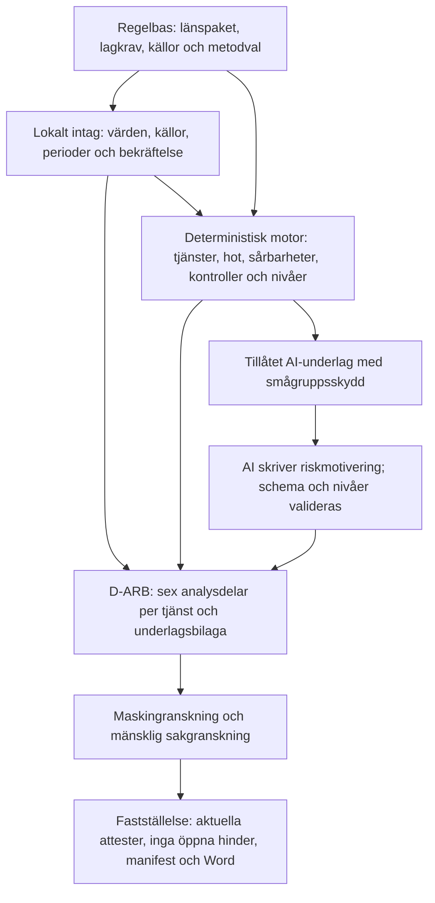

# 11 Källkontroll av den allmänna riskbedömningen mot användarens källor

Kontroll gjord 2026-10-11 av Claude på användarens begäran. Frågan var om programmets allmänna riskbedömning följer lag, föreskrift och de källor användaren lämnat. Kontrollen jämför källornas krav med regelbas 1.1.0, riskmotorn, AI-underlaget och ett syntetiskt Word-utkast (intagets testprofil, testleverantör, inget AI-anrop).

**Detta är en teknisk källkontroll, inte en juridisk granskning.** Den ersätter inte sakkunnigs attest.

## 1 Kontrollerade källor

Användarens filer i iCloud-mappen `Penningtvätt/`. Dubbletter identifierades med SHA-256 och lästes en gång.

| Källa | Typ | Status i regelbasen |
|---|---|---|
| 14FS 2024:11 (tre identiska kopior) | Föreskrift | Samma SHA-256 som `SRC-14FS-2024-11` |
| 01FS 2024:20 | Föreskrift | Samma SHA-256 som `SRC-01FS-2024-20` |
| Rapport 2026:14 *Erfarenheter från länsstyrelsernas penningtvättstillsyn* (två kopior) | Tillsynsrapport | Samma SHA-256 som `SRC-TS-2026-14` |
| Samordningsfunktionens vägledning till redovisningskonsulter och skatterådgivare, mars 2025 | Vägledning | Samma SHA-256 som `SRC-VAGL-2025-03` |
| Länsstyrelsen VG: *Gör en allmän riskbedömning*, *Lär känna kunderna*, *Skapa rutiner*, *Förhindra penningtvätt* (sparade webbsidor) | Vägledning | Ej registrerade som egna källor; research 10 §12 hänvisar till samma sida hos Länsstyrelsen Halland |
| Två Pages-dokument | Kopior av sidan *Förhindra penningtvätt* hos Stockholm respektive VG | Innehåll om återkontroller och tematiska platsbesök saknas i regelbasen |
| *Ingripanden och sanktioner*, Stockholm och VG (sparade webbsidor) | Beslutsöversikt | `SRC-LST-INGRIPANDEN`, hämtad 2026-09-29; nyare beslut och domar saknas |
| Länsstyrelsernas nyhetsbrev juni 2025, november 2025, februari 2026, juni 2026 | Nyhetsbrev | Sammanfattade i research 01; hänvisade myndighetsrapporter ej registrerade |
| Björn Lundén: *Redovisningskonsulter & penningtvättslagen*, e-bok januari 2022 | Sekundärkälla | Sammanfattad i research 01. Bygger på upphävda föreskrifter (14FS 2017:178), NRA 2020/2021 och en inaktuell lista över högrisktredjeländer. Används inte som regelkälla. |

## 2 Vad som redan uppfylls

| Krav eller tillsynspunkt | Källa | Hur programmet hanterar det |
|---|---|---|
| Dokumenterad allmän riskbedömning, skild från kundbedömning och rutiner | PTL 2:1–2; 14FS 2:1; rapport 2026:14 | Eget dokument D-ARB; rutiner och kundmodell är separata spår |
| Tjänster identifieras konkret | 14FS 2:2 | Elva tjänster, inklusive skatterådgivning och bolagsbildning (B-26) |
| Analys per tjänst, inte gemensamt | Rapport 2026:14 | Eget riskavsnitt per erbjuden tjänst; B-04 kontrolleras maskinellt |
| Omfattning per tjänst | Beslut 6045/6572-2026 (B-24) | Kunder och omsättning per tjänst med period och källa |
| Separat terrorfinansieringsrisk | PTL 2:1; rapport 2026:14 | Egen nivå per tjänst, konsekvens alltid allvarlig |
| Hänsyn till NRA:s sektorsrisk | Rapport 2026:14 | NRA 2024/2025 som referens; avvikelse kräver belagd motivering (B-13-grind) |
| En kontroll sänker inte risken utan belägg | Länsstyrelsens vägledning | Utformning och genomförande krävs; annars ingen sänkning |
| Utvärdering minst årligen och före förändringar, med datum | 14FS 2:3 | D-ARB.10 och B-16; saknat datum stoppar fastställelse |
| Källor för hot anges | Länsstyrelsens vägledning | Varje hot har källhänvisning |
| Rätt föreskrift efter säte | PTF 16 § | Regelpaket per tillsynsområde; användarens 01FS och 14FS stämmer med registrerade summor |
| Okänt är inte låg risk | Spec | Okända uppgifter ger preliminärt resultat som inte kan fastställas |

## 3 Luckor

Prioritet: **H** = bindande krav eller återkommande grund för sanktion, **M** = vägledning eller tillsynspraxis som Länsstyrelsen granskar mot, **L** = förbättring.

### 3.1 Egen rapportering vägs inte in i hotanalysen (H)

14FS 2 kap. 2 § och PTL 2 kap. 1 § kräver att uppgifter från egen rapportering av misstänkta aktiviteter *särskilt* beaktas vid analysen av hot. Intaget samlar in `P-VERK.antal_rapporter` och `P-VERK.antal_avbojanden`, men:

- fälten används inte av någon sårbarhet eller beslutsregel,
- de saknas i tillåtelselistan `risk_per_tjanst`, så AI:n som skriver riskavsnitten ser dem inte,
- i utkastet hamnar antalen under *Sårbarheter* som fråga och svar, inte i hotanalysen.

Fritexten `P-BESK.erfarenheter` placeras under *Hot* men analyseras inte.

**Åtgärd:** Flytta antalen till D-ARB.4 och lägg in dem i tillåtelselistan; smågrupper visas redan som "färre än 5". Kräv en deterministisk mening per tjänst om vad egen rapportering visar, även när antalet är noll. B-15 blir då en maskinell kontroll.

### 3.2 Sårbarhetskatalogen täcker inte de riskfaktorer som källorna räknar upp (H)

14FS 2 kap. 2 § kräver att sårbarheter *identifieras och analyseras* för kunder, distributionskanaler, geografi och verksamhetsspecifika omständigheter. Katalogen har tio poster, och varje tjänst får samma sex. Rapport 2026:14 och Länsstyrelsens vägledning pekar ut följande som saknas helt:

| Kategori | Saknas | Källa |
|---|---|---|
| Kunder | Nära kundrelationer (B-07 finns men ingen sårbarhet); kunder i politiskt utsatt ställning; komplexa eller utländska ägarstrukturer; ideella föreningar och stiftelser; nystartade, kortlivade eller övertagna bolag | Rapport 2026:14; vägledning 2025; nyhetsbrev juni och november 2025, juni 2026 |
| Kanaler | Kund som inte träffas fysiskt eller identifieras på distans; ombud, tredje part eller hänvisande rådgivare; extern tjänsteleverantör för kundkännedom | Rapport 2026:14; Länsstyrelsens vägledning; research 10 §5 planerade fälten men de byggdes inte |
| Geografi | Kunder etablerade i högrisktredjeland; länder med korruption eller svagt penningtvättsregelverk; utsatta områden i Sverige | Rapport 2026:14; nyhetsbrev februari 2026 (Polisens lägesbild 2025) |
| Verksamhet | Personal eller uppdragstagare utan utbildning; en person med alla roller utan dubbelkontroll; ekonomiskt beroende av enskilda kunder; utkontrakterade moment; flera verksamhetsställen | Rapport 2026:14; Länsstyrelsens vägledning |

`P-KUND.andel_juridisk` och `P-KUND.andel_nya` samlas in och skickas till AI men påverkar ingen regel.

**Åtgärd:** Komplettera fältregister och sårbarhetskatalog med källa och `metodval` för effekten. Varje ny post kräver sakkunnig granskning (AGENTS.md regel 4 och 8).

### 3.3 Sårbarheter som inte gäller motiveras inte (H)

Utkastet skriver "Gäller inte enligt byråns uppgifter" för varje sårbarhet som inte gäller. Rapport 2026:14 kritiserar uttryckligen att en byrå säger att geografiska risker saknas utan analys, och att kundkategorier anges utan förklaring (B-06, B-10). B-06–B-11 kontrolleras i dag bara manuellt.

**Åtgärd:** Varje sårbarhet får en kort motivering ur underlaget, till exempel andel och period, eller en uppgift från byrån. Lägg till maskinell kontroll för B-09/B-10: "gäller inte" för geografi utan motivering blir ett blockerande fynd.

### 3.4 Hotkatalogen är för smal och saknar terrorfinansiering (H)

Varje tjänst har två hot, ett tjänstespecifikt och H-03. H-01 och H-02 används inte av någon tjänst. Det motsvarar B-05 i rapport 2026:14: fokus på ett fåtal hot. Saknade tillvägagångssätt som myndigheterna beskriver:

- Vägledningen 2025: felbetalningar som ska återbetalas till annat konto, målvakter och bulvaner, uppdelade utlandsbetalningar, brottsvinster bokförda som försäljning och uttagna som lön eller utdelning, karusellbedrägeri.
- Finanspolisen 2025–2026 (enligt nyhetsbreven): direktbetalningar i skiktningsfasen, företag som brottsverktyg och historikbolag, underlagsproducerande företag, arbetslivskriminalitet.
- Terrorfinansiering: insamling via ideella föreningar och Swish, hawala, kryptotillgångar, transaktioner till konfliktområden och transitländer (Finanspolisen 2025, FATF 2025). Programmet anger en terrorfinansieringsnivå men beskriver inget sådant hot.

Länsstyrelsen kräver att både förbrottet och tvättprocessen förstås för penningtvätt, och medlens ursprung och användning för terrorfinansiering.

**Åtgärd:** Komplettera hotkatalogen med källa per post. Varje tjänst ska ha minst ett hot för terrorfinansiering.

### 3.5 Utkastet ser ut som ett ifyllt formulär (H)

Avsnitt 3–5 återger intagets frågor och svar ordagrant, till exempel "Hur många aktiva kunder har betydande kontanthantering? 0. Period … Källa …". Rapport 2026:14, Länsstyrelsens beslut och den dom som e-boken citerar underkänner mallar och kryssrutor utan beskrivning, analys och slutsats. Risken är att utkastet bedöms som en mall trots korrekt motor.

**Åtgärd:** Strukturera om per tjänst: beskrivning (byråns egen text), hot med egen erfarenhet, sårbarheter med motivering, kontroller och effekt, nivå med motivering, slutsats. Underlag och källor flyttas till en bilaga.

### 3.6 Omfattningen motiveras inte efter storlek och art (M)

PTL 2 kap. 2 § kräver att omfattningen bestäms efter storlek och art. Enligt Länsstyrelsen ska det framgå hur omfattningen bestämts. D-ARB.2 anger bara rättslig omfattning (punkt 19, 20). Proportionalitetsnivån i spec 7.5 är inte byggd, trots att omsättning, antal personer, verksamhetsställen och tjänster redan finns i profilen.

**Åtgärd:** Ett deterministiskt stycke i D-ARB.2 som anger storlek, art och vald nivå med regelspår.

### 3.7 Riskbedömningen leder inte till slutsatser för rutinerna (M)

PTL 2 kap. 2 § kräver att riskbedömningen kan ligga till grund för rutiner och riktlinjer. Länsstyrelsens beslut 2025–2026 anger genomgående att en bristfällig riskbedömning gjort att byrån inte kunnat skapa verksamhetsanpassade rutiner. D-ARB.9 listar bara kontroller som saknar belägg.

**Åtgärd:** Per tjänst med hög eller mycket hög risk: vad risken betyder för kundkännedomens nivå, övervakningens fokus och utbildningens innehåll (14FS 2:10). Spec 11 listar redan "slutsatser".

### 3.8 Riskreducerande åtgärders effekt (M)

Länsstyrelsens vägledning: om åtgärder tas med ska deras effektivitet bedömas, det vill säga om de i realiteten bidragit. Bedömningen ska framgå innan riskerna vägs samman. Programmet prövar att kontrollen finns och har belägg, inte om den haft effekt. Kvarstående risk står i D-ARB.6, före kontrollerna i D-ARB.7.

**Åtgärd:** Placera D-ARB.7 före riskavsnitten. Lägg till en fråga om utfallet, till exempel upptäckta avvikelser och vad som ändrats.

### 3.9 Omvärldsbevakning och nyare myndighetskällor (M)

Spec 11 listar omvärldsbevakning i den allmänna riskbedömningen, men avsnittet finns inte. Rapport 2026:14 (B-05) kräver egen omvärldsbevakning. Följande källor nämns i användarens nyhetsbrev och är inte registrerade. De behöver hämtas, kontrollsummeras och läsas innan de används:

- Finanspolisens årsrapporter 2024 och 2025; *Finanspolisen informerar* om direktbetalningar (2025), terrorfinansiering (2025) och storskalig penningtvätt i företagsmiljö (2026)
- Brå 2025:20 *Företag som brottsverktyg*
- Ekobrottsmyndighetens lägesbild 2025
- Polisens *Lägesbild över utsatta områden* 2025
- Myndighetsgemensam lägesbild organiserad brottslighet 2025; SMOB:s samhällsgemensamma lägesbild 2026
- Säkerhetspolisens/NCT:s bedömning av terrorhotet 2026; FATF *Comprehensive Update on Terrorist Financing Risks* (2025); Europol TE-SAT 2025

**Åtgärd:** Avsnitt för omvärldsbevakning med byråns egna källor och datum. Nya källor i `kallor.yaml` med `typ` och kontrollsumma.

### 3.10 Mindre luckor (L)

- **Uppdateringsgrunder:** 14FS 2 kap. 12 § andra stycket kräver uppdatering vid behov efter hot eller hämnd mot personal. D-ARB.10 bör även nämna ny NRA, ändrad EU-lista över högrisktredjeländer och tillsynsbeslut.
- **Spridning:** Enligt Länsstyrelsen ska alla med en roll i skyddet ta del av riskbedömningen, och utbildningen ska utgå från den (14FS 2:10). En uppgift om hur den sprids saknas.
- **Rapporteringsförmåga:** Registrering som rapportör i goAML betonas i nyhetsbrevet juni 2026 och i VG:s tematiska platsbesök. En kontrollfråga saknas.
- **Tidigare tillsyn:** Stockholm gör återkontroller; kvarstående brister efter ingripande är försvårande. Tidigare beslut och åtgärdade brister frågas inte efter.
- **Rättspraxis:** VG:s sida redovisar förvaltningsrättsdomar 2025–2026 (mål 12554-25, 842-26 och 1129-26) som avslår överklaganden om bristfällig allmän riskbedömning. Domarna bör beställas och läggas i källregistret som tillsynspraxis (jämför research 10 §2.6).
- **Sammanvägd byrånivå:** Länsstyrelsen kräver nivå per tjänst; en byrånivå är inget lagkrav. Spec 7.4 beskriver en sammanvägning som koden uttryckligen inte gör. Spec och kod bör stämma överens.

## 4 Det som inte är ett lagkrav

Sakkunnigattesten som hindrar `faststall` är projektets kvalitetsskydd (research 10 §12). Med repots regelbas kan programmet i dag bara skapa utkast. AMLR artikel 10 kräver från 2027-07-10 att ledningsorganet godkänner riskbedömningen och att risken för kringgående av riktade finansiella sanktioner ingår. Riskbedömningar som fastställs före det datumet behöver utvärderas igen inför tillämpningsdagen.

## 5 Verifiering

- SHA-256 för användarens PDF:er jämförda med `regelbas/kallor.yaml`.
- Utkastet skapades med intagets testprofil `klar`, `Testleverantor` och `skapa_utkast` i en tillfällig mapp. AI-underlaget för D-ARB.6.1 granskades: inget fält för egen rapportering eller sektorsnivå ingick.
- Inga ändringar i `src/` eller i den operativa regelbasen. Inga nätverksanrop eller AI-anrop.

## 6. Oberoende källkontroll och teknisk uppföljning – Codex 2026-10-11

Kontrollen jämförde fynden med den aktuella koden före rättelserna. H1/H2 bekräftades och återskapades i syntetiska regressioner före kodändring. H3:s konkreta luckor stöds av rapport 2026:14 och vägledningen (kundrelationer/kanaler på fysisk PDF-sida 8, geografi sida 9, organisation sida 10 i rapporten). H4 behöver preciseras: H-03 var redan markerad `galler_tf: true` och kopplad till tjänster. Det som saknades var konkreta TF-tillvägagångssätt och bredare tjänstekoppling, inte varje TF-hot.

De bevarade originalen av 14FS 2024:11, 01FS 2024:20, rapport 2026:14 och vägledningen mars 2025 jämfördes med källregistrets SHA-256. Sparade Länsstyrelsewebbsidor och nyhetsbrev juni/november 2025 samt februari/juni 2026 lästes som sekundära ingångar till de refererade originalrapporterna. Tillsynsbesluten 6045-2026 och 6572-2026 kontrollerades i lokalt arkiv; avgörande formuleringar om tjänsteanalys, egna rapporteringserfarenheter och omfattning jämfördes med originalfoton av beslutens sida 4 (IMG_5940 respektive IMG_6001), inte enbart OCR. Uppgift om laga kraft är fortfarande inte verifierad.

Tolv nya PDF-original hämtades från respektive utgivare, filsignatur kontrollerades, text extraherades och relevanta avsnitt lästes. Originalen SHA-256-kontrollerades och registrerades före användning: Finanspolisens årsrapporter 2024/2025, Företag som brottsverktyg 2026, TF- och Swish-material 2025, Brå 2025:20, EBM:s lägesbild 2025, polisens utsatta områden 2025, myndighetsgemensam lägesbild 2025, SMOB 2026, NCT 2026 och Europol TE-SAT 2025. Detaljer/URL/summor finns i [manifestet](kallmanifest-2026-10-11.json); det innebär inte att varje sida i varje rapport lästs eller att byråns bevakning är utförd. SMOB är ett forskningscentrum; rapporten behandlas som forskningsunderlag.

FATF:s PDF-hämtning nekades med HTTP 403. Läsbar webbrendering ersätter inte en originalfil och SHA-256; FATF-posten har inte registrerats eller lagts till nya katalogposters källor. Domarna 12554-25, 842-26 och 1129-26 har inte erhållits i original och används därför inte som nya rättsliga slutsatser. Dessa delar av M4/L kvarstår tills original kan kontrolleras.

Alla nya hot/sårbarheter och omfattningströsklar är källbundna **metodval med `ej_granskad` sakkunnigstatus**. Källan stöder riskförhållandet/tillvägagångssättet; den fastställer inte programmets poäng, konservativa byråövergripande tillämpning eller gränsvärden. Dessa behöver verklig juridisk/metodisk sakprövning och kalibrering. Genomförande och verifiering redovisas i [STATUS](../STATUS.md) och den användargodkända [H5-planen](../superpowers/plans/2026-10-11-d-arb-tjanststruktur.md).

## 7. Programmets struktur efter rättelserna

`regelverk/` laddar och kontrollerar källor, typade villkor och rättslig omfattning för länspaketet. `profil/`, `intag/` och `foretagsdata/` hanterar lokala fakta och källbundna registerförslag; importerade värden blir inte automatiskt bekräftade. `bedomning/` räknar nivåer och belägg deterministiskt. `dokument/underlag.py` begränsar vad AI får se; övriga dokumentbyggare fogar in lokala fakta och underlagsmotiveringar utan AI-tolkning. `granskning/` söker täcknings- och analysbrister. `faststallelse/` kräver aktuella godkännanden av den renderade texten och strukturen. `lagring/` och `drift/` bevarar körningar, kontrollsummor, historik och återställningsbara paket utanför repot.

Källornas roller skiljs åt: PTL och tillämpliga länsföreskrifter binder juridiska krav; riskrapporter och vägledningar stöder hot/sårbarheter; tillsynsbeslut beskriver de granskade ärendena och typiska brister; nyhetsbrev/webbsidor leder till aktuella original. Programmets numeriska skalor, trösklar och reduktioner är egna metodval. Varken en källhänvisning eller ett grönt tekniskt prov gör dessa sakkunniggranskade.
