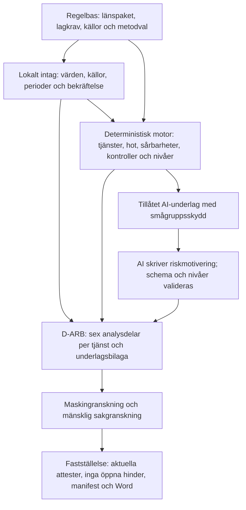

# 11 Källkontroll av den allmänna riskbedömningen mot användarens källor

Kontroll gjord 2026-10-11 av Claude på användarens begäran. Frågan var om programmets allmänna riskbedömning följer lag, föreskrift och de källor användaren lämnat. Kontrollen jämför källornas krav med regelbas 1.1.0, riskmotorn, AI-underlaget och ett syntetiskt Word-utkast (intagets testprofil, testleverantör, inget AI-anrop).

**Detta är en teknisk källkontroll, inte en juridisk granskning.** Den ersätter inte sakkunnigs attest.

## 1 Kontrollerade källor

Användarens filer i iCloud-mappen `Penningtvätt/`. Dubbletter identifierades med SHA-256 och lästes en gång.

| Källa | Typ | Status i regelbasen |
|---|---|---|
| 14FS 2024:11 (tre identiska kopior) | Föreskrift | Samma SHA-256 som `SRC-14FS-2024-11` |
| 01FS 2024:20 | Föreskrift | Samma SHA-256 som `SRC-01FS-2024-20` |
| Rapport 2026:14 *Erfarenheter från länsstyrelsernas penningtvättstillsyn* (två kopior) | Tillsynsrapport | Samma SHA-256 som `SRC-TS-2026-14` |
| Samordningsfunktionens vägledning till redovisningskonsulter och skatterådgivare, mars 2025 | Vägledning | Samma SHA-256 som `SRC-VAGL-2025-03` |
| Länsstyrelsen VG: *Gör en allmän riskbedömning*, *Lär känna kunderna*, *Skapa rutiner*, *Förhindra penningtvätt* (sparade webbsidor) | Vägledning | Ej registrerade som egna källor; research 10 §12 hänvisar till samma sida hos Länsstyrelsen Halland |
| Två Pages-dokument | Kopior av sidan *Förhindra penningtvätt* hos Stockholm respektive VG | Innehåll om återkontroller och tematiska platsbesök saknas i regelbasen |
| *Ingripanden och sanktioner*, Stockholm och VG (sparade webbsidor) | Beslutsöversikt | `SRC-LST-INGRIPANDEN`, hämtad 2026-09-29; nyare beslut och domar saknas |
| Länsstyrelsernas nyhetsbrev juni 2025, november 2025, februari 2026, juni 2026 | Nyhetsbrev | Sammanfattade i research 01; hänvisade myndighetsrapporter ej registrerade |
| Björn Lundén: *Redovisningskonsulter & penningtvättslagen*, e-bok januari 2022 | Sekundärkälla | Sammanfattad i research 01. Bygger på upphävda föreskrifter (14FS 2017:178), NRA 2020/2021 och en inaktuell lista över högrisktredjeländer. Används inte som regelkälla. |

## 2 Vad som redan uppfylls

| Krav eller tillsynspunkt | Källa | Hur programmet hanterar det |
|---|---|---|
| Dokumenterad allmän riskbedömning, skild från kundbedömning och rutiner | PTL 2:1–2; 14FS 2:1; rapport 2026:14 | Eget dokument D-ARB; rutiner och kundmodell är separata spår |
| Tjänster identifieras konkret | 14FS 2:2 | Elva tjänster, inklusive skatterådgivning och bolagsbildning (B-26) |
| Analys per tjänst, inte gemensamt | Rapport 2026:14 | Eget riskavsnitt per erbjuden tjänst; B-04 kontrolleras maskinellt |
| Omfattning per tjänst | Beslut 6045/6572-2026 (B-24) | Kunder och omsättning per tjänst med period och källa |
| Separat terrorfinansieringsrisk | PTL 2:1; rapport 2026:14 | Egen nivå per tjänst, konsekvens alltid allvarlig |
| Hänsyn till NRA:s sektorsrisk | Rapport 2026:14 | NRA 2024/2025 som referens; avvikelse kräver belagd motivering (B-13-grind) |
| En kontroll sänker inte risken utan belägg | Länsstyrelsens vägledning | Utformning och genomförande krävs; annars ingen sänkning |
| Utvärdering minst årligen och före förändringar, med datum | 14FS 2:3 | D-ARB.10 och B-16; saknat datum stoppar fastställelse |
| Källor för hot anges | Länsstyrelsens vägledning | Varje hot har källhänvisning |
| Rätt föreskrift efter säte | PTF 16 § | Regelpaket per tillsynsområde; användarens 01FS och 14FS stämmer med registrerade summor |
| Okänt är inte låg risk | Spec | Okända uppgifter ger preliminärt resultat som inte kan fastställas |

## 3 Luckor

Prioritet: **H** = bindande krav eller återkommande grund för sanktion, **M** = vägledning eller tillsynspraxis som Länsstyrelsen granskar mot, **L** = förbättring.

### 3.1 Egen rapportering vägs inte in i hotanalysen (H)

14FS 2 kap. 2 § och PTL 2 kap. 1 § kräver att uppgifter från egen rapportering av misstänkta aktiviteter *särskilt* beaktas vid analysen av hot. Intaget samlar in `P-VERK.antal_rapporter` och `P-VERK.antal_avbojanden`, men:

- fälten används inte av någon sårbarhet eller beslutsregel,
- de saknas i tillåtelselistan `risk_per_tjanst`, så AI:n som skriver riskavsnitten ser dem inte,
- i utkastet hamnar antalen under *Sårbarheter* som fråga och svar, inte i hotanalysen.

Fritexten `P-BESK.erfarenheter` placeras under *Hot* men analyseras inte.

**Åtgärd:** Flytta antalen till D-ARB.4 och lägg in dem i tillåtelselistan; smågrupper visas redan som "färre än 5". Kräv en deterministisk mening per tjänst om vad egen rapportering visar, även när antalet är noll. B-15 blir då en maskinell kontroll.

### 3.2 Sårbarhetskatalogen täcker inte de riskfaktorer som källorna räknar upp (H)

14FS 2 kap. 2 § kräver att sårbarheter *identifieras och analyseras* för kunder, distributionskanaler, geografi och verksamhetsspecifika omständigheter. Katalogen har tio poster, och varje tjänst får samma sex. Rapport 2026:14 och Länsstyrelsens vägledning pekar ut följande som saknas helt:

| Kategori | Saknas | Källa |
|---|---|---|
| Kunder | Nära kundrelationer (B-07 finns men ingen sårbarhet); kunder i politiskt utsatt ställning; komplexa eller utländska ägarstrukturer; ideella föreningar och stiftelser; nystartade, kortlivade eller övertagna bolag | Rapport 2026:14; vägledning 2025; nyhetsbrev juni och november 2025, juni 2026 |
| Kanaler | Kund som inte träffas fysiskt eller identifieras på distans; ombud, tredje part eller hänvisande rådgivare; extern tjänsteleverantör för kundkännedom | Rapport 2026:14; Länsstyrelsens vägledning; research 10 §5 planerade fälten men de byggdes inte |
| Geografi | Kunder etablerade i högrisktredjeland; länder med korruption eller svagt penningtvättsregelverk; utsatta områden i Sverige | Rapport 2026:14; nyhetsbrev februari 2026 (Polisens lägesbild 2025) |
| Verksamhet | Personal eller uppdragstagare utan utbildning; en person med alla roller utan dubbelkontroll; ekonomiskt beroende av enskilda kunder; utkontrakterade moment; flera verksamhetsställen | Rapport 2026:14; Länsstyrelsens vägledning |

`P-KUND.andel_juridisk` och `P-KUND.andel_nya` samlas in och skickas till AI men påverkar ingen regel.

**Åtgärd:** Komplettera fältregister och sårbarhetskatalog med källa och `metodval` för effekten. Varje ny post kräver sakkunnig granskning (AGENTS.md regel 4 och 8).

### 3.3 Sårbarheter som inte gäller motiveras inte (H)

Utkastet skriver "Gäller inte enligt byråns uppgifter" för varje sårbarhet som inte gäller. Rapport 2026:14 kritiserar uttryckligen att en byrå säger att geografiska risker saknas utan analys, och att kundkategorier anges utan förklaring (B-06, B-10). B-06–B-11 kontrolleras i dag bara manuellt.

**Åtgärd:** Varje sårbarhet får en kort motivering ur underlaget, till exempel andel och period, eller en uppgift från byrån. Lägg till maskinell kontroll för B-09/B-10: "gäller inte" för geografi utan motivering blir ett blockerande fynd.

### 3.4 Hotkatalogen är för smal och saknar terrorfinansiering (H)

Varje tjänst har två hot, ett tjänstespecifikt och H-03. H-01 och H-02 används inte av någon tjänst. Det motsvarar B-05 i rapport 2026:14: fokus på ett fåtal hot. Saknade tillvägagångssätt som myndigheterna beskriver:

- Vägledningen 2025: felbetalningar som ska återbetalas till annat konto, målvakter och bulvaner, uppdelade utlandsbetalningar, brottsvinster bokförda som försäljning och uttagna som lön eller utdelning, karusellbedrägeri.
- Finanspolisen 2025–2026 (enligt nyhetsbreven): direktbetalningar i skiktningsfasen, företag som brottsverktyg och historikbolag, underlagsproducerande företag, arbetslivskriminalitet.
- Terrorfinansiering: insamling via ideella föreningar och Swish, hawala, kryptotillgångar, transaktioner till konfliktområden och transitländer (Finanspolisen 2025, FATF 2025). Programmet anger en terrorfinansieringsnivå men beskriver inget sådant hot.

Länsstyrelsen kräver att både förbrottet och tvättprocessen förstås för penningtvätt, och medlens ursprung och användning för terrorfinansiering.

**Åtgärd:** Komplettera hotkatalogen med källa per post. Varje tjänst ska ha minst ett hot för terrorfinansiering.

### 3.5 Utkastet ser ut som ett ifyllt formulär (H)

Avsnitt 3–5 återger intagets frågor och svar ordagrant, till exempel "Hur många aktiva kunder har betydande kontanthantering? 0. Period … Källa …". Rapport 2026:14, Länsstyrelsens beslut och den dom som e-boken citerar underkänner mallar och kryssrutor utan beskrivning, analys och slutsats. Risken är att utkastet bedöms som en mall trots korrekt motor.

**Åtgärd:** Strukturera om per tjänst: beskrivning (byråns egen text), hot med egen erfarenhet, sårbarheter med motivering, kontroller och effekt, nivå med motivering, slutsats. Underlag och källor flyttas till en bilaga.

### 3.6 Omfattningen motiveras inte efter storlek och art (M)

PTL 2 kap. 2 § kräver att omfattningen bestäms efter storlek och art. Enligt Länsstyrelsen ska det framgå hur omfattningen bestämts. D-ARB.2 anger bara rättslig omfattning (punkt 19, 20). Proportionalitetsnivån i spec 7.5 är inte byggd, trots att omsättning, antal personer, verksamhetsställen och tjänster redan finns i profilen.

**Åtgärd:** Ett deterministiskt stycke i D-ARB.2 som anger storlek, art och vald nivå med regelspår.

### 3.7 Riskbedömningen leder inte till slutsatser för rutinerna (M)

PTL 2 kap. 2 § kräver att riskbedömningen kan ligga till grund för rutiner och riktlinjer. Länsstyrelsens beslut 2025–2026 anger genomgående att en bristfällig riskbedömning gjort att byrån inte kunnat skapa verksamhetsanpassade rutiner. D-ARB.9 listar bara kontroller som saknar belägg.

**Åtgärd:** Per tjänst med hög eller mycket hög risk: vad risken betyder för kundkännedomens nivå, övervakningens fokus och utbildningens innehåll (14FS 2:10). Spec 11 listar redan "slutsatser".

### 3.8 Riskreducerande åtgärders effekt (M)

Länsstyrelsens vägledning: om åtgärder tas med ska deras effektivitet bedömas, det vill säga om de i realiteten bidragit. Bedömningen ska framgå innan riskerna vägs samman. Programmet prövar att kontrollen finns och har belägg, inte om den haft effekt. Kvarstående risk står i D-ARB.6, före kontrollerna i D-ARB.7.

**Åtgärd:** Placera D-ARB.7 före riskavsnitten. Lägg till en fråga om utfallet, till exempel upptäckta avvikelser och vad som ändrats.

### 3.9 Omvärldsbevakning och nyare myndighetskällor (M)

Spec 11 listar omvärldsbevakning i den allmänna riskbedömningen, men avsnittet finns inte. Rapport 2026:14 (B-05) kräver egen omvärldsbevakning. Följande källor nämns i användarens nyhetsbrev och är inte registrerade. De behöver hämtas, kontrollsummeras och läsas innan de används:

- Finanspolisens årsrapporter 2024 och 2025; *Finanspolisen informerar* om direktbetalningar (2025), terrorfinansiering (2025) och storskalig penningtvätt i företagsmiljö (2026)
- Brå 2025:20 *Företag som brottsverktyg*
- Ekobrottsmyndighetens lägesbild 2025
- Polisens *Lägesbild över utsatta områden* 2025
- Myndighetsgemensam lägesbild organiserad brottslighet 2025; SMOB:s samhällsgemensamma lägesbild 2026
- Säkerhetspolisens/NCT:s bedömning av terrorhotet 2026; FATF *Comprehensive Update on Terrorist Financing Risks* (2025); Europol TE-SAT 2025

**Åtgärd:** Avsnitt för omvärldsbevakning med byråns egna källor och datum. Nya källor i `kallor.yaml` med `typ` och kontrollsumma.

### 3.10 Mindre luckor (L)

- **Uppdateringsgrunder:** 14FS 2 kap. 12 § andra stycket kräver uppdatering vid behov efter hot eller hämnd mot personal. D-ARB.10 bör även nämna ny NRA, ändrad EU-lista över högrisktredjeländer och tillsynsbeslut.
- **Spridning:** Enligt Länsstyrelsen ska alla med en roll i skyddet ta del av riskbedömningen, och utbildningen ska utgå från den (14FS 2:10). En uppgift om hur den sprids saknas.
- **Rapporteringsförmåga:** Registrering som rapportör i goAML betonas i nyhetsbrevet juni 2026 och i VG:s tematiska platsbesök. En kontrollfråga saknas.
- **Tidigare tillsyn:** Stockholm gör återkontroller; kvarstående brister efter ingripande är försvårande. Tidigare beslut och åtgärdade brister frågas inte efter.
- **Rättspraxis:** VG:s sida redovisar förvaltningsrättsdomar 2025–2026 (mål 12554-25, 842-26 och 1129-26) som avslår överklaganden om bristfällig allmän riskbedömning. Domarna bör beställas och läggas i källregistret som tillsynspraxis (jämför research 10 §2.6).
- **Sammanvägd byrånivå:** Länsstyrelsen kräver nivå per tjänst; en byrånivå är inget lagkrav. Spec 7.4 beskriver en sammanvägning som koden uttryckligen inte gör. Spec och kod bör stämma överens.

## 4 Det som inte är ett lagkrav

Sakkunnigattesten som hindrar `faststall` är projektets kvalitetsskydd (research 10 §12). Med repots regelbas kan programmet i dag bara skapa utkast. AMLR artikel 10 kräver från 2027-07-10 att ledningsorganet godkänner riskbedömningen och att risken för kringgående av riktade finansiella sanktioner ingår. Riskbedömningar som fastställs före det datumet behöver utvärderas igen inför tillämpningsdagen.

## 5 Verifiering

- SHA-256 för användarens PDF:er jämförda med `regelbas/kallor.yaml`.
- Utkastet skapades med intagets testprofil `klar`, `Testleverantor` och `skapa_utkast` i en tillfällig mapp. AI-underlaget för D-ARB.6.1 granskades: inget fält för egen rapportering eller sektorsnivå ingick.
- Inga ändringar i `src/` eller i den operativa regelbasen. Inga nätverksanrop eller AI-anrop.

## 6. Oberoende källkontroll och teknisk uppföljning – Codex 2026-10-11

Kontrollen jämförde fynden med den aktuella koden före rättelserna. H1/H2 bekräftades och återskapades i syntetiska regressioner före kodändring. H3:s konkreta luckor stöds av rapport 2026:14 och vägledningen (kundrelationer/kanaler på fysisk PDF-sida 8, geografi sida 9, organisation sida 10 i rapporten). H4 behöver preciseras: H-03 var redan markerad `galler_tf: true` och kopplad till tjänster. Det som saknades var konkreta TF-tillvägagångssätt och bredare tjänstekoppling, inte varje TF-hot.

De bevarade originalen av 14FS 2024:11, 01FS 2024:20, rapport 2026:14 och vägledningen mars 2025 jämfördes med källregistrets SHA-256. Sparade Länsstyrelsewebbsidor och nyhetsbrev juni/november 2025 samt februari/juni 2026 lästes som sekundära ingångar till de refererade originalrapporterna. Tillsynsbesluten 6045-2026 och 6572-2026 kontrollerades i lokalt arkiv; avgörande formuleringar om tjänsteanalys, egna rapporteringserfarenheter och omfattning jämfördes med originalfoton av beslutens sida 4 (IMG_5940 respektive IMG_6001), inte enbart OCR. Uppgift om laga kraft är fortfarande inte verifierad.

Tolv nya PDF-original hämtades från respektive utgivare, filsignatur kontrollerades, text extraherades och relevanta avsnitt lästes. Originalen SHA-256-kontrollerades och registrerades före användning: Finanspolisens årsrapporter 2024/2025, Företag som brottsverktyg 2026, TF- och Swish-material 2025, Brå 2025:20, EBM:s lägesbild 2025, polisens utsatta områden 2025, myndighetsgemensam lägesbild 2025, SMOB 2026, NCT 2026 och Europol TE-SAT 2025. Detaljer/URL/summor finns i [manifestet](kallmanifest-2026-10-11.json); det innebär inte att varje sida i varje rapport lästs eller att byråns bevakning är utförd. SMOB är ett forskningscentrum; rapporten behandlas som forskningsunderlag.

FATF:s PDF-hämtning nekades med HTTP 403. Läsbar webbrendering ersätter inte en originalfil och SHA-256; FATF-posten har inte registrerats eller lagts till nya katalogposters källor. Domarna 12554-25, 842-26 och 1129-26 har inte erhållits i original och används därför inte som nya rättsliga slutsatser. Dessa delar av M4/L kvarstår tills original kan kontrolleras.

Alla nya hot/sårbarheter och omfattningströsklar är källbundna **metodval med `ej_granskad` sakkunnigstatus**. Källan stöder riskförhållandet/tillvägagångssättet; den fastställer inte programmets poäng, konservativa byråövergripande tillämpning eller gränsvärden. Dessa behöver verklig juridisk/metodisk sakprövning och kalibrering. Genomförande och verifiering redovisas i [STATUS](../STATUS.md) och den användargodkända [H5-planen](../superpowers/plans/2026-10-11-d-arb-tjanststruktur.md).

## 7. Programmets struktur efter rättelserna

`regelverk/` laddar och kontrollerar källor, typade villkor och rättslig omfattning för länspaketet. `profil/`, `intag/` och `foretagsdata/` hanterar lokala fakta och källbundna registerförslag; importerade värden blir inte automatiskt bekräftade. `bedomning/` räknar nivåer och belägg deterministiskt. `dokument/underlag.py` begränsar vad AI får se; övriga dokumentbyggare fogar in lokala fakta och underlagsmotiveringar utan AI-tolkning. `granskning/` söker täcknings- och analysbrister. `faststallelse/` kräver aktuella godkännanden av den renderade texten och strukturen. `lagring/` och `drift/` bevarar körningar, kontrollsummor, historik och återställningsbara paket utanför repot.

Källornas roller skiljs åt: PTL och tillämpliga länsföreskrifter binder juridiska krav; riskrapporter och vägledningar stöder hot/sårbarheter; tillsynsbeslut beskriver de granskade ärendena och typiska brister; nyhetsbrev/webbsidor leder till aktuella original. Programmets numeriska skalor, trösklar och reduktioner är egna metodval. Varken en källhänvisning eller ett grönt tekniskt prov gör dessa sakkunniggranskade.

## 8. Ny granskning av skrivande, riskmotor och realistiskt utkast – 2026-10-14

**Bedömning:** utkastet är en tekniskt spårbar prototyp men ännu ingen välfungerande, färdig allmän riskbedömning för byråns personal. Kritiken om längd och avsaknad av tabeller är befogad. Enbart kortare AI-prompt eller snyggare Word-layout löser inte bristerna: även motorns kontrollreduktion, tjänsteanknytning, TF-kalibrering och förklaringar behöver prövas.

### 8.1 Omfattning och källkritik

Granskat: den fiktiva Göteborgsbyrån med sju personer, 120 kunder och fyra tjänster; Word-export `20261014T174127345527Z`; profil, bedömning, skrivresultat, faktablad, granskningsfynd och aktuell kod/regelbas 1.3.0. Alla 24 poster i det operativa källregistret har inventerats. Befintlig research har jämförts med dagens implementation; äldre fynd i avsnitt 3 ovan beskriver inte automatiskt nuläget. Tolv sparade myndighets-/forsknings-PDF:ers SHA-256 stämmer med manifestet från 11 oktober. Relevanta delar har granskats, inte varje sida i alla långa rapporter.

Webbsökningen omfattar svensk lag, Länsstyrelsens vägledning och tillsyn, Polisen/NRA, FATF, AMLA samt öppet branschmaterial. ”Alla källor online” kan inte bli ett slutet eller uttömmande urval. Här prioriteras rättskällor och originalutgivare. Privata byråhandlingar och e-boken från 2022 har behandlats genom den befintliga källgenomgången; de har inte nylästs i sin helhet. Domar som saknas i original är fortfarande inte verifierade prejudikat. Medlemslåsta FAR-/Srf-mallar har inte granskats.

FATF:s vägledning för redovisningsprofessionen är icke bindande och dess webbplats varnar för att den inte inkluderar senare standardändringar, bland annat 2025. Den används för metodresonemang, inte som svensk lag. AMLA:s kontrollerade sida visar fortfarande **utkast och stängd konsultation**, inte verifierade slutliga riktlinjer. EUR-Lex svarade med robotkontroll vid dagens försök; antagen AMLR-text är tidigare kontrollerad i projektet, men har inte fullständigt återverifierats här. Inget framtida regelpaket aktiveras av denna granskning.

### 8.2 Vad källorna kräver och vad som är ett designval

| Fråga | Källstöd och slutsats | Betydelse för dokumentet |
|---|---|---|
| Vad ska bedömas? | PTL 2 kap. 1–2 §§: hur tjänsterna kan missbrukas, riskens storlek, relevanta kunder, kanaler, geografi, egna rapporter och myndighetsinformation. | Ett verksamhetsanpassat resonemang behöver gå att följa, inte bara en lista med riskord. |
| Måste risknivån motiveras? | 14FS 2024:11, 2 kap. 2 § kräver identifiering och analys av hot/sårbarheter samt motivering av nivåer. | Nivå, faktorer, samspel och bedömningsskäl ska hänga ihop per tjänst. |
| Hur långt och i vilken form? | Länsstyrelsens aktuella vägledning låter verksamheten välja ordning och presentation. Omfattningen följer storlek, art och risk. Inget generellt sidantal eller obligatorisk Word-mall har identifierats. | Tabeller är ett lämpligt designval här, inte ett separat lagkrav. Kortfattad motivering behövs även i en tabell. |
| Hur används kontroller? | Vägledningen kräver redovisad effektprövning om kontroller används i riskbedömningen. | Att en kontroll finns eller att bokföringen stämmer räcker inte automatiskt för lägre penningtvättsrisk. |
| Hur uppdateras dokumentet? | 14FS 2 kap. 3 §: minst årlig utvärdering, behovsstyrd uppdatering och prövning före relevanta förändringar; datum ska framgå. | Versionsruta, verkligt besluts-/utvärderingsdatum och uppföljningsansvar. |
| Hur kvalitetssäkras motorn? | PTL 6 kap. 1 § kräver modellriskhantering när modeller används. | Reproducerbar kod är nödvändig men säger inte att vikter, gränser eller nivåer är välgrundade. |

Primärkällor: [PTL](https://www.riksdagen.se/sv/dokument-och-lagar/dokument/svensk-forfattningssamling/lag-2017630-om-atgarder-mot-penningtvatt-och_sfs-2017-630/), [14FS 2024:11](https://www.lansstyrelsen.se/download/18.74c322ef18f9ee08a2929/1716358223326/2024-11%20Penningtv%C3%A4tt%20Dalarnas%20l%C3%A4n%20G%C3%A4vleborgs%20l%C3%A4n%20Hallands%20l%C3%A4n%20V%C3%A4rmlands%20l%C3%A4n%20V%C3%A4stra%20G%C3%B6talands%20l%C3%A4n%20%C3%96rebro%20l%C3%A4n.pdf), [Länsstyrelsen VG: Gör en allmän riskbedömning](https://www.lansstyrelsen.se/vastra-gotaland/samhalle/betalning-ekonomi-och-pengar/forhindra-penningtvatt-och-finansiering-av-terrorism/gor-en-allman-riskbedomning.html).

Tillsynsrapport 2026:14, särskilt tryckta sidor 5–10, betonar individuell tjänsteanalys, samspel mellan riskfaktorer och dokumenterade skäl. Beslut 48548-2025, 29 januari 2026, s. 3–6 visar dessutom att tjänstenamn och olika risknivåer inte räcker när kopplingen till verksamhetens faktiska förhållanden saknas. Detta är tillsynsunderlag; överklagande/laga kraft har inte kontrollerats. [Rapport 2026:14](https://www.lansstyrelsen.se/download/18.51b8c30c19d05558bd82e18e/1774259142687/Erfarenheter%20fr%C3%A5n%20l%C3%A4nsstyrelsernas%20penningtv%C3%A4ttstillsyn.pdf), [beslut 48548-2025](https://www.lansstyrelsen.se/download/18.4d207a9019c47c545ea238c6/1770992429802/Beslut%20om%20sanktionsavgift%20Y-ekonomi.pdf).

### 8.3 Mätning av det faktiskt genererade dokumentet

| Mätning | Resultat |
|---|---:|
| Ord i huvuddel, bilagor och rubriker (blankstegsdelning) | 18 167 |
| Icke tomma stycken inklusive rubriker | 374 |
| Word-tabeller / bilder | 0 / 0 |
| Innehållsförteckningsfält / explicita Word-fotnoter / hyperlänkelement | 0 / 0 / 0 |
| Underlagsbilaga, utan dess huvudrubrik | 4 943 ord |
| Fyra tjänsteavsnitt, utan deras huvudrubriker | 10 264 ord |
| Förberedda skrivsvar, före lokal sammansättning | 3 264 ord |
| Samma sanktionskontrollstycke | 8 förekomster |
| Maskinellt godkända skrivdelar | 20 av 20 |
| Öppna granskningsfynd | 4, samtliga höga |

Detta är inte ett verifierat sidantal; sidbrytning beror på Word-renderingen. Mätningen är reproducerbar i den sparade DOCX-filen. Skrivsvaren utgör ungefär 18 procent av ordmängden. Deras avsiktliga upprepningar är dåliga som språkdemonstration, men förklarar inte huvuddelen av längden.

Bokföringsavsnittet har cirka 1 395 ord bara under sårbarheter. `sarbarhetsstycke` återger hela byråns och tjänstens geografibeskrivning för varje geografisk faktor; detta upprepas dessutom mellan tjänster. `arb.py` bygger både ett gemensamt kontrollkapitel och samma kontroller inne i tjänsterna. Bilagan återger råa uppgifter och samtliga 24 källor, även när de inte används direkt i just denna analys.

**Min tidigare beskrivning behöver därför korrigeras:** de repetitiva fixtursvaren är en begränsning, men dokumentlängden är framför allt en fråga om sammansättning, dubblering och hur underlag presenteras.

### 8.4 Så fungerar motorn och så utföll detta fall

1. Bekräftade uppgifter och perioder används för att härleda andelar. Tillämpliga tjänster väljs från katalogen.
2. Varje tjänst har fasta grundnivåer för sannolikhet och konsekvens. Gällande sårbarheter adderar steg till sannolikheten, högst till ”hög”.
3. En 3 × 3-matris ger risk på fyra nivåer. Konsekvensen för TF är alltid ”allvarlig” enligt projektets metodval.
4. **Minst en** verksam och belagd tjänstekontroll sänker penningtvättsrisken ett steg för hela tjänsten. Den regeln sänker inte TF.
5. Sanktionsrisk är en separat, mycket enkel dimension med grundnivå, en anknytningsindikator och egen kontroll. Den avgör inte om ett förbud eller en listträff föreligger.
6. AI får ett begränsat faktablad och skriver fem delar per tjänst. Kod infogar nivåer, lokala fakta, kontrollstatus och bilagor. Maskinkontroller och senare mänsklig sakgranskning är separata steg.

**Faktiska motorutfall, preliminära och inte sakkunnigbedömda:**

| Tjänst | Kunder | Omsättning jan–sep | PT före kontroll | PT efter kontroll | TF | Sanktionsrisk efter kontroll |
|---|---:|---:|---|---|---|---|
| Löpande bokföring | 100 | 3 000 000 kr | Hög | Måttlig | Mycket hög | Måttlig |
| Bokslut och årsredovisning | 110 | 1 350 000 kr | Hög | Måttlig | Mycket hög | Måttlig |
| Deklarationer | 100 | 450 000 kr | Hög | Måttlig | Mycket hög | Måttlig |
| Löner | 45 | 600 000 kr | Hög | Hög | Mycket hög | Måttlig |

Kundgrupperna överlappar. TF-kolumnen är motorns TF-bedömning; någon separat kvarstående TF-nivå beräknas inte. Tabellen visar hur befintliga utdata kan göras läsbara och innebär inget godkännande av nivåerna.

### 8.5 Prioriterade fynd

**P1 – För grov kontrollreduktion.** I detta fall är kontrollen av bokföringsunderlag ”begränsad”, men bankavstämningen ”verksam”. Bokföringens PT-risk sänks ändå från hög till måttlig. I en isolerad variant ändrades underlagskontrollen till ”verkningslös”; resultatet var fortfarande måttligt. När bankkontrollens effekt ändrades till ”ej bedömd” blev risken hög. `motor.py:194–197` använder `any(...)`; det finns ingen explicit hotvis täckningsprövning i själva sänkningen. Att beloppen stämmer mot bank kan inte i sig styrka fakturans verklighet eller affärssyfte. Åtgärd: bedöm kontrollens täckning av aktuella scenarier och restbrister före reduktion, med sakkunnigprövad metod. Byt inte bara till ett annat godtyckligt antal kontroller.

**P1 – TF och PT når taket för lätt för att skilja tjänsterna åt.** Samma åtta sårbarheter tillämpas på alla fyra tjänster; sju av dem påverkar både PT och TF. I ett mekaniskt känslighetsprov med övriga indikatorer nollställda gav enbart 12 kontantkunder av 120 TF-nivån hög. Med dessutom en enda kund med utlandstransaktion blev TF mycket hög. Detta bevisar känslighet och mättnad i modellen, inte att den verkliga risken är låg. Nya vikter kräver scenariofacit och kalibrering. NRA:s sektorsrisk är PT-referens på egen skala; TF behandlas kvalitativt i NRA och motsvarar inte automatiskt motorns högsta nivå. [NRA 2024/2025, septemberversionen, s. 3 och 122–125](https://polisen.se/0c34c8d8c94e1a371d8cca457b84fb0a/siteassets/dokument/om-polisen/penningtvatt/nationell-riskbedomning-av-penningtvatt-och-finansiering-av-terrorism-i-sverige-2024_2025.pdf).

**P1 – Byrågemensamma indikatorer ersätter tjänstens faktiska exponering.** En distanskund, utländsk ägare eller extern AML-leverantör kan bidra med ett helt steg i varje tjänst. Modellens försiktighetsantagande är märkt, men intaget visar inte vilka tjänster som berörs eller vilka grupper som överlappar. Extern leverantör och utkontraktering kan dessutom beskriva samma förhållande och båda höja risken. Förslag: tjänstevis relevans och kända överlapp i aggregerad form, samlade gemensamma organisationsfaktorer samt särskild markering där fördelningen faktiskt är okänd. Kundernas riskprofiler ska inte räknas fram ur denna tabell.

**P1 – Skribenten saknar en stor del av det som behövs för verksamhetsanpassning.** Faktabladet har tomma `nivaer` och inga motorregelspår. I denna profil får 18 av 24 sårbarheter per tjänst utfallet ”prövas lokalt”. Byråns konkreta fritext om arbetssätt, branscher, kontroller och erfarenheter skickas inte till modellen. Det är ett avsiktligt dataskyddsbeslut. Konsekvensen är att även en riktig modell bara kan analysera den begränsade vy den ser; den kan inte motivera en exakt nivå den inte känner till. Behåll dataskyddet. Bygg en lokal, tydlig förklaring av varje beräknat utfall och överväg separat godkända, strukturerade uppdragsfakta för skribenten. Skicka inte rå fritext eller fler personuppgifter som genväg.

**P1 – Godkänt schema är inte godkänd analys.** Alla 20 testsvar är maskinellt godkända trots upprepade meningar och svaga resonemang. Referenser i rätt kategori och ord som kundkännedom/övervakning/utbildning räcker för flera kontroller. Likhetskontrollen jämför olika tjänsters motsvarande delar, men bevisar inte att texten inom en del är meningsfull eller att den motiverar nivåerna. Behåll hårda faktakontroller, lägg till relevanta negativa kvalitetsfall och sakkunnigbedömt facit. En AI-domare kan ge stöd efter validering, men inte bli ensam godkännare.

**P2 – Tabeller saknas i datamodell och rendering.** `rendera_docx` skriver rubriker och stycken; ingen tabell byggs. Instruktionen ”skriv kortare och använd tabeller” till AI räcker därför inte. Strukturerade tabeller måste byggas ur samma profil/bedömning, ingå i dokumentets innehållssumma och sakgranskas. AI ska inte hitta på tabellens riskvärden.

**P2 – Läsbar spårbarhet är svagare än intern spårbarhet.** Styckenas referens-ID:n lagras men renderas inte som styckehänvisningar eller fotnoter. En stor källförteckning visar inte vilken källa som stöder ett visst scenario eller metodsteg. Förslag: korta källnummer och sid-/avsnittshänvisning där de behövs; fullständiga metadata i separat verifierbar bilaga. Visa också uttryckligen när källan stöder riskfaktorn men inte dess poäng.

**P2 – Arbetsuppgifter och åtgärder blandas med utvecklingsanteckningar.** Kapitel 7 före 6 beror på att stabila interna ID:n används som visningsnummer efter omflyttning. Formuleringar om ”M6”, ”prövas lokalt” och långa metodreservationer gör rapporten till en teknisk logg. Åtgärdsbilagan innehåller maskinfynd men är ingen komplett handlingsplan med prioritet, ansvar, tidsfrist och verifiering. Värden som byrån inte beslutat ska markeras som obeslutade, inte uppfinnas.

**P2 – Den fiktiva intervjun behöver även kvalitativ följdfråga.** Två avböjanden och noll rapporter kräver i ett verkligt fall en beskrivning av vilka observationer som gjordes och hur rapporteringsfrågan prövades; antalet visar inte ensamt om skyldigheten inträtt. Valet av 24 ”riskbranschkunder” behöver en definierad klassificering och spårbar koppling till tjänster. Påhittade kontrollprover är lämpliga för detta scenario men inga verkliga effektbelägg.

FATF:s vägledning, punkterna 66–68, beskriver varierande betydelse och sammanhang för faktorer och att ingen enda metod passar alla redovisningsverksamheter. Det stöder behovet av kalibrering, inte en viss ny poängtabell. [FATF:s original](https://www.fatf-gafi.org/content/dam/fatf-gafi/guidance/RBA-Accounting-Profession.pdf.coredownload.pdf).

### 8.6 Risker som behöver analyseras i just detta scenario

Följande är **förslag till analytiska scenarier**, inte konstaterade brott eller nya beslutade risknivåer. Myndigheternas modus behöver knytas till uppdragets faktiska befogenheter. Vägledningen mars 2025, s. 16–23, och NRA s. 122–125 stödjer bland annat osanna underlag, skenbara affärer och brottsvinster som ges legitimt utseende. [Samordningsfunktionens vägledning](https://polisen.se/siteassets/dokument/om-polisen/penningtvatt/vagledning-till-redovisningskonsulter-och-skatteradgivare.pdf).

| Tjänst | Möjligt missbruk hos exempelbyrån | Sårbarhet att pröva | Vad kontrollen måste visa | Praktisk följd |
|---|---|---|---|---|
| Bokföring | Osanna underentreprenörsfakturor eller brottsvinster bokförda som restaurangförsäljning. | Svag arbetsspecifikation, kontanter och långvariga relationer. Inte samma sak som att alla byggkunder är misstänkta. | Affärens substans och rimlighet; bankavstämning ensam verifierar bara flödet. | Följ upp ofullständiga fakturor och avvikande omsättning; dokumentera komplettering och eskalering. |
| Bokslut | Fiktiva lager, fordringar eller ägarlån ger en legitim fasad åt tillgångar och verksamhet. | Kundproducerade lagerlistor och tio kunder med externt upprättad bokföring. | Vilket stöd finns för tillgången och värderingen? Vad täckte andragranskningen? | Separat granskningsfokus på svårstyrkta poster, inte bara avprickad bokslutschecklista. |
| Deklarationer | Osanna kostnadsunderlag förs vidare och ger sken av legitima affärer. | Beroende av bokslut/underlag; avstämning fångar inte nödvändigtvis osanna affärshändelser. | Justeringarnas och underlagens sakliga stöd. | Identifiera när fel är redovisningsfel respektive när omständigheterna kräver närmare AML-granskning. |
| Löner | Påhittade anställningar eller löneflöden ger medel ett legitimt utseende. | Kundattesterade timmar och sena kontoändringar. | Behörig beställning, stöd för anställning/arbete och kontroll av ändringar. | Följ avvikande lönemönster; lönebedrägeri och penningtvätt ska skiljas åt men kan samverka. |
| TF, prövas per tjänst | Företagsmedel eller legala inkomster används vidare för terroriständamål; osanna fakturor kan dölja överföringen. | Faktiska motparter, syften och kanaler; bankdata avslöjar inte automatiskt ändamålet. | Vad byrån kan upptäcka i sitt uppdrag och vilka kunskapsluckor som finns. | Konkreta signaler och uppföljning; varken ”utland = terrorism” eller ”svenska kunder = ingen risk”. |

Ny omvärldskandidat: FATF publicerade 26 juni 2026 material om TF via sociala medier, meddelandetjänster och streaming. Det är särskilt relevant om kundbasen innehåller insamling, plattformsinkomster eller liknande flöden. Det ska inte läggas på alla fyra tjänster som standardtext. Kandidaten finns inte i dagens operativa register och har inte aktiverats. [FATF:s originalpublicering](https://www.fatf-gafi.org/en/publications/Methodsandtrends/detecting-and-disrupting-tf-through-smsps.html).

### 8.7 Föreslagen kortare disposition

Detta är ett **redaktionellt mål, inte lagkrav**: för denna byrå bör man först prova cirka 8–12 sidor huvudrapport och en separat, länkad underlags-/metodbilaga. Justera efter faktisk läsbarhet och kravtäckning; sidmålet får inte pressa bort analys. En rimlig provbudget är cirka 3 500–5 000 ord huvudtext inklusive tabellinnehåll, därefter verklig Word-kontroll.

1. **En sida med överblick:** omfattning, version/datum, ansvar, preliminär status, viktigaste risker och öppna beslut.
2. **Byrå- och tjänsteöversikt i tabell:** tjänst, kunder, omsättning/period, kundtyper, uppdragets befogenheter. Icke erbjudna tjänster samlas kort i avgränsningen.
3. **Kort metodförklaring och en läsbar riskmatris:** definiera kvalitativa skalor, vad kontroll kan påverka och hur okända uppgifter hanteras. Markera metodstatus.
4. **En analys per tjänst, normalt 1–1,5 sida:** koncentrerad scenario-/faktortabell plus motivering. Särskilj PT och TF. Gemensamma förhållanden refereras, lokala avvikelser analyseras.
5. **Kontrollernas täckning och brister i tabell:** scenario, kontroll, utformning, genomförande, effektbelägg, begränsning, kvarstående risk. Gemensam kontroll beskrivs en gång.
6. **Prioriterad handlingsplan:** brist/risk, föreslagen åtgärd, beslutad ansvarig, tidsfrist, hur effekt ska följas upp. Obeslutade fält är synliga.
7. **Utvärdering och omvärldsbevakning:** verkligt genomförda bedömningar och planerad uppföljning hålls isär.
8. **Separat bilaga:** råa intervjusvar, full metod, regelversioner, källmetadata och spårbarhet. Bilagan omfattas fortsatt av manifest och sakgranskning.

En färgmatris är ett stöd för överblick; den får inte bli den enda motiveringen eller skapa intryck av statistiskt uppmätta sannolikheter. Använd textetiketter även om färg används. Något enda genomsnittligt byråbetyg behövs inte för att dölja skillnader mellan tjänsterna.

### 8.8 Föreslagen ordning för nästa ändring

| Steg | Konkret leverans | Verifiering |
|---|---|---|
| 1. Modellprövning | Behåll motorutfall spårbara men utred kontrolltäckning, TF-vikter, byrå-/tjänsteexponering och dubblerade indikatorer före kalibrering. | Sakkunnigbedömda kontrastfall, känslighetsanalys, monotonicitet och dokumenterad osäkerhet. Ingen nivå sänks bara för att den ser hög ut. |
| 2. Dokumentmodell | Typade tabeller, separata visningsnummer, en enda gemensam beskrivning, lokal utfallsförklaring och källhänvisningar. | Samma riskvärden som motorn; ändrad cell/ordning/källa ogiltigförklarar sakgodkännande; historiska exporter förblir oförändrade. |
| 3. Skrivarunderlag | Godkända strukturerade uppdragsfakta och tydlig arbetsdelning mellan lokal förklaring och AI:s analys. | Identitets-/smågruppsskydd, inga råa personuppgifter, inga ogrundade samband eller kontrollpåståenden. |
| 4. Verkligt språkprov | Skriv samma realistiska fall med riktig modell och jämför mot den kortare dispositionen. | Mät upprepning, täckning, sakfel, motivering, lästid och redigeringsbehov; därefter en kontrasterande byråprofil. Separat kostnadstak behövs enligt tidigare beslut. |

Bedömningsrubrik, 1 = svagt och 5 = starkt: verksamhetsunderlag **3/5** (fiktivt, vissa fördelningar saknas), metodstöd **2/5** (spårbart men okalibrerat), analys i genererat exempel **1/5** (testsvar), intern proveniens **4/5**, läsarens källspårbarhet **2/5**, struktur/läsbarhet **1/5**. Detta är mina diagnostiska omdömen, inte sakkunnigattest eller statistiska kvalitetsmått. Den riktiga modellens skrivkvalitet är **inte bedömd**.

### 8.9 Evidens och begränsningar

Mätningar och diagnostik finns i `~/.local/share/riskanalys/provkorningar/granskning-20261014/`: `matning.py`, `matning.json`, `tf-kanslighet.json` och bildkontroll av NRA s. 122. Utkastets SHA-256 är `81a7dff130fbea4dc121ac6a31e5c99d74a459c0d0c6c18ed4257cfff663b950`. Känslighetsvarianterna kördes i minnet, inte som nya byråfakta. De är mekaniska kontrastprov och kan innehålla avsiktlig skillnad mellan kategorifält och oförändrad fritext; ingen sådan variant exporterades eller godkändes.

Inga programfiler, operativa regler, riktiga profiler eller exporter har ändrats. Full testsvit har inte körts om för denna research; körda mätningar är dokumentanalys och rena motoranrop. Kodens beteende är verifierat för dessa prov, inte juridiskt godkänt. Fortsatt osäkert: slutliga AMLA-riktlinjers publiceringsläge utanför den kontrollerade konsultationssidan, medlemsmallars utformning, full rättspraxis/laga kraft, verklig byrås kontrollbevis och verklig AI-text.

### 8.10 Inventering av samtliga 24 registrerade källor

Tabellen redovisar täckningen i denna granskning. Inventerad källa betyder inte att varje sida har lästs på nytt eller att en äldre hämtning är en verifiering av dagens rättsläge. För de tolv läges-/hotrapporterna kontrollerades lokala original mot manifestets SHA-256 och relevanta textavsnitt lästes. De ger underlag för riskscenarier, inte färdiga vikter eller individuella risknivåer. Kompletterande webbkällor, inklusive FATF, AMLA och det offentliga Y-ekonomi-beslutet, redovisas i avsnitten ovan.

| Källa | Användning och kontroll i denna granskning |
|---|---|
| [SRC-PTL](https://rkrattsbaser.gov.se/sfst?bet=2017:630) – Lag (2017:630) om åtgärder mot penningtvätt och finansiering av terrorism | Rättslig grund; aktuell lagtext kontrollerad online. |
| [SRC-14FS-2024-11](https://www.lansstyrelsen.se/download/18.74c322ef18f9ee08a2929/1716358223326/2024-11%20Penningtv%C3%A4tt%20Dalarnas%20l%C3%A4n%20G%C3%A4vleborgs%20l%C3%A4n%20Hallands%20l%C3%A4n%20V%C3%A4rmlands%20l%C3%A4n%20V%C3%A4stra%20G%C3%B6talands%20l%C3%A4n%20%C3%96rebro%20l%C3%A4n.pdf) – Länsstyrelsen i Västra Götalands läns föreskrifter och allmänna råd om åtgärder mot penningtvätt och finansiering av terrorism (14FS 2024:11) | Tillämpliga regionala föreskrifter för exemplet; original kontrollerat online. |
| [SRC-TS-2026-14](https://www.lansstyrelsen.se/download/18.51b8c30c19d05558bd82e18e/1774259142687/Erfarenheter%20fr%C3%A5n%20l%C3%A4nsstyrelsernas%20penningtv%C3%A4ttstillsyn.pdf) – Erfarenheter från länsstyrelsernas penningtvättstillsyn – fokus den allmänna riskbedömningen, rapport 2026:14 | Tillsynens erfarenheter av analysens innehåll; rapport läst online. |
| [SRC-VAGL-2025-03](https://polisen.se/0be344afbcdff1a86db5cde12c2188c5/siteassets/dokument/om-polisen/penningtvatt/vagledning-till-redovisningskonsulter-och-skatteradgivare.pdf) – Information till redovisningskonsulter och skatterådgivare om penningtvätt och finansiering av terrorism (mars 2025) | Branschspecifika upplägg och varningssignaler; relevanta avsnitt kontrollerade online. |
| [SRC-NRA-2024-25](https://polisen.se/0c34c8d8c94e1a371d8cca457b84fb0a/siteassets/dokument/om-polisen/penningtvatt/nationell-riskbedomning-av-penningtvatt-och-finansiering-av-terrorism-i-sverige-2024_2025.pdf) – Nationell riskbedömning av penningtvätt och finansiering av terrorism i Sverige 2024/2025 | Nationell sektorbild; relevanta avsnitt och figur på s. 122 kontrollerade. |
| [SRC-LST-INGRIPANDEN](https://www.lansstyrelsen.se/vastra-gotaland/samhalle/betalning-ekonomi-och-pengar/forhindra-penningtvatt-och-finansiering-av-terrorism.html) – Ingripanden och sanktioner penningtvätt | Ingång till tillsynsmaterial; inget självständigt stöd för en viss riskpoäng. |
| [SRC-LST-VG-6045-2026](https://www.lansstyrelsen.se/vastra-gotaland/samhalle/betalning-ekonomi-och-pengar/forhindra-penningtvatt-och-finansiering-av-terrorism.html) – Beslut om sanktionsavgift, diarienummer 6045-2026 (redovisningsbyrå, se docs/research/09-tillsynsbeslut-2026.md) | Tidigare lokal källgenomgång i research 09 använd; fotografierna har inte jämförts på nytt. |
| [SRC-LST-VG-6572-2026](https://www.lansstyrelsen.se/vastra-gotaland/samhalle/betalning-ekonomi-och-pengar/forhindra-penningtvatt-och-finansiering-av-terrorism.html) – Beslut om sanktionsavgift, diarienummer 6572-2026 (redovisningsbyrå, se docs/research/09-tillsynsbeslut-2026.md) | Tidigare lokal källgenomgång i research 09 använd; fotografierna har inte jämförts på nytt. |
| [SRC-PTF](https://rkrattsbaser.gov.se/sfst?bet=2009:92) – Förordning (2009:92) om åtgärder mot penningtvätt och finansiering av terrorism | Registrerings-/tillsynsram; befintligt källinventarium, ingen ny fullständig paragrafkontroll. |
| [SRC-12FS-2024-8](https://www.lansstyrelsen.se/download/18.74c322ef18f9ee08a291e0d9/1716879026716/fs2024-8%20L%C3%A4nsstyrelsen%20i%20Sk%C3%A5ne%20l%C3%A4ns%20f%C3%B6reskrifter%20och%20allm%C3%A4nna%20r%C3%A5d%20om%20%C3%A5tg%C3%A4rder%20mot%20penningtv%C3%A4tt%20och%20finansiering%20av%20terrorism.pdf) – Länsstyrelsen i Skåne läns föreskrifter och allmänna råd, 12FS 2024:8 | Annat länspaket; befintlig jämförelse i research 10, ingen ny fullständig paragrafkontroll. |
| [SRC-01FS-2024-20](https://www.lansstyrelsen.se/download/18.707df2a018f9ec7c62149421/1717509242057/01FS%202024-20.pdf) – Länsstyrelsen i Stockholms läns föreskrifter och allmänna råd, 01FS 2024:20 | Annat länspaket; befintlig jämförelse i research 10, ingen ny fullständig paragrafkontroll. |
| [EU-269-2014](https://eur-lex.europa.eu/eli/reg/2025/2037/oj/eng) – EU 269/2014 artikel 2, lydelse enligt autentisk EUT EU 2025/2037 artikel 1.2; avgränsat engelskt källutdrag | Avgränsat sanktionsunderlag; ny åtkomst till EUR-Lex blockerad, inte förnyat verifierat. |
| [SRC-EBM-2025](https://www.ekobrottsmyndigheten.se/wp-content/uploads/2025/05/ebm-lagesbild-2025.pdf) – Ekonomisk brottslighet – Ekobrottsmyndighetens lägesbild 2025 | Lokal originalfil och SHA-256 verifierade; relevanta avsnitt lästa som hot-/bakgrundsunderlag. |
| [SRC-FIPO-AR-2025](https://polisen.se/b445dba0497ba9eb7943d0fbaa1c8d45/siteassets/dokument/finanspolisen/arsrapporter/finanspolisens-arsrapport-2025.pdf) – Finanspolisens årsrapport 2025 | Lokal originalfil och SHA-256 verifierade; relevanta avsnitt lästa som hot-/bakgrundsunderlag. |
| [SRC-FIPO-AR-2024](https://polisen.se/684e38bed3d8279d53e92af715769214/siteassets/dokument/finanspolisen/arsrapporter/finanspolisen_arsrapport_2024_tillg.pdf) – Finanspolisens årsrapport 2024 | Lokal originalfil och SHA-256 verifierade; relevanta avsnitt lästa som hot-/bakgrundsunderlag. |
| [SRC-FIPO-FORETAG-2026](https://polisen.se/8fe83310adc2c5c237323d50c6012100/siteassets/dokument/finanspolisen/fipo-informerar/2026_fipo-informerar_storskalig-penningtvatt-i-foretagsmiljo.pdf) – Storskalig penningtvätt i företagsmiljö | Lokal originalfil och SHA-256 verifierade; relevanta avsnitt lästa som hot-/bakgrundsunderlag. |
| [SRC-FIPO-TF-2025](https://polisen.se/f4dc3a983cd5a7738db26e055dfebdca/siteassets/dokument/finanspolisen/fipo-informerar/fipo-informerar_terrorfinansiering_2025.pdf) – Finanspolisen informerar: Terrorfinansiering 2025 | Lokal originalfil och SHA-256 verifierade; relevanta avsnitt lästa som hot-/bakgrundsunderlag. |
| [SRC-FIPO-SWISH-2025](https://polisen.se/8aec5215d427ca11ae6c11371e99e42e/siteassets/dokument/finanspolisen/fipo-informerar/2025_fipo-informerar_swish_direktbetalningar.pdf) – Swish och direktbetalningar 2025 | Lokal originalfil och SHA-256 verifierade; relevanta avsnitt lästa som hot-/bakgrundsunderlag. |
| [SRC-BRA-2025-20](https://bra.se/download/18.51af66dd19afd01636541b6/1765461166378/2025_20_F%C3%B6retag%20som%20brottsverktyg.pdf) – Företag som brottsverktyg, Brå 2025:20 | Lokal originalfil och SHA-256 verifierade; relevanta avsnitt lästa som hot-/bakgrundsunderlag. |
| [SRC-POLIS-UTSATTA-2025](https://polisen.se/siteassets/dokument/organiserad_brottslighet/utsatta-omraden/lagesbild-over-utsatta-omraden-2025.pdf) – Lägesbild över utsatta områden 2025 | Lokal originalfil och SHA-256 verifierade; relevanta avsnitt lästa som hot-/bakgrundsunderlag. |
| [SRC-MYND-OB-2025](https://www.ekobrottsmyndigheten.se/wp-content/uploads/2025/08/myndighetsgemensam-lagesbild-2025.pdf) – Myndighetsgemensam lägesbild organiserad brottslighet 2025 | Lokal originalfil och SHA-256 verifierade; relevanta avsnitt lästa som hot-/bakgrundsunderlag. |
| [SRC-SMOB-2026](https://www.iffs.se/media/24545/2026_samhallsgemensam-lagesbild.pdf) – Samhällsgemensam lägesbild 2026 | Lokal originalfil och SHA-256 verifierade; relevanta avsnitt lästa som hot-/bakgrundsunderlag. Samhällsgemensamt underlag, inte bindande myndighetsföreskrift. |
| [SRC-NCT-2026](https://www.sakerhetspolisen.se/download/18.43f7ac8819be7e0dd51537/1770705828780/NCT%20Hela%CC%8Arsbedo%CC%88mning%202026.pdf) – NCT Helårsbedömning 2026 | Lokal originalfil och SHA-256 verifierade; relevanta avsnitt lästa som hot-/bakgrundsunderlag. Terrorhotnivå är inte byråns TF-risknivå. |
| [SRC-EUROPOL-TESAT-2025](https://www.europol.europa.eu/cms/sites/default/files/documents/EU_TE-SAT_2025.pdf) – European Union Terrorism Situation and Trend Report 2025 | Lokal originalfil och SHA-256 verifierade; relevanta avsnitt lästa som hot-/bakgrundsunderlag. |

## 9. Fördjupad strukturresearch efter H6 — 2026-10-14

### 9.1 Slutsats och granskningssätt

**H6 är en fungerande presentation av dagens motor, men jag rekommenderar en tydligare disposition och mer verksamhetsnära analys.** Det finns inget belägg för att en viss rubrikordning, sidmängd eller antal tabeller är bäst för alla redovisningsbyråer. Länsstyrelsen lämnar uttryckligen ordning och presentationsform till verksamhetsutövaren. FATF:s redovisningsvägledning, punkterna 66–68, beskriver också att metod och faktorernas betydelse behöver anpassas till verksamheten. [Länsstyrelsens vägledning](https://www.lansstyrelsen.se/vastra-gotaland/samhalle/betalning-ekonomi-och-pengar/forhindra-penningtvatt-och-finansiering-av-terrorism/gor-en-allman-riskbedomning.html), [FATF 2019](https://www.fatf-gafi.org/content/dam/fatf-gafi/guidance/RBA-Accounting-Profession.pdf.coredownload.pdf).

Denna granskning jämför H6:s senaste sparade dokument, dokumentbyggaren och mätningar med **24 primärkällor**: lag/föreskrift, myndighetsvägledning, fyra offentliga tillsynsbeslut, hotrapporter, professionens vägledning och skriv-/tillgänglighetsråd. Relevanta avsnitt har lästs; det är inte en fullständig genomgång av varje publikation eller all rättspraxis. Källförteckningen nedan anger läsomfång. Svenska rättskällor väger tyngst. Utländsk vägledning används för metod- och läsarjämförelser, inte för nya svenska skyldigheter. Medlemslåsta FAR-/Srf-mallar har inte granskats. Srf:s sökträff om kvalitetsuppföljning kunde inte öppnas och ingår inte i de 24. FAR:s allmänna artikel om riskbaserat konsultarbete har inte använts som AML-krav.

**Viktigt tillsynsfynd:** Jas-beslutet beskriver en riskbedömning som redan hade en tabell med tjänster, kunder, geografi, leveranssätt, risker och åtgärder. Kritiken gällde bland annat generell exponering och otillräcklig analys/motivering. Fler tabeller löser därför inte ensamma innehållsproblemet. Beslutet är tillsynsunderlag, inte här verifierad lagakraftvunnen dom. [Jas, 2025-08-22, dnr 17165-2025, s. 3–4](https://www.lansstyrelsen.se/download/18.1b56e98e19913b46efa36a6c/1757400897908/Beslut%20om%20sanktionsavgift%20-%20Jas%20Redovisningsbyr%C3%A5%20AB.pdf).

### 9.2 Vad källorna kräver och vad jag föreslår

| Fråga | Källstöd | Följd för dokumentet |
|---|---|---|
| Hur och hur mycket kan verksamheten utnyttjas? | PTL 2 kap. 1–2 §§: egen verksamhet, tjänster, kunder, distribution, geografi, egna rapporter och myndighetsinformation; proportionerlig och aktuell bedömning. | Visa faktiska uppdrag och exponering, inte bara en allmän branschbeskrivning. |
| Varför denna nivå? | 14FS 2024:11, 2 kap. 1–3 §§: identifiering, analys, värdering och motivering; årlig utvärdering och relevanta förändringar. | En beräkningslogg ska kompletteras med saklig analys av riskernas samband. |
| Kan kontroller räknas av? | Länsstyrelsens vägledning: om åtgärder tas med i riskbedömningen måste deras faktiska effektivitet bedömas före sammanvägningen. | Skilj kontrollens existens, genomförande, täckning och belagd effekt. |
| Vad ska medarbetaren kunna använda? | Tillsynsrapport 2026:14 lyfter verksamhetsanpassning, samverkande riskfaktorer och motiverade slutsatser. | Gör sambandet mellan analys och prioriterade arbetssätt synligt. |
| Måste allt ligga i tabeller? | Myndigheternas skrivregler, 1.5.3 och 3.9.2: sammanfattning först, tolkningshjälp i text och viktigaste tabellerna i huvudtexten. | Använd tabell för jämförelse och löptext för resonemang; detaljtabeller kan ligga i bilagan. |

Källor: [PTL, 2 kap.](https://www.riksdagen.se/sv/dokument-och-lagar/dokument/svensk-forfattningssamling/lag-2017630-om-atgarder-mot-penningtvatt-och_sfs-2017-630/), [14FS 2024:11](https://www.lansstyrelsen.se/download/18.74c322ef18f9ee08a2929/1716358223326/2024-11%20Penningtv%C3%A4tt%20Dalarnas%20l%C3%A4n%20G%C3%A4vleborgs%20l%C3%A4n%20Hallands%20l%C3%A4n%20V%C3%A4stra%20G%C3%B6talands%20l%C3%A4n%20%C3%96rebro%20l%C3%A4n.pdf), [tillsynsrapport 2026:14, s. 6–10](https://www.lansstyrelsen.se/download/18.51b8c30c19d05558bd82e18e/1774259142687/Erfarenheter%20fr%C3%A5n%20l%C3%A4nsstyrelsernas%20penningtv%C3%A4ttstillsyn.pdf), [Språkrådets skrivregler](https://www.isof.se/utforska/vagledningar/myndigheternas-skrivregler).

Åtgärdsplan, en sida med överblick och de sidbudgetar jag föreslår nedan är **redaktionella val**. Den allmänna riskbedömningen ska ge underlag för rutiner; den behöver inte innehålla en hel rutinhandbok. Jas-beslutets kritik av en rutin-/åtgärdskolumn ska inte läsas som ett generellt förbud mot att visa analysens praktiska konsekvenser.

### 9.3 Vad som fortfarande brister i H6-provet

Det senaste verifierade fyrtjänstprovet är D-ARB-tjanst-v5: **6 096 huvudord, 5 078 bilageord och tio tabeller**. Den tidigare sparade Word-kompatibla renderingen visar 15 sidor huvudrapport och 15 sidor bilaga/fynd. Ny avsnittsmätning finns i `~/.local/share/riskanalys/provkorningar/strukturresearch-20261014/dokumentmatning.json`.

| Observation i aktuellt prov | Varför det spelar roll | Rekommenderad ändring |
|---|---|---|
| Risköversikten är kapitel 11, omkring s. 13–14. | Läsaren hittar huvudresultatet sent. | Flytta en kort risköversikt och öppna frågor till första sidan. |
| Fyra beräkningstabeller innehåller 999 ord och återkommer med liknande faktorer och reservationer. | Rapporten förklarar modellen mer utförligt än den förklarar riskernas praktiska innebörd. | Lägg full beräkning i B1 och behåll nivå, kort utfallsförklaring och direktlänk i huvudtexten. |
| Återkommande källsuffix i huvudtexten omfattar cirka 892 ord. | Hänvisningar fyller celler och kan ge intryck att myndigheten fastställt den exakta motorpoängen. | Korta, precisa hänvisningar per scenario/tabellnot; skilj myndighetsstöd från egen metod. |
| Fyra tjänsteavsnitt har vardera sex underrubriker och nästan 1 000 ord. | Samma analys delas upp i många små sektioner; jämförelsen blir svår. | Samla uppdrag/exponering, scenarier och motivering i tre läsbara delar per tjänst. |
| Kontroller redovisas samlat, men läsaren måste själv knyta deras räckvidd till scenarierna. | En verksam bankavstämning kan uppfattas som skydd även mot osanna affärer. | Ange kontroll-ID, vad kontrollen täcker, vad den inte täcker och beläggets räckvidd. |
| Åtgärdstabellen har generell täckningsprövning samt ”Ej beslutat” för ansvar/tid. | Tabellen visar öppna beslut men är ännu ingen beslutad handlingsplan. | Föreslå konkreta leveranser och verifiering; inhämta beslut utan att uppfinna ansvar eller datum. |
| B1 innehåller råintag, alla 24 källors metadata och dessutom en läsbar förteckning över använda källor. | Full proveniens behövs, men bilagan blir svår att navigera. | Dela B1 i tydliga underavsnitt och undvik dubblering av samma metadata. |

**999 och 892 får inte summeras som två oberoende besparingar:** källsuffix finns även inne i beräkningstabellerna. Dessa mätningar är redaktionell diagnostik, inte kvalitetsbetyg eller lagkrav.

Huvudtexten består av cirka 1 750 manuellt förberedda skrivord och 4 346 övriga ord. Med dagens maximala 3 000 skrivord blir huvudtexten 7 346 ord. Att endast korta AI:s svar räcker därför inte. Den lokalt byggda texten, beräkningsredovisningen och källpresentationen behöver också ändras.

**Det viktigaste innehållsgapet:** ”basnivå + faktorer + tak + kontrollavdrag” visar hur programmet räknade. Det visar inte i sig varför slutsatsen är sakligt rimlig för just tjänsten. H6:s kvalitativa AI-syntes ser fortfarande inte risknivåerna. Nästa version måste därför ha en separat, lokalt granskad analys som kopplar faktisk exponering till den sparade slutsatsen och tydligt markerar där dagens metod inte ger tillräckligt stöd. AI ska inte fylla luckan genom att gissa nivåer. I Y-ekonomi-beslutet kritiseras generella service-/kanalbeskrivningar utan tillräcklig sammanvägd analys; i Alexander Karlsson-beslutet bland annat otillräcklig redovisning av kontrollernas funktion/effektivitet. Det sistnämnda anges som överklagat på myndighetens översikt. [Y-ekonomi, s. 3–6](https://www.lansstyrelsen.se/download/18.4d207a9019c47c545ea238c6/1770992429802/Beslut%20om%20sanktionsavgift%20Y-ekonomi.pdf), [Alexander Karlsson, s. 3–4](https://www.lansstyrelsen.se/download/18.888fba919ed43ce64360ffc/1782377713996/Beslut%20om%20sanktionsavgift%20-%20Alexander%20Karlsson%20Redovisning%20AB.pdf), [beslutsstatus](https://www.lansstyrelsen.se/skane/samhalle/betalning-ekonomi-och-pengar/forhindra-penningtvatt-och-finansiering-av-terrorism/ingripanden-och-sanktioner-penningtvatt.html).

### 9.4 Den disposition jag rekommenderar för denna byrå

Detta är ett förslag till nästa dokumentversion, inte en redan genomförd ändring eller ett nytt godkänt metodpaket. **En Word-fil behålls**, med huvudrapport och navigerbar B1 efter sidbrytning.

| Del | Innehåll och läsarens fråga | Proportionerlig provbudget |
|---|---|---|
| 1. Samlad bedömning och öppna beslut | Vilka tjänster berörs, separata PT-/TF-utfall, viktigaste scenarierna, kvarstående brister, omfattning/period, version och tydlig utkast-/metodstatus. | Cirka 1 sida |
| 2. Byråns faktiska exponering | Tjänster, kundtyper, leveranssätt och geografi; antal/andel/period där stöd finns; uppdragets befogenheter och väsentliga avgränsningar. | Cirka 1 sida |
| 3. Hur bedömningen görs | Kort definition av hot/sårbarhet, skala, kontrollprövning och osäkerhet. Gemensamma förhållanden beskrivs en gång, med tjänstevisa avvikelser. | Cirka 1 sida |
| 4. Analys per tjänst, 4.1–4.4 | Konkret uppdrag och exponering; relevanta missbruksscenarier; samverkande faktorer; kontrollernas täckning; kort motivering av PT och TF samt öppna analysfrågor. | Cirka 4–6 sidor totalt |
| 5. Kontroller och kvarstående brister | Gemensamma kontrollbeskrivningar med scenario-/tjänstelänkar, genomförande och effektbelägg. Brister och osäkerheter lyfts fram. | Cirka 1 sida |
| 6. Prioriteringar, utvärdering och fortsatt arbete | Praktiska konsekvenser för rutiner/kundriskarbete, föreslagna respektive beslutade åtgärder, ansvar/tid/verifiering där beslutat, senaste utvärdering och ändringstriggers. Kort gransknings-/källnot. | Cirka 1–2 sidor |
| B1. Underlag, beräkning och källversioner | B1.1 verifierbara byråbelägg; B1.2 full motorberäkning; B1.3 fulla källmetadata och använda referenser; B1.4 granskningsfynd/metodfrågor. | Efter behov |

**Cirka 9–12 sidor är ett redaktionellt provmål**, inte en bindande gräns. Ord- och sidmål måste mätas tillsammans; tabeller, rubriker och marginaler påverkar sidantal. Väsentlig analys får aldrig strykas för att nå målet. Den första sidan får visa dagens beräknade nivåer, men inte kalla dem sakkunnigvaliderade eller skapa ett nytt genomsnittligt byråbetyg.

En kort gemensam beskrivning är inte tillräcklig om förhållandet fungerar olika i olika tjänster. Varje tjänst måste visa hur kunder, leverans och geografi påverkar just den tjänsten, inklusive sakligt motiverad låg relevans och okända uppgifter. Kundgrupper kan överlappa; deras antal ska inte summeras som unika kunder. Skillnaden mellan att bokföra en betalning, förbereda den och faktiskt kunna genomföra den behöver framgå.

PT och TF behöver egna resonemang. En verksamhets storlek eller utlandskoppling säger inte ensam hur finansiering av terrorism kan ske. NRA 2024/2025 använder kvalitativ TF-bedömning och dess nationella sektorsvärdering är inte en färdig byrånivå. [NRA, s. 3, 7 och 122–125](https://polisen.se/0c34c8d8c94e1a371d8cca457b84fb0a/siteassets/dokument/om-polisen/penningtvatt/nationell-riskbedomning-av-penningtvatt-och-finansiering-av-terrorism-i-sverige-2024_2025.pdf).

### 9.5 Tabeller som faktiskt förbättrar analysen

Mitt förslag är fem tabelltyper, återanvända där innehållet motiverar dem. Antal tabeller är inget kvalitetsmått.

| Tabelltyp | Föreslagna fält | Begränsning |
|---|---|---|
| Risköversikt | Tjänst, PT före kontroll, PT efter kontroll, TF, viktigaste öppna fråga. | Använd endast sparade utfall. Ingen påhittad TF-restnivå om motorn inte beräknar en sådan. |
| Exponering | Förhållande, omfattning/period, berörda tjänster, belägg/okänd fördelning. | Redovisa nämnare och överlapp. Noll rapporter bevisar inte låg risk. |
| Scenarier | Möjligt missbruk, faktisk exponering, hur/varför, relevant kontroll och gap. | Ingen ny numerisk poäng per scenario utan beslutad metod. |
| Kontrollprövning | Kontroll och täckning, genomförande, effektbelägg, kvarstående begränsning. | Rutinen finns ≠ kontrollen fungerar ≠ alla hot täcks. |
| Åtgärder | Prioriterad brist, konkret leverans, ansvar/tid, verifiering och beslutsläge. | Skilj förslag från beslut; obeslutade fält får stå öppna. |

En kort motivering följer scenario-/kontrolltabellen och förklarar sambanden. Långa stycken i varje cell flyttas till denna text eller till B1. Som läsbarhetsval bör de flesta tabeller ha tre–fem kolumner, tydlig rubrik, återkommande rubrikrad och textetiketter även vid färg. Undvik sammanslagna celler där de försvårar förståelsen. W3C stöder enkla, tydliga tabellstrukturer; Microsoft beskriver Word-rubriker, tabelltillgänglighet och upprepade rubrikrader. Detta är inte en genomförd tillgänglighetscertifiering av vår fil. [W3C](https://www.w3.org/WAI/tutorials/tables/tips/), [Microsoft, tillgänglighet](https://support.microsoft.com/en-us/accessibility/word/make-your-word-documents-accessible-to-everyone-with-accessibility-assistant), [Microsoft, rubrikrader](https://support.microsoft.com/en-gb/word/repeat-table-header-on-subsequent-pages).

**Illustration, inte nya konstaterade byråfakta eller riskbeslut:**

| Möjligt missbruk i bokföring | Exponering att verifiera | Kontrollens räckvidd | Kvarstående fråga |
|---|---|---|---|
| Osann underentreprenörsfaktura bokförs som legitim kostnad. | Kundtyp, tjänstens omfattning, faktisk underlagskvalitet och vem som verifierar leveransen. | Bankavstämning visar att betalning och bokföring stämmer; den styrker inte ensam att arbetet utförts. Underlagskontroll behöver prövas separat. | Vilka belägg krävs vid avvikelse, och hur hanteras en brist som bankkontrollen inte täcker? |

Myndighetsvägledningen tar upp bland annat affärer utan stöd, osanna fakturor och underlag som inte stämmer med kundens verksamhet. Exemplet ovan är min tillämpning för dokumentets utformning, inte en källa till nytt kontrollavdrag. [Samordningsfunktionens vägledning, s. 19–24](https://polisen.se/siteassets/dokument/om-polisen/penningtvatt/vagledning-till-redovisningskonsulter-och-skatteradgivare.pdf).

### 9.6 Källor, motiveringar och ny omvärld

Huvudrapporten bör skilja fyra roller: **rättsligt krav**, **beskrivning av hot/modus**, **byråns faktaunderlag** och **eget metodval**. En hotrapport kan stödja scenariot utan att stödja poäng, tak eller avdrag. Korta hänvisningar ska därför knytas till det påstående de stöder; full URL, version och hash ligger kvar i B1. Spårbarheten och hela bilagans sakgranskning måste bevaras vid omflyttning.

Två aktuella nationella rapporter förtjänar en separat relevansprövning: juridiska personer/konstruktioner, september 2026, och civilsamhällesorganisationer, september med uppdatering oktober 2026. Den första kan tillföra kund-/ägarstrukturscenarier. Den andra har ett avgränsat insamlings-/fördelningsperspektiv och får inte användas för att kategoriskt höja alla föreningars TF-risk. De har **inte** lagts till i den operativa regelbasen. [Juridiska personer 2026, sammanfattning och avsnitt 5.7](https://polisen.se/f2584f47e56bfafc9c9a5a43b3350951/siteassets/dokument/om-polisen/penningtvatt/nationell-riskbedomning-2026-juridiska-personer-och-konstruktioner.pdf), [civilsamhällesorganisationer 2026, sammanfattning](https://polisen.se/486fbe8ebfe2031d1a3e058f53fddc97/siteassets/dokument/om-polisen/penningtvatt/nationell-riskbedomning-2026-civilsamhallesorganisationer.pdf).

Versionskontroll: den livehämtade NRA 2024/2025 anger september 2026 och har SHA-256 `69017b4bd5f622e5c71f8200bd16d0c114f32329854c145f4d682bd1dd84f212`, samma som dagens källkatalog. Webbverktygets cache visade juni i en textversion. Detta är skäl att binda analysen till original/version/hash, inte ett konstaterat nytt katalogfel.

Internationella jämförelser stärker behovet av verklig verksamhetsanpassning, men visar inte att en viss disposition är empiriskt bäst. ICAEW:s tematiska granskning av 100 utvalda byråer med hög/hög–medel tillsynsrisk fann både bra och svaga fria format; mall/checklista utan analys var problematisk. Det är ett avgränsat tillsynsurval, inte ett experiment på svenska rapporters läsbarhet. [ICAEW:s rapport, s. 10–17](https://www.icaew.com/-/media/corporate/files/regulations/aml-supervision/aml-thematic-reviews/the-firm-wide-risk-assessment.ashx). HMRC:s tjänstescenarier och FINTRAC:s riskcykel är jämförelsestöd; deras risknivåer, PF-krav och översynsintervall importeras inte som svenska regler.

### 9.7 Prioriterad förbättring och hur den ska verifieras

1. **Ordna huvudrapporten efter läsarens frågor.** Flytta risköversikten först, gruppera tjänsterna under ett gemensamt kapitel och slå samman utvärdering/omvärld/fortsatt arbete. Behåll en fil.
2. **Flytta detaljer, inte sakmotivering.** Fulla beräkningstabeller och upprepad källmetadata går till navigerbar B1. Huvudtexten behåller nivåer, relevanta belägg, kort förklaring och metodbegränsning. Gör en ny gemensam ordmätning; överlappande besparingar räknas inte två gånger.
3. **Bygg scenariokopplad analys.** För varje tjänst: faktiskt uppdrag, missbruk, samverkande exponering, kontrollens täckning och varför slutsatsen håller eller ännu saknar tillräckligt stöd. Öppna M1–M4 kvarstår; presentationsändring får inte legitimera dagens generella kontrollavdrag eller ändra nivåer.
4. **Gör åtgärderna konkreta och beslutbara.** Exempelvis dokumenterad prövning av underlagskontroll mot osanna fakturor, med leverans och verifiering. Ansvar, datum och effekt kommer från byråns beslut/belägg.
5. **Prova med både medarbetare och granskare.** Kan läsaren inom fem minuter hitta största relevanta risker, varför de gäller, kontrollgap och nästa åtgärd? Kan granskaren följa ett påstående till byråbelägg och rätt källroll? Detta är föreslagna användbarhetsprov, inte redan utförda mätningar.

Tekniska acceptansprov vid en senare implementation: samma sparade nivåer, fynd och faktaunderlag; täckning av fyra riskdimensioner per tjänst; inga obelagda kontroller eller nya scenarioresultat; ändrad cell/källa/bilaga ogiltigförklarar tidigare sakgodkännande; historiska exporter verifieras; minimi-/maxtext och en kontrasterande byråprofil mäts; Word granskas för sidbrytningar, länkar, förstoring och tabellhuvuden. Ett verkligt modellprov och sakkunnigprövning behövs separat för språk- respektive metodkvalitet.

### 9.8 Lästa primärkällor och avgränsning

De 24 raderna är separata publikationer/sidor, inte antalet sökträffar. PDF-sidor avser dokumentets tryckta sidnummer där sådana finns.

| Nr | Originalkälla | Lästa delar och användning |
|---|---|---|
| 1 | [PTL 2017:630](https://www.riksdagen.se/sv/dokument-och-lagar/dokument/svensk-forfattningssamling/lag-2017630-om-atgarder-mot-penningtvatt-och_sfs-2017-630/) | 2 kap. 1–3 §§; innehåll, proportionalitet och skillnad från kundrisk. |
| 2 | [14FS 2024:11](https://www.lansstyrelsen.se/download/18.74c322ef18f9ee08a2929/1716358223326/2024-11%20Penningtv%C3%A4tt%20Dalarnas%20l%C3%A4n%20G%C3%A4vleborgs%20l%C3%A4n%20Hallands%20l%C3%A4n%20V%C3%A4stra%20G%C3%B6talands%20l%C3%A4n%20%C3%96rebro%20l%C3%A4n.pdf) | 2 kap. 1–3 och 7 §§; analys/motivering, utvärdering och rutiner. |
| 3 | [Länsstyrelsen: Gör en allmän riskbedömning](https://www.lansstyrelsen.se/vastra-gotaland/samhalle/betalning-ekonomi-och-pengar/forhindra-penningtvatt-och-finansiering-av-terrorism/gor-en-allman-riskbedomning.html) | Hela sakvägledningen; presentationsfrihet och kontrollernas effektivitet. |
| 4 | [Tillsynsrapport 2026:14](https://www.lansstyrelsen.se/download/18.51b8c30c19d05558bd82e18e/1774259142687/Erfarenheter%20fr%C3%A5n%20l%C3%A4nsstyrelsernas%20penningtv%C3%A4ttstillsyn.pdf) | S. 5–10; återkommande analysbrister. |
| 5 | [Samordningsfunktionens branschvägledning, mars 2025](https://polisen.se/siteassets/dokument/om-polisen/penningtvatt/vagledning-till-redovisningskonsulter-och-skatteradgivare.pdf) | S. 3–9 och varningssignaler s. 19–24; arbetsgränser och konkreta exponeringar. |
| 6 | [NRA 2024/2025](https://polisen.se/0c34c8d8c94e1a371d8cca457b84fb0a/siteassets/dokument/om-polisen/penningtvatt/nationell-riskbedomning-av-penningtvatt-och-finansiering-av-terrorism-i-sverige-2024_2025.pdf) | Sammanfattning, metod och 7.19, s. 122–125; sektor och TF-avgränsning. Original/hash kontrollerade. |
| 7 | [Jas, 2025-08-22](https://www.lansstyrelsen.se/download/18.1b56e98e19913b46efa36a6c/1757400897908/Beslut%20om%20sanktionsavgift%20-%20Jas%20Redovisningsbyr%C3%A5%20AB.pdf) | S. 3–4; tabell räcker inte utan motivering. |
| 8 | [Y-ekonomi, 2026-01-29](https://www.lansstyrelsen.se/download/18.4d207a9019c47c545ea238c6/1770992429802/Beslut%20om%20sanktionsavgift%20Y-ekonomi.pdf) | S. 3–6; faktisk exponering och sammanvägning. |
| 9 | [Alexander Karlsson, 2026-06-10](https://www.lansstyrelsen.se/download/18.888fba919ed43ce64360ffc/1782377713996/Beslut%20om%20sanktionsavgift%20-%20Alexander%20Karlsson%20Redovisning%20AB.pdf) | S. 3–4; kontrollfunktion/effekt. Överklagat enligt nr 11. |
| 10 | [Martins, 2026-06-04](https://www.lansstyrelsen.se/download/18.458c24da19eafd611653fd8d/1781523118359/Beslut%20om%20sanktionsavgift%20-%20Martins%20Redovisningsbyr%C3%A5%20AB.pdf) | S. 3–4; innehållsdelar ersätter inte samband och motivering. |
| 11 | [Länsstyrelsen Skåne: beslut/status](https://www.lansstyrelsen.se/skane/samhalle/betalning-ekonomi-och-pengar/forhindra-penningtvatt-och-finansiering-av-terrorism/ingripanden-och-sanktioner-penningtvatt.html) | Berörda beslutsrader; ingen generell slutsats om laga kraft. |
| 12 | [FAR: exempel och riskfaktorer](https://www.far.se/kunskap/penningtvatt/penningtvatt-exempel-och-riskfaktorer/) | Offentlig branschvägledning; inget åtkomstpåstående om medlemsmallar. |
| 13 | [FATF: accounting profession, 2019](https://www.fatf-gafi.org/content/dam/fatf-gafi/guidance/RBA-Accounting-Profession.pdf.coredownload.pdf) | Punkterna 60–70; kontext och varierande metod. Äldre, icke bindande vägledning. |
| 14 | [ICAEW: FWRA thematic review](https://www.icaew.com/-/media/corporate/files/regulations/aml-supervision/aml-thematic-reviews/the-firm-wide-risk-assessment.ashx) | S. 10–17 och urval; brittisk tillsynsjämförelse. |
| 15 | [ICAEW: AML compliance essentials, 2026](https://www.icaew.com/regulation/aml-supervision/aml-resources/aml-compliance-essentials) | Offentlig sida; proportionalitet för mindre byråer. |
| 16 | [ICAEW: supervisory insights, FWRA](https://www.icaew.com/regulation/aml-supervision/anti-money-laundering-supervision-report/aml-top-compliance-insights/firm-wide-risk-assessments) | Verksamhetsanpassning och relevanta kontroller. |
| 17 | [HMRC: risks common to accountancy service providers](https://www.gov.uk/government/publications/anti-money-laundering-guidance-for-the-accountancy-sector/risks-common-to-accountancy-service-providers) | Tjänster och scenarier; uppdaterad 2026-01-09. Inga brittiska nivåer överförda. |
| 18 | [FINTRAC: risk-based approach](https://fintrac-canafe.canada.ca/guidance-directives/compliance-conformite/rba/rba-eng) | Riskcykel och relevanta bilagor; kanadensisk metodjämförelse. |
| 19 | [Språkrådet: Myndigheternas skrivregler, 2014](https://www.isof.se/utforska/vagledningar/myndigheternas-skrivregler) | Via sidans aktuella DiVA-original: 1.2, 1.5.3 och 3.9.2. Original hämtat och text läst lokalt. |
| 20 | [W3C: Tables tips](https://www.w3.org/WAI/tutorials/tables/tips/) | Enkel struktur och läsbarhet; webbvägledning. |
| 21 | [Microsoft: Word accessibility](https://support.microsoft.com/en-us/accessibility/word/make-your-word-documents-accessible-to-everyone-with-accessibility-assistant) | Rubriker/tabeller; inte genomförd certifiering eller Mac-funktionsprov. |
| 22 | [Microsoft: repeat table headers](https://support.microsoft.com/en-gb/word/repeat-table-header-on-subsequent-pages) | Upprepade rubrikrader och sidbrytning. |
| 23 | [NRA 2026: juridiska personer/konstruktioner](https://polisen.se/f2584f47e56bfafc9c9a5a43b3350951/siteassets/dokument/om-polisen/penningtvatt/nationell-riskbedomning-2026-juridiska-personer-och-konstruktioner.pdf) | Sammanfattning och 5.7, s. 59–60; ny omvärldskandidat. |
| 24 | [NRA 2026: civilsamhällesorganisationer](https://polisen.se/486fbe8ebfe2031d1a3e058f53fddc97/siteassets/dokument/om-polisen/penningtvatt/nationell-riskbedomning-2026-civilsamhallesorganisationer.pdf) | Sammanfattning och scope; oktoberuppdatering, ny omvärldskandidat. |

### 9.9 Vad som faktiskt gjorts

Endast research, STATUS och en kort hänvisning i befintlig H6-plan har ändrats genom detta strukturarbete. Inga programfiler, riskregler, AI-tillåtelselistor eller exporter har ändrats. Ingen full testsvit har körts om; arbetet består av källäsning, dokumentmätning, manifestkontroll och visuell läsning av sparat Word-prov. Mätartefakter och hämtade original ligger privat i `~/.local/share/riskanalys/provkorningar/strukturresearch-20261014/`. Rekommendationerna är ännu inte implementerade. Riktig AI-text, faktisk byråeffekt, sakkunnig metodprövning och den föreslagna läsbarhetsutvärderingen är fortsatt oprövade.

## 10. Verksamhetsanpassad AI och sammanhängande dokument, 2026-10-17

**Status: källgranskning och designförslag inför beslut, inte en genomförd programändring.** Detta avsnitt kompletterar den befintliga forskningen efter det manuella AI-provet och ersätter inte A+B:s beslut eller historiska verifiering. Användarens mål är en färdig, lättläst och verksamhetsanpassad bedömning med bibehållen analys och spårbarhet. Ett framtida tillsynsgodkännande kan inte garanteras av programmet eller av denna research.

### 10.1 Vad som faktiskt behöver förbättras

Det påhittade fyrtjänstprovet med verkliga AI-anrop blev 5 670 huvudord och 16 huvudsidor i LibreOffice. Full export blev 73 sidor inklusive B1 och granskningsfynd. Det visar att dagens riktbudget inte säkert nås med verklig AI och lokala analysutkast. Det är ett prov, inte en generell prestandamätning. Underlag och separat dokumentgranskning finns privat i `~/.local/share/riskanalys/provkorningar/lindviken-ai-20261017/`.

Tre förklaringar är synliga i koden:

- `faktablad.py` lämnar avsiktligt risknivåer och regelspår utanför AI-underlaget. Privat beskrivning av arbetssätt skickas inte heller. AI kan därför inte skriva en fullständig lokal nivåmotivering utifrån dagens underlag.
- `promptar/delar.py` beställer två separata textdelar och kräver kategoritäckning och hänvisningar. Det uppmuntrar återkommande formeltext även när ett sammanhängande resonemang vore tydligare. Ett faktum behöver dessutom uttryckligt omfång: byråns kundandel är inte automatiskt samma andel inom en viss tjänst.
- `gemensam_analys.py` ersätter upprepningar med numrerade resonemang. Det sparar ord men tvingar läsaren att leta. `foljder_v6.py` kan kontrollera att vissa ämnen nämns, men det bevisar inte att de praktiska följderna är tillräckligt konkreta.

Slutsatsen är att ändra underlag, skrivuppdrag och läsordning tillsammans. Att enbart be modellen att skriva mindre generellt löser inte saknad information. Någon empiriskt bevisad, absolut bästa disposition har inte identifierats.

### 10.2 Källor som styr förslaget

Svensk lag och tillämpliga regionala föreskrifter styr kraven. Svenska myndighetsvägledningar och tillsynsbeslut hjälper till att tolka innehållet. Internationella exempel används för scenarier och metodjämförelse. Språk- och AI-dokumentation styr föreslagen utformning och teknisk verifiering, inte svenska rättskrav.

| Källa och kontrollerad del | Betydelse för nästa version |
|---|---|
| [PTL 2017:630](https://www.riksdagen.se/sv/dokument-och-lagar/dokument/svensk-forfattningssamling/lag-2017630-om-atgarder-mot-penningtvatt-och_sfs-2017-630/), särskilt 2 kap. 1–3 §§ och 6 kap. 1 §; [14FS 2024:11](https://www.lansstyrelsen.se/download/18.74c322ef18f9ee08a2929/1716358223326/2024-11%20Penningtv%C3%A4tt%20Dalarnas%20l%C3%A4n%20G%C3%A4vleborgs%20l%C3%A4n%20Hallands%20l%C3%A4n%20V%C3%A4rmlands%20l%C3%A4n%20V%C3%A4stra%20G%C3%B6talands%20l%C3%A4n%20%C3%96rebro%20l%C3%A4n.pdf), 2 kap. | Verksamhetsanpassad, dokumenterad och aktuell bedömning; rätt regionalt regelpaket och ikraftträdandedatum. Ingen föreskriven ordmängd eller viss tabellmall har identifierats i dessa bestämmelser. |
| [Länsstyrelsens vägledning](https://www.lansstyrelsen.se/vastra-gotaland/samhalle/betalning-ekonomi-och-pengar/forhindra-penningtvatt-och-finansiering-av-terrorism/gor-en-allman-riskbedomning.html), delarna om analys och bedömning; [tillsynsrapport 2026:14](https://www.lansstyrelsen.se/download/18.51b8c30c19d05558bd82e18e/1774259142687/Erfarenheter%20fr%C3%A5n%20l%C3%A4nsstyrelsernas%20penningtv%C3%A4ttstillsyn.pdf), s. 5–10. | Beskriv hur faktorer samverkar i det verkliga uppdraget och varför det påverkar bedömningen. En kontroll får inte räknas som effektiv bara för att den finns. |
| [Jas, 2025-08-22](https://www.lansstyrelsen.se/download/18.1b56e98e19913b46efa36a6c/1757400897908/Beslut%20om%20sanktionsavgift%20-%20Jas%20Redovisningsbyr%C3%A5%20AB.pdf), s. 3–4; [Y-ekonomi, 2026-01-29](https://www.lansstyrelsen.se/download/18.4d207a9019c47c545ea238c6/1770992429802/Beslut%20om%20sanktionsavgift%20Y-ekonomi.pdf), s. 3–6. | Tabeller, tjänstebeskrivningar och angivna risknivåer ersätter inte analys. Läsaren måste förstå sambandet mellan uppdrag, kunder, geografi, distributionskanaler och utnyttjande. Besluten gäller sina respektive omständigheter. |
| [Alexander Karlsson, 2026-06-10](https://www.lansstyrelsen.se/download/18.888fba919ed43ce64360ffc/1782377713996/Beslut%20om%20sanktionsavgift%20-%20Alexander%20Karlsson%20Redovisning%20AB.pdf), s. 3–5. | Kontrollernas verkan behöver förklaras och prövas innan den används i bedömningen. Beslutet anges som **överklagat** på [myndighetens beslutssida](https://www.lansstyrelsen.se/skane/samhalle/betalning-ekonomi-och-pengar/forhindra-penningtvatt-och-finansiering-av-terrorism/ingripanden-och-sanktioner-penningtvatt.html); det behandlas inte som lagakraftvunnen dom. |
| [Ekobrottsmyndigheten/FAR/Srf, guide uppdaterad oktober 2025](https://www.ekobrottsmyndigheten.se/wp-content/uploads/2025/12/en-guide-inom-ekobrottsomradet-riktat-till-redovisningskonsulter.pdf), avsnitt 4.2–4.3 och 6.6, s. 12 och 22. | Konkret stöd för arbetsmetodik, varningssignaler och osanna fakturor. Ett underlag som går att bokföra är inte därmed belagt som sann affär. Guidens bredare ekobrottsfrågor ska inte automatiskt klassas som penningtvätt. Reko/Rex-original i medlemsmaterial har inte granskats genom denna källa. |
| [NRA 2026: juridiska personer och konstruktioner](https://polisen.se/f2584f47e56bfafc9c9a5a43b3350951/siteassets/dokument/om-polisen/penningtvatt/nationell-riskbedomning-2026-juridiska-personer-och-konstruktioner.pdf), sammanfattning, avgränsning och 5.7. | Relevant ny källkandidat för ägarstrukturer och redovisningens legitimerande funktion. Rapportens samhällsbedömning är inte en automatisk kundklassning eller en ny numerisk regel. |
| [FATF:s redovisningsvägledning, 2019](https://www.fatf-gafi.org/content/dam/fatf-gafi/guidance/RBA-Accounting-Profession.pdf), punkterna 21 och 60–70; [HMRC:s tjänsterisker, uppdaterade 2026-01-09](https://www.gov.uk/government/publications/anti-money-laundering-guidance-for-the-accountancy-sector/risks-common-to-accountancy-service-providers), löneavsnittet. | Jämförelsestöd för proportionerlig analys. HMRC anger direkt betalning från kundens konto som förhöjd risk; slutsatsen att skilja betalningsmandat från enbart löneberäkning är vår tillämpning, inte HMRC:s uttryckliga tvådelade modell. Brittiska rättskrav och risknivåer förs inte över till Sverige. |
| [Språkrådet, Myndigheternas skrivregler](https://www.isof.se/utforska/vagledningar/myndigheternas-skrivregler), 1.5.3, 3.9.2 och 14.1–14.2, lästa i sparat original. | Det viktigaste tidigt, tolkande löptext kring centrala tabeller och korta källhänvisningar med fullständig förteckning. Valet att använda noter är en redaktionell rekommendation, inte ett lagkrav. |

Källorna om företagsmiljö, betalningskedjor, TF och digitala plattformar i avsnitt 8–9 kvarstår. Civilsamhällesrapportens original gick inte att öppna på nytt i denna kontroll; tidigare läsning räknas inte som en färsk verifiering. Relevans för respektive byrå ska prövas, inte alla katalogscenarier läggas in i varje rapport.

### 10.3 Tre möjliga lösningar

**Rekommendation: ett sammanhängande AI-uppdrag per tjänst med tydligt avgränsade verksamhetsfakta.** Modellen får förstå vad byrån gör och var insynen slutar. Den returnerar sammanhängande text med strukturerade beläggshänvisningar bakom texten. Lokala riskbeslut och privata motiveringar fogas in lokalt. Hypotesen om ett anrop per tjänst ska jämföras med dagens delanrop i riktiga skrivprov; antal anrop är inte ett rättskrav eller ett redan bevisat kvalitetsval.

Två alternativ har övervägts: enbart språkputs inom dagens två delar är billigare men lämnar kontextbristen; en avslutande AI-omskrivning av hela rapporten kan förbättra flytet men skulle kräva en annan integritets- och granskningslösning när rapporten innehåller privata uppgifter. Det senare rekommenderas inte inom detta bygge.

Det rekommenderade användarflödet är nedan. Byggordningen behöver däremot börja med sakfel och nivåmotivering före utökad AI-text, enligt preciseringen i 10.8.

1. **Bekräfta verksamheten.** Återanvänd redan bekräftade strukturerade fakta. Fråga bara efter saknade eller motstridiga uppgifter som påverkar analysen. Några fasta val beskriver tjänstens mandat, underlag, insyn och kontroller. Befintliga 16 granskningsblock blir inte 16 nya obligatoriska fritextfrågor ovanpå detta.
2. **Bygg ett avgränsat skrivunderlag.** Varje faktum har omfång, period, källa och status: exempelvis hela byrån, löneuppdrag eller ett visst delmoment. Fördelningar mellan tjänster får inte gissas från totaler. Fråga riktat efter tjänstefördelning när en byråövergripande faktor är relevant för flera tjänster; skyddade uppgifter stannar lokalt även efter komplettering. Okänd uppgift är inte nekande svar. Geografi är bredare än enbart sanktioner.
3. **Skriv analysen sammanhängande.** Utgå från uppdraget, förklara relevant utnyttjande och koppla till kund-/kanal-/geografifaktorer när underlaget stöder sambandet. Skilj möjliga scenarier från faktiskt iakttagna händelser. Förklara penningtvätt och TF efter deras respektive relevans; lägg inte in ett mekaniskt identiskt TF-stycke i varje tjänst.
4. **Pröva lokala slutsatser.** Programmet visar vad som stöder resonemanget och vad som saknas. Byrån bekräftar eller ändrar förslag och bedömer kontrollernas faktiska tillämpning. Den lokala riskmotiveringen och följder för kundkännedom, övervakning, kompetens och uppdragens hanterbarhet måste vara konkreta.
5. **Granska och exportera.** Först när tillämpliga sak- och metodkrav är uppfyllda kan dokumentet fastställas. Ett välskrivet utkast får inte få status som godkänt därför att texten låter övertygande.

### 10.4 Vad AI får och inte får göra i förslaget

De tillkommande verksamhetsuppgifterna är i första hand fasta, uttryckligt bekräftade val om byråns arbete: exempelvis löneberäkning kontra betalningsmandat, vem som attesterar underlag och vilka flöden som är synliga. Det är en föreslagen ändring av AI-kontraktet som måste specificeras och godkännas före implementation.

Skydden i spec 8.4.10 behålls: inga personuppgifter, privat profil-/analysfritext, faktiska kontrollutfall, motorresultat eller härledda privata regelspår skickas. Fria svar får inte automatiskt sammanfattas och skickas som en genväg runt tillåtelselistan. Skyddade smågrupper och komplement skyddas även i nya fält och i återförsök. Två underlag som endast skiljer sig i privata uppgifter ska ge samma externa begäran, inklusive antal och innehåll i omförsök.

AI:n kan beskriva ett möjligt missbruk och vad en katalogbeskriven kontroll normalt prövar. Den får inte hävda att byrån utfört kontrollen, att den varit effektiv, att en viss kund är misstänkt eller att en nivå är rätt. Sådana påståenden behöver lokala belägg och behörig granskning. Saknad information visas där den påverkar ett beslut; tekniska maskeringsmeddelanden ska inte fylla den färdiga löptexten.

Ett versionsbundet källunderlag innehåller relevanta originalutdrag med källroll: rättskrav, myndighetsvägledning, scenario eller metodval. AI:n hänvisar till tillåtna käll-ID:n och byråfakta i metadata. Programmet framställer korta hänvisningar och källförteckning; modellen hittar inte på länkar. Word-fotnoter är inget krav och väljs inte utan separat teknisk prövning, se 10.8.

Anthropics [promptvägledning](https://platform.claude.com/docs/en/build-with-claude/prompt-engineering/claude-prompting-best-practices) stöder tydlig kontext, relevanta exempel och ett precist skrivuppdrag. [Structured outputs](https://platform.claude.com/docs/en/build-with-claude/structured-outputs) säkrar formatet, inte att påståenden är sanna. Därför behövs sakprövning utöver schema- och ordkontroller. [Leverantörens evalvägledning](https://platform.claude.com/docs/en/test-and-evaluate/develop-tests) används för uppgiftsspecifika prov, inte som intyg om juridisk kvalitet.

### 10.5 Föreslagen läsordning och skrivexempel

Huvudrapporten börjar med bedömning, viktigaste exponeringar, beslut/åtgärder och aktuell granskningsstatus. Därefter följer en kort byråbeskrivning och metodavgränsning, sammanhängande tjänsteanalyser, en samlad åtgärdstabell samt uppdatering och källnyckel. Varje tjänst har få stycken och en kompakt tabell där den tillför överblick. Nivåmotiveringen ligger nära nivån; den göms inte enbart i B1.

Förslaget behåller en Wordfil med navigerbar B1. Beräkningar, full källmetadata och detaljerade kontroll-/granskningsspår hör hemma där. Kravtäckning följs i en intern matris i stället för att samtliga kategorier räknas upp i varje stycke. Gemensam metod beskrivs en gång, medan väsentliga tjänstespecifika förklaringar står kvar vid tjänsten. Befintliga låsta stycken och granskningsregler får inte försvinna enbart för att spara ord; deras placering och eventuell samordning måste prövas uttryckligen och historisk verifiering bevaras.

Korta källhänvisningar placeras vid materiella påståenden, normalt samlade per stycke; en kompakt förteckning och fullständiga versioner/sidhänvisningar i B1 bevarar spårbarheten. Detta ersätter återkommande källuppräkningar i löptexten. Huvudtextens 3 500–5 000 ord och 9–12 sidor är redaktionella mål som ska mätas tillsammans, inte skäl att skära bort nödvändig analys eller krympa texten oläsligt. Fynd kan grupperas i presentationen med full täckning bevarad i granskningsunderlaget.

**Illustrativt skrivexempel, inte ett nytt AI-resultat eller en godkänd riskmotivering.** Det tidigare exemplet blandade AI-möjlig text och privat fritext utan att visa deras ursprung. Här görs gränsen uttrycklig. Märkningarna nedan är för designgranskningen; den färdiga rapporten ska kunna läsas sammanhängande med proveniensen bevarad i modellen.

Lokalt infogad uppdragsbeskrivning från det påhittade privata underlaget:

> Vi beräknar löner och upprättar arbetsgivardeklarationer för 22 företagskunder utifrån underlag som kunden har attesterat. Kunden verkställer betalningarna. Vår möjlighet att upptäcka ett utnyttjande ligger därför främst i vilka löneuppgifter vi får och hur avvikelser följs upp.
>
AI-möjligt scenarioutkast från tillåtna verksamhetsval och källunderlag:

> En kund kan lämna uppgifter om fiktiva anställningar eller arbetstid som inte motsvarar utfört arbete. Lönebesked och deklarationer kan då ge osanna utbetalningar ett trovärdigt underlag.

Lokalt infogad uppgift om genomförande, som behöver sakgranskas och inte bevisar effekt:

> Vi kontrollerar ändringar av mottagarkonton mot behörig kontaktperson.

AI-möjlig beskrivning av kontrolltypens begränsning, om den stöds av det godkända beskrivningsunderlaget:

> En behörighetskontroll prövar vem som lämnar instruktionen, men visar inte att anställningen eller arbetstiden är verklig.

Scenariostöd: HMRC:s löneavsnitt ovan; kontrollbegränsningen är ett uttryckligt analytiskt resonemang. Exemplet är inte hela tjänsteavsnittet och bedömer inte TF, risknivå eller kontrollens verifierade effekt. Dessa delar behöver egna underlag. Om en annan byrå verkställer betalningar måste texten ändras i sak till att också analysera mandat och genomförande, inte bara byta byrånamn eller kundantal.

### 10.6 Vad som ska vara klart före leverans

| Område | Föreslaget färdigkrav |
|---|---|
| Saklig täckning | Spårbar matris från tillämpligt krav och relevant scenario till fakta, analys, lokal prövning och dokumentplats. Ny källsignal prövas för relevans; den blir inte automatiskt en ny riskfaktor. |
| Riskmetod | M1–M4 och kontrollernas räckvidd/effekt behandlas med sakkunnig. Dagens generella kontrollavdrag och TF-konstruktion blir inte validerade genom bättre språk. Metodändringar kräver källstöd eller märkning som metodval, expertprövning och regressionsprov. |
| AI-kvalitet | Verkliga skrivprov på kontrasterande syntetiska byråer och uppdrag: bland annat beräkning kontra betalning, god kontra begränsad insyn samt relevanta TF-/utlands-/plattformsscenarier. Kontrollera stödda påståenden, omfång, begriplighet, skillnader mellan tjänster och avsaknad av uppdiktade kontroller. En AI-granskare kan hjälpa, men är inte godkännandeinstans. |
| Säkerhet och återanvändning | Automatiska prov av hela externa begäran, privata variationer, smågrupper, käll-ID:n, otillåtna påståenden och omförsök. Ändrade sakuppgifter, analys, källversioner eller dokumentinnehåll ogiltigförklarar berörda godkännanden; gamla exporter ska fortfarande kunna verifieras. |
| Verkligt arbetsflöde | Genomför från intag till läsbar export och försök till fastställelse, både med komplett underlag och verkliga luckor. Mät arbetsbörda efter återanvändning och förifyllnad; ersätt inte generisk text med fler onödiga frågor. |
| Läsbarhet och användning | Mät huvudord, sidor och bilaga med normal/maximal text. Kontrollera tabeller, noter, innehållsförteckning och navigering i Word. Medarbetare ska kunna hitta bedömning, skäl och nästa åtgärd; detta prov är ännu inte genomfört. |

Teknisk leverans kan bli färdig inom ett avgränsat bygge. Verklig byråbekräftelse, modellansvar, sakkunnig metodvalidering och myndighetens bedömning kan inte ersättas med programtester. Inget i detta avsnitt sätter en sakkunnigstatus eller utlovar godkännande.

### 10.7 Genomfört i denna researchomgång

Källor, aktuellt programflöde och det sparade manuella AI-provet har jämförts. Endast detta befintliga researchdokument har kompletterats. Ingen tillåtelselista, regelbas, prompt, beräkning eller export har ändrats; inga nya AI-anrop eller fullständiga testkörningar har gjorts. Förslaget behöver ett designbeslut innan befintlig spec och därefter genomförandeplan ändras. Det är inte en ny godkänd plan eller implementation.

### 10.8 Kontroll av Claudes granskning och reviderad prioritering, 2026-10-17

Claudes bifogade granskning har kontrollerats mot kod, sparade sidtexter och primärkällor. Textens föreslagna svar ”Godkänt som riktning” är ett citat från granskaren, inte ett designgodkännande från användaren. Nedan korrigeras och preciseras vårt förslag; inga programändringar genomförs genom detta.

**Nivåmotiveringen prioriteras före mer AI-text.** [Forvis Mazars, 2026-08-14, dnr 3647-2026](https://www.lansstyrelsen.se/download/18.31e7edd71a116040fbd1597b/1791528260807/Beslut%20om%20sanktionsavgift%20-%20Forvis%20Mazars%20Accounting%20Int%20AB.pdf), s. 3–4, bekräftar problemet: relevanta rubriker och ett omfattande riskverktyg ersätter inte analysen av avgörande faktorer och betydelsen för tjänsten. Viktig avgränsning: myndigheten accepterar samtidigt kund-, kanal- och geografidelarna lästa tillsammans med verktyget. Beslutet förbjuder inte bilagor eller riskverktyg. [Hanko, 2026-05-18, dnr 38008-2025](https://www.lansstyrelsen.se/download/18.6116caf819eafe53201127c/1781080645537/Beslut%20om%20sanktionsavgift%20-%20Hanko%20Redovisning%20AB.pdf), s. 3, och [Stella, 2026-05-29, dnr 47923-2025](https://www.lansstyrelsen.se/download/18.458c24da19eafd61165d49d/1781178296864/Beslut%20om%20sanktionsavgift%20Stella%20Redovisning%20AB.pdf), s. 5–6, ger motsvarande stöd. Här bedöms sakmotiveringen, inte besluten som domstolspraxis. Forvis-originalet kunde inte läsas i webbverktyget men hämtades direkt från myndigheten och textlästes lokalt, s. 1–4; SHA-256 `05328ec72451ef4cdb6fed529e729196d1a14dfcbcaca03246df00fb99afd0dc`.

Nivån behöver två skilda underlag nära varandra i huvudtexten: programmets verifierbara beräkningsförklaring och byråns sakliga bedömning av varför exponeringen, sannolikheten, konsekvensen och eventuella kontroller motiverar slutsatsen. En mening som enbart återger antal faktorer eller en tabellräkning räcker inte som den senare. Ingen textgenerator får välja några godtyckliga ”viktigaste faktorer” som motorn inte faktiskt prioriterar; vid tak eller likvärdiga bidrag ska det framgå. Ogranskade metodval ska beskrivas som sådana.

**Lokala utfall ska synas utan att lämna datorn.** Granskningens absoluta formulering att huvudrapporten aldrig visar kundutfall är för stark: där finns bland annat 100 procent juridiska personer, digital andel och sex utlandskunder. Men flera skyddade faktorer blir kvar som ”prövas lokalt” och får ingen konkret lokal slutsats vid analysen. En typad plats för ett lokalt utfallsstycke är därför ett relevant designförslag. Den ska kunna visa gäller, gäller inte, under metodgräns, okänt, inaktuellt och motstridigt underlag, med rätt omfång och period. Ett falskt regelvillkor får inte formuleras som frånvaro av risk.

Detta är mer än att ersätta ett ord med ja eller nej. Den omgivande AI-texten måste hålla för samtliga privata utfall; AI får annars inte skriva den meningen. Välj i första hand hela lokalt genererade meningar/stycken med kända fakta och uttrycklig lokal bedömning. Typade ID:n och tillåten placering valideras innan lokal infogning. Fel efter lokal infogning får inte ge ett privatvärdesberoende omförsök till AI. Säkerhetsprovet ska jämföra hela anropskedjan för privata variationer. Fler tjänstefördelningar får inte kringgå smågrupps- eller komplementsskyddet.

**Sakfel och överflöd verifierade.** `falt.yaml` frågar om anknytning som ”behöver prövas” mot sanktioner. I tre tjänsteavsnitt gör AI-texten avsaknad av sådan uppgift till påståendet att ingen anknytning behöver prövas. Ett fjärde uttrycker samma problem som en registreringsuppgift. Fråga, förklaring, visningsnamn, prompt och validator behöver behandlas tillsammans med källstöd: ingen identifierad riskindikator betyder inte att sanktionsprövning kan avstås. Gamla nej-svar får inte tyst få en ny betydelse efter en frågeändring; kompatibilitet eller ny bekräftelse måste definieras.

`lasta_v6.py` lägger till både byråns och tjänstens geografibeskrivning. I provet är deras innehåll identiskt. Samordning ska bevara båda beläggskopplingarna och bara göras när omfång, period och källa är förenliga; lika text är inte i sig bevis för lika tjänsteexponering. Metodens fyra upprepade hänvisningsrader på s. 2 bör visa faktisk status och relevant begränsning, samlat, utan att granskningsstopp döljs.

Färsk kontroll av de 16 huvudsidorna ger 17 ”prövas lokalt”, 51 ”öppna bilaga B1” vid skiftlägesokänslig sökning, 84 ”Källor:” och 29 ”Tabellresonemang”. Det stöder att ta bort upprepad programtext före ökad textbudget. Uppgifterna 1 355 AI-ord och cirka 800 ordagranna dubblettord har inte verifierats med en jämförbar mätmetod här. Att ordmålet säkert kan nås trots mer AI-text återstår att mäta; besparingar får inte dubbelräknas.

**M1 får ett tydligt beslutsalternativ.** Förslaget ”ingen riskreduktion innan relevant räckvidd och faktisk effekt är belagda lokalt” är förenligt med vägledningens krav på effektbedömning före sammanvägning. Det är fortfarande ett föreslaget metodval, inte ett infört lagkrav eller sakkunnigbeslut. Även när ett avdrag inte kan göras kan underlaget vara för ofullständigt för fastställelse; ett försiktigt beräknat utfall är inte automatiskt ett komplett dokument. [Länsstyrelsens vägledning, avsnitt om riskreducerande åtgärder](https://www.lansstyrelsen.se/skane/samhalle/betalning-ekonomi-och-pengar/forhindra-penningtvatt-och-finansiering-av-terrorism/gor-en-allman-riskbedomning.html).

**Tekniska förbehåll beaktas.** [Anthropics dokumentation](https://platform.claude.com/docs/en/build-with-claude/structured-outputs#feature-compatibility) bekräftar att inbyggda citations inte fungerar med `output_config.format`; käll-ID:n i vårt schema behålls. [python-docx-projektets öppna fotnotsärende](https://github.com/python-openxml/python-docx/issues/1) stöder att inte förutsätta ett färdigt fotnots-API. Korta styckehänvisningar blir förstahandsförslag. Löneexemplets proveniens och HMRC-tolkningen är rättade ovan.

AMLA:s [instrumentöversikt, uppdaterad 7 oktober 2026](https://www.amla.europa.eu/policy/regulatory-instruments_en), och [samrådssida för artikel 10.4](https://www.amla.europa.eu/policy/public-consultations/consultation-draft-guidelines-business-wide-risk-assessment_en) anger avslutat samråd, med resultat att följa. Någon slutlig riktlinje har inte identifierats där i denna kontroll. Det är mer precist än att säkert slå fast en kommande publicering under fjärde kvartalet. Utkast ska inte behandlas som gällande svenska regler. Versions-/ikraftträdandekontroll görs igen när specen låses.

**Reviderad byggordning inför designbeslut:** (1) sanktionssemantik, geografidubblett och överflödig metodtext; (2) lokal nivåförklaring plus sakmotivering och M1-alternativ; (3) lokal visning av skyddade utfall; (4) riktade tjänstefördelningar och verksamhetsval; (5) sammanhängande AI-text med tydlig proveniens; (6) läsordning och korta hänvisningar; (7) kontrasterande AI-prov, säkerhetsprov och dokumentläsning. En eventuell kategoritabell är presentationsstöd, inte ett nytt lagkrav på en viss layout. Grunddata måste också vara rimliga: korrekt återgivning av provets nollvärde för riskbranscher löser inte en möjlig motsägelse mot dess beskrivna kundbranscher.

Endast researchdokumentet har ändrats vid denna återgranskning. Inga produktfixar, metodbeslut eller nya AI-anrop har gjorts, och full testsvit har inte körts. Befintliga privata exporter och `research_notes/` är oförändrade; ett myndighetsoriginal har lagts i den privata källmappen.
