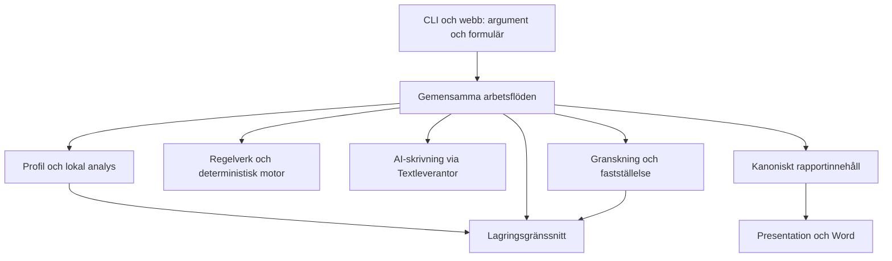

# Plan för robust programstruktur och fortsatt utveckling

**Gällande testpolicy, ändrad på användarens begäran 2026-10-24:** Fullsviten körs endast på uttrycklig begäran. Tidigare formuleringar i denna plan om obligatorisk fullsvit eller ny körning inför merge/leverans är ersatta av AGENTS regel 6. Sparade resultat och genomförda steg nedan är historiska bevis. Inga tester körs i denna policyändring.

> **För genomförande:** använd `superpowers:executing-plans`, ett avgränsat steg i taget. Kryssrutorna följer faktiskt utfört arbete. Ingen automatisk delegering eller commit ingår; projektets arbetsregler gäller.

**Datum:** 2026-10-24. **Status:** tekniskt genomförande verifierat på `codex/robust-programstruktur`, bas `416579e`; slutlig fullverifiering och externa acceptanser redovisas i §8.

**Mål:** göra Riskanalys lättare att ändra och verifiera, med bevarad spårbarhet, historik och fastställelseskydd. Robusthet ska visas genom mätningar och felprov, inte genom fler abstraktionslager.

**Arkitektur:** utveckla befintlig områdesindelning till en modulär monolit. CLI och webb använder gemensamma arbetsflöden och typade tjänster. Regelverk/riskmotor behåller deterministiska beslut; AI-skrivning, rapportinnehåll och leverans får tydligare kontrakt.

**Teknik:** befintlig Python 3.12/Pydantic/YAML/python-docx/pytest. Förslag att införa uv-låsfil och Import Linter stegvis; inga sådana verktyg installeras i planeringsarbetet.

**Styrande underlag:** [huvudspecifikation §5, §16 och §18](../specs/2026-10-08-riskanalys-design.md), [aktuell arkitekturgranskning med kodbelägg](../reviews/2026-10-24-programarkitektur.md), [testtidsplan F5–F10](2026-10-22-snabbare-verifiering-plan.md), [testguide](../../testning.md), [AGENTS](../../../AGENTS.md).

## 1. Beslut och avgränsning

Detta är den samordnande planen för programstruktur, miljö och driftsäkerhet. Befintliga planer äger fortsatt testtidsarbete, V10, redaktionellt arbete och sakkunniggranskning. Genomför ett avgränsat steg i taget; uppdatera resultat här och i ansvarig befintlig plan. Denna plan innebär inte att samtliga tidigare produktplaner ska genomföras samtidigt.

- Börja med pågående ändringar och verifieringsmiljön, därefter leverantörsval och gemensamma arbetsflöden. Större filflyttar kommer senare, endast med påvisad nytta.
- Behåll filbaserad lagring tills mätning eller samtidighetskrav visar ett konkret behov av något annat. En databas, mikrotjänster, en meddelandebuss eller ett nytt webbframework ingår inte i den valda inriktningen.
- Bevara API-beteende, felmeddelanden, källreferenser, originaltext, historiska paket och sakkunnigstatus. Refaktorering och ändrad riskmetod ska vara skilda uppgifter.
- Förenkla även filstrukturen enligt §3.1–3.5: fem utpekade sammanslagningar (S4 utgår efter granskning), tre motiverade nya programfiler och uttryckligt bevarande av övriga filer. Nya lager/mappar skapas inte rutinmässigt. Filantal och faktisk ändringsspridning redovisas var för sig.
- Varje steg får en namngiven genomförare när det startas. Samma delade modeller, lagring eller regelbas ska inte ändras samtidigt av flera aktörer i denna arbetskopia.
- Commit, push, publicering och externa AI-anrop ingår inte i planuppdraget. Commit, push och grenval följer AGENTS: bara på användarens uttryckliga begäran, med bevarat pågående arbete. Planen inför inga egna git-regler.

Källorna stöder principer och jämförelser, inte att en viss mappstruktur är universellt optimal. Värdet för Riskanalys ska avgöras med kriterierna i §3.

## 2. Nuläge som styr ordningen

**Uppdatering 2026-10-24 (granskning av planen):** A0:s utförda punkter är nu kryssade nedan. **Tidigare uppdatering samma dag:** YAML-/historikrättningen är committad i `11226d9` och aktiveringsprövningen i `8b3c914`. Fullsvitens sparade resultat är 3 609 godkända, ett bortvalt liveprov, inga fel eller överhoppningar. En ny kontroll inför push visar exakt match mellan collection/JUnit och samtliga 866 snapshotresurser i arbetskopian. Regelbasen validerar. A0:s krav på verifiering av dessa två kodändringar är därmed uppfyllt; F6/F7/F10 och själva arkitekturomläggningen återstår. Nedanstående tabell beskriver läget vid planens första inventering, före denna fullverifiering. Se [testguidens kandidatresultat](../../testning.md#kandidatkörning-efter-båda-rättningarna).

Inventeringen omfattar arbetskopian på `main`, HEAD `8ca798d508b96931e48c05ce29f3a0a71b7518f0`, inklusive ocommittade ändringar. [Källhashar och importmetod](../reviews/2026-10-24-programarkitektur-underlag.json) hör till arkitekturgranskningens snapshot; kontrollera dem på nytt före kodarbete.

| Observation | Följd för planen |
|---|---|
| 249 programfiler, median 81 rader; `dokument/` innehåller 100 filer. | Filstorlek ensam är inget skäl att dela fler filer. Prioritera ansvar och ändringsspridning. |
| Webb importerar leverantörsval från `kommandon/skriv_kommando.py`; analystjänsten läser formulärdata. | Börja med konkreta gränser som kan förbättras utan att ändra metod eller dokumentformat. |
| Profilsparning har redan lås, revisionskontroll, temporär fil, `fsync` och atomiskt byte. Återställningsprov finns i tunn kedja och M2. | Granska täckning och flerstegsfel; inför inte en ny lagringsabstraktion enbart för strukturens skull. |
| `.venv312` fungerar: Python 3.12.15; installerat pytest 9.1.1 och Pydantic 2.14.1. Ingen `uv.lock`, annan låsfil, `.python-version` eller `.github/workflows` finns lokalt. | Gör miljön reproducerbar. Frånvaro av lokal CI-konfiguration säger inget säkert om externa kontroller eller GitHub-inställningar. |
| Pågående YAML-/historik-/analysoptimeringar ändrar delad kod och modellbindning. | Slutför deras riktade verifiering före nya strukturändringar. Fullsvit återstår enligt aktuell testguide före nästa berörda integrations-/leveranspunkt. |
| Testguidens kandidatkörning efter båda optimeringarna: snabbprofil 140 prov/39,4 s, analys 303 prov/392,0 s, full 3 609 prov/39 min 30 s. | Sparade resultat, inte nya körningar här. Analysprofilen visar att 300-sekundersmålet inte är uppnått för alla normalvarv. |
| V10 återanvänder V9/V8. Modellidentiteten innehåller explicita filsökvägar/importer. | Filflytt kan ändra identitet även när beteendet är samma. Äldre filnamn betyder inte oanvänd kod. |
| Senast dokumenterade huvudrapporter har 19 sidor; mänsklig sakkunnigprövning återstår. | Teknisk struktur, läsbarhet och saklig prövning behöver var sin acceptans. |

Tidigare status om att Python 3.12-miljön saknades beskriver ett äldre läge. Inga nya test- eller prestandaresultat påstås i denna plan.

## 3. Målbild och mätbara acceptanser



Diagrammet visar önskad ansvarsfördelning, inte samtliga tillåtna Python-importer. Fastställelsens kontroll över slutrendering ska bevaras. De konkreta tillåtna kanterna införs och provas i A5.

| Egenskap | Acceptans / hur den mäts |
|---|---|
| Kort återkoppling | Relevanta områdes-, konsument- och snabbprov ryms normalt inom 300 s inklusive insamling, med jämförbara upprepningar enligt F7. Relevanta injicerade fel upptäcks. Tidsstopp är ofullständigt. |
| Reproducerbar miljö | Ren installation från vald Python-/uv-version och låsfil ger samma låsta beroenden. Aktuell kandidat passerar föreskrivet provurval. |
| Begripliga gränser | Nya gränser har ansvar, parametrar, utdata och fel dokumenterade; förbjuden import får importkontrollen att falla. |
| Säker förändring | Gamla fastställda artefakter ändras inte. Fryst/aktuell profil, analys och modell skiljs fortfarande åt; äldre format har kvar sin verifieringsväg. |
| Återställning | Ett syntetiskt V10-paket verifieras i en ny datamapp utan åtkomst till ursprungsdata. Separat prov visar återställning av pågående arbete. Tid och eventuell dataförlust redovisas. |
| Praktisk användbarhet | Avsedd användare kan förklara bedömning, osäkerheter och nästa åtgärd med spårbara källor. Sakkunnig prövar sak/metod separat enligt befintlig guide. |

Följ dessutom antal områden som ändras i tre representativa uppgifter (profilfält, rapportpresentation, leverantörskonfiguration), tid till relevant provsvar och återöppnade fel. Jämför samma slags uppgift före/efter; ingen poängsumma eller påstådd procentsats för ”optimal arkitektur”.

### 3.1 Konkret filstruktur för nästa etapp

**Tillägg efter användarens önskemål om färre filer, 2026-10-24.** Alla kodvägar nedan är relativa till `src/riskanalys/`. Inventeringen omfattar exakt **249 `.py`-filer**, inklusive paketens `__init__.py`. Den fullständiga utgångslistan finns under `programfiler` i [inventeringsunderlaget](../reviews/2026-10-24-programarkitektur-underlag.json). Den har kontrollerats mot arbetskopian vid detta tillägg.

**Fullständig beslutsregel:** behåll samtliga befintliga filer på sin nuvarande plats, utom de fem källfiler som uttryckligen ska sammanföras i §3.2. Lägg endast till de tre programfilerna i §3.3 inom denna strukturetapp. Därmed har varje befintlig programfil ett beslut; exemplen i tabellen är läsingångar, inte en lista över de enda filer som ska finnas.

| Katalog | Filer nu → mål | Filer och ansvar som ska finnas kvar |
|---|---:|---|
| Paketrot | 4 → 6 | `__init__.py`, `cli.py`, `nyckelfil.py`, `fel.py`; nya `konfiguration.py` och `arbetsfloden.py`. |
| `analys/` | 15 → 16 | `modeller.py`, `tjanst.py`, `lagring.py`, `gemensam.py`, `gemensamma_operationer.py`, `provning.py`, `provning_v2.py`, `overforing.py` och övriga befintliga filer; ny `andringar.py`. |
| `bedomning/`, inklusive `kundmodell/` | 14 → 14 | `motor.py`, `scenarier.py`, `korning.py`, `modeller.py`, `sektorsrisk.py` och samtliga övriga filer. Beräkning hålls skild från rapport-/granskningslogik. |
| `dokument/`, inklusive `promptar/` | 100 → 98 | Skrivning, innehåll, presentation och leverans behåller befintliga ingångar enligt §3.4. `redaktionmodell_v10.py` och `wordstil_v10.py` införlivas enligt S5–S6. |
| `drift/` | 5 → 5 | `__init__.py`, `historik.py`, `modellidentitet.py`, `modellrapport.py`, `modellrisk.py`. Identitet och belägg har egna ansvar. |
| `faststallelse/` | 6 → 6 | `__init__.py`, `faststall.py`, `grindar.py`, `modeller.py`, `resultatgranskning.py`, `sakgranskning.py`. S4 utgår; se §3.2. |
| `foretagsdata/` | 9 → 8 | `__init__.py`, `arsredovisning.py`, `bolagsverket.py`, `bolagsverket_svar.py`, `lagring.py`, `modeller.py`, `samlad.py`, `scb.py`. `Bokslut` flyttas till `modeller.py`. |
| `granskning/` | 15 → 14 | `kontroller.py` får även `sektorsfynd`; `korning.py`, `modeller.py`, analys-/versionskontroller och övriga filer behålls. |
| `intag/` | 31 → 30 | `webb.py`, `tjanst.py`, `fragor.py`, `svar.py`, `tackning.py`, `kvalitet.py`, formulär-/vyfiler och övriga filer behålls; `komplettering.py` införlivas i `fragor.py`. `dokument.py` behåller webbansvar efter A3. |
| `kommandon/` | 15 → 15 | Befintliga kommandofiler behålls som CLI-adaptrar. Flytta gemensam funktionalitet ur dem, men skapa inte en enda stor kommandofil. |
| `lagring/` | 6 → 6 | `__init__.py`, `datamapp.py`, `kontrollsumma.py`, `korningar.py`, `manifest.py`, `yamlfil.py`. Dessa har skilda kontrakt trots att flera är små. |
| `profil/` | 12 → 12 | `modeller.py`, `hantering.py`, `lagring.py`, `omfattning.py`, plan-/förändringsfiler och övriga filer behålls. Pågående optimeringar färdigställs före omstrukturering. |
| `regelverk/` | 17 → 17 | `modeller.py`, `laddning.py`, `villkor.py`, `urval.py`, validerings-/granskningsfiler och övriga filer behålls. Ingen uppdelning av modeller enbart på grund av radantal. |
| **Totalt** | **249 → 247** | **249 − 5 sammanförda källfiler + 3 nya programfiler.** |

**247 är ett villkorat etappmål, inte en prognos om alla framtida funktioner.** Det gäller när samtliga fem sammanslagningar har passerat kontrollerna och gamla importvägar kan tas bort. Om tre nya filer införs innan några gamla kan tas bort blir det tillfälligt 252. Behövs en kompatibilitetsfil ska den räknas med och behovet redovisas; en tunn wrapper är inte en borttagen fil. Testfiler, låsfil, CI och dokumentation ingår inte i dessa programfilstal.

### 3.2 Fem sammanslagningar med tydlig mottagare

S1–S3, S5 och S6 är nu genomförda på arbetsgrenen; faktisk verifiering och avvikelser finns i §8. S1–S3 och S5 hör till den fristående etappen **S-små** (§4), S6 till A7. Varje rad är en separat granskningsbar ändring. Radantalen i tabellen är storleken vid planeringen; summan före importstädning visar omfattningen, inte slutlig längd. Faktiskt slutantal redovisas i §3.5 och §8.

| ID | Källfil → fil som ska finnas kvar | Vad flyttas och varför | Storlek före städning |
|---|---|---|---:|
| S1 | `foretagsdata/bokslut.py` → `foretagsdata/modeller.py` | `Bokslut` hör till registerbildens typade data; `Bolagsverksbild` använder redan typen. Behåll klassnamn, validering, Decimal-/periodhantering och serialisering. | 16 + 110 = 126 |
| S2 | `intag/komplettering.py` → `intag/fragor.py` | `fragefalt(rb, id) -> tuple[str, ...]` kopplar kompletteringsbehov till grundfrågor. Samla frågegenerering och frågekoppling; ändra importen i `intag/vyer.py`. | 17 + 44 = 61 |
| S3 | `granskning/sektorsrisk.py` → `granskning/kontroller.py` | `sektorsfynd` skapar B-13-fynd och används redan av granskningskontrollerna. Den deterministiska beräkningen i `bedomning/sektorsrisk.py` behålls separat. | 11 + 245 = 256 |
| ~~S4~~ | **Utgår i denna etapp.** `faststallelse/resultatgranskning.py` behålls. | Källfilen importerar `resultatmodell_v9`, `rendering_v9` och `rapportvyer_v9`. Flyttade till `sakgranskning.py` skulle dessa V9-beroenden laddas av alla dess konsumenter: `faststall.py`, `grindar.py`, `granskning/dokument_v8.py` och `kommandon/sakgranska_kommando.py`. Det ökar kopplingen, vilket §3.5 inte räknar som förbättring. Kan föreslås på nytt med funktionslokala importer och redovisad importgraf före/efter. | 25 + 176 = 201 |
| S5 | `dokument/redaktionmodell_v10.py` → `dokument/resultatmodell_v10.py` | Samla V10:s konstruktions- och källmodeller. Flytta `RedaktionV10` utan schema-/fältändring; behåll den som separat klass tillsammans med `KonstruktionV10` och `ResultatbyggeV10`. Ingen flytt av omformningsalgoritmen. | 15 + 21 = 36 |
| S6 | `dokument/wordstil_v10.py` → `dokument/wordstil.py` | Samla Word-stilfunktionerna. Behåll `anpassa_tabeller` som separat funktion, anropad på samma ställe enbart för avsedd V10-presentation. Ändra inte standardstilen för äldre versioner. | 37 + 84 = 121 |

**Prov och konsumenter för varje rad:** alla provvägar i tabellen är relativa till `tester/`; samtliga finns vid planeringen. Utöka vid nya konsumenter i genomförandets aktuella diff.

| ID | Kontroller som måste bevaras eller kompletteras | Riktat befintligt provurval |
|---|---|---|
| S1 | Samma `Bokslut`-validering och serialiserade registerbild för schema 1–4. Uppdatera importen även i årsredovisningsläsaren; privata original ska fortsatt bara refereras. | `foretagsdata/test_arsredovisning.py`, `foretagsdata/test_register_bolagsverket.py`, `intag/test_bolagsverket_intag.py`. |
| S2 | Alias, andelsfält och basfält leder till rätt grundfrågor i samma ordning; ingen dubblett eller rekursionsloop. Befintligt webbprov kontrollerar länkar för kontantantal och antal aktiva. | `intag/test_fragor.py`, `intag/test_webb.py`; lägg saknade direkta fall i `test_fragor.py`. |
| S3 | B-13 behåller katalogens grund och skiljer saknad lokal motivering från bedömning av motiveringens kvalitet. Flytten får inte flytta riskbeslut till granskningen. | `regelkontrakt/test_sektorsrisk.py`, `intag/test_fragor.py`. |
| ~~S4~~ | Gäller bara om S4 föreslås på nytt: exakt alla R-avsnitt attesteras tillsammans; ändrad analys/struktursumma ger inga nya attester; A/B1 kan fortsatt granskas separat; äldre attester serialiseras oförändrat. Direkta konsumenter att uppdatera: `kommandon/sakgranska_kommando.py:92`, `typfall/test_resultatrapport_hela_kedjan.py:25`, `typfall/test_gemensam_analys_hela_kedjan.py:45` och de två resultatgranskningsproven. | `enhet/test_resultatgranskning_v9.py`, `enhet/test_resultatgranskning_v10.py`, `typfall/test_resultatrapport_hela_kedjan.py`, `typfall/test_gemensam_analys_hela_kedjan.py`. |
| S5 | Samma V10-flyttregister, frysta källor, JSON/schema och identiska original; nya typimporter får inte skapa cirkulär initiering. Uppdatera `presentation_v10.py` och `redaktionspresentation_v10.py`. | `enhet/test_redaktionell_offline.py`, `enhet/test_redaktionell_produkt.py`, `enhet/test_presentation_v10.py`. |
| S6 | Samma Word-XML, text, marginaler och kolumnbredder för berörda syntetiska fall; oförändrad V8/V9-rendering. Jämför ZIP-innehåll med hantering av dokumentets befintliga tidsmetadata, inte godtycklig tolerans i saktext. Direkta konsumenter: `dokument/rendering_v10.py:94` och verktyget `docs/research/verktyg/redaktionell_offline.py:14`, som `enhet/test_redaktionell_offline.py` kör. | `enhet/test_rendering_v8.py`, `enhet/test_rendering_v9.py`, `enhet/test_redaktionell_produkt.py`, `enhet/test_redaktionell_offline.py`; visuell kontroll om renderat utfall avviker. |

**Arbetsgång per S-rad:**

- Läs källfil, mottagare och alla konsumenter i aktuell arbetskopia. Kontrollera även strängbaserade importvägar, testpatchar, serialiserade typnamn och modellförteckning. Kör det riktade basurvalet före flytten; komplettera saknade beteendefall.
- Flytta funktion/klass med samma kontrakt och uppdatera konsumenter. Behåll nödvändiga lokala importer om en top-level-import skulle ge en initieringscykel. Inför inga nya generella hjälplager.
- Kör samma prov efter flytt, berörda konsumentprov, snabbprofil och aktuella importkontrakt. Jämför serialisering/historiska artefakter där tabellen kräver det. Fullsvit följer AGENTS för modell-/attest-/formatpåverkan och större färdigt paket.
- Ta bort källfilen först när ingen stödd konsument behöver den gamla importvägen. Bevara frysta pakets egna filer. Höj ingen sakkunnigstatus.
- Gör den gemensamma kontrollen av filbindningar och modellbindning i §4 för raden. För S-rader innebär den att källfilens rad stryks ur `modellfiler`, och att mottagaren och varje ändrad konsument binds om.
- Den frysta fixturen `redaktionell_v10_d8a91a1.json.gz` innehåller historiska filhashar som inte jämförs mot aktuell kod och ska inte skrivas om.
- Uppdatera områdesguide, karta och denna tabells utfall: faktiskt antal borttagna filer, nya beroenden och eventuella kompatibilitetsfiler. Om sammanslagningen ökar koppling eller försämrar begriplighet ska den utgå med motivering och filprognosen justeras.

Riktade prov körs som `.venv312/bin/python -m pytest <tabellens filer med prefix tester/> -q`, därefter relevant snabb-/samlad kontroll enligt §5. Till exempel för S3: `.venv312/bin/python -m pytest tester/regelkontrakt/test_sektorsrisk.py tester/intag/test_fragor.py -q`. Förväntat: samma beteende före/efter, inga förlorade provpåståenden och inga nya otillåtna importvägar.

### 3.3 Endast tre nya programfiler i denna etapp

| Ny fil | Äger | Ska inte bli |
|---|---|---|
| `konfiguration.py` (A2) | `Skrivkonfiguration` och `skapa_textleverantor`; sätter samman befintlig leverantör utifrån samma val för CLI/webb. | En allmän samling globala tillstånd, regler eller hemligheter. |
| `arbetsfloden.py` (A3) | Skapa/uppdatera/kontrollera/läsa utkast via gemensamma tjänster och samma aktualitetsvillkor. Flytta sammanhängande kontrollhjälpare när de behövs av operationerna. | Ett nytt paket med `__init__.py`, `api.py`, `service.py` och wrappers för ett enda arbetsflöde. |
| `analys/andringar.py` (A4) | Typade, blockavgränsade ändringskommandon som transportadaptrar och analystjänst delar. | Ett HTTP-formulärschema eller en alternativ kopia av hela analysmodellen. |

I A3 ska `intag/dokument.py` finnas kvar för `omfattningsknapp`, `rapportdel` och andra faktiska webbansvar. Gemensam utkastlogik flyttas ut; kvarvarande kompatibilitetswrappers dokumenteras och omprövas. En användning av paketet `arbetsfloden/` i den äldre plantexten ersätts här av **en enda `arbetsfloden.py`**.

### 3.4 Dokumentdelen: behåll tydliga ansvar utan en stor mappflytt

Nästa etapp behåller katalogen `dokument/`. AI-skrivning, rapportinnehåll och leverans ska ha tydliga ingångar i de befintliga filerna; skapa inte samtidigt nya `ai/`, `rapport/` och `leverans/`-paket för alla 100 filer.

| Ansvar | Befintliga filer som uttryckligen behålls |
|---|---|
| AI-underlag och svar | `underlag.py`, `faktablad.py`, `leverantor.py`, `claude.py`, `skrivning.py`, `delskrivning.py`, `aischema.py`, `delvalidering.py`, `validering.py`, `skrivversion.py` och `promptar/` med befintligt innehåll. |
| Kanoniskt innehåll och källspår | `modeller.py`, `arb_v8.py`, `arb_v9.py`, `arb_v10.py`, `resultatrapport_v9.py`, `resultatrapport_v10.py`, `resultatmodell_v9.py`, `resultatmodell_v10.py`, `rapportfakta_v10.py`, `rapportdelar_v10.py`, `profiloriginal_v8.py`, `ursprung_v8.py`. |
| Presentation och omformning | `presentation_v8.py`, `presentation_v9.py`, `presentation_v10.py`, `redaktionell_v10.py`, `redaktionspresentation_v10.py`, `presentationsval_v10.py`. |
| Vyer, Word och paketkontroll | `rapportvyer.py`, `rapportvyer_v9.py`, `rapportvyer_v10.py`, `rendering.py`, `rendering_v9.py`, `rendering_v10.py`, `wordstil.py`, `export.py`, `leverans_v8.py`, `leverans_v9.py`, `leverans_v10.py`, `rapportpaket_v8.py`, `rapportpaket_v9.py`, `rapportpaket_v10.py`. |
| Versionsgräns | `rapportversion.py` behålls separat från `skrivversion.py`: dokumentformat och AI-skrivformat har olika livscykel trots de korta filerna. |

Övriga dokumentfiler behålls enligt §3.1. Ingen V5–V9-fil tas bort enbart på grund av versionsnamn. Även små `kvalitet.py`, `kontrollsumma.py`, `rapportversion.py` och `presentationsval_v10.py` behålls eftersom delad validering, integritet respektive versionsval är tydliga ansvar. Användning och gräns väger tyngre än radantal. `_SLUTRENDERING` och den fullständiga paketverifieringen bevaras.

### 3.5 Hur vi avgör att filstrukturen blev enklare

För varje genomförd ändring redovisas (1) faktiska programfiler och wrappers, (2) berörda filer/moduler för samma representativa användningsfall, (3) nya eller borttagna beroenden och (4) bevarade beteendeprov. En sammanslagning som bara gör en större fil men ökar kopplingen ska inte räknas som förbättring.

Fem sammanslagningar och tre nya gränsfiler ger bara **två färre programfiler netto**. Det är en försiktig, konkret första etapp. Större minskningar behöver separat belägg för duplicerad eller oanvänd funktionalitet; inget mål att halvera filantalet är underbyggt. Testfiler och frysta fixturer slås inte ihop eller raderas bara för att programfilerna ändrar namn.

**Faktiskt utfall 2026-10-24:** 249 → 247 programfiler, 27 188 → 27 423 fysiska Pythonrader. Kodmängden minskar alltså inte; de nya typade gränserna och felkontrollerna kostar 235 rader netto. Ingen generell algoritmisk komplexitetsminskning är uppmätt. `ansvarsgranser.json` i verifieringsunderlaget sparar importuttrycken före/efter för följande representativa ingångar.

| Användningsfall | Före | Efter och faktisk ansvarsfördelning |
|---|---|---|
| Välj skrivleverantör från webb/CLI | Webb → `kommandon/skriv_kommando.py::valj_leverantor`; CLI äger sammansättningen. | Båda → `konfiguration.py`; CLI behåller en tunn wrapper. Valets implementation har en gemensam ägare, webb→kommandon förbjuds transitivt. |
| Skapa/uppdatera/läsa utkast | De fyra operationerna och kontrollhjälparen ägs av `intag/dokument.py`, tillsammans med webbknapp och rapportvy. | Operationerna ägs av `arbetsfloden.py`; `intag/dokument.py` behåller två webbansvar och kompatibla importalias. Antalet filer för gränsen ökar med en, men arbetsflödet kan användas utan UI-modulens ansvar. CLI:s enklare deloperationer behålls avsiktligt. |
| Spara/bekräfta analysblock | `analys/tjanst.py` har fyra importuttryck från `intag/analysformular.py` och blandar adapterparsning med domänoperationen. | Tjänsten har ett importuttryck från neutral `analys/andringar.py`; webb/CLI anpassar transportdata före anrop. Revision, tillåtna fält, referenser och attest kontrolleras mot aktuellt läge under lås. Ett nytt kommandomodulansvar införs, inte en kopia av hela analysmodellen. |

Dessa konkreta gränser, fem borttagna hjälpfiler och tre maskinellt provade importkontrakt är förbättringsbeläggen. Antalet globala importkanter används inte som ett betyg eller som bevis för lägre komplexitet.


Den specifika filkartan är vår bedömning av aktuell kod. Källstödet är att samla sammanhängande ansvar, ha tydliga modulgränser och undvika onödig generalisering [K2, K10, K13]; ingen extern källa föreskriver dessa filnamn eller antalet 247.

## 4. Genomförandeordning

Kryssade punkter är utförda lokalt enligt §8. Fullsvitsberoende tekniska slutgrindar är nu verifierade på samma kandidat; mänskliga acceptanser står öppna. Arbetsgången per S-rad i §3.2 är en återanvändbar checklista; sammanslagningarnas faktiska utfall redovisas separat i §8. Förberedd CI innebär en lokal konfiguration, ingen påstådd fjärrkörning.

**Gemensam kontroll för varje kodetapp (S-små, A2–A7 och varje annan ändring under `src/riskanalys/`):**

- [x] **Filbindningar.** `regelverk/metodbeslut.py::obligatoriska_filer` binder **alla** `.py`-filer under `src/riskanalys/` via det delade ankaret `modellfiler` i `regelbas/beslutstabeller/metodbeslut.yaml`. Lägg till nya programfiler, till exempel `konfiguration.py`, `arbetsfloden.py` och `analys/andringar.py`. Stryk borttagna filer, och bind om kontrollsumman för varje ändrad fil med samma metod som i `11226d9`/`8b3c914`. Annars underkänner `beslutsfel` genomförandet, med "saknar obligatoriska modell-/attestfiler" eller "modellfil … saknas eller har ändrats". Kontrollera med `riskanalys regelbas validera` och `beslutsfel`. Höj ingen sakkunnigstatus.
- [x] **Modellbindning.** `drift/modellidentitet.py::_bindning` hashar regelbasens kontrollsumma tillsammans med de 26 filerna i `MODELLFILER`. Eftersom `metodbeslut.yaml` ingår i regelbasen ändrar **varje** kodetapp modellbindningen, även när de 26 filerna är orörda. Det gällde redan `11226d9` och `8b3c914`. Redovisa bindningen före och efter.
- [x] **Följd för sparade underlag.** Bedömningsmanifest, analyspaketens `bindning.modell` och modellvalideringsrapporter som skapats med tidigare bindning matchar inte längre den aktuella (`dokument/analysstatus.py:50`, `drift/modellrapport.py:48`). Fortsatt arbete kräver ny bedömningskörning och ny modellvalidering, och analysen måste prövas och bindas på nytt. Beskriv detta för byrån vid leverans. Historiska och fastställda paket bevaras oförändrade och verifieras mot sin egen frysta bindning; de skrivs aldrig om.
- [x] **Samla kodetapper.** Samla flera små kodetapper till en leveranspunkt där det går, så att byrån inte behöver ompröva underlag efter varje enskild ändring.

**Huvudordning:** A0 → A1 → A2 → A3 → A4. A5 växer med varje färdig gräns. Etappen **S-små** (S1, S2, S3, S5) beror inte på A3–A5 och kan göras när som helst efter A0, en rad i taget, men inte samtidigt som ett annat steg ändrar samma filer. A6 startar med inventering efter A1 och ska vara klar före verklig leverans; den behöver inte vänta på A4. A7 kräver stabila kontrakt från A3–A5. A8 samlar teknisk och mänsklig leveranskontroll. Detta är en beroendeordning, ingen tidsuppskattning utan mätunderlag.

### A0. Stäng pågående ändringspaket och frys baslinjen

**Filer:** befintliga ändringar i `src/riskanalys/{analys,profil,intag,lagring,regelverk}/`, `dokument/underlag.py`, `kommandon/profil_kommando.py`, `regelbas/beslutstabeller/metodbeslut.yaml`; testguiden och testtidsplanen. Kontrollera aktuell diff innan filurvalet används.

**In → ut:** dagens ändrade kod och sparade prov → identifierad kandidat, verifieringsutfall och kontrollerad prestandabaslinje.

- [x] Inventera samtliga ändringar och vem/vilken uppgift de hör till. Bevara andra aktörers arbete och befintliga bevis. Spara filhashar och Python-/paketversioner; HEAD ensam beskriver inte en smutsig arbetskopia.
- [x] Slutför F8 i befintlig testtidsplan (2026-10-24, `11226d9` och `8b3c914`; se testguiden). Prova YAML-inläsningens semantik, profilhistorik och analysens aktivitetsprövning. Kontrollera att ändrade kontrollsummor motsvarar verkliga kodändringar och att status inte höjts till sakkunnigverifierad.
- [x] Kör relevanta regressioner och konsumentprov samt snabbprofil. Kör den aktuella analysprofilen och redovisa om den fortfarande överstiger 300 s. Utfall 2026-10-24: snabb 140/39,4 s, analys 303/392,0 s, alltså över 300 s.
- [x] Redovisa följden för sparade data enligt den gemensamma kontrollen i §4. Både `11226d9` och `8b3c914` ändrade modellbindningen, eftersom `metodbeslut.yaml` ingår i regelbasens kontrollsumma; `8b3c914` ändrade dessutom `profil/omfattning.py`, som ingår i `MODELLFILER`. Beskriv för byrån vilka underlag som behöver köras om eller valideras på nytt. Det är avsett skydd, inte ett fel.
- [x] Följ F6 → F7 → F10 efter profileringen. Inför explicita områdesprofiler före en automatisk diffväljare. Knyt varje flyttat testpåstående till nytt prov; optimera delad uppbyggnad utan att dela muterbar testdata.
- [x] Mät före/efter i separata, jämförbara kopior med samma miljö och belastning. Spara samtliga upprepningar; de tidigare 255/59,9-sekunderskörningarna är inte en kontrollerad effektmätning.
- [x] Vid nästa samlade kontrollpunkt (2026-10-24: 3 609 godkända, 39 min 30 s, 866 resurser oförändrade): fullprofil på exakt kandidat, insamling/JUnit/snapshot jämförda och regelbas validerad. Markera fel, överhoppade eller ej körda prov uttryckligen.

**Kontroll:** befintliga `test_yamllasning.py`, `test_aktivitetsprov.py`, `test_inforandeval.py`, profil-/analyslagring och berörda webbprov väljs efter diff. Använd `scripts/testa.py snabb`, `analys` respektive `full` enligt §5. **Klart:** inga oidentifierade ändringar blandas in i nästa steg; aktuell verifieringsstatus är redovisad. A1 får förberedas separat men inte tillskrivas A0:s resultat.

### S-små. Fyra små sammanslagningar utan beroende på A3–A5

**Filer:** S1, S2, S3 och S5 i §3.2, med respektive konsumenter och prov. **Ordning:** S1 → S2 → S3 → S5, en rad per avgränsad ändring; commits görs bara på användarens begäran. **Förutsättning:** A0 klar; inget annat steg ändrar samma filer samtidigt. S2 rör `intag/fragor.py` och S3 `granskning/kontroller.py`; samordna med A2–A4 om de är igång.

- [x] Följ arbetsgången per S-rad i §3.2, inklusive metodbeslutens fillista.
- [x] Kör radens riktade prov och snabbprofil. Ändrad regelbasfil räknas som delad kritisk logik enligt AGENTS; samla fullsviten till en kontrollpunkt efter de fyra raderna.
- [x] Redovisa faktiskt filantal (målet för etappen är 249 → 245 före A2–A4:s nya filer) och eventuella kvarvarande kompatibilitetsfiler.

**Klart:** fyra källfiler borttagna, oförändrat beteende, inga fel i `beslutsfel`. **Återgång:** separata commits kan göras på begäran och då återtas var för sig utan datamigrering. Nuvarande ändringar är ocommittade; återställ inte arbetskopian utan uttryckligt uppdrag.

### A1. Lås miljön och gör verifieringen upprepningsbar

**Ändra:** `pyproject.toml`, `scripts/testa.py`, `docs/testning.md`, relevant startinstruktion i `README.md`. **Nya föreslagna filer:** `uv.lock`, `.python-version`, därefter `.github/workflows/verifiera.yml`. En lokal workflowfil innebär inte att fjärrkontroller eller branchskydd är aktiverade.

**In → ut:** befintliga beroendekrav och vald stödd miljö → låst installation och spårbar körningsmiljö.

- [x] Välj och dokumentera exakt uv-version och Python 3.12-patchversion med nuvarande fungerande miljö som utgångspunkt. Behåll `requires-python` medvetet; påstå inte att alla högre Pythonversioner eller Windows är testade. `fcntl` gör plattformsantagandet relevant.
- [x] Generera låsfil i en separat arbetskopia och granska alla beroendeförändringar. Installera med `uv sync --locked --extra dev`; `dev` är idag ett extra. Vid bruk av befintligt mappnamn: `UV_PROJECT_ENVIRONMENT=.venv312`. Prova först i en ny kopia eftersom exakt synk kan ta bort paket.
- [x] Kontrollera `uv lock --check`, ren återinstallation och föreskrivna prov. Ändra tillfälligt ett beroendekrav i provkopian och visa att `--locked` stoppar en inaktuell låsfil; använd inte `--frozen` för detta färskhetskrav.
- [x] Låt testbevis omfatta låsfil, Python-/verktygsversion, installerade beroenden och provverktygets relevanta konfiguration. Prova att ändrad låsfil under körning underkänner snapshotkontrollen. Logga inga nycklar eller privata miljövariabler.
- [x] Förbered CI för avsedd plattform: låskontroll, dokumentkontroll, importkontroll när A5 finns, relevant provurval och bevarade JUnit-/snapshotresultat. Fullprofil körs bara på uttrycklig begäran enligt AGENTS; omfattningen av körda urval redovisas. Installation och exekvering av workflow provas innan CI sägs fungera.

**Klart:** ny lokal installation ger redovisat reproducerbart resultat. Införandet är delad testinfrastruktur och ska få samlad fullverifiering enligt AGENTS. **Återgång:** återgå till föregående miljödefinition och återskapa miljön i en separat mapp; radera inte användarens fungerande miljö.

### A2. Flytta leverantörsval ur CLI

**Gemensam kontroll:** filbindningar och modellbindning enligt §4. Den nya programfilen läggs till i `modellfiler`, och ändrade konsumenter binds om.

**Ändra:** `src/riskanalys/kommandon/skriv_kommando.py`, `src/riskanalys/intag/webb.py`. **Ny föreslagen fil:** `src/riskanalys/konfiguration.py`. **Prov:** befintliga `tester/enhet/test_skriv_kommando.py`, `test_leverantor.py`, `tester/intag/test_webb.py`; ny `tester/enhet/test_skrivkonfiguration.py`.

**Föreslaget kontrakt:** fryst `Skrivkonfiguration(leverantor, testsvar, modell, effort)` där `leverantor` är `Literal["claude", "test"]`, `testsvar` är `Path | None`, övriga fält `str`. `skapa_textleverantor(val: Skrivkonfiguration) -> Textleverantor`. Samma befintliga standardkonstanter och `LeverantorFel`; inga nya modellval.

- [x] Skriv prov för befintligt leverantörsval: förberett svar, saknad svarsfil, saknad nyckel, vidareförd modell/effort. Ersätt Claude-konstruktorn; inget nätanrop. Låt ett nytt gemensamt fabriksprov först visa att gränssnittet saknas.
- [x] Inför konfiguration/fabrik och mappa CLI-argument och webbkonfiguration dit. Behåll vid behov `valj_leverantor(args)` som tunn kompatibilitetswrapper.
- [x] Verifiera båda ingångarnas samma val/fel utan att webben importerar kommandopaketet. Kontrollera samtliga konsumenter, även lokala importer.
- [x] Kör leverantörs-/CLI-/berörda webbprov och snabbprofil. Kontrollera påverkan på modellförteckningen före eventuell uppdatering; höj ingen expertstatus.

**Riktat kommando:** `.venv312/bin/python -m pytest tester/enhet/test_skrivkonfiguration.py tester/enhet/test_skriv_kommando.py tester/enhet/test_leverantor.py -q`. Det nya fabriksprovet ska först falla för saknat gränssnitt och sedan passera; befintliga prov ska fortsätta passera. Lägg till berörda webbprov från `tester/intag/test_webb.py` och snabbprofil enligt §5.

**Klart:** UI-valen fungerar som tidigare och fabriken kräver inget `argparse.Namespace`. **Återgång:** den lilla gränsändringen kan återtas utan data-/formatmigrering.

### A3. Gör utkastflödet till en gemensam tjänst

**Gemensam kontroll:** filbindningar och modellbindning enligt §4. Den nya programfilen läggs till i `modellfiler`, och ändrade konsumenter binds om.

**Ändra:** `src/riskanalys/intag/dokument.py` och dess faktiska konsumenter i webb/kommandon. **Nya föreslagna filer:** `src/riskanalys/arbetsfloden.py`, `tester/enhet/test_utkastflode.py`. Återanvänd befintliga bedömnings-, skrivnings-, gransknings- och exporttjänster. En enda arbetsflödesfil ersätter det tidigare föreslagna paketet, enligt §3.3.

**Kontrakt:** bevara `skapa_utkast(byramapp: Path, rb: Regelbas, leverantor: Textleverantor) -> Path` och `uppdatera_export(byramapp: Path, rb: Regelbas, tidigare: Path, *, rapportformat: str | None = None) -> Path`. `Regelbas` finns i `regelverk/modeller.py`; `Textleverantor` i `dokument/leverantor.py`. Behåll gamla importvägar som tunna wrappers under övergången.

- [x] Skriv karaktäriserande prov före flytt: aktuellt underlag fungerar; gammal export avvisas efter relevant profil-/analys-/modelländring. Bevara skillnaden mellan inaktuell bedömning, som stoppar uppdatering, och ändrad lokal analys/utvärdering, som kan granskas på nytt och exporteras från sparat skrivsvar utan leverantörsanrop. Prova båda fallen.
- [x] Flytta samordningen, inte alla delsystem. Bevara låsens omfattning, snapshot, fel och ordningsföljd. Ett enskilt CLI-kommando får inte plötsligt utföra hela kedjan.
- [x] Låt webb och de CLI-operationer som verkligen har samma semantik använda samma publika operation. Dokumentera avsiktliga skillnader.
- [x] Testa byte av profil/analys mellan kontroll och användning, dubbla uppdateringar och fel under export. Ett blandat paket får aldrig exponeras som färdigt.
- [x] Kör nya tjänsteprov, `tester/intag/test_resultatrapport_v10.py`, berörda granskning-/lagringsprov och snabbprofil. Fullkedja på samlad kandidat enligt AGENTS.

**Klart:** samordningens kontrakt finns på ett ställe och kan provas utan HTTP. Publicerad historik och tidigare fastställda paket är byteoförändrade.

### A4. Flytta transportparsning ur analystjänsten utan att flytta säkerhetsgränsen

**Gemensam kontroll:** filbindningar och modellbindning enligt §4. Den nya programfilen läggs till i `modellfiler`, och ändrade konsumenter binds om.

**Ändra:** `src/riskanalys/analys/tjanst.py`, `intag/analysformular.py`, `intag/webb.py`, `kommandon/analys_kommando.py`. **Ny föreslagen fil:** `analys/andringar.py`. **Prov:** `tester/enhet/test_analysformular.py`, `test_analys_kommando.py`, `test_analyslagring.py`, `tester/intag/test_granskning_analyslas.py` och berörda analysprov.

**Avsedd gräns:** transporten ger en typad, blockavgränsad ändring med förväntad revision. Analystjänsten kontrollerar och tillämpar ändringen på aktuellt paket under lås. Genomförandets kontrakt är fryst `Blockandring(tjanst, nummer, revision, operation, forfattare, visad_summa, block, varden, nya_rader, borttagna_rader)`. `varden` innehåller exakt blockets fält enligt `BLOCKFALT` och typade modellvärden; ett komplett `Tjansteanalys` accepteras inte som kommando. Kontrollrader identifieras av det redigerbara paret `(scenario, kontroll)`, övriga rader av `id`. Scenario- och modellriskoperationer har egna frysta kommandon. Tjänsten omvaliderar värden, referenser och visad summa mot aktuellt paket under lås.

- [x] Lista fält, operationer och invariants för spara/bekräfta; separera CSRF/HTTP från revisions-, referens- och attestregler. Nuvarande `Blockandring` är utgångspunkt, inte automatiskt slutlig DTO.
- [x] Lägg regressioner: gammal revision, manipulerad `visad_summa`, otillåtet fält, ändrat rad-ID/referens och ändring av ett annat block ska stoppas. CLI-bekräftelse ska ha samma domänvillkor som webb.
- [x] Flytta en operation/blockfamilj i taget. Om adapterparsning läser en äldre snapshot måste tjänsten återkontrollera revision och domänvillkor under låset före sparning.
- [x] Inför samtidighetsprov med samordnade processer: två ändringar från samma revision får inte tyst skriva över varandra. Kontrollera att avvisad ändring inte ändrar attest/historik.
- [x] Kör respektive block-/konsumentprov och snabbprofil; avsluta hela ändringspaketet med fullkontroll enligt AGENTS.

**Klart:** analystjänstens publika operation behöver inga HTTP-/CSRF-fält och importerar inte formulärmodulen. Den nuvarande säkerheten under lås är bevarad. **Stoppvillkor:** påbörja inte flytten innan kommandots tillåtna påverkan är definierad och provbar.

### A5. Gör modulgränser maskinellt kontrollerbara

**Ändra:** `pyproject.toml`, låsfil från A1, befintlig programkarta och berörda områdesguider. Konfiguration kan ligga i `pyproject.toml`; skapa inte flera konkurrerande importpolicyfiler.

**In → ut:** klarlagda publika gränser → importkontrakt som detekterar avsedda fel.

- [x] Ta aktuell importbaslinje inklusive transitiva vägar och typimporter. Börja med konkreta kontrakt, exempelvis webb → kommandon förbjudet efter A2, analys → formulär förbjudet efter A4.
- [x] Skydda intern implementation endast där ett fungerande publikt gränssnitt finns. Motor → UI/konkret AI/Word prövas mot dagens verkliga vägar innan regeln blir blockerande.
- [x] Motivera nödvändiga undantag per importkant och ange när de ska omprövas. Behåll fel för undantag som inte längre matchar; inga breda wildcardundantag för att få grönt.
- [x] Kör `lint-imports` i installerad låst miljö. Injicera en förbjuden direkt import och en relevant indirekt väg i separat provkopia; kontrollen ska falla, medan ordinarie kod passerar.
- [x] Lägg kontrollen i lokal verifiering och förberedd CI. Uppdatera kartan. Beteendeprov krävs fortfarande för dataflöden och fastställelse.

**Klart:** de namngivna gränserna är testade. Antal importcykler eller korsande kanter används som signal, inte kvalitetsbetyg.

### A6. Visa säker lagring och återställning för aktuellt system

**Läs/ändra efter belagd lucka:** `profil/lagring.py`, `analys/lagring.py`, `lagring/yamlfil.py`, `lagring/manifest.py`, `dokument/export.py`, fastställelsens skrivväg. **Prov:** befintliga lagrings-/manifestprov, `tester/typfall/test_tunn_kedja.py`, `tester/m2/test_m2_kedja.py`; ny `tester/typfall/test_aterstallning_v10.py`. Dokumentera rutinen i huvudspec §5.3 och befintlig driftguide.

**In → ut:** nuvarande skriv- och backupvägar → verifierad felhantering och återställningsinstruktion.

- [x] Inventera varje muterbar artefakt, dess lås/revision och när en operation räknas som genomförd. Sök konsumenterna till generiska `spara_yaml` innan dess icke-atomiska skrivning klassas som en faktisk risk. Bevara redan fungerande atomiska vägar.
- [x] Gör felmatris för skrivning: före/efter temporär fil, flush/`fsync`, namnbyte, manifest och slutligt paket. Lägg felprov där täckning saknas. Ett fel efter namnbyte får inte felaktigt rapporteras som att inget ändrats.
- [x] Kontrollera samtidighet över processer och att omstart kan skilja färdig version från ofullständigt arbete. Bevara tidigare giltig version; rensa inte okända användarfiler automatiskt.
- [x] Prova fullständigt syntetiskt V10-paket i ny datamapp med ursprungskopian otillgänglig, fryst regelbas och sparat AI-svar. Verifiera alla rapportdelar och checksummefel; saknad/ändrad fil ska ge åtgärdbart fel utan ny AI-körning.
- [x] Prova separat backup/återställning av pågående profil, analys, historik och attester. Säkerställ konsistent snapshot genom dokumenterat skrivstopp eller befintliga lås. Låst paket och hela arbetsdatamappen är olika återställningsfall.
- [x] Mät återställningstid och identifiera senaste återställbara tidpunkt. Föreslå driftsanpassade gränser för förlorat arbete, lagringsplats, retention och återkommande återställningsprov; ansvarig driftägare behöver fastställa dem före verklig drift.
- [x] Kontrollera specens krav om registrerad backup och varning mot faktisk implementation. Om det saknas, avgränsa det som egen produktuppgift med prov; hävda inte att en manifestkontroll uppfyller backupkravet.

**Klart:** dokumenterad och genomförd återställning för både låst V10 och pågående arbete; kvarstående driftbeslut synliga. Python garanterar inte en flerfilstransaktion bara för att en enskild `os.replace` är atomisk [K8]. Ett simulerat skrivfel är inte bevis för alla strömavbrott/filesystemfel.

**A6-B – belagd produktlucka, avgränsad fortsättning:** det finns ingen registrering av säkerhetskopia och ingen automatisk varning för utebliven sådan i aktuell kod (`rg` på backup/säkerhetskopia visar endast återställningsfel). Manifestkontroll får inte beskrivas som att kravet är uppfyllt. Acceptansprov för en separat produktändring: (1) ny datamapp utan registrerad kopia visar en tydlig varning, (2) registrering binder rätt datamapp och verifierad kopia/tidpunkt utan att innebära sakkunniggodkännande, (3) annan datamapp, saknad/skadad kopia och gammal registrering avlägsnar inte varningen, (4) backupregistrering muterar inga låsta paket. Ingen sådan funktion eller automatiserad backup påstås införd här.

**Förslag till driftägaren, inte fastställd policy:** konsistent arbetsmappskopia varje arbetsdag och efter större genomgång, separat kopia direkt efter fastställelse, mål högst en arbetsdags förlorat pågående arbete och återställning inom fyra arbetstimmar. Skyddad kopia utanför originalets disk; preliminärt 30 dagliga och 12 månadskopior, medan fastställda paket följer beslutad bevarandepolicy. Prova återställning månadsvis och efter lagrings-/miljöbyte. Dessa tal är ett lokalt diskussionsförslag, inte hämtade standardgränser eller uppmätt produktionskapacitet. K9 motiverar att återställningstid och accepterad dataförlust väljs uttryckligt.

### A7. Dela dokumentansvaret när gränserna är bevisade

**Startfiler under `src/riskanalys/`:** `dokument/skrivning.py`, `dokument/leverantor.py`, `dokument/resultatrapport_v10.py`, `dokument/rendering_v10.py`, `dokument/export.py`, `lagring/manifest.py`, `faststallelse/faststall.py`, `drift/modellidentitet.py`. Den enda sammanslagningen i A7 är S6 i §3.2; S1–S3 och S5 genomförs i S-små och S4 utgår. Hela `dokument/` flyttas inte.

**Avsedda kontrakt:** tillåtna faktaunderlag → sparat validerat skrivsvar; frysta sakdata/skrivsvar → kanoniskt `Dokument`; dokument → versionerad presentation; godkänd presentation → tre leveransdelar. Filintegritet och rapportens semantiska verifiering har olika ansvar men ska båda ingå i full paketverifiering.

- [x] Dokumentera varje gräns i befintliga AI-/rapport-/leveransguider och huvudspec. Första leveransen kan bestå av publika gränssnitt i befintliga paket; fysisk flytt kräver egen nyttobedömning.
- [x] Genomför och verifiera S6 enligt §3.2. Behåll äldre importväg om stödda konsumenter behöver den och räkna kvarvarande filer ärligt. V8/V9 som V10 använder får inte tas bort som ”legacy”. Följ bevarandelistan i §3.4.
- [x] Om manifestansvaret delas: bevara `verifiera_manifest` som fullständig kontroll eller uppdatera alla konsumenter med likvärdig kontroll. Ett generiskt checksummeprov får inte ersätta semantisk V10-kontroll vid fastställelse.
- [x] Bevara `_SLUTRENDERING`-skyddet och dess avsedda åtkomst. Ändra inte spärren för att förenkla importgrafen.
- [x] Kartlägg ändring i modellidentitet före flytt. Visa identitet före/efter och hantera nytillkommen identitet som sådan; frysta expertpaket och äldre attester får inte skrivas om eller automatiskt gälla nya filer.
- [x] Jämför kanona innehåll, källor, flyttregister, historiska bytes och samtliga tre leveransdelar. Håll innehålls-/layoutändringar utanför ren refaktorering. Kör format-, modellrisk-, fastställelse- och relevanta fullkedjeprov.

**Klart:** varje genomförd sammanslagning har tydligare ansvar och verifierat likvärdigt beteende. Redovisa faktiskt filantal mot det villkorade målet 247 och motivera avvikelser. Upprepa bara om nästa flytt ger konkret minskad ändringsspridning; 100 flyttade filer är inget mål.

### A8. Samlad leverans och återkommande arbetssätt

**Ändra:** resultat i denna plan, ansvarig befintlig produktplan, `docs/STATUS.md`, relevanta områdesguider och vid verkligt genomförande `docs/sakkunniggranskning.md`.

- [x] Kör regelbasvalidering enligt ändringens påverkan och fullprofil endast på uttrycklig begäran. Spara miljö, collection/JUnit, snapshot, fel/överhoppningar och återställningsutfall. Dokumentändring ensam utlöser ingen ny fullkörning.
- [ ] Fortsätt läsbarheten i [redaktionella V10-planen](2026-10-24-redaktionell-runda.md). Pröva med avsedda användare hur de hittar riskorsak, osäkerhet, belägg och åtgärd. Redovisa sidantal och förståelse separat; ta inte bort original eller spårbarhet för att nå en sidgräns.
- [x] Genomför avgränsad native Word-kontroll av alla tre delarna i ett separat syntetiskt utkast med aktuell presentationsversion. Utfall och begränsningar finns i §9; detta är inte fullständig sidgranskning eller användaracceptans.
- [ ] Slutför visuell sidgranskning av den avsedda slutleveransen i mottagarens Word-miljö och dokumentera användaracceptans enligt §9.
- [ ] Genomför verklig sakkunnigprövning enligt [granskningsguiden](../../sakkunniggranskning.md) av rätt aktuell modellbindning. Tekniska prov får inte höja sakgranskningsstatus.
- [x] Registrera observerade fel och användarproblem i befintlig plan, prioritera efter påverkan och gör en liten uppgift åt gången. Välj nya abstraheringar först när upprepade konkreta ändringar visar behovet.
- [x] Vid varje avgränsad uppgift: läs rätt område, ange berört kontrakt, reproducera ändrat beteende, ändra, kör relevanta prov, uppdatera plan/status/guide och bygg kartan. Vid överlämning anges körda kontrollers omfattning och senaste kandidat; ny fullsvit kräver uttrycklig begäran.

**Klart:** tekniskt resultat, användarresultat, expertresultat och driftberedskap redovisas var för sig. ”Alla tester gröna” är ingen sammanfattande produktacceptans.

## 5. Verifieringskommandon och fel som måste fångas

Följande är standardkommandon för genomförandet. Faktiskt körda resultat redovisas i §8. Kör från projektroten. Ersätt `NYTT_ID` med en unik beteckning för varje körning; gamla bevis skrivs inte över.

```bash
.venv312/bin/python scripts/testa.py snabb --ut /private/tmp/riskanalys-snabb-NYTT_ID
.venv312/bin/python scripts/testa.py analys --ut /private/tmp/riskanalys-analys-NYTT_ID
.venv312/bin/python scripts/testa.py full --ut /private/tmp/riskanalys-full-NYTT_ID
.venv312/bin/riskanalys regelbas validera
python3.12 docs/research/verktyg/bygg_obsidiankarta.py
python3.12 docs/research/verktyg/bygg_obsidiankarta.py --check
git diff --check
```

Välj dessutom områdes-/konsumentprov utifrån stegets konkreta diff; snabbprofilen ensam är otillräcklig. Efter A1 kan låskontroll och efter A5 importkontroll köras med den låsta verktygsmiljön. Exit 0 ska kompletteras med wrapperns `verifierad`, `collection_matchar`, `oforandrat` och redovisade fel/överhoppningar. Tidsmålet bedöms separat.

**Review Focus — fem viktigaste regressionsriskerna:**

| Risk | Tilldelad kontroll |
|---|---|
| Snabbt men ofullständigt provurval | A0/F7/F10: täckningsmatris, injicerade relevanta fel, insamling/JUnit; okänd påverkan breddas. |
| Formulärflytt skapar glapp mellan revision och sparning | A4: gammal revision och processkonkurrens, kontroll under lås; endast avsett block får ändras. |
| Filflytt gör gammal attest giltig för ny modell | A3/A7: identitet och frysta kontra aktuella underlag, oförändrade historiska paket, korrekt stopp. |
| Avbruten export eller backup ger blandat paket | A3/A6: fel vid skrivstegen, omstart och återställning utan ursprungskopia, alla tre V10-delar kontrolleras. |
| Tunnare gränssnitt kringgår AI-/fastställelseskydd | A2/A3/A7: inga nya AI-anrop vid uppdatering, bevarad tillåtelselista, semantisk paketverifiering och slutrenderingsspärr. |

## 6. Källor och varför de används

Primärkällorna nedan är kontrollerade i researchen 2026-10-24. Context7 har använts för pytest (`/pytest-dev/pytest`), uv (`/astral-sh/uv`) och Import Linter (`/seddonym/import-linter`). I föregående arkitekturgenomgång användes även Sphinx. Context7 är dokumentationsåtkomst, inte ett bevis på installerat verktyg eller fungerande projektkontroll.

| ID | Källa | Tillämpning och begränsning |
|---|---|---|
| K1 | [OpenFisca: architecture](https://openfisca.org/doc/architecture.html) | Separera beräkningskärna från regeldata. Projektets egen struktur är en relevant jämförelse, inte ett oberoende kvalitetsbetyg. |
| K2 | [Open edX: OEP-49](https://docs.openedx.org/projects/openedx-proposals/en/latest/best-practices/oep-0049-django-app-patterns.html) | Små publika modulgränssnitt och enkla data över gränsen; underlag för A2–A5. Riktlinjen innebär inte att hela Open edX redan följer den. |
| K3 | [Sphinx: build phases](https://www.sphinx-doc.org/en/master/extdev/index.html#build-phases) | Åtskilda steg för dokumentinnehåll, kontroll och utformat; förebild för A7, inget ramverksbyte. |
| K4 | [Architecture Patterns with Python: service layer](https://www.cosmicpython.com/book/chapter_04_service_layer) och [unit of work](https://www.cosmicpython.com/book/chapter_06_uow) | Samordna användningsfall och definiera transaktionsgräns. Bokens databasexempel gör inte filbaserad lagring transaktionell automatiskt. |
| K5 | [uv: layout](https://docs.astral.sh/uv/concepts/projects/layout/) och [locking/sync](https://docs.astral.sh/uv/concepts/projects/sync/) | Låsfil, exakt synk och skillnaden mellan locked/frozen; A1. En låsfil bevisar inte applikationskompatibilitet. |
| K6 | [pytest: fixtures och säker teardown](https://docs.pytest.org/en/stable/how-to/fixtures.html#safe-teardowns) | Dela dyr, läsbar uppbyggnad med kontrollerad livstid; kopiera före mutation och isolera varje tests data. Testsnabbhet kräver lokal mätning. |
| K7 | [Import Linter: forbidden](https://import-linter.readthedocs.io/en/stable/contract_types/forbidden/) och [protected](https://import-linter.readthedocs.io/en/stable/contract_types/protected/) | Kontrollerbara beroenden; ta hänsyn till transitiva importer och smala undantag. Kontrollerar inte faktisk attest-/datahantering. |
| K8 | [Python 3.12: os.replace](https://docs.python.org/3.12/library/os.html#os.replace) och [os.fsync](https://docs.python.org/3.12/library/os.html#os.fsync) | Atomiskt namnbyte och buffert-/disksynk har olika roller; A6. Garantierna ska bedömas för aktuell plattform och operation. |
| K9 | [Google SRE: Data Integrity](https://sre.google/sre-book/data-integrity/) | Återställningsförmåga, faktisk återställningstid och tolererad dataförlust ska provas. Skala ned metoden till projektets data och drift, kopiera inte Googles infrastruktur. |
| K10 | [Google Engineering Practices: Small CLs](https://google.github.io/eng-practices/review/developer/small-cls.html) | Små sammanhängande ändringar är lättare att granska och återta. Konsumenter och relevanta tester ska följa samma ändring. |
| K11 | [C4: introduction](https://c4model.com/introduction) och [dynamic diagram](https://c4model.com/diagrams/dynamic) | Använd system-, komponent- och flödesvyer i befintlig programkarta. Komplettera med projektets versions-/tillståndsvy; genererade filkort är metadata. |
| K12 | [pretix: code structure](https://docs.pretix.eu/dev/development/structure.html) | Gemensam kärna och olika ingångar som jämförelse för tunna adaptrar. Inget behov av att införa pretix pluginsystem eller Django är belagt. |
| K13 | [Google Engineering Practices: complexity](https://google.github.io/eng-practices/review/reviewer/looking-for.html#complexity) | Bedöm begriplighet och undvik onödig generalisering. Stöd för att väga färre filhopp mot nya beroenden; ger ingen universell gräns för antal filer eller rader. |

## 7. Planens egenkontroll och nästa arbetsuppgift

- Nulägesbelägg, föreslagen arkitektur och framtida acceptans är åtskilda. Ingen tidsvinst eller produktberedskap är fastställd genom denna dokumentleverans.
- A0 samordnar befintliga F-uppgifter utan att kopiera deras implementation. A8 hänvisar till befintligt redaktionellt arbete och sakkunnigguide.
- Alla fem regressionsrisker ovan har ett ansvarigt steg och konkret kontroll. A4:s exakta ändringstyp kräver fortsatt förberedelse. Fem konkreta sammanslagningar har mottagare och prov: S1–S3 och S5 i S-små, S6 i A7; S4 utgår. Metodbeslutens fillista och kompatibilitet måste hanteras före borttagning.
- Återgång för refaktorering betyder kodåtergång med bevarade data. Om ny modellidentitet eller nytt format skapats måste även kompatibilitet/attester hanteras uttryckligt; gamla paket skrivs inte tillbaka.

**Nästa arbetsuppgift:** använd §9 för slutleveransens visuella sidgranskning, läsbarhet med avsedda användare och verklig sakkunnigprövning. Den lokala tekniska implementationen är klar och en avgränsad Word-kontroll är genomförd. Driftägaren fastställer backup-/återställningsmål; A6-B är en separat avgränsad produktuppgift. Commit, integration och publicering kräver användarens uppdrag. Ingen ny testsvit startas.

**Historisk kontroll av planeringsleveransen:** egna dokumentändringar är genomlästa mot de aktuella ingångarna, befintliga återställningsproven och testpolicyn. Lokala länkmål kontrolleras, kartan byggs och aktualitetskontrolleras, `git diff --check` körs och 838 program-/regel-/test-/skript-/pyproject-filer jämförs med snapshot före dokumentskrivningen. Utfall förs i statusjournalen. Inga produktändringar, installationer, pytestkörningar, commits eller pushar ingår.


## 8. Genomförandelogg och verifierad kandidat, 2026-10-24

Arbetskopia `/private/tmp/riskanalys-robust-20261024`, gren `codex/robust-programstruktur`, bascommit `416579e`. Originalets två dokumentcommits och ospårade `Namnlös.canvas` bevaras. Inga commits, merge eller push ingår i genomförandeuppdraget utan uttrycklig begäran.

| Etapp | Infört och verifiering hittills |
|---|---|
| A0/F6/F7 | Explicita områdesprofiler och urvalsorsak, V10-baskontrakt, tidsbudget som inte blir grönt vid överskridande. Full urvalsmängd bevarad. Baslinje: snabb 140/40,30 s; tidigare bred analys 303/414,37 och 454,77 s under varierande belastning. Ingen kausal hastighetsvinst härleds ur dessa tider. |
| A1 | uv 0.13.5 och Python 3.12.15; körpaketens tidigare versioner bevarade i `uv.lock`, Import Linter 2.15 tillagt som utvecklingsverktyg. Ren separat synk provad. Ändrat men lösbart beroendekrav ger uttryckligen inaktuell låsfil både med `uv lock --check` och `uv sync --locked --extra dev --no-install-project`; låsfilen lämnas oförändrad. Snapshot binder låsfil, Pythonpinne, CI och installerade paketversioner. Workflow är förberedd, inte fjärrkörd. |
| S-små | S1, S2, S3 och S5 flyttade med uppdaterade kända konsumenter. `resultatgranskning.py` behålls. Inga frysta fixturhashar skrivs om. |
| A2 | Fryst konfiguration och gemensam fabrik; webb importerar inte kommandon. Nya fabriksprov RED 5 → GREEN 13 tillsammans med leverantörsprov; befintliga CLI-prov 8 godkända. |
| A3 | Utkastoperationer i `arbetsfloden.py`, webbansvar och importalias kvar i `intag/dokument.py`. Verklig V8→V10-uppdatering utan nya AI-anrop och gammal profilkontroll ingår i riktad verifiering. |
| A4 | Typade block-, scenario- och modellriskkommandon; kontroll mot aktuell revision/bindning under lås. Rena formulär-/CLI-/kommandoprov 64 godkända efter granskningsrättning; tvåprocessprovet ger exakt en vinnare. Tre CLI-prov bekräftar befintliga kontrollrader i block 10–12 utan ny skrivning. |
| A5 | Tre positiva importkontrakt. Sex negativa injektioner täcker direkt och transitiv förbjuden väg för samtliga tre kontrakt. Inga ignorerade importkanter behövs. |
| A6 | Generisk YAML är privat och atomisk; RED 3 → GREEN 7 med fel före/efter namnbyte. Verklig låst V10 återställd till ny datamapp utan ny AI/rendering, och två skadade rapportfall avvisas. Hela arbetsmappen återställd med profil-/analysregister, historik och attester. A6-B och driftägarmålen ovan är uttryckliga öppna produkt-/driftbeslut. |
| A7 | S6 flyttad med exakt samma funktions-AST till `wordstil.py`. Endast avsedda V10-/offlinekonsumenter bytta. Tre nya och fem borttagna programfiler ger faktiskt 247. Guider/spec/programkarta uppdateras kring de införda gränserna. |
| A8/F10 | Tidig riktad omgång 42 godkända; efter konsument-/referensrättning 85 godkända på 192,07 s. Sex nya områdesvarv och slutlig fullprofil är verifierade; se slutresultatet nedan. |

**Slutgranskning:** oberoende granskare reproducerade P1: kontrollrader saknar `id`. Gemensam radidentitet och regressioner för befintlig/ny/redigerad/bekräftad kontroll rättades. Skillnaden i dubblettvalidering vid direkt typad konsumtion bedömdes också viktig för domänkontraktet och rättades. Nya regressioner RED 13 → GREEN; samlad ren kontroll 64 godkända. Granskaren verifierade inte fullsvit eller mänsklig acceptans. Generatorns hantering av ostagade borttagningar rättades separat med reproducerande prov RED → GREEN; alla sju import-/kartprov passerar.

**Bevarade säkerhetsgränser kring A3/A6/A7:** `test_export_vagrar_andrat_analysregister_under_rendering` kontrollerar ändring mellan kontroll och användning; `test_byteavlasning_haller_samma_analyslas_for_bada_filer` kontrollerar låset genom byteavläsning; `test_avbruten_andra_rendering_publicerar_inget` stoppar blandad leverans; V9/V10-formatbytesproven uppdaterar flera gånger från samma gamla utkast och bevarar dess bytes. Den nya utkastfilen ändrar inte dessa underliggande lås-/publiceringsalgoritmer. Alla dessa är nu godkända i slutkandidatens fullsvit.

**Samlade riktade bevis:** `/private/tmp/riskanalys-robust-slutregression.xml`, 42/42, noll fel/skips. Återställning inklusive verifiering: V10 0,961 s och arbetsmapp 0,922 s i små syntetiska lokala fall. Senast återställbara läge är den konsistenta kopians snapshot; ingen återspelning av arbete efter kopian prövas. Tiderna är inte produktions-RTO eller prov på annan disk/dator.

**Modellbindning:** före `sha256:9adc0452cb96541c1e368a8c69ce44070aae28fb64add8ce58373cd21c8797c5` (kontrolleras mot baslinjebeviset), efter `sha256:a802c25869c5fe20a310843d561e832b123ee4ca7a0592535f7640f453bfa73e`. Alla programfiler binds om i metodbesluten; sakkunnigstatus höjs inte. För fortsatt arbete med äldre aktuella underlag krävs ny bedömning/validering och uttrycklig prövning av analysbindningen. Historiska paket bevaras oförändrade.

**Öppna externa acceptanser:** verkliga användares förståelse, mänsklig sakkunnigprövning och beslutade driftsmål kan inte ersättas av automatiska prov. Word finns installerat men native-kontrollen kunde inte slutföras: filöppningsdialogen följdes av upprepade UI-timeouter. Vid ett senare nytt försök rapporterade verktyget att Macen är låst och kräver manuell upplåsning; användaren har tillfrågats medan fullsviten fortsätter. De tre aktuella syntetiska kontrollkopiorna från godkänd fullkontroll 2 finns i `/Users/gt/.local/share/riskanalys/provkorningar/robust-20261024-native-slut/` (ursprung och kontrollsummor i `ursprung.json`). De tidigare kopiorna före rättningen bevaras i syskonmappen `robust-20261024-native`; ingen native Word-acceptans påstås.

**Genomförandebeslut:** plattformens worktreeverktyg kunde inte hitta committen i chattens repository; en länkad arbetskopia skapades i `/private/tmp` med Git. Skillens numeriska uppgiftsmallar ersattes av planens A-/S-etiketter och löpande logg. Ingen automatisk commit gjordes. A0:s nya samlade infrastrukturkontroll läggs vid A8/F10 på hela isolerade kandidaten; ingen integration till `main` görs innan den passerat. Pythonstödet avgränsas till 3.12, eftersom andra versioner inte prövats. Dessa beslut påverkar arbetsform och verifieringsanspråk, inte riskmetoden.


**Första områdesrepetitioner på samma kandidat före fullkontrollens konsument-/referensrättning:**

| Profil | Prov per körning | Första | Andra | Utfall |
|---|---:|---:|---:|---|
| Leverantör/utkast | 197 | 79,97 s | 79,51 s | verifierad, inom 300 s |
| Analysblock/lagring/HTTP | 291 | 97,19 s | 96,79 s | verifierad, inom 300 s |
| Rapport/V10/export | 233 | 213,45 s | 214,02 s | verifierad, inom 300 s |

Varje rad har matchande collection/JUnit, oförändrat snapshot och noll fel/skips. Bevismappar: `/private/tmp/riskanalys-robust-leverantor-{1,2}`, `/private/tmp/riskanalys-robust-analysblock-{1,2}`, `/private/tmp/riskanalys-robust-rapport-{1,2}`. Dessa är avgränsade utvecklingsvarv och ersätter inte fullsviten.

**Första parade kontrollen före/efter, före konsument-/referensrättningen:** oförändrad `test_analysformular.py`, 36 identiska fall i samma Python-/paketmiljö, växelvis två gånger från original respektive kandidat: före 0,911/0,974 s, efter 0,892/0,376 s inklusive processstart/JUnit. Råresultat och testfilens hash finns i `parad-jamforelse.json` i planens arbetslogg. Små tider och bara två par stödjer ingen generell prestandavinst. Den väsentliga uppmätta förbättringen i utvecklingsarbetet är ett explicit relevant urval under 300 s, med oförändrat fullurval.

**Mätbegränsning under fullsviten:** datorns systemlogg visar vilopauser med stängt lock under körningen. Datorns klockslag visar ett längre förlopp än verktygets rapporterade monotona mättid (första fullkörningen 2 373,40 s); dessa klockor ska inte blandas eller användas som en ren prestandajämförelse. Funktionsutfall, insamling/JUnit och snapshot verifieras separat; ett timeoutfel skulle fortfarande redovisas som fel. Användaren har ombetts hålla datorn vaken.

**Fullkontroll 2 avslutad, verifierad nedan:** `/private/tmp/riskanalys-robust-full-20261024-2`, med rättad kod/regeldata/tester/verktyg frysta. 3 659 ordinarie fall är insamlade, ett liveprov bortvalt. JUnit, insamling och snapshot stämmer; slututfallet redovisas nedan.


**Första fullkontrollen underkänd, därefter rättad:** 3 647 godkända, ett failure och åtta setupfel, ett liveprov bortvalt. Collection/JUnit stämmer, 872 resurser oförändrade, `verifierad=false`. Orsak: två kvarvarande indirekta anrop i `tester/fixturer/fylld_gemensam.py` använde det gamla tjänstegränssnittet. Efter rättning blottlades att den nya dubblettkontrollen felaktigt avvisade oförändrade äldre exponeringsbelägg från befintlig överföring. Tre regressioner RED → GREEN skyddar både bevarande och förbud mot att föra dubbletter till en ny rad. Tjänsten jämför mot aktuellt läge under lås; befintliga underlag normaliseras inte tyst. Den första underkända körningen bevaras oförändrad.

**Ny verifieringspunkt:** 85 berörda konsument-/regressionsprov är godkända på 192,07 s. Fullprofil 2 och nya områdesrepetitioner är avslutade och verifierade på den frysta rättade kandidaten. För att utnyttja datorns kärnor körs fullsviten samtidigt som de sex områdesvarven, ett områdesvarv i taget, med separata pytestprocesser och syntetiska datamappar. Alla binds till samma frysta snapshot. Tiderna redovisas med denna bakgrundsbelastning; ingen kausal hastighetsvinst påstås. Ingen integrationsgrind försvagas.


**Ny parad kontroll på slutlig programkod:** oförändrade 36 formulärfall kördes växelvis två gånger mot originalet och slutkandidaten i samma Python-/paketmiljö. Exakt samma fallmängd, inga fel. Före 1,121/0,528 s, efter 0,596/0,517 s inklusive processstart/JUnit. Fullsvit och ett områdesvarv pågick samtidigt; inga generella kausala hastighetsvinster härleds. Råbevis: `parad-slut-jamforelse.json` med testfilens hash och fyra JUnit-/loggfiler i arbetsloggen.


**Slutlig teknisk kontroll på rättad kandidat:** **3 659 godkända, ett liveprov bortvalt, noll fel/skips; 2527,79 s (42 min 08 s) rapporterad monoton mättid inklusive insamling**. Exakt collection/JUnit inklusive multiplicitet och 872 av 872 snapshotresurser oförändrade. Alla 400 tidigare assert-uttryck i tolv ändrade befintliga testfiler är bevarade. Den första underkända fullkontrollen sparas separat och används aldrig som godkänt bevis.

**Nya områdesrepetitioner på samma slutliga snapshot:**

| Profil | Prov per varv | Första | Andra | Utfall |
|---|---:|---:|---:|---|
| Leverantör/utkast | 200 | 84,06 s | 86,17 s | verifierade, inom 300 s |
| Analysblock/lagring/HTTP | 294 | 106,66 s | 106,71 s | verifierade, inom 300 s |
| Rapport/V10/export | 236 | 242,30 s | 252,73 s | verifierade, inom 300 s |

Områdesvarven kördes ett i taget samtidigt som fullsviten, i separata processer och syntetiska datamappar. Tiderna inkluderar denna bakgrundsbelastning; ingen kausal hastighetsvinst påstås. Alla sex har exakt collection/JUnit, oförändrat snapshot och noll fel/skips.

Råbevis: `/private/tmp/riskanalys-robust-full-20261024-2` och `/private/tmp/riskanalys-robust-{leverantor,analysblock,rapport}-slut-{1,2}`. Beständiga bevis, miljöuppgifter, tidigare underkända körningar och komplett ocommittad patch: `/Users/gt/.local/share/riskanalys/provkorningar/robust-programstruktur-20261024`. Den tekniska A0–A8-kandidaten och F6/F7/F10 är lokalt verifierade. A8:s verkliga användar-/sakkunnig-/native Word-acceptans samt driftägarmål kvarstår; fjärr-CI är endast förberedd. Ingen commit, merge eller push har gjorts.

Fullsvitens egna återställningsmätningar inklusive verifiering: låst V10 1,02 s, arbetsmapp 1,08 s. Små syntetiska lokala fall; inga produktions-RTO eller garanterade driftmål.


## 9. Avslut och konkret återstående acceptans, 2026-10-24

**Tekniskt genomförande:** A0–A7 och A8:s automatiserade genomförande är klara. Produktändringarna finns i `2d25550`, CI-ändringen i `a21bf49`, på `codex/robust-programstruktur`. Den senare instruktionen från användaren tar bort obligatorisk ny fullsvit. Inga tester har körts under denna fortsättning; tidigare resultat redovisas i §8. Mänskliga beslut nedan är fortfarande obesvarade och får inte kryssas genom en agentbedömning.

**Word-kontroll som nu är utförd:** de tidigare sparade kontrollkopiorna avser `D-ARB-v10-presentation-1`, det frysta syntetiska återställningspaketet. Alla tre öppnades i Microsoft Word utan reparationsvarning; pagineringen var 17/27/83 sidor. Detta är historisk kompatibilitet, inte kontroll av aktuell presentation. Originalen är oförändrade.

Därefter skapades ett separat **utkast** med `D-ARB-v10-presentation-2` genom befintliga `redaktionspresentation_v10.skapa` och `rendering_v10.rendera_rapportvyer_v10`, med samma frysta syntetiska källor och ordinarie utkaststatus. Ingen ny riskberäkning, AI-körning, attest eller ändring av det fastställda paketet gjordes. Alla tre nya DOCX öppnades i Word i utskriftslayout. Första och sista sidan granskades visuellt; inga avklippta rader eller överlapp observerades där. Faktiska sidantal: **huvudrapport 16, A 30, B1 87**. Tiosidorsriktmärket är inte uppnått; inget innehåll kapades. Detta är ett annat syntetiskt fall än de äldre redaktionella referensernas 19-sidorsrapporter och ingen generell sidantalsjämförelse.

Kontrollkopior och ursprungs-/filhashar ligger i `/Users/gt/.local/share/riskanalys/provkorningar/robust-20261024-native-fortsatt/aktuellt-format/`. Den samlade observationen finns i föräldramappens `wordkontroll.json`. DOCX-hasharna är oförändrade efter Word. Externa fält uppdaterades inte och filerna sparades inte från Word. En separat Word-PDF av den historiska huvudrapporten skapades; senare PDF-exporter avbröts eftersom **Spara** och **Ny mapp** var inaktiva även vid annan lokal destination. Ingen PDF av aktuell presentation och ingen fullständig sidgranskning påstås.

**Context7:** den officiella [python-docx-dokumentationen om renderade sidbrytningar](https://python-docx.readthedocs.io/en/latest/api/text.html#docx.text.pagebreak.RenderedPageBreak), hämtad via Context7 `/websites/python-docx_readthedocs_io_en`, anger att biblioteket saknar renderingsfunktion. Därför kommer sidantalen ovan från Word, inte från DOCX-metadata eller räknade manuella sidbrytningar.

| Återstående moment | Vem genomför det | Konkret underlag och vad som ska antecknas |
|---|---|---|
| Visuell slutkontroll | Den som ansvarar för leveransen, i mottagarens Word-miljö | Använd de tre filer som faktiskt ska levereras. Anteckna presentation, filhashar, Word-version, sidantal och granskade sidor. Läs hela huvudrapporten samt bilagornas breda tabeller, källregister och övergångar. Registrera varje avklippning, överlapp och bruten hänvisning med del/sida. Nuvarande stickprov ersätter inte detta. |
| Läsbarhet | Avsedda användare, med en person som antecknar | Låt läsaren själv hitta varför en tjänst fått sin risknivå, vad som är osäkert, vilket lokalt belägg som stöder en kontroll och vem som ska göra nästa åtgärd. Anteckna valt ställe, läsarens återgivning, behov av hjälp och missförstånd per uppgift. Redovisa faktisk förståelse och sidantal separat; inget svar är registrerat ännu. |
| Sakkunnigprövning | Verklig sakkunnig enligt granskningsguiden | Använd underlag bundet till den aktuella modellen, med dokumenterad identitet, kompetens, oberoende och beslut per objekt. Äldre expertpaket och dessa syntetiska Word-kopior godkänner inte nuvarande modell. Importera inget antaget godkännande. |
| Backupmål | Ansvarig driftägare | Besluta kopieringsfrekvens, skyddad plats utanför originalets disk, retention, accepterad dataförlust, återställningstid och ansvarig. Förslaget i A6 är ett obeslutat diskussionsunderlag. |

**A6-B:s avgränsning:** den ursprungliga A6-punkten var att upptäcka och avgränsa en saknad backupregistrering/varning; det är gjort. Att bygga den funktionen är en separat produktändring med de fyra acceptansfallen i A6, inte en okryssad sammanslagning eller refaktorering. Ingen sådan funktion hävdas införd.

Denna fortsättning ändrar dokumentation och bevarar policyändringen från föregående uppdrag. Ingen program-/regel-/testkod ändras, ingen commit/merge/push utförs och ingen mänsklig acceptans registreras.
