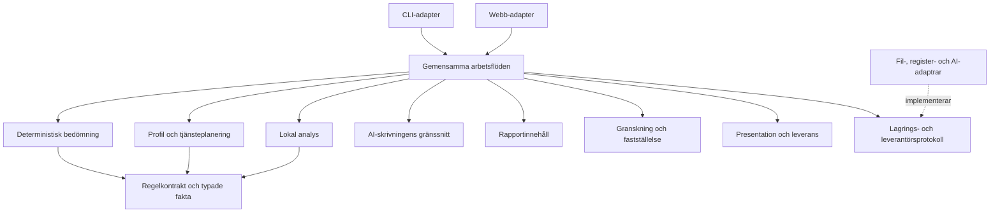
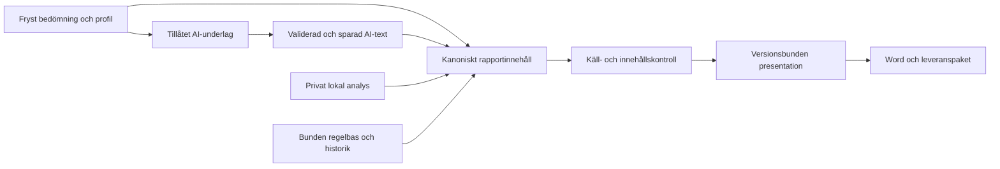

# Programarkitektur: nuläge och rekommenderad struktur, 2026-10-24

**Rekommendation:** utveckla den befintliga områdesindelningen till en modulär monolit med uttryckliga Python-gränssnitt, gemensamma arbetsflöden för CLI/webb och en tydligare gräns mellan AI-skrivning, rapportinnehåll och leverans. Behåll ett sammanhållet Pythonprogram. Modellera ansvar, beroenden, körflöden och källbindningar i skilda vyer.

Detta är ett gransknings- och beslutsunderlag. Förslagen är inte genomförda eller beslutade genom denna research. Befintliga specifikationer och planer är fortsatt styrande. Underlaget bygger på aktuell kod, Context7 och projektens egna dokumentationer.

## 1. Vad som undersökts

Arbetskopia: `/Users/gt/Documents/Riskanalys/Riskanalys`, lokal `main`, bascommit `8ca798d508b96931e48c05ce29f3a0a71b7518f0`. Arbetskopian hade redan lokala kod-, test-, regel- och dokumentationsändringar. Mätningen gäller dessa aktuella filbytes, inte en ren checkout av bascommiten.

Läsordning: AGENTS → START → Programflöde → relevanta områdesguider → originalkod och konsumenter. Samtliga 249 programfiler har AST-lästs; utvalda centrala implementationer har lästs närmare. Alla funktioners beteende har inte granskats.

[Maskinläsbart underlag](2026-10-24-programarkitektur-underlag.json) innehåller källhashar, paketstorlekar och de registrerade importuttrycken. Rader räknas med `splitlines()`, inklusive tomrader och kommentarer. Paket betyder första segmentet efter `riskanalys`. Absoluta statiska importuttryck räknas på alla AST-djup, även lokala, villkorade och `TYPE_CHECKING`-importer. Relativa/dynamiska importer och transitiv symbolupplösning ingår inte. Detta mått skiljer sig från Obsidian-generatorns unika filrelationer.

| Färsk observation | Utfall | Tolkning |
|---|---:|---|
| Programfiler | 249 | Storlek, inte kvalitetsbetyg |
| Fysiska Pythonrader | 27 188 | Den äldre navigeringsinventeringen anger 27 149; lokala ändringar ingår här |
| Median per programfil | 81 rader | Programmet består redan till stor del av små filer |
| Filer med högst 150 rader | 192 | Ytterligare uppdelning bör styras av ansvar |
| Filer över 500 rader | 4 | Stora enskilda filer är inte hela strukturfrågan |
| `dokument/` | 100 filer, 11 431 rader | 40,2 % av filerna och 42,0 % av programraderna |
| Paketöverskridande importuttryck | 861 | Möjliga beroenden; inte antal körda anrop |
| Ömsesidiga paketpar | 10 | Beroenden åt båda håll på paketnivå; bevisar inte cirkulära filimporter eller körfel |

De tio paketparen är `analys–dokument`, `analys–intag`, `dokument–faststallelse`, `dokument–granskning`, `dokument–intag`, `dokument–lagring`, `drift–profil`, `faststallelse–granskning`, `intag–kommandon` och `profil–regelverk`. Varje par behöver bedömas efter sitt ansvar; antalet ska inte användas som ett godtyckligt nollmål.

## 2. Det som redan är bra

- `src/`-layout, en tydlig CLI-ingång och verksamhetsnamn som `profil`, `bedomning`, `analys` och `granskning` gör strukturen begriplig.
- Beräkning, textproduktion och mänskliga beslut har skilda roller. Detta är en arkitekturgräns att bevara.
- `bedomning/motor.py` är i huvudsak beräkning över typade indata. `analys/provning.py` beskriver uttryckligen rena innehållsprövningar.
- `analys/tjanst.py` har redan gemensamma operationer för CLI och webb. `dokument/leverantor.py:61` har ett `Textleverantor`-protokoll och en testleverantör. Börja där i stället för att konstruera samma abstraktion en gång till.
- `Dokument`, presentationsmodeller, manifest, frysta profiler och modellbindning ger viktiga befintliga kontrakt. V10:s återanvändning av V9/V8 är synlig i originalkoden.
- De 14 navigeringsområdena skiljer redan AI-skrivning, rapport och Word/leverans. Den begreppsliga uppdelningen kan användas för att förbättra kodgränserna.

Min bedömning är därför att den största nyttan ligger i tydligare beroenderiktning och gränssnitt. En allmän uppdelning i ännu fler små filer har svagare stöd i inventeringen.

## 3. Konkreta strukturfrågor i koden

| Prioritet | Observation och kodbelägg | Konsekvens | Rekommenderad riktning |
|---|---|---|---|
| 1 | `intag/webb.py:15` importerar `valj_leverantor` från `kommandon/skriv_kommando.py`. Funktionen tar `argparse.Namespace`. | Webbens konfiguration binds till CLI-representationen. | Låt en gemensam start-/konfigurationsfunktion välja leverantör från typad konfiguration; injicera resultatet till båda ingångarna. |
| 1 | `intag/dokument.py:16` samordnar bedömning, skrivning, granskning och export; filen innehåller också aktualitetskontroll och uppdatering av export. | Ett tvärgående arbetsflöde har sitt hem i intagsområdet. | Ge dessa operationer ett gemensamt arbetsflödeshem och ett explicit anropskontrakt. Återanvänd befintliga operationer och bevara alla grindar. |
| 2 | `analys/tjanst.py:171`, `:186`, `:313` och `:348` hämtar parsning och valhjälp från `intag/analysformular.py`. | Analystjänsten känner till formulärrepresentation; tillåtna fält inkluderar exempelvis `csrf`. | Låt webb-adaptern tolka formulär till typade ändringar. Lägg delade rena urvals-/valideringsfunktioner nära analysmodellen. Analystjänsten tar typade ändringar och revisionsvillkor. |
| 2 | `dokument/` innehåller bland annat `claude.py`, `skrivning.py`, `arb_v10.py`, `presentation_v10.py`, `rendering.py` och `export.py`. | Leverantör, innehåll, granskning av presentation och filutmatning delar ett brett paketnamn. | Definiera tre ansvar: skrivning, rapport och leverans. Inför gränssnitt före större filflyttar. |
| 3 | `lagring/manifest.py:150–152` känner till rapportpaket V8/V9/V10. | Generisk filintegritet är samtidigt en ingång till domänspecifik paketvalidering. | Separera ren manifestkontroll från kontroll av rapportpaketets semantik. Behåll en sammansatt säker ingång för de konsumenter som behöver båda. |
| 3 | `dokument/rendering_v10.py:51` hämtar `_SLUTRENDERING` från fastställelsekedjan. | Rendering och fastställelse binds ihop, men beroendet skyddar samtidigt slutstatus. | Granska ett smalt internt tillstånds-/behörighetskontrakt. Ta inte bort identitetskontrollen för att få en snyggare beroendegraf. |
| Senare | `arb_v10.py:2` använder V9; `arb_v9.py` använder V8. | Aktuella och historiska byggdelar är sammanflätade. | Dokumentera historiska respektive delade byggdelar. Extrahera stabila delar först när kontrasten mot frysta format är verifierad. |

Att en hjälpfunktion ligger i `intag` visar inte automatiskt att den är UI-kod. Exempelvis är flera fördelningsfunktioner rena. Bedöm funktionernas ansvar innan de flyttas. Detsamma gäller importerna mellan profil och regelverk.

## 4. Jämförelse med dokumenterade projekt

Urvalet bygger på relevanta problem och tillgänglig primärdokumentation. Det är inte en oberoende kvalitetsrankning av projekten. Ingen källa visar att en viss mappstruktur är universellt bäst.

| Projekt | Dokumenterat mönster | Vad Riskanalys kan ta över | Anpassningsgräns |
|---|---|---|---|
| OpenFisca | Beräkningskärna, landsregler och utökningar har skilda roller. Kärnan ger Python-API och testverktyg. | Bevara separationen mellan regeldata och beräkning; tydliggör ett typat beräkningskontrakt. | Riskanalys behöver inte byta regelformat eller anta OpenFiscas DSL. [Primärkälla](https://openfisca.org/doc/architecture.html) |
| Open edX | OEP-49 anger `api.py` som Python-ingång och enkla dataobjekt över modulgränser; Import Linter kan skydda dessa. | Ge varje verksamhetsmodul ett litet publikt gränssnitt och kontrollera vilka interna moduler andra får importera. | Riktlinjen säger själv att mycket befintlig kod ännu inte följer den. Låna principen, inte hela plattformens distributionsmodell. [Primärkälla](https://docs.openedx.org/projects/openedx-proposals/en/latest/best-practices/oep-0049-django-app-patterns.html) |
| Sphinx | Bygget skiljer läsning till dokumentträd, konsistenskontroll, referensupplösning och skrivning till utformat. | Utveckla befintligt `Dokument` och presentationsmodeller som uttryckliga steg: innehåll → käll-/innehållskontroll → presentation → Word. | Riskanalys behöver inget byte till Sphinx. Befintliga referenser och frysta original måste bevaras. [Primärkälla](https://www.sphinx-doc.org/en/master/extdev/index.html#build-phases) |
| pretix | Gemensam kärna samt separata gränssnitt för arrangörer, köpare och API; testerna speglar områdena. | Håll ingångar tunna och rikta prov efter ansvar och kontrakt. | Det finns inget belägg för att Riskanalys behöver Django eller pretix pluginsystem. [Primärkälla](https://docs.pretix.eu/dev/development/structure.html) |

Som kompletterande mönsterkälla beskriver *Architecture Patterns with Python* ett tjänstelager som samordnar användningsfall och kan testas med ersättningar för lagringen. Detta stöder gemensamma arbetsflöden och injicerade beroenden; någon generell meddelandebuss krävs inte för det. [Författarnas kapitel](https://www.cosmicpython.com/book/chapter_04_service_layer).

## 5. Så bör strukturen modelleras

### 5.1 System och körmiljö

Använd C4 som läsordning: systemkontext → körbara delar och datalager → komponenter där mer detalj behövs. C4 skiljer även statiska och dynamiska vyer. [C4:s introduktion](https://c4model.com/introduction), [komponentvy](https://c4model.com/diagrams/component), [dynamisk vy](https://c4model.com/diagrams/dynamic).

För Riskanalys bör systembilden visa byråanvändare, programmet, privata filer, regeldata, registerkällor och AI-leverantören. Märk vilka uppgifter som får passera respektive gräns. Körmiljöbilden ska återge CLI och loopbackservern enligt faktisk start, snarare än framställa varje område som en egen driftsatt tjänst.

### 5.2 Ansvar och tillåtna kodberoenden

Följande är **en föreslagen komponentstruktur**. Pilar betyder tillåtna anrop/importberoenden; bilden är inte ett påstående om dagens importgraf. Sammansättningen väljer konkreta adaptrar och lämnar dem som beroenden till arbetsflödena.



Bilden visar huvudsakliga gränser, inte alla legitima domänberoenden. Rapporten får exempelvis använda bedömningens publika resultattyper. Granskningen får använda rapportkontraktet. En sådan typimport behöver inte behandlas som ett anrop till hela den andra modulens arbetsflöde.

Behåll verksamhetsnamnen. En möjlig framtida placering är:

```text
src/riskanalys/
  profil/          # fakta, bekräftelse och tjänsteplanering
  regelverk/       # katalogkontrakt, urval, villkor och inläsning
  bedomning/       # beräkning och dess offentliga resultat
  analys/          # lokala underlag, prövning och analysbeslut
  skrivning/       # tillåtet underlag, textschema och skrivoperationer
  rapport/         # kanoniskt innehåll och källreferenser
  leverans/        # presentation, Word och paket
  granskning/      # fynd och käll-/innehållskontroller
  faststallelse/   # beslut, grindar och låst leverans
  foretagsdata/    # källtolkning och registerförslag
  arbetsfloden/   # samordning över flera områden
  kommandon/      # CLI-parsning och resultatvisning
  intag/          # webb/formulär och intervjusamordning
  lagring/        # filmekanik, lås, manifest och kontrollsummor
  drift/          # modellidentitet och historik
```

Detta är ett diskussionsförslag, inte ett krav på att flytta alla filer eller skapa alla mappar. Inom ett område kan `api.py`, offentliga typer, ren prövning och lagringsadapter räcka. Skapa underlager först när de har ett verkligt ansvar. Låt befintliga `tjanst.py` vara startpunkter där de redan fyller rollen. Undvik att samla alla verksamhetsmodeller i en gemensam jättemodul.

### 5.3 Körflöden och dokumentets dataflöde

Dokumentera de viktiga användningsfallen var för sig: bekräfta profil, skapa skrivning, ändra lokal analys, uppdatera rapport från sparad skrivning och fastställa ett paket. Varje flöde anger indata, revisionsvillkor, vilka filer som läses/skrivs och vilka tidigare granskningar som blir inaktuella.

För rapporten är en lämplig målriktning följande. Pilar betyder **dataöverföring**, inte Python-importer. Det lokala analysunderlaget kan vara ofullständigt i ett utkast; ett sådant utkast måste behålla sina öppna markörer.



Den privata analysen har ingen pil till AI-underlaget. Word kan få lokala personuppgifter först vid sin tillåtna gräns. Kontroll av slutstatus och mänsklig fastställelse tillkommer i fastställelseflödet; en Word-rendering i sig godkänner inget.

### 5.4 Tillstånd och källbindningar

Komplettera områdeskartan med en tabell över artefakter: profilrevision, bedömningsmanifest, modellbindning, skrivresultat, analysrevision/-beslut, rapportformat, presentationsversion, sakgranskning och slutpaket. För varje artefakt anges vad den binds till och vad som gör den inaktuell.

Skilj åtminstone dessa versionsbegrepp:

| Kontrakt | Aktuellt dokumenterat värde | Ändringens betydelse |
|---|---|---|
| Lokal analys | Schema 2 | Hur underlag och tjänstetillämpningar lagras |
| AI-skrivning | V8 | Begäran, svar och valideringskontrakt |
| Rapport | V10 | Rapportens kanoniska struktur |
| Presentation | `D-ARB-v10-presentation-2` | Redaktionella flyttar och visning |
| Beräkningsmodell | Innehållsbunden identitet | Motorfiler, relevanta beroenden och regelbas |

Dessa bör inte ersättas med en gemensam versionssiffra. En ändrad lokal analys ska kunna projiceras från redan sparad AI-text när befintliga kontrakt tillåter det; det ska inte automatiskt skapa en ny extern skrivning.

## 6. Gör gränserna maskinellt kontrollerbara

Context7 har använts med `/seddonym/import-linter` för importkontrakt och `/sphinx-doc/sphinx` för dokumentets byggfaser. Uppgifterna har jämförts med respektive primärdokumentation. Context7 är här dokumentationshämtning; ingen plugin eller arkitekturgrind har installerats i projektet.

Import Linter kan förbjuda importberoenden, definiera lager och skydda interna moduler. Ett `forbidden`-kontrakt granskar normalt även indirekta importer. Därför måste dagens transitiva beroenden kartläggas innan en ny regel görs blockerande. [Import Linters kontrakt](https://import-linter.readthedocs.io/en/stable/contract_types/forbidden/), [skyddade moduler](https://import-linter.readthedocs.io/en/stable/contract_types/protected/).

Exempel på **föreslagen, inte körd konfiguration** med dagens modulnamn:

```toml
[tool.importlinter]
root_package = "riskanalys"

[[tool.importlinter.contracts]]
name = "Riskberakning utan granssnitts- och dokumentberoenden"
type = "forbidden"
source_modules = ["riskanalys.bedomning.motor"]
forbidden_modules = [
  "riskanalys.kommandon",
  "riskanalys.intag",
  "riskanalys.dokument",
]
```

Börja med få, relevanta regler: beräkning får inte bero på UI/AI/Word; webb ska inte behöva CLI-parsning; rapportinnehåll får inte anropa den konkreta AI-leverantören; intern lagringskod nås via utsedda tjänster. Tillåt medvetna undantag per kant med motivering och ett borttagningsvillkor. En total lista över tillåtna beroenden måste även hantera typimporter och rena hjälpfunktioner.

En importkontroll bevisar inte att rätt data skickas till AI, att atomiska sparningar fungerar eller att fastställelse inte kan kringgås. De befintliga beteende- och kedjeproven behövs fortfarande. Öppna inte upp en grind enbart för att få importkontrollen grön.

## 7. Rekommenderad ordning för fortsatt arbete

**Fortsättning efter nytt planuppdrag:** [samordnad införandeplan A0–A8](../plans/2026-10-24-robust-programstruktur.md) konkretiserar nedanstående rekommendationer och lägger verifieringsbaslinje/miljö först. Den använder befintliga testtids- och produktplaner och innehåller kontroller för lagring, återställning, modellidentitet och mänsklig acceptans. Den ursprungliga researchen nedan är fortsatt ett underlag, inte ett genomförandebeslut.

| Ordning | Avgränsat steg | Konkret verifierbart resultat |
|---|---|---|
| 1 | Lägg de föreslagna ansvaren och tillåtna beroendena i befintlig programkarta/specifikation när inriktningen beslutas. | Varje gräns har indata, utdata, fel och ansvarig modul; nuläge och målbild skiljs åt. |
| 2 | Bryt webbens koppling till `argparse` och CLI:s leverantörsval. | Båda ingångarna kan få samma leverantör från gemensam typad konfiguration. Syntetisk leverantör används i prov. |
| 3 | Ge skapa/uppdatera-utkast ett gemensamt arbetsflödesgränssnitt; återanvänd `Intagstjanst`/`Analystjanst`. | Ingångarna använder samma aktualitets- och revisionsvillkor. Uppdatering från sparat skrivsvar behöver inget nytt AI-anrop. |
| 4 | Låt analystjänsten ta typade ändringar och flytta formulärparsningen till adaptergränsen. | Domänoperationen behöver inga HTTP-/CSRF-fält och kan användas direkt av CLI. |
| 5 | Inför ett fåtal importkontrakt för de klarlagda gränserna. | Den avsedda förbjudna importen får kontrollen att falla; den legitima vägen passerar. Befintliga avvikelser redovisas. |
| 6 | Dela dokumentansvaret stegvis och separera generell filintegritet från rapportpaketets kontroll. | Samma innehåll, källreferenser, bilagor och spärrar före/efter. Historiska kontrakt bevaras. |

Införandeuppgifter hör hemma i befintliga relevanta planer; denna rapport skapar ingen konkurrerande genomförandeplan. Testtidsarbetet har redan sin [befintliga plan](../plans/2026-10-22-snabbare-verifiering-plan.md) och [research](2026-10-24-teststrategi-femminuter.md). Tydligare gränser kan underlätta provurval, men ingen tidsvinst är uppmätt här.

Särskild försiktighet krävs med `drift/modellidentitet.py`: modellförteckningen innehåller explicita modul- och filsökvägar, och `_kontrollera_importer` granskar beroenden. Även en beteendebevarande flytt kan ändra modellidentiteten och beröra frysta expert-/leveranspaket. Sådana paket ska inte skrivas om tyst.

Vid ett senare införande: reproducera ändrat beteende, kör berörda områdes-/gränsprov och snabbprofil enligt AGENTS. Relevanta befintliga skydd omfattar exempelvis `test_modellrisk.py`, `test_formathinder.py`, `test_arb_v8.py`, `test_resultatrapport_v10.py` och `tester/intag/test_skyddad_begaran.py`. Bevara täckning för samtidiga profilsparningar, fryst kontra aktuell analys, ändrad modellbindning och atomisk dokumentprojektion. Fullsvit krävs vid de samlade kontrollpunkter som AGENTS anger.

## 8. Käll- och metodbedömning

Granskningen använder en riktad metod- och källbedömning enligt `scientific-thinking-scholar-evaluation`. Ett sammanvägt akademiskt kvalitetsbetyg är inte tillämpligt på denna arkitekturjämförelse.

| Bedömningsfråga | Stöd och begränsning |
|---|---|
| Är nuläget reproducerbart? | Aktuella källhashar och importuttryck finns i JSON-underlaget. Körningsbeteende har inte provats. |
| Stöder källorna projektbeskrivningarna? | Projektens egna dokumentationer stöder de angivna mönstren. De bevisar inte att varje intern modul följer dem. |
| Är rekommendationerna bevisat bäst? | Nej. De är en bedömning utifrån faktisk koppling, befintliga kontrakt och relevant erfarenhetsdokumentation. |
| Har effekten mätts? | Ingen ny mätning av testtid, AI-kontext, felutfall eller utvecklingshastighet. Sådana påståenden kräver jämförbara före-/efterprov. |
| Är alla beroenden kartlagda? | Nej. Statisk importanalys täcker inte dynamisk koppling, filprotokoll, samtliga transaktioner eller verkliga användningsflöden. |

## 9. Verifiering och avgränsning av denna leverans

Researchen ändrar dokumentation och skapar ett statiskt evidensunderlag. Bevarandekontrollen visar **844 byteoförändrade filer** i produktkod, regeldata, fixturer, testkod, skript och `pyproject.toml`. Evidensfilen innehåller deras kontrollsummor.

Körda kontroller: AST-läsning av 249 programfiler; kontroll av rapportens 13 Markdown-länkar med noll saknade lokala mål; kontroll att fem uttryckligen nämnda testfiler finns; kartbygge och `--check` med exit 0; `git diff --check` med exit 0. Källorna har öppnats genom webbresearch; länkkontrollen är inte en nätverkskontroll av varje extern länk.

Ingen pytest/fullsvit, extern AI-skrivning, installation, commit eller push ingår. Ingen ändrad programfunktion eller prestandaförbättring påstås. Import Linter-exemplet är inte en verifierad projektgrind. Slutlig metadata-/bevarandekontroll upprepas efter dokumentationens avslutande uppdatering.
